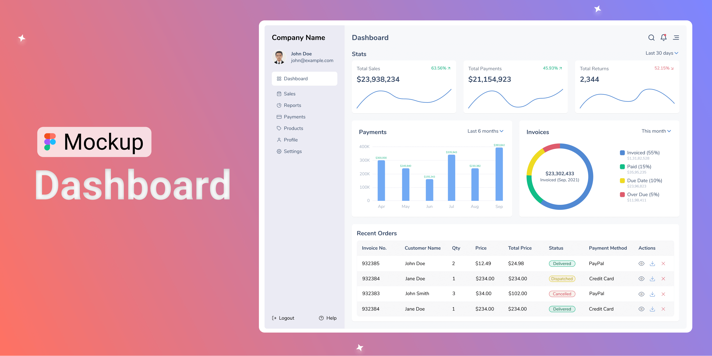
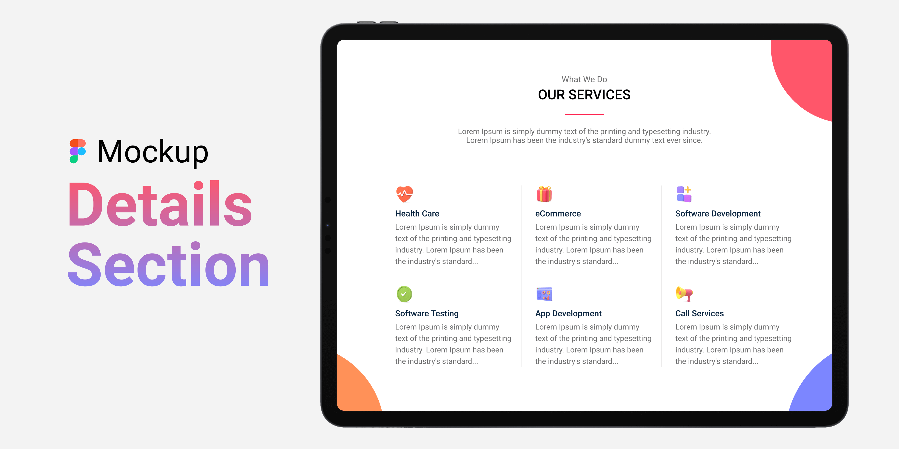
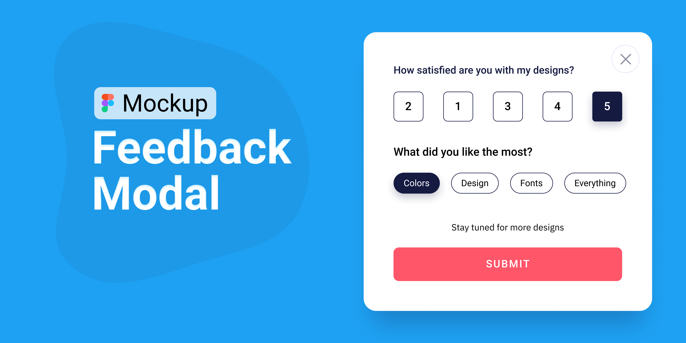
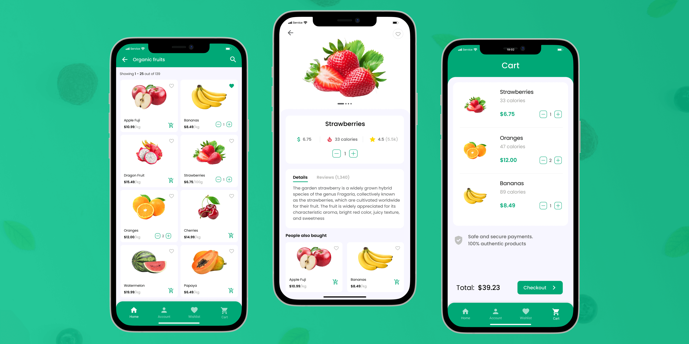
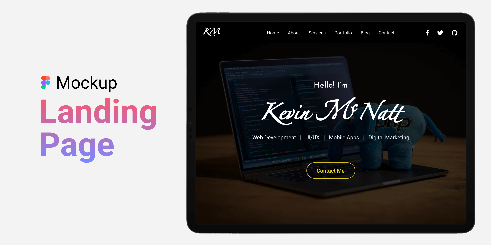
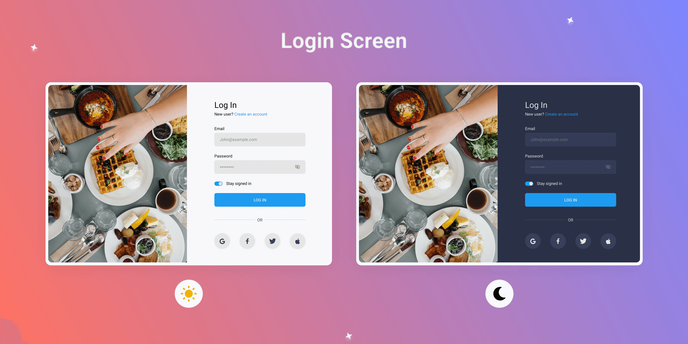
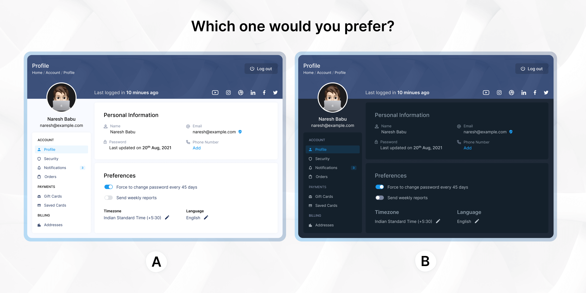
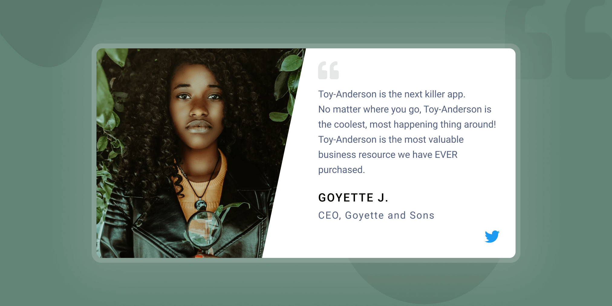
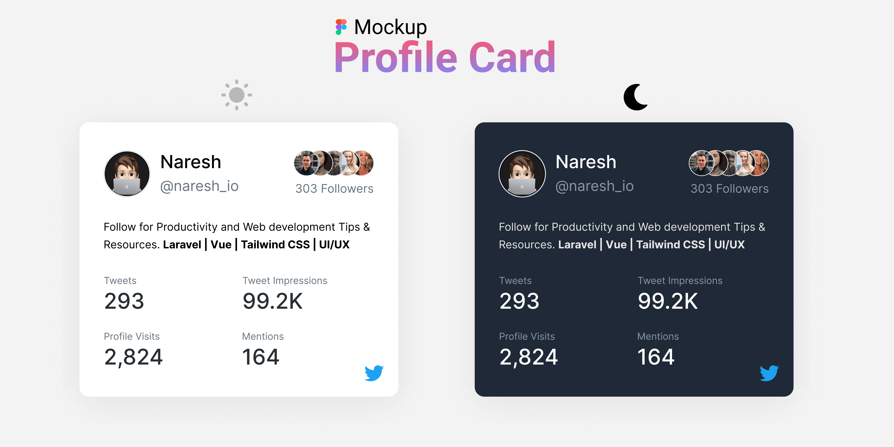

Đối với lập trình viên web frontend, bạn chắc chắn phải biết chuyển từ design sang code với [HTML](/tag/html) và [CSS](/tag/css) (thường gọi là **cắt HTML**). Để làm được điều này, bạn cần phải có một bản thiết kế sẵn. Đáp ứng nhu cầu này, mình sẽ chia sẻ với bạn 10 Figma templates cho web và ứng dụng di động hoàn miễn phí mà mình sưu tầm được.

Trong mỗi file tải về, đều có sẵn một file **.fig** và các file ảnh. Bạn chỉ cần đăng ký tài khoản trên [Figma](https://www.figma.com/) bằng gmail là có thể mở được file **.fig** này.

Nếu gặp khó khăn, bạn có thể để lại bình luận xuống phía dưới hoặc gửi email cho mình. Mình sẽ hỗ trợ khi có thể.

## 10 Figma templates cho web và di động

Dưới đây là 10 templates mà bạn có thể sử dụng hoàn toàn miễn phí cho cá nhân và các dự án thương mại.

### Figma template cho Dashboard

Để quản lý, phân tích các chỉ số KPI về hiệu quả công việc, kinh doanh thì chắc hẳn không thể thiếu dashboard.

<a  href="https://drive.google.com/file/d/1KxZfimd4BD8HoYJL8XJMEAddn3BQHuWA/view?usp=sharing" class="btn btn-primary margin-bottom">
  Download
</a>

### Figma template cho Details Section

Details section là một phần quan trọng không thể thiếu trong một trang Landing page của công ty khi muốn quảng các các dịch vụ của họ.

<a  href="https://drive.google.com/file/d/1LEBI4TQmx-U9Ogmci3eOGcUswxEFIGHt/view?usp=sharing" class="btn btn-primary margin-bottom">
  Download
</a>

### Figma template cho Feedback Modal

Feedback Modal cần khi bạn muốn thu thập ý kiến phản hồi của người dùng.

<a  href="https://drive.google.com/file/d/1201QPzxuFcXOFhjN6a5sKi_fy50_QOBL/view?usp=sharing" class="btn btn-primary margin-bottom">
  Download
</a>

### Figma template cho Fruits Store

Đây là mẫu Figma trên di động dành cho một cửa hàng bán hoa quả.

<a  href="https://drive.google.com/file/d/1QPQ8C-zb0Gd_oH7vTSryRmEitwOYgm-7/view?usp=sharing" class="btn btn-primary margin-bottom">
  Download
</a>

### Figma template cho Landing Page

Đây là mẫu Landing Page mà bạn có thể sử dụng để làm trang portfolio giới thiệu về bản thân, các dự án, kiến thức kinh nghiệm lập trình.

<a  href="https://drive.google.com/file/d/1KRvtC5hM1So03hnRm4qecYeY67_PsE3O/view?usp=sharing" class="btn btn-primary margin-bottom">
  Download
</a>

### Figma template cho Login Screen

Màn hình đăng nhập là một phần không thể thiếu đối với nhiều trang web.

<a  href="https://drive.google.com/file/d/1rkqjUI9IcE5ZMpiaf9WV5gri_NzxZpm7/view?usp=sharing" class="btn btn-primary margin-bottom">
  Download
</a>

### Figma template cho Mobile Gallery

Mẫu Figma này dành dùng để trình diễn bộ sưu tập ảnh trên di động.

<a  href="https://drive.google.com/file/d/1TuuTJcp2XpZwydPbqaclL2xJvEHpLBDC/view?usp=sharing" class="btn btn-primary margin-bottom">
  Download
</a>

### Figma template cho Profile Section

Mẫu Figma này dùng cho mục thông tin cá nhân.

<a  href="https://drive.google.com/file/d/1PB-R5-aKI2sd_I1eQsC5QpqWBnxcU4dU/view?usp=sharing" class="btn btn-primary margin-bottom">
  Download
</a>

### Figma template cho Testimonial

Testimonial là mục thể hiện những nhận xét của người dùng sau khi sử dụng dịch vụ.

<a  href="https://drive.google.com/file/d/1tv0bb3mqZOmbcu8B6cA_mBb8xZy-P3-I/view?usp=sharing" class="btn btn-primary margin-bottom">
  Download
</a>

### Figma template cho Twitter Profile Card

Twitter Profile Card được dùng khi bạn muốn show thông tin về Twitter của bản thân.

<a  href="https://drive.google.com/file/d/1ynP8HimTl77cGwbnhjqyaL27aBEgJ3Hc/view?usp=sharing" class="btn btn-primary margin-bottom">
  Download
</a>

## Kết luận

Trên đây là 10 Figma Templates cho web và di động. Bạn thấy thích thiết kế nào nhất? Hãy chia sẻ với mình trong phần bình luận phía dưới nhé!

Ngoài ra, bạn cũng có thể ủng hộ tác giả của những thiết kế này nhé (mình chỉ sưu tầm lại thôi):

👉 [10 Figma Templates for Mobile & Web](https://www.buymeacoffee.com/nareshbabu/10-figma-templates-mobile-web)

★ Nếu bạn thấy bài viết này hay thì hãy theo dõi mình trên Facebook để nhận được thông báo khi có bài viết mới nhất nhé:

- Facebook Fanpage: [Complete JavaScript](https://www.facebook.com/completejavascript/)
- Facebook Group: [Hỏi đáp JavaScript VN](https://www.facebook.com/groups/HoiDapJavascriptVN)
- Portfoflio : [Lam Pham](http://about.phamvanlam.com/)
