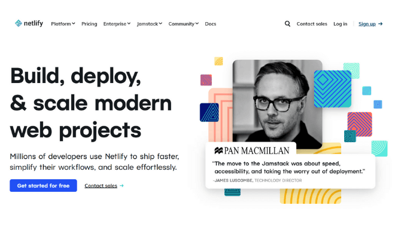
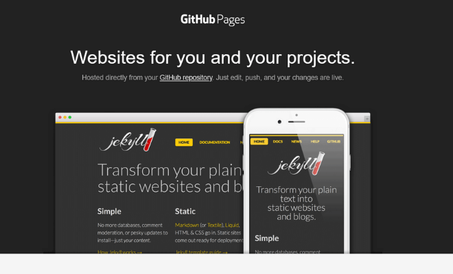
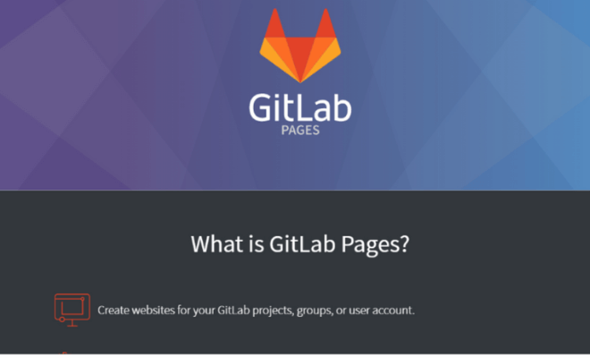
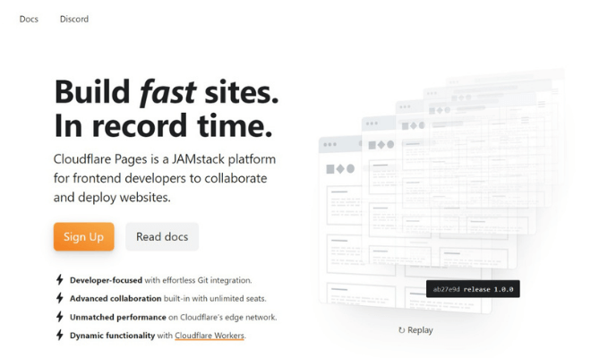
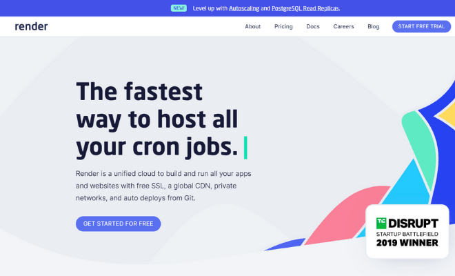
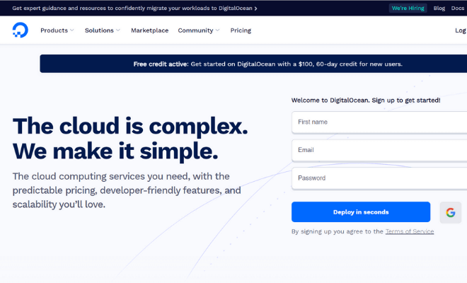
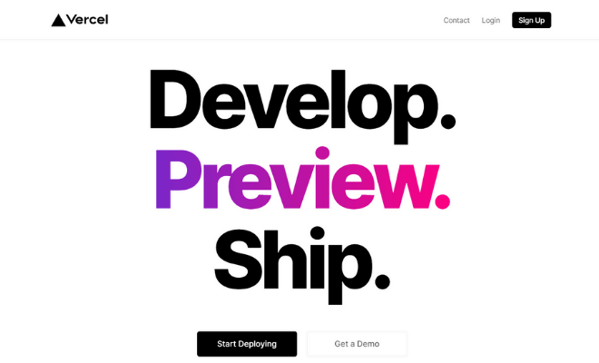
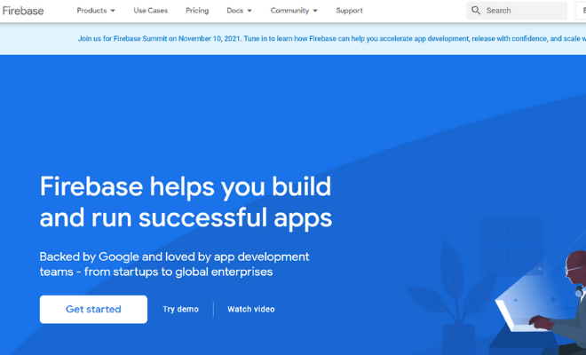
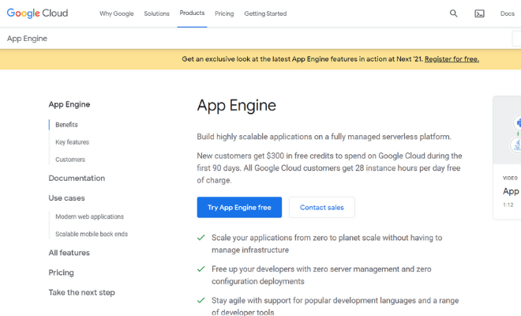
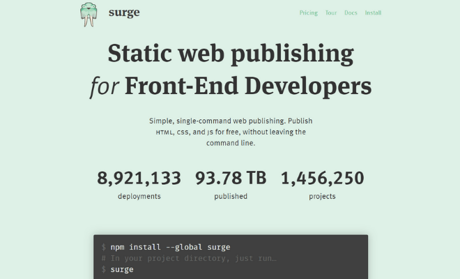

Cùng với sự phát triển nhanh đến chóng mặt của các Static Site Generator (trình sinh web tĩnh) và kiến trúc website JAMstack, rất nhiều các trang web đã hỗ trợ deploy web tĩnh miễn phí. Tuy nhiên, không phải dịch vụ nào cũng cho phép thay đổi tên miền. Vì vậy, bài viết này mình sẽ tổng hợp lại 10 hosting miễn phí cho web tĩnh mà bạn có thể áp dụng ngay cho các dự án của mình.

Nhưng trước khi đi vào danh sách chi tiết 10 hosting miễn phí này, mình muốn giới thiệu một chút về web tĩnh là gì và tại sao lại có nhiều dịch vụ hosting miễn phí cho web tĩnh như vậy? Liệu có phải những thứ miễn phí thì đều không tốt?

## Web tĩnh là gì?

Web tĩnh hiểu một cách đơn giản là trang web mà nội dung của nó không thể thay đổi được khi đã deploy code lên hosting. Bất cứ một thay đổi nào về nội dung bài viết thì đều phải chỉnh sửa lại code, build và deploy lại lên hosting.

Với web tĩnh, bạn có thể sử dụng HTML, CSS và JavaScript. Hoặc sử dụng một Static Site Generator (ví dụ [Gatsby.js](/tag/gatsbyjs)) để hỗ trợ xây dựng website nhanh chóng, đơn giản hơn.

Chính vì web tĩnh không có những yêu cầu về server như quản lý database, tạo nội dung động với CMS như [Wordpress](/tag/wordpress) nên các dịch vụ dưới đây đều cung cấp hosting miễn phí cho web tĩnh. Và thậm chí là các website này còn cho phép thay đổi tên miền, miễn phí SSL và hỗ trợ CI (Continuous Integration).

Bạn hãy đọc và xem dịch vụ nào phù hợp với dự án cá nhân của bạn nhé!

## 10 hosting miễn phí cho web tĩnh

Dưới đây là danh sách các hosting miễn phí cho phép bạn thay đổi tên miền.

### 1. [Netlify](https://www.netlify.com/)

Bản thân blog **Complete JavaScript** của mình cũng là web tĩnh được [deploy lên Netlify](/tao-trang-blog-voi-gatsby-js#deploy-lên-netlify). Và mình rất ưng ý với dịch vụ hosting này nên sẽ tiếp tục sử dụng nó dài dài.

Với Netlify bạn không chỉ deploy được web tĩnh mà còn cả single-page application và website thương mại điện tử phức tạp.

Netlify cho phép bạn kết nối với các private repo trên Github kết hợp với hệ thống CI giúp bạn deploy code một cách dễ dàng.

**Giá**: miễn phí  
**Giới hạn**: kích thước 100GB, băng thông 100GB/tháng, thời gian build code 300 phút/tháng  
**Thay đổi tên miền**: có  
**Hỗ trợ SSL**: có  
**Miễn phí CI**: có  
**Nâng cấp**: có, sau khi nâng cấp bạn có thể sử dụng khá nhiều tính năng nâng cao, plugin hỗ trợ như quản lý form, bảo vệ mật khẩu,...

### 2. [Github Pages](https://pages.github.com/)

Github Pages cho phép bạn deploy web tĩnh trực tiếp từ repo trên Github. Rõ ràng, việc tạo account và các repo trên Github là hoàn toàn miễn phí nên chuyện Github hỗ trợ hosting miễn phí là điều dễ hiểu.

Github đặc biệt hỗ trợ Jekyll (vì đơn giản nó là hàng của Github mà). Tuy nhiên, bạn cũng có thể dụng các Static Site Generator khác một cách bình thường.

Bản thân mình thì thường hay deploy single-page application [viết bằng React lên Github](/deploy-ung-dung-react-len-github-pages). Vì nó nhanh, tiện và đơn giản.

**Giá**: miễn phí  
**Giới hạn**: kích thước 1GB, băng thông 100GB/tháng, 10 lần build/giờ  
**Thay đổi tên miền**: có  
**Hỗ trợ SSL**: chỉ hỗ trợ khi sử dụng sub-domain của Github. Tuy nhiên, bạn có thể sử dụng kết hợp với dịch vụ free SSL của Cloudflare.  
**Miễn phí CI**: chỉ hỗ trợ Jekyll, với những thằng khác thì bạn có thể sử dụng Travis.  
**Nâng cấp**: có, sau khi nâng cấp bạn có thể sử dụng private repo.

### 3. [Gitlab Pages](https://docs.gitlab.com/ee/user/project/pages/)

Gitlab Pages cũng tương tự như Github Pages. Ngoài việc là Gitlab hỗ trợ miễn phí CI cho hầu hết các Static Site Generators.

**Giá**: miễn phí  
**Giới hạn**: tương tự Github Pages với kích thước 1GB, băng thông 100GB/tháng  
**Thay đổi tên miền**: có  
**Hỗ trợ SSL**: có, với một vài [giới hạn](https://docs.gitlab.com/ce/user/project/pages/#limitations)  
**Miễn phí CI**: có  
**Nâng cấp**: không hỗ trợ cho Gitlab Pages

### 4. [Cloudflare Pages](https://pages.cloudflare.com/)

Cloudflare Pages cho phép bạn deploy và hosting JAMstack websites một cách dễ dàng. Cloudflare có tích hợp Git, hỗ trợ băng thông không giới hạn, hỗ trợ CDN và cho phép tạo preview build cho mỗi commit.

**Giá**: miễn phí  
**Giới hạn**: 500 lần build/tháng  
**Thay đổi tên miền**: có  
**Hỗ trợ SSL**: có  
**Miễn phí CI**: có  
**Nâng cấp**: có, sau khi nâng cấp bạn có thể sử dụng một số dịch vụ nâng cao như page rules, hỗ trợ doanh nghiệp,...

### 5. [Render.com](https://render.com/)

Render.com cho phép bạn build và deploy web tĩnh trực tiếp từ Git repo, với hỗ trợ SSL và global CDN.

**Giá**: miễn phí  
**Giới hạn**: băng thông 100GB/tháng  
**Thay đổi tên miền**: có  
**Hỗ trợ SSL**: có  
**Miễn phí CI**: có  
**Nâng cấp**: có, sau khi nâng cấp bạn có thể sử dụng một số dịch vụ background, dockers,...

### 6. [DigitalOcean App Platform](https://m.do.co/c/6111d2704eb4)

DigitalOcean được biết đến nhiều nhất với VPS. Tuy nhiên, DigitalOcean App Platform đã ra đời - cung cấp dịch vụ hosting miễn phí cho web tĩnh cũng như web động.

DigitalOcean App Platform hỗ trợ deploy code trực tiếp từ Github cũng như Gitlab với SSL miễn phí và cho phép thay đổi tên miền.

**Giá**: miễn phí  
**Giới hạn**: băng thông 100GB/tháng, 100 lần build/tháng  
**Thay đổi tên miền**: có  
**Hỗ trợ SSL**: có  
**Miễn phí CI**: có  
**Nâng cấp**: có, sau khi nâng cấp bạn có thể sử dụng một số dịch vụ như web động, thời gian build nhiều hơn, băng thông cao hơn.

### 7. [Vercel](https://vercel.com/)

Vercel là một platform tốt cho phép bạn build, preview và deploy websites một cách dễ dàng.

Với Vercel, bạn có thể build và deploy dễ dàng cho những trang web được tạo bởi kiến trúc JavaScript như: Next.js, Gatsby.js, React, Vue.js, Nuxt, Angular,...

**Giá**: miễn phí  
**Giới hạn**: Không giới hạn băng thông, số lần (thời gian) build, Serverless function và một số giới hạn.  
**Thay đổi tên miền**: có  
**Hỗ trợ SSL**: có  
**Miễn phí CI**: có  
**Nâng cấp**: có, sau khi nâng cấp bạn có thể sử dụng một số dịch vụ nâng cao như hỗ trợ nhiều thành viên, tăng giới hạn, bảo vệ mật khẩu, build song song,...

### 8. [Firebase Hosting](https://firebase.google.com/)

Firebase Hosting của Google cho phép bạn deploy web tĩnh cũng như single-page application một cách dễ dàng.

Firebase Hosting cho phép thay đổi domain và miễn phí SSL. Hơn nữa, bạn cũng có thể sử dụng một số dịch vụ miễn phí khác của Firebase như realtime-database, file storage,...

**Giá**: miễn phí  
**Giới hạn**: kích thước 1GB, băng thông 10GB/tháng  
**Thay đổi tên miền**: có  
**Hỗ trợ SSL**: có  
**Miễn phí CI**: có  
**Nâng cấp**: có, sau khi nâng cấp bạn sẽ có thêm dung lượng lưu trữ và băng thông hàng tháng.

### 9. [Google App Engine](https://cloud.google.com/appengine/)

Google App Engine cho phép bạn deploy web tĩnh.

Google App Engine hỗ trợ nhiều ngôn ngữ Backend như PHP, Go, Java. Tuy nhiên, với web tĩnh, bạn chỉ cần viết một file config là **app.yaml**.

**Giá**: miễn phí  
**Giới hạn**: kích thước 1GB, băng thông 1GB/ngày (56MB/phút)  
**Thay đổi tên miền**: có  
**Hỗ trợ SSL**: có  
**Miễn phí CI**: không  
**Nâng cấp**: có, nếu bạn vượt quá giới hạn miễn phí, bạn sẽ bị tính tiền tương ứng.

### 10. [Surge](https://surge.sh/)

Surge hỗ trợ deploy web tĩnh với CLI. Bạn chỉ cần cài đặt npm module và chạy câu lệnh với surge trực tiếp trong project.

Surge cho phép thay đổi tên miền miễn phí và có hỗ trợ SSL cơ bản.

**Giá**: miễn phí  
**Giới hạn**: không đề cập  
**Thay đổi tên miền**: có  
**Hỗ trợ SSL**: hỗ trợ đầy đủ khi custom domain nếu bạn nâng cấp lên gói trả phí  
**Miễn phí CI**: không  
**Nâng cấp**: có, sau khi nâng cấp bạn có thể tùy chỉnh SSL, chuyển hướng, bảo vệ mật khẩu,...

## Kết luận

Trên đây là 10 hosting miễn phí cho web tĩnh - cho phép thay đổi tên miền. Bản thân mình cũng đã sử dụng qua một vài dịch vụ trên đây. Và hiện tại mình đang sử dụng nhiều nhất với Netlify và Github Pages.

Có lẽ, do mình sử dụng React và Gatsby.js là chủ yếu nên việc sử dụng 2 dịch vụ trên đã quá đủ và phù hợp.

Còn bạn thì sao? Bạn đã / đang sử dụng dịch vụ hosting nào? Ngoài 10 hosting miễn phí cho web tĩnh được đề cập ở trên, bạn có đề xuất dịch vụ nào nữa không?

Cho mình biết trong phần bình luận phía dưới nhé!

★ Nếu bạn thấy bài viết này hay thì hãy theo dõi mình trên Facebook để nhận được thông báo khi có bài viết mới nhất nhé:

- Facebook Fanpage: [Complete JavaScript](https://www.facebook.com/completejavascript/)
- Facebook Group: [Hỏi đáp JavaScript VN](https://www.facebook.com/groups/HoiDapJavascriptVN)
- Portfoflio : [Lam Pham](http://about.phamvanlam.com/)
