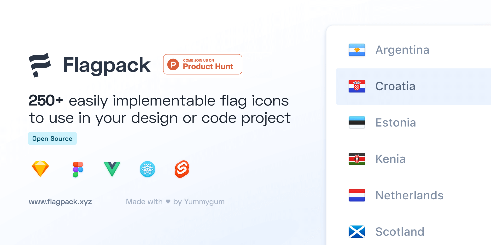
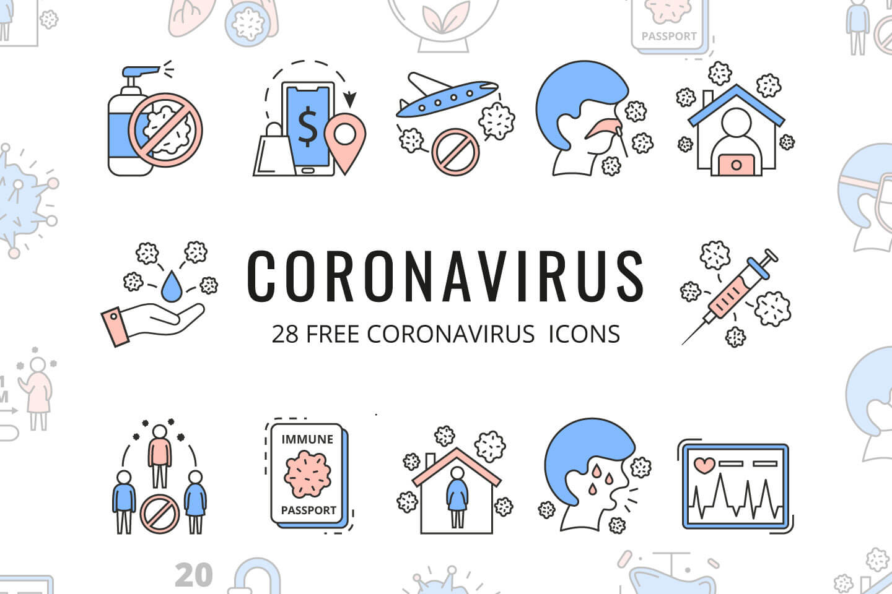
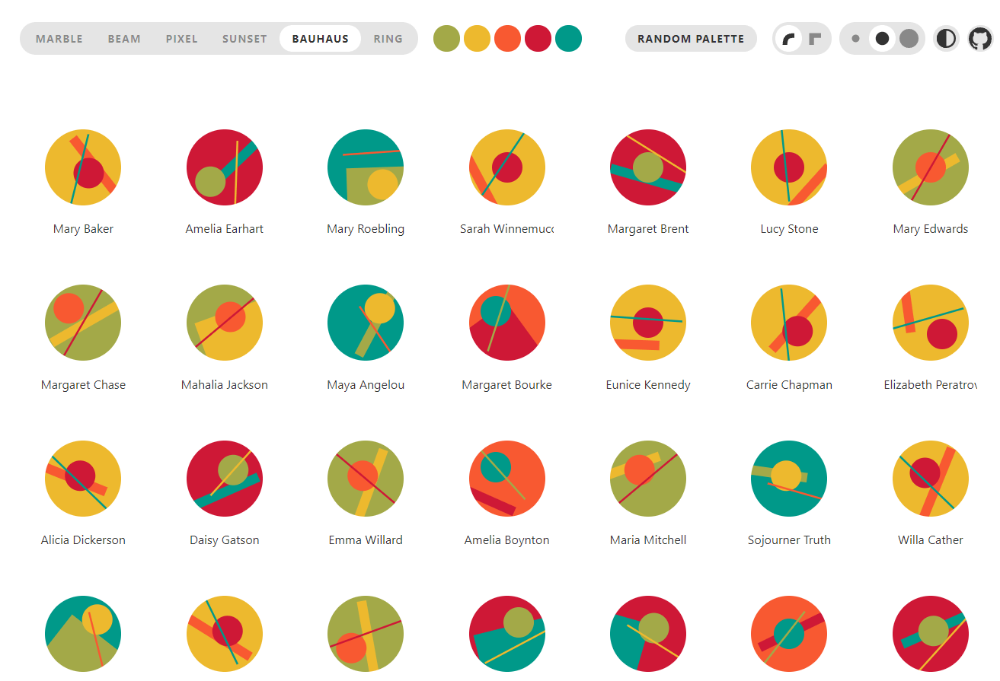
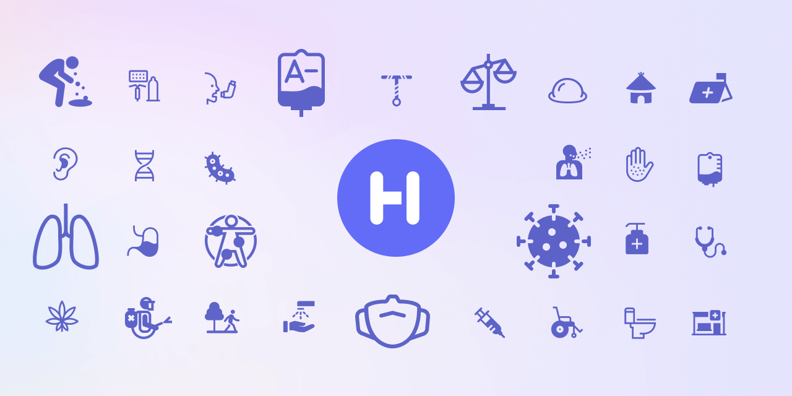
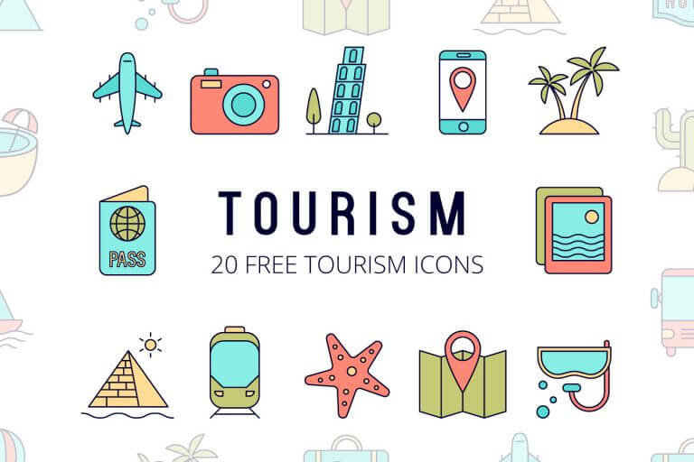
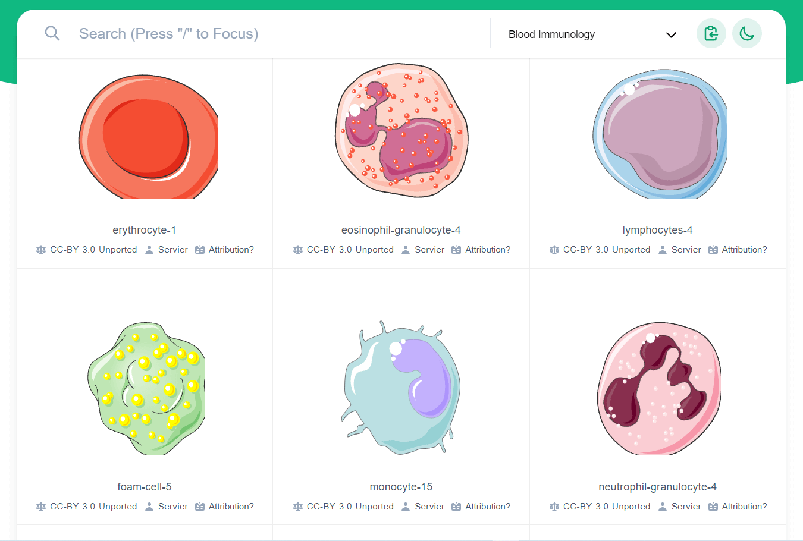
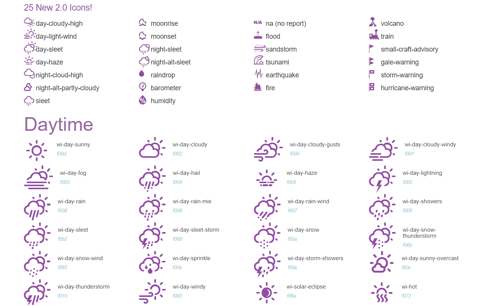
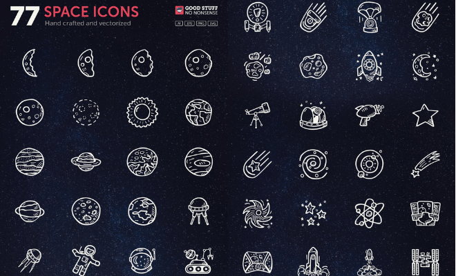
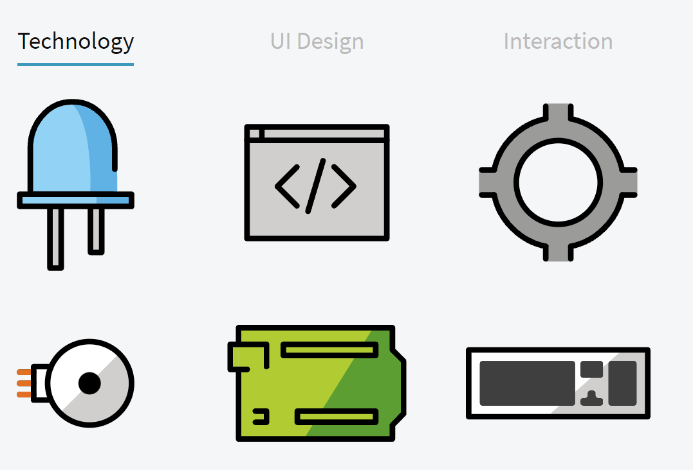
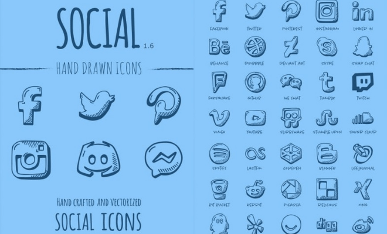

Đối với dân IT, khi lập trình web hay các ứng dụng điện thoại, máy tính thì việc tìm kiếm và tải icon miễn phí tốn khá nhiều thời gian. Vì vậy, bài viết này sẽ tổng hợp lại 10 bộ icon miễn phí, chất lượng cao mà bạn có thể sử dụng cho các sản phẩm của mình.

## 10 bộ icon miễn phí dành cho dân IT

Dưới đây là danh sách bộ icon miễn phí cho bạn tải về.

### Bộ icon miễn phí về lá cờ của các quốc gia

Bộ icon về lá cờ của các quốc gia thường được sử dụng khi bạn muốn hiển thị thông tin liên quan đến quốc gia như: lựa chọn quốc gia khi nhập thông tin cá nhân, hiển thị tiền tệ, thời tiết các nước,...

Bộ icon Flagpack này có trên **250 icon của các nước**, được tối ưu cho kích thước nhỏ giúp phù hợp với các thiết kế của bạn. Thêm nữa là họ cung cấp sẵn một vài styles mặc định và bạn có thể tùy chỉnh theo mong muốn.

Đặc biệt, Flagpack có 2 phiên bản cho bạn lựa chọn: dành cho dân thiết kế và dành cho dân IT.

Đối với designer, bạn có thể chọn tải về phiên bản Figma hoặc Sketch.

Còn đối với lập trình viên (web), dĩ nhiên bạn cũng có thể tải về phiên bản Figma hoặc Sketch rồi xuất ra file ảnh. Hoặc bạn có thể cài đặt trực tiếp vào code (hỗ trợ [React](/react), Vue và Svelte).

<a  href="https://flagpack.xyz/" class="btn btn-primary margin-bottom">
  Download
</a>

### Bộ icon về COVID-19

Đây là bộ icon miễn phí về những vấn đề liên quan đến dịch bệnh COVID-19 như: ho, ốm, sốt, giãn cách xã hội, làm việc từ xa, tiềm phòng,...

Bộ icon này bao gồm các định dạng: AI, EPS, SVG và PNG.

<a  href="https://graphicsurf.com/item/coronavirus-vector-icon-set/?affiliate=136522" class="btn btn-primary margin-bottom">
  Download
</a>

### Boring Avatars

Đừng để cái tên đánh lừa bạn. Bộ icon miễn phí này không hề **boring** một chút nào.

Boring Avatars là một thư viện mã nguồn mở (code bằng React) để sinh ra avatar dạng SVG, có thể tùy chỉnh dựa trên bộ màu và username.

Có 6 style khác nhau và một vài tùy chỉnh khác. Bạn có thể thự nghiệm trực tiếp trên trang chủ.

<a  href="https://boringavatars.com/" class="btn btn-primary margin-bottom">
  Download
</a>

### Bộ icon về sức khỏe

Đây là bộ icon miễn phí, mã nguồn mở về tất cả mọi thứ liên quan đến vấn đề sức khỏe như: máu, cơ thể con người, thiết bị y tế, cơ quan y tế,...

Bộ Health icons này có trên 1166 icon khác nhau, với 3 styles (outlined, filled, nagative) và 2 định dạng (SVG, png).

<a  href="https://healthicons.org/" class="btn btn-primary margin-bottom">
  Download
</a>

### Bộ icon về du lịch

Đây là bộ icon miễn phí liên quan đến du lịch với các định dạng AI, EPS và PNG.

Bạn có thể tải về và thoải mái sử dụng cho các dự án cá nhân hoặc thương mại.

<a  href="https://graphicsurf.com/item/tourism-vector-free-icon-set/?affiliate=136522" class="btn btn-primary margin-bottom">
  Download
</a>

### Bộ icon về khoa học

Đây là bộ icon miễn phí về các chủ đề liên quan đến khoa học: sinh học (vắc-xin, vi-rút, bộ gen), hóa học (các dụng cụ thí nghiệm hóa học), khoa học máy tính,...

Bộ bioicons này có trên 1699 icons khác nhau. Và bạn có thể tải xuống dạng SVG.

<a  href="https://bioicons.com/" class="btn btn-primary margin-bottom">
  Download
</a>

### Bộ icon về thời tiết

Weather Icons là bộ icon miễn phí về thời tiết (mưa, nắng, giông, bão, gió,...).

Đây là icon dạng [CSS](/tag/css). Nghĩa là bạn cần phải tải về một file CSS để đưa vào project. Và sử dụng thì hoàn toàn tương tự như FontAwesome.

<a  href="https://erikflowers.github.io/weather-icons/" class="btn btn-primary margin-bottom">
  Download
</a>

### Bộ icon về vũ trụ

Đây là bộ icon miễn phí dạng vẽ tay về vũ trụ, không gian như: các sao trong dải ngân hà, tàu vũ trụ, phi hành gia,...

Có 77 icon khác nhau với các định dạng AI, EPS, PNG và SVG cho bạn thoải mái sử dụng.

<a  href="https://goodstuffnononsense.com/hand-drawn-icons/space-icons/" class="btn btn-primary margin-bottom">
  Download
</a>

### OpenMoji

Đây là bộ icon miễn phí mã nguồn mở của trên 60 học sinh, 3 giáo sư và trên 20 người đóng góp.

OpenMoji có khoảng trên 4000 icon về các chủ đề môi trường tự nhiên, động vật, thức ăn, con người, hoạt động, địa điểm,...

Bạn có thể tải về 2 định dạng phổ biến là SVG và PNG.

<a  href="https://openmoji.org/" class="btn btn-primary margin-bottom">
  Download
</a>

### Bộ icon về mạng xã hội

Đây là bộ icon miễn phí dạng vẽ tay về các mạng xã hội như: Facebook, Twitter, Youtube,...

Có 133 icon khác nhau với các định dạng AI, EPS, PNG và SVG cho bạn thoải mái sử dụng.

<a  href="https://goodstuffnononsense.com/hand-drawn-icons/social-media-icons/" class="btn btn-primary margin-bottom">
  Download
</a>

## Kết luận

Trên đây là 10 bộ icon miễn phí dành cho dân IT. Mình thật sự cảm ơn những người đã làm ra các bộ icon chất lượng cao mà lại miễn phí như này.

Bạn thấy ấn tượng với bộ icon nào nhất? Chia sẻ với mình trong phần bình luận nhé!
