Để có một bài viết tốt thì nội dung thôi là chưa đủ. Bạn nên sử dụng thêm hình ảnh để minh họa phù hợp. Tuy nhiên, nếu bạn tải ảnh trực tiếp từ Google thì rất có thể bạn sẽ bị dính lỗi bản quyền hình ảnh.

Vì vậy, mình tổng hợp lại 10 trang web tải ảnh miễn phí chất lượng cao. Bạn thoải mái sử dụng mà không lo vi phạm bản quyền nhé!

## Tại sao nên tải ảnh miễn phí từ các kho ảnh sau đây?

Ảnh trên các trang này đa phần là ảnh HD, Full HD, 2K và 4K. Vì chúng thường được tạo bởi các nhiếp ảnh gia chuyên nghiệp.

Chủ đề ảnh đa dạng, có chức năng tìm kiếm giúp bạn dễ dàng tìm thấy ảnh theo ý muốn.

Phần lớn các ảnh có bản quyền CC0 - nghĩa là bạn toàn quyền sử dụng, không cần trích dẫn nguồn. Tuy nhiên, một số hình ảnh có yêu cầu riêng, bạn chú ý xem kỹ trước khi tải về.

## Danh sách trang web tải ảnh miễn phí

Dưới đây là tổng hợp danh sách 10 trang web tải ảnh miễn phí chất lượng cao.

### [Pixabay Photos](https://pixabay.com/photos/)

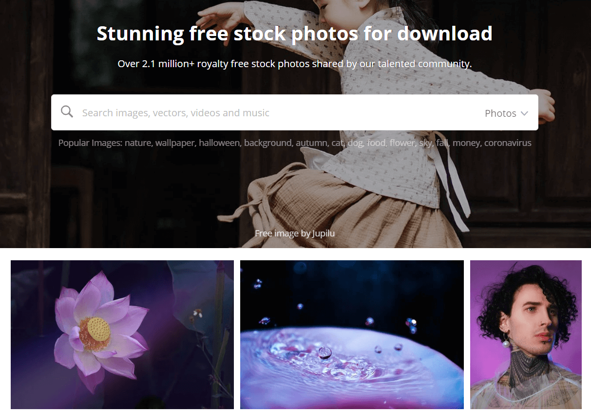

### [Pexels](https://www.pexels.com/)

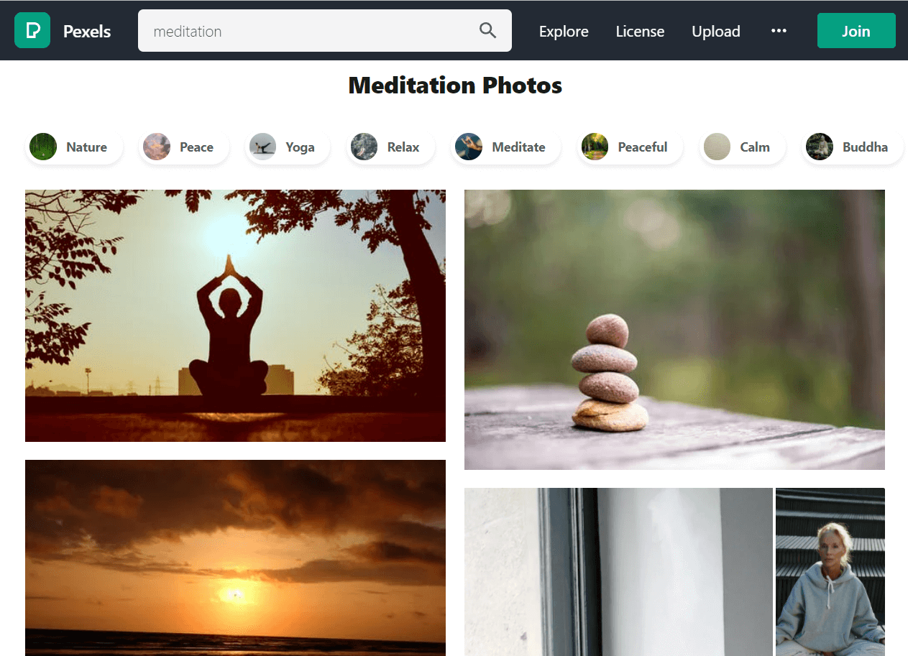

### [Unsplash](https://unsplash.com/)

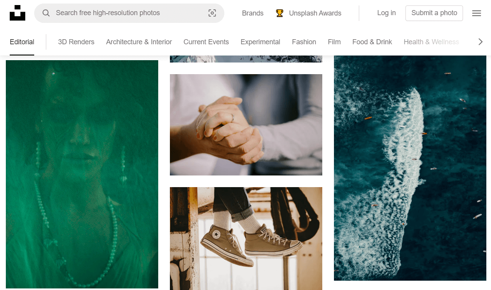

### [Gratisography Photos](https://gratisography.com/photos/photos/)

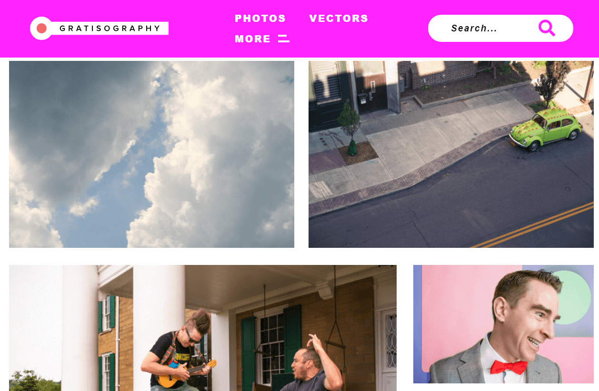

### [Burst](https://burst.shopify.com/)

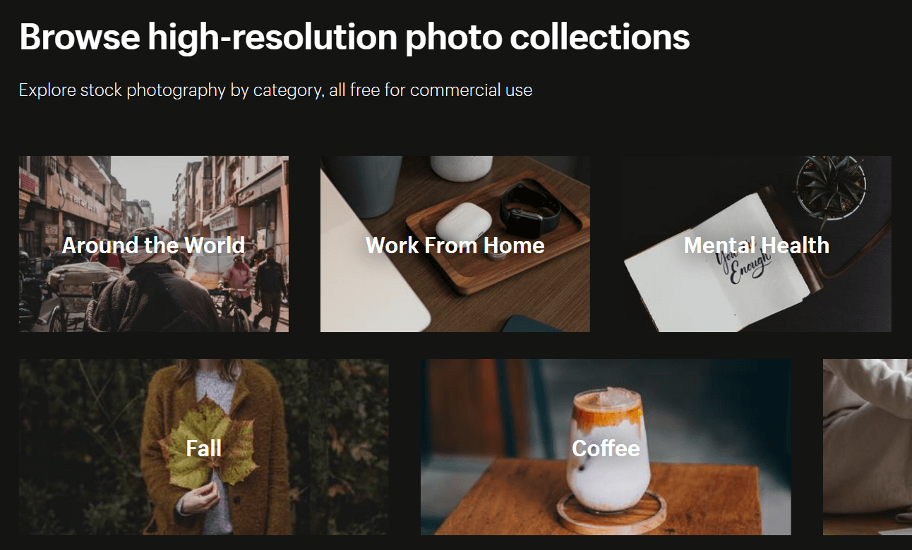

### [Glyphs Photos](https://glyphs.co/photos)

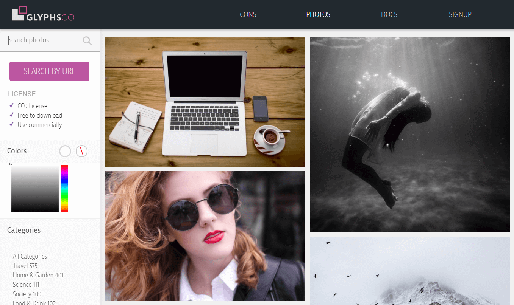

### [Picjumbo](https://picjumbo.com/)

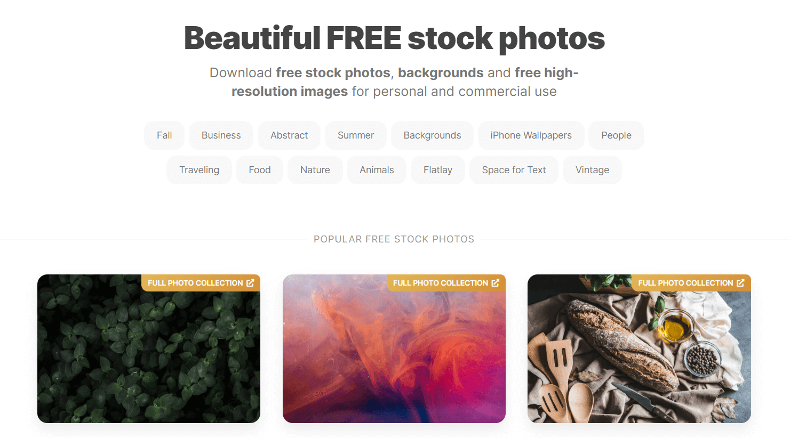

### [FreeImages](https://www.freeimages.com/)

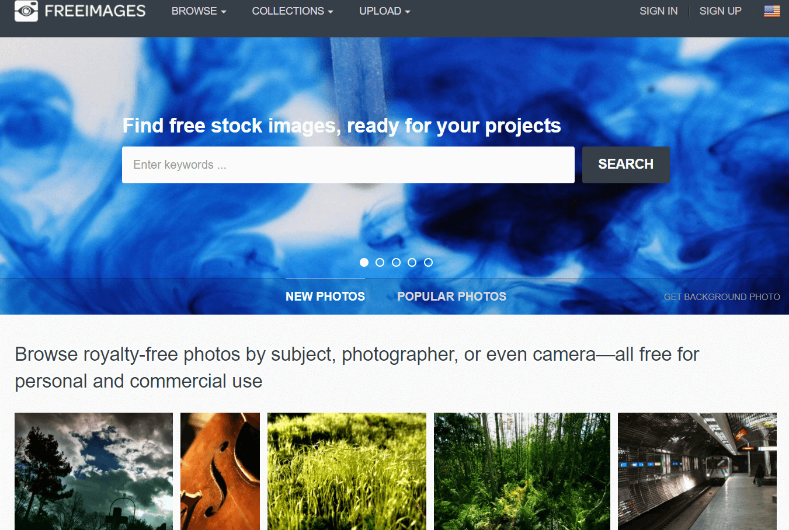

### [StockSnap](https://stocksnap.io/)

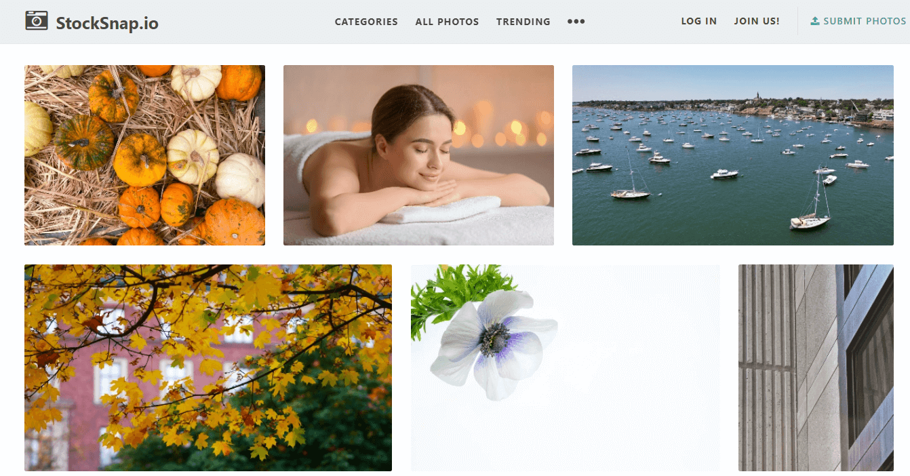

### [Rawpixel](https://www.rawpixel.com/)

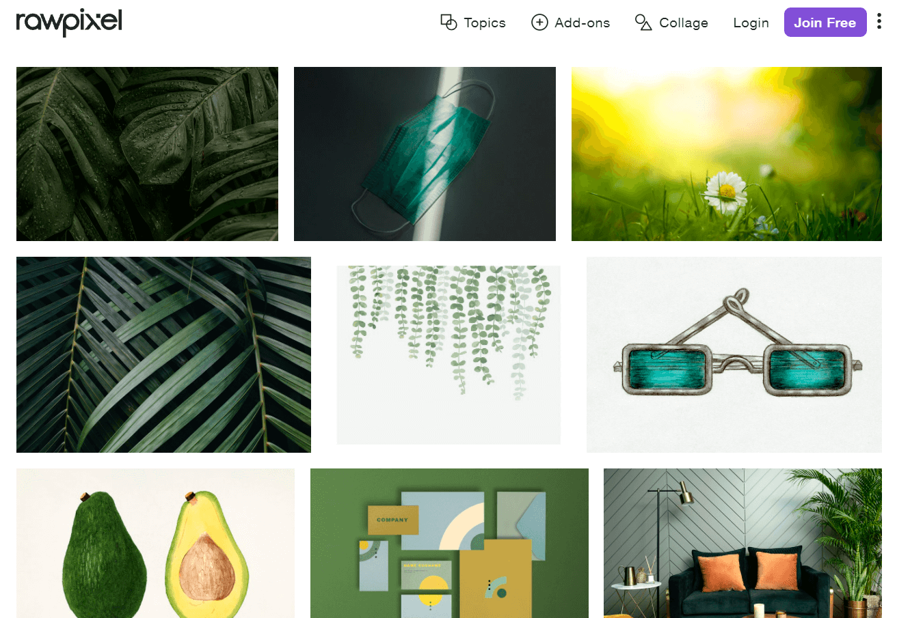

## Kết luận

Trên đây là 10 trang web tải ảnh miễn phí chất lượng cao mà bạn có thể sử dụng trong các bài viết hoặc trong các dự án web mà không lo về vấn đề bản quyền.

Tuy nhiên, nếu những trang web này không có những hình ảnh mà bạn mong muốn thì bạn thử tham khảo trên [Shutterstock](https://shutterstock.7eer.net/KeX6b7) xem sao. Tuy nhiên, ảnh trên trang web này thường sẽ mất phí nhé!

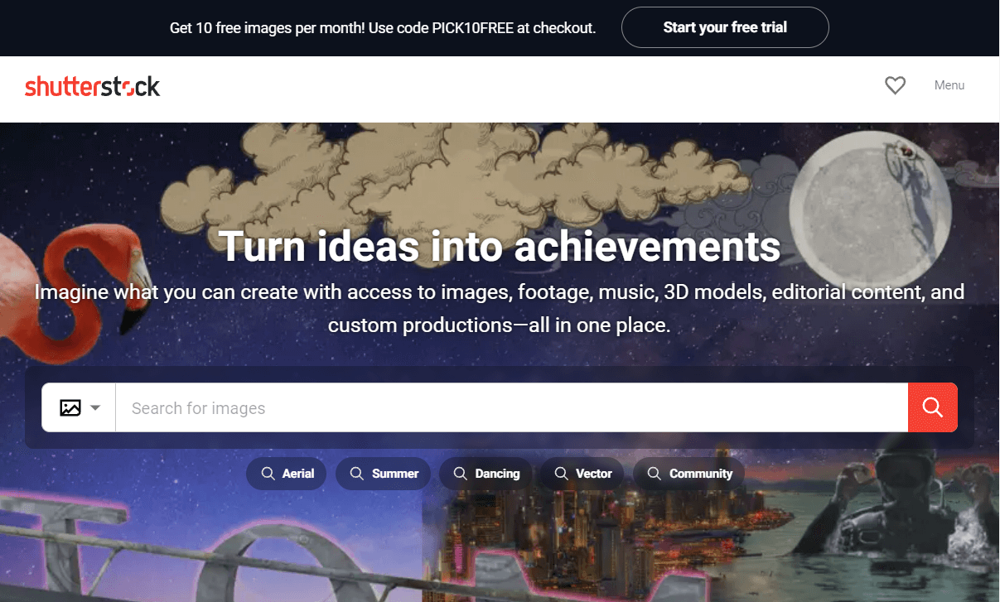

★ Nếu bạn thấy bài viết này hay thì hãy theo dõi mình trên Facebook để nhận được thông báo khi có bài viết mới nhất nhé:

- Facebook Fanpage: [Complete JavaScript](https://www.facebook.com/completejavascript/)
- Facebook Group: [Hỏi đáp JavaScript VN](https://www.facebook.com/groups/HoiDapJavascriptVN)
- Portfoflio : [Lam Pham](http://about.phamvanlam.com/)
