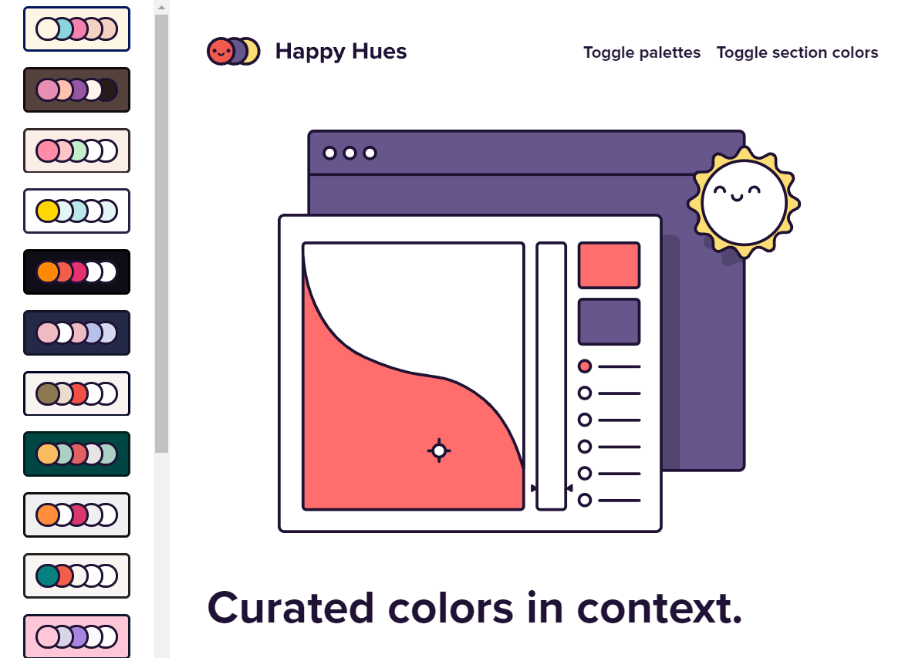
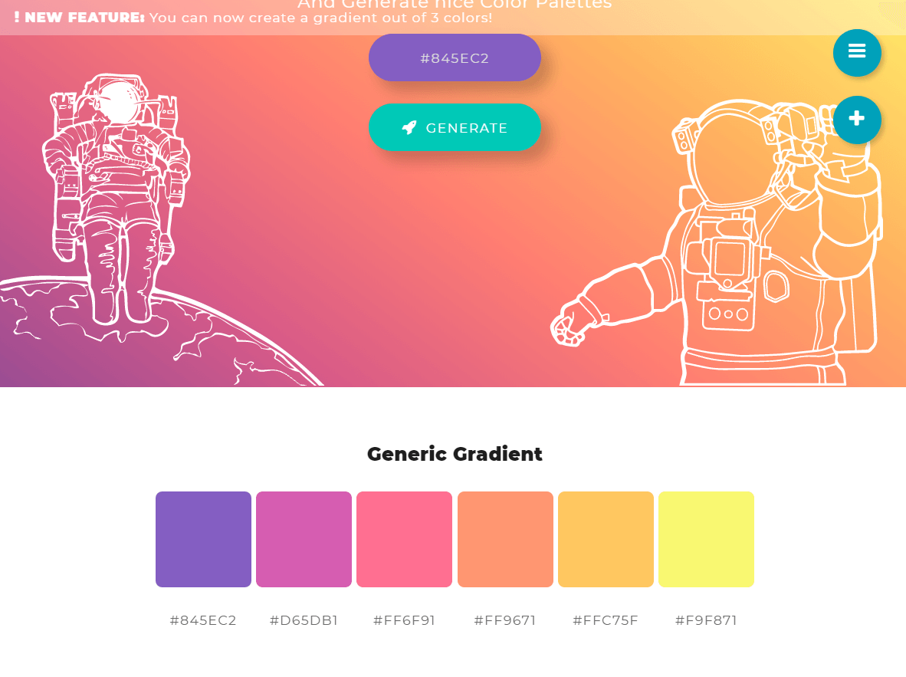
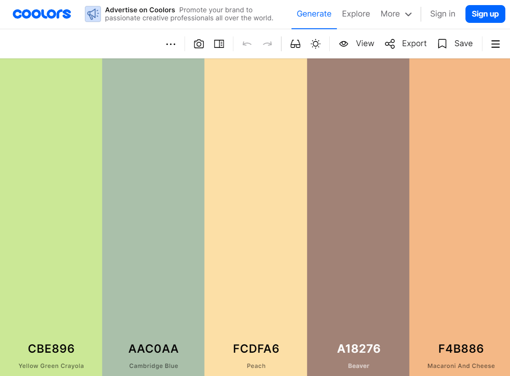
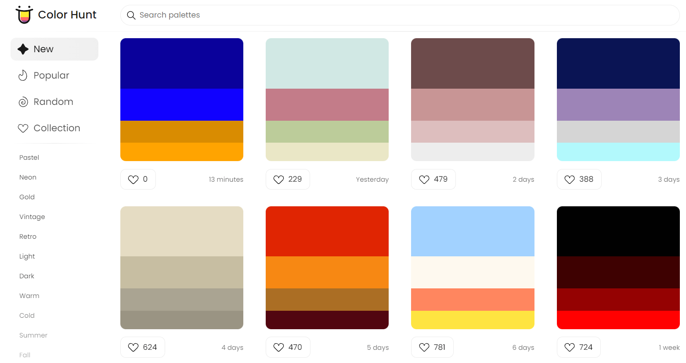
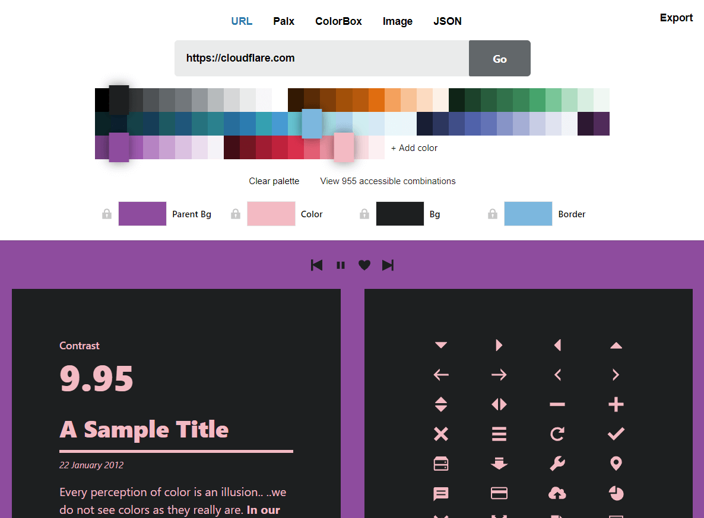
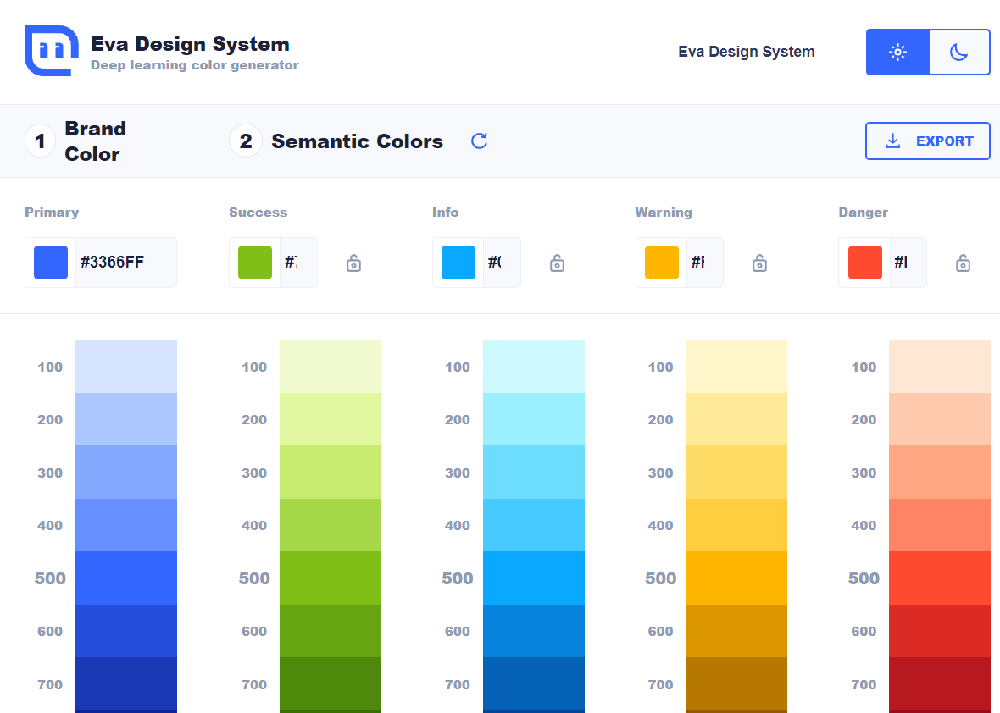
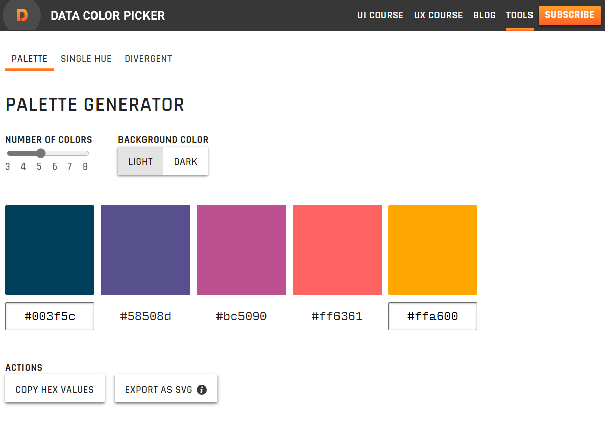
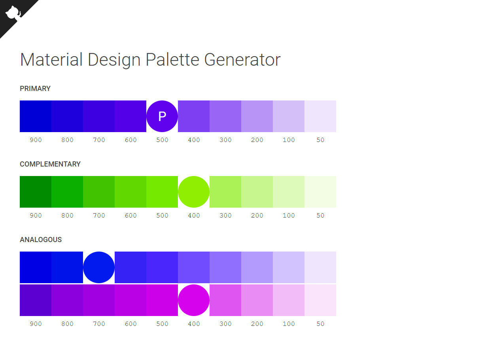
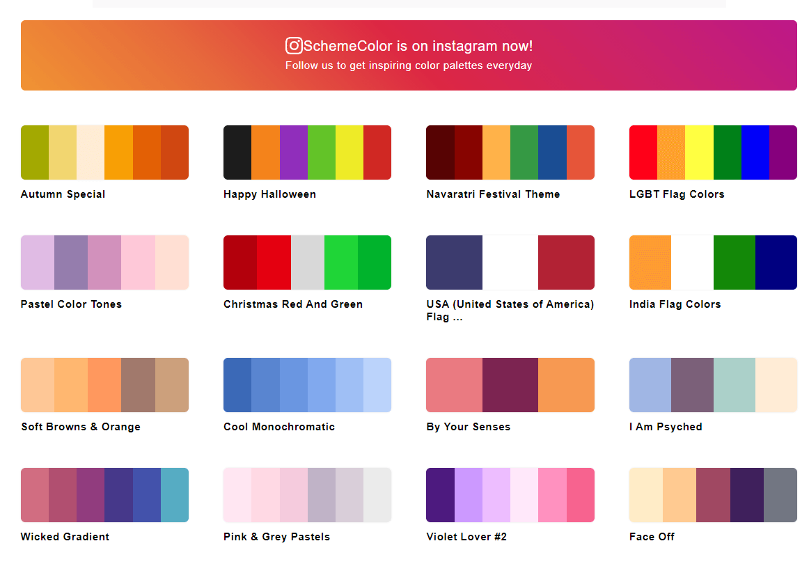
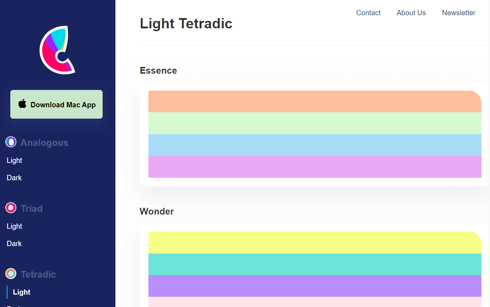

Đối với lập trình viên web, việc lựa chọn [tổ hợp mã màu](/ma-mau-logo-cac-thuong-hieu-noi-tieng) sao cho phù hợp với project của mình thật sự khó khăn. Vì vậy, bài viết này mình sẽ tổng hợp lại 10 trang web tạo palette màu cực tốt, màu sắc hiện đại và tươi mới.

## Palette màu là gì?

Palette màu có thể hiểu đơn giản là một bảng màu. Đối với lập trình web thì đó chính là tổ hợp các màu mà bạn sẽ sử dụng cho các phần tử trên website.

Ví dụ như màu của background, màu chữ, màu link, màu của button,....

## Tại sao nên sử dụng Palette màu có sẵn?

Nếu bạn có năng khiếu về design hoặc biết kết hợp màu sắc thì bạn có thể tự tìm ra các mã màu và sự kết hợp của chúng sao cho hợp lý.

Nhưng ngược lại thì rất có thể, bạn sẽ tạo ra một sản phẩm mà màu sắc của các phần tử không thật sự đẹp. Hoặc các màu sắc khi kết hợp lại với nhau không thể hiện được sự tương phản, kém nổi bật.

Đó chính là lí do bạn nên tham khảo 10 trang web tạo palette màu cực tốt sau đây.

## Trang web tạo palette màu cực tốt

Dưới đây là danh sách 10 trang web tạo palette màu cực tốt dành cho bạn.

### [Happy Hues](https://www.happyhues.co/)

Happy Hues không chỉ đưa ra các palette màu, mà còn cho bạn ví dụ trực quan khi áp dụng các tổ hợp màu đó vào thực tế.

### [ColorSpace](https://mycolor.space/)

Với ColorSpace, bạn chỉ cần nhập vào một mã màu chủ đạo. Sau đó, trang web này sẽ tự động sinh ra các palette màu có thể phối hợp với mã màu mà bạn nhập vào.

### [Coolors](https://coolors.co/)

Colors cho phép bạn tạo random các palette màu. Hơn nữa, bạn có thể xem các palette màu có sẵn, palette màu nào đang là xu hướng, phổ biến,...

### [Color Hunt](https://colorhunt.co/)

Với Color Hunt, bạn cũng có thể tạo random các palette màu, xem tổ hợp màu nào đang phổ biến. Ngoài ra, bạn có thể theo dõi các palette màu theo chủ đề.

### [Color - Cloudflare Design](https://color.cloudflare.design/)

Trang web này cũng phép bạn xem các palette màu một cách trực quan - cách mà palette màu được áp dụng vào thực tế.

### [Eva Design System](https://colors.eva.design/)

Với Eva Design System, bạn chỉ cần nhập vào một mã màu chủ đạo. Sau đó, trang web này sẽ sử dụng AI để sinh ra tổ hợp màu tương ứng.

### [Data Color Picker](https://learnui.design/tools/data-color-picker.html#palette)

Data Color Picker hỗ trợ bạn nhập mã màu đầu tiên hoặc mã màu cuối cùng. Sau đó, palette màu tương ứng sẽ được tạo ra. Hơn nữa, trang web này còn cho phép bạn lựa chọn số lượng màu trong tổ hợp (từ 3 đến 8 màu).

### [Material Design Palette Generator](https://materialpalettes.com/)

Trang web này giúp bạn tạo palette màu theo chuẩn Material Design của Google. Bạn chỉ cần nhập vào mã màu chủ đạo (primary color). Trang web sẽ tự động sinh ra tổ hợp màu giúp bạn.

### [Scheme Color](https://www.schemecolor.com/)

Scheme Color cung cấp các palette màu có sẵn. Bạn có thể lọc để tìm kiếm tổ hợp màu theo màu chủ đạo hoặc theo một chủ đề nhất định.

### [Culrs](https://www.culrs.com/#/)

Culrs giúp bạn tìm kiếm những palette màu rất trẻ trung và hiện đại.

## Kết luận

Trên đây là 10 trang web tạo palette màu cực tốt dành cho bạn.

Bạn thấy thích trang web nào nhất?

Ngoài những trang web trên thì bạn có gợi ý trang nào khác không?

Chia sẻ với mình trong phần bình luận nhé!
