Dù trên logo, poster hay website, **font chữ** luôn là một công cụ thiết kế linh hoạt, tuyệt vời để thay đổi cảm giác của mọi người khi đọc nội dung của bạn.

Sau đây là một số font chữ kiểu **multi line** (nhiều dòng) miễn phí và đẹp mắt nhất. Bạn có thể xem danh sách đầy đủ bên dưới.

## Paralines

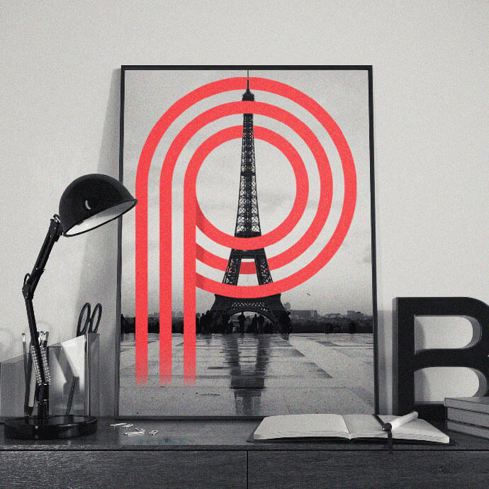

Paralines là phông chữ miễn phí với sự rung cảm cổ điển. Cảm hứng cho font Paralines đến từ cả phông chữ hiện đại và thiết kế cổ điển trong quá khứ.

<a  href="https://www.behance.net/gallery/28060847/Paralines-Free-Font/" class="btn btn-primary margin-bottom" target="_blank" rel="noopener noreferrer">
  Download
</a>

## Metrica

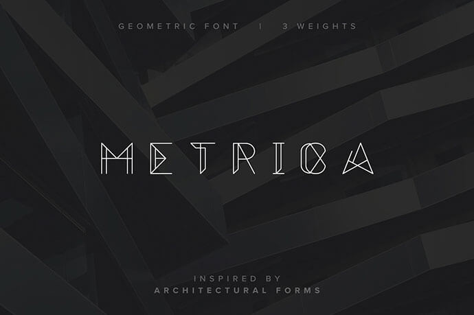

Phông chữ Metrica là một kiểu chữ in hoa mới, sắc nét và cơ học. Lấy cảm hứng từ kiến ​​trúc, phông chữ Metrica được thiết kế với kiểu dáng hình học, phẳng.

Sử dụng ảnh hưởng từ các góc nhìn cảm nhận với thiết kế tòa nhà, tác giả muốn một cái gì đó thật nổi bật và có thể nhận ra ngay lập tức.

<a  href="https://www.behance.net/gallery/25458247/Metrica-Free-Font/" class="btn btn-primary margin-bottom" target="_blank" rel="noopener noreferrer">
  Download
</a>

## Phông chữ Achi

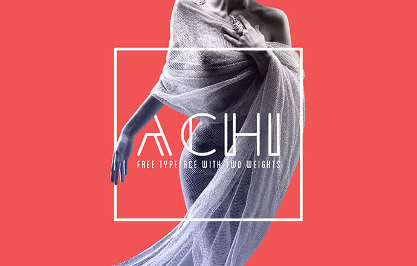

ACHI Font là một phông chữ thời trang miễn phí kiểu **sans serif**, được thiết kế bằng cách sử dụng **shibu pg** - một nhà thiết kế thời trang kiểu Ấn Độ.

Phông chữ này có vẻ ngoài rất bắt mắt và thời trang, đặc biệt trong các dự án thiết kế hình ảnh, in ấn hoặc bố cục thương hiệu.

<a  href="https://freefontsfamily.com/achi-font-free/" class="btn btn-primary margin-bottom" target="_blank" rel="noopener noreferrer">
  Download
</a>

## Stoked

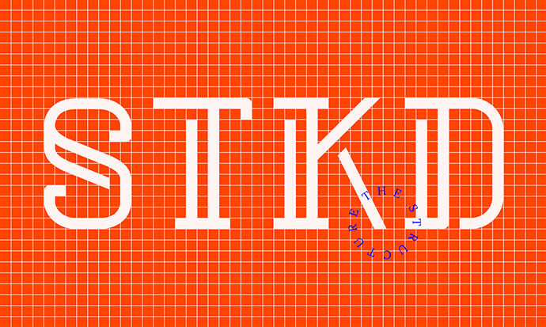

<a  href="https://www.behance.net/gallery/24597223/STOKED-%2528free-font%2529" class="btn btn-primary margin-bottom" target="_blank" rel="noopener noreferrer">
  Download
</a>

## Road Free Font

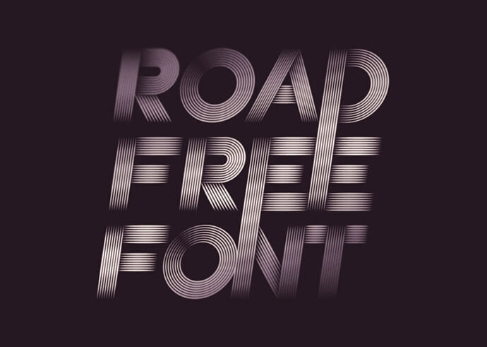

Road là một kiểu chữ tải xuống miễn phí với phong cách cổ điển, thiết kế bởi Patrick Seymour - một giám đốc nghệ thuật và người thiết kế font chữ.

<a  href="https://www.hellofont.com/vfonts/350" class="btn btn-primary margin-bottom" target="_blank" rel="noopener noreferrer">
Download
</a>

## Plento Free Typeface

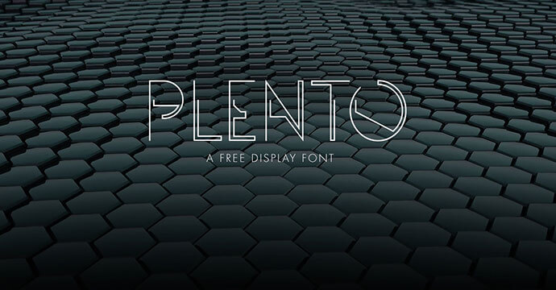

Plento là một phông chữ hiển thị dạng không gian được sắp xếp gọn gàng và hình học. Plenty rất hữu ích cho biểu trưng, ​​tiêu đề, trang phục, bìa album,...

<a  href="https://freedesignresources.net/plento-free-typeface/" class="btn btn-primary margin-bottom" target="_blank" rel="noopener noreferrer">
Download
</a>

## Metropolis 1920

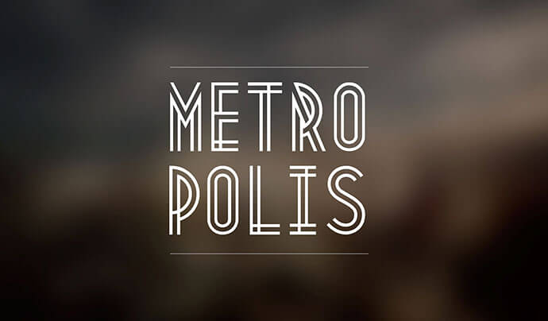

Một phông chữ lấy cảm hứng từ phong trào công nghiệp của những năm 1920. Metropolis 1920 xuất phát từ phong trào công nghiệp của những năm 1920, nơi những tòa nhà chọc trời sinh ra.

Sử dụng kỹ thuật đường đôi, nhà thiết kế muốn tạo ra phông chữ theo phong cách **Art Deco** của riêng mình đại diện cho thời đại này.

Kết quả là một kiểu chữ đậm, sắc nét với một bố cục chắc chắn.

<a  href="https://www.behance.net/gallery/3244285/Metropolis-1920" class="btn btn-primary margin-bottom" target="_blank" rel="noopener noreferrer">
Download
</a>

## Lines Free Font

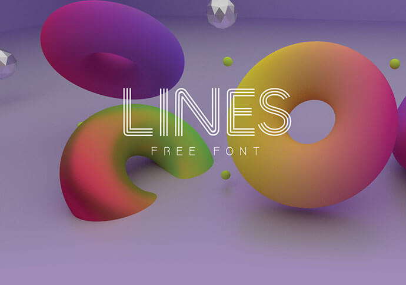

Lines là phông chữ mới của FGD được tạo ra bởi Marcelo Reis Melo, một phông chữ hiện đại siêu sang trọng với ký tự tiếng Anh Thụy Điển và Đức. Có sẵn trong OTF, TTF và Webfont.

Mình hy vọng bạn đánh giá cao dự án này và tạo ra những thứ tuyệt vời với những kí tự này, hãy chia sẻ nếu bạn thích nó.

<a  href="https://www.behance.net/gallery/35541461/LINES-FREE-FONT" class="btn btn-primary margin-bottom" target="_blank" rel="noopener noreferrer">
Download
</a>

## Geom Display Typeface: Free

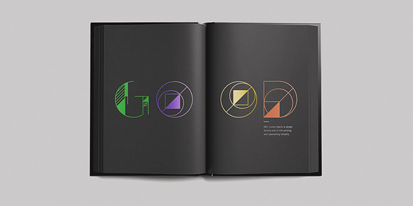

GEOM là kiểu hiển thị vector lấy cảm hứng từ các dạng và lưới hình học cơ bản. Font chữ này là miễn phí sử dụng công việc cá nhân và thương mại.

Được thiết kế bởi Danilo Gusmão Silveira.

<a  href="https://www.behance.net/gallery/25507411/GEOM-Display-Typeface-Free" class="btn btn-primary margin-bottom" target="_blank" rel="noopener noreferrer">
Download
</a>

## Quarz 974

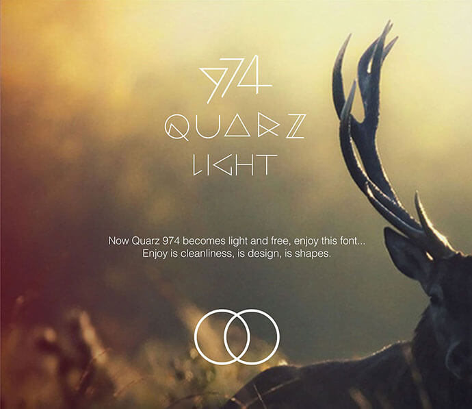

Quartz 974 là một kiểu phông chữ lấy cảm hứng từ các đường đơn giản và hình học như hình tam giác. Nó rất thích hợp cho tiêu đề, logo, áp phích. Đó là lý do tại sao font chữ này chỉ bao gồm chữ viết hoa và số.

<a  href="https://www.hellofont.com/fonts/472" class="btn btn-primary margin-bottom" target="_blank" rel="noopener noreferrer">
Download
</a>

## Bend Typeface

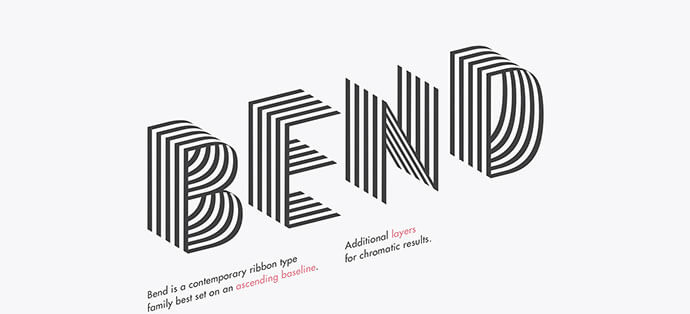

Bend là font chữ thuộc họ **ribbon hiện đại**. Không giống như hầu hết các kiểu chữ của thể loại đó, Bend là sans serif. Đó là góc nhìn từ trên xuống và các đường sọc đặc trưng tạo ra ảo giác thanh lịch về thể tích.

Một tính năng nổi bật của Bend là đường cơ sở tăng dần. Chỉ cần xoay phần tử văn bản 14 độ sẽ cho thấy hiệu ứng 3D và toàn bộ tiềm năng của Bend.

Bend có ba lớp khác nhau cho kết quả màu sắc khác nhau. Và là một kiểu chữ hiển thị, Bend thích được đặt ở kích thước lớn và câu ngắn.

<a  href="https://www.behance.net/gallery/18734261/Bend-Typeface-free-font" class="btn btn-primary margin-bottom" target="_blank" rel="noopener noreferrer">
Download
</a>

## Razor Free Font

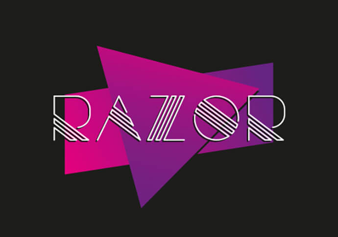

Razor đưa bạn trở lại Miami vào những năm 1980. Hãy nghĩ về flamengo màu hồng, giai điệu DeLorean bằng thép không gỉ... Các ký tự nhiều hàng mỏng hoạt động tốt khi được in ở kích thước lớn hơn một chút.

<a  href="https://www.behance.net/gallery/5836021/Razor-Free-Font" class="btn btn-primary margin-bottom" target="_blank" rel="noopener noreferrer">
Download
</a>

## Lovelo Inline Font

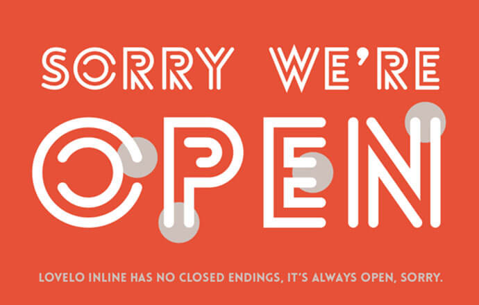

Lovelo Inline được tạo ra với rất nhiều tình yêu. Ban đầu nó được phát triển cho nhà sản xuất xe đạp Velo Arch.

<a  href="https://www.behance.net/gallery/6787299/Lovelo-Inline-Font" class="btn btn-primary margin-bottom" target="_blank" rel="noopener noreferrer">
Download
</a>

## Metria Free Display Font

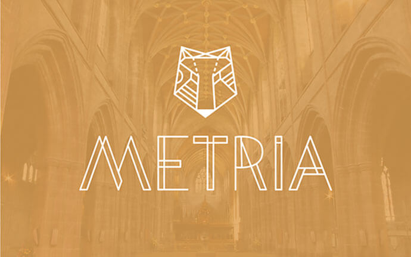

Metria là một kiểu chữ hiển thị hình học dựa trên các góc nhất quán và một hình tròn không hoàn hảo.

Đó là một phông chữ hiển thị rất linh hoạt được lấy cảm hứng từ các dạng hình học, cứng nhắc được kết hợp với các đường cong tự nhiên để làm cho các kí tự trở nên sống động.

<a  href="https://www.behance.net/gallery/15194403/Metria-Free-Display-Font-Free-Download" class="btn btn-primary margin-bottom" target="_blank" rel="noopener noreferrer">
Download
</a>

## Cheque Free

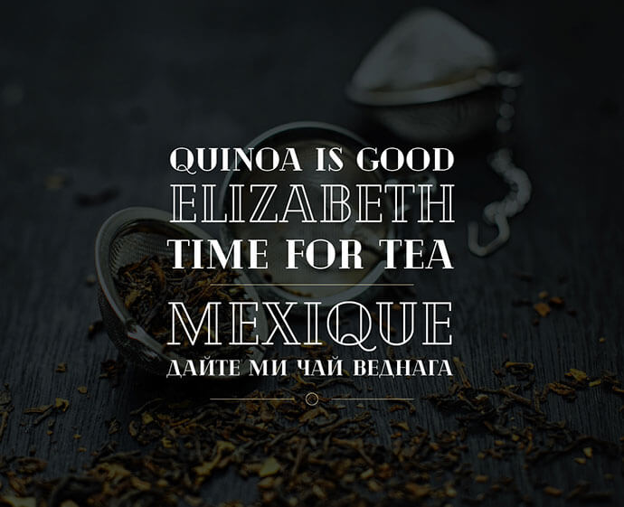

Cheque là một phông chữ hiển thị của Fontfabric. Nó bắt đầu như một dự án của sinh viên nhưng sau đó đã phát triển hết khả năng, trở thành phông chữ tuyệt đẹp như bây giờ.

Phông chữ dựa trên các hình dạng hình học và có một cái nhìn cổ điển rất sang trọng. Cheque có vẻ ngoài đẹp nhất khi được sử dụng cho tiêu đề hoặc bố cục.

Phông chữ thông thường và phông chữ Đen đều miễn phí cho mục đích sử dụng cá nhân và thương mại. Được thiết kế bởi Mirela Belova, Fontfabric.

<a  href="https://www.behance.net/gallery/48317013/Cheque-Free" class="btn btn-primary margin-bottom" target="_blank" rel="noopener noreferrer">
Download
</a>

## Potra

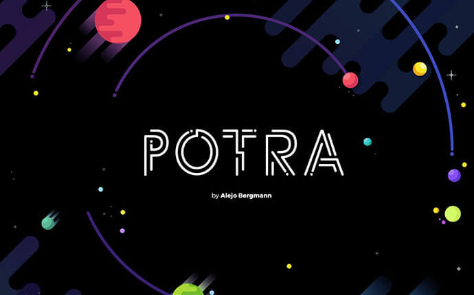

Potra là một phông chữ hiển thị tương lai với các đường tròn được thiết kế bởi Alejo Bergmann. Nó chứa tất cả các chữ cái viết hoa, chữ số và ký hiệu.

Phông chữ này hoàn toàn phù hợp cho nhiều mục đích hiển thị khác nhau bao gồm biểu trưng, ​​huy hiệu và nhãn, tiêu đề và biểu ngữ, bản in và hơn thế nữa.

<a  href="https://www.behance.net/gallery/67098235/POTRA-FREE-FUTURISTIC-DISPLAY-FONT" class="btn btn-primary margin-bottom" target="_blank" rel="noopener noreferrer">
Download
</a>

## Srfm_neon

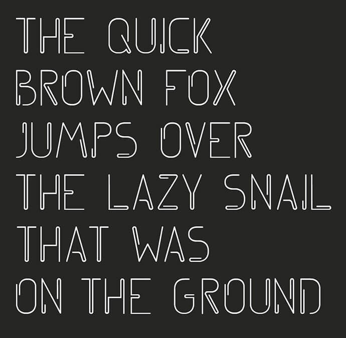

SRFM Neon là một phông chữ miễn phí chỉ viết hoa, lấy cảm hứng từ các hình dạng ánh sáng neon. Được thiết kế và phát hành bởi Srfm.

<a  href="https://www.behance.net/gallery/20711045/srfm_neon-FONT-(free)" class="btn btn-primary margin-bottom" target="_blank" rel="noopener noreferrer">
Download
</a>

## Zero Free Typeface

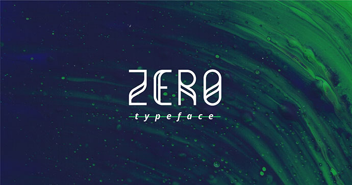

Zero là một phông chữ hiển thị kiểu sans-serif. Phông chữ này là hình học và dựa trên lưới, cùng một lưới được sử dụng để thiết kế tất cả các glyph, "W" và "M".

Zero phù hợp cho tiêu đề, áp phích và cả logo. Có sẵn để sử dụng thương mại.

<a  href="https://www.behance.net/gallery/37298493/Zero-Free-Typeface" class="btn btn-primary margin-bottom" target="_blank" rel="noopener noreferrer">
Download
</a>

## Pirou

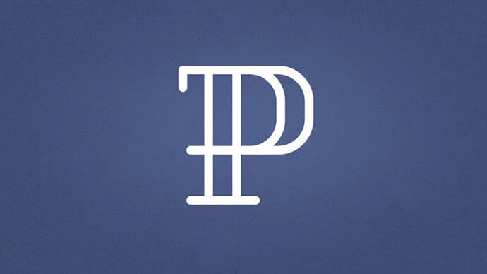

Pirou là một kiểu chữ phác thảo thử nghiệm được lấy cảm hứng từ Didot. Phông chữ chứa hơn 300 ký tự bao gồm chữ hoa, chữ thường, số, ký hiệu, chữ ghép và dấu. Pirou được thiết kế cho tiêu đề lớn như logo, tiêu đề, áp phích.

<a  href="https://www.behance.net/gallery/20090589/PIROU-Free-Font" class="btn btn-primary margin-bottom" target="_blank" rel="noopener noreferrer">
Download
</a>

## Kiểu chữ Mad Squire

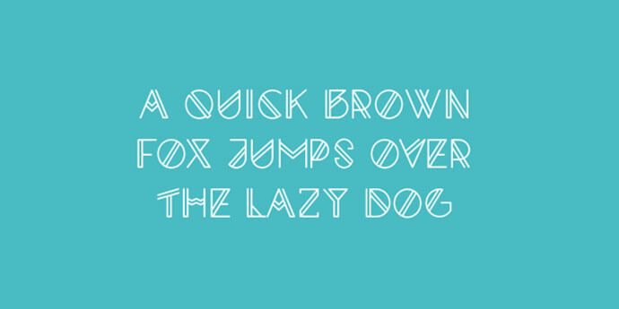

Mad Squire là một kiểu chữ sans serif hình học và thử nghiệm miễn phí lấy cảm hứng từ các đường thẳng song song.

Mad Squire được thực hiện như một dự án cá nhân và vì vậy nó hoàn toàn miễn phí cho mục đích sử dụng cá nhân và thương mại.

<a  href="https://www.behance.net/gallery/21888779/Mad-Squire-typeface-FREE-FONT" class="btn btn-primary margin-bottom" target="_blank" rel="noopener noreferrer">
Download
</a>

## Ny Bricks

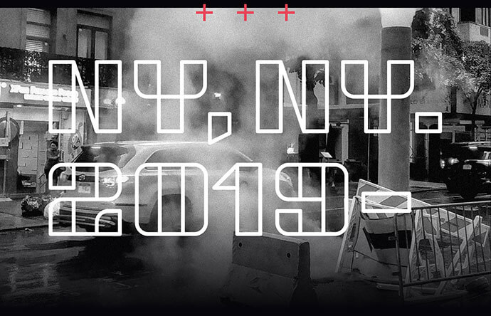

NY Bricks là một kiểu chữ hiển thị mạnh mẽ, miễn phí.

Ny Bricks lấy cảm hứng từ phong cách đường phố. Lý tưởng cho áp phích, tiêu đề, thương hiệu và tác phẩm nghệ thuật kiểu chữ. Phông chữ chứa tất cả các chữ cái viết hoa, số, dấu câu và các ký tự đa ngôn ngữ.

NY Bricks miễn phí cho mục đích sử dụng cá nhân và thương mại. Được thiết kế bởi Mariano Diez. Cyrillic set bởi Denis Ignatov.

<a  href="https://www.behance.net/gallery/83151057/NY-Bricks-Free-font" class="btn btn-primary margin-bottom" target="_blank" rel="noopener noreferrer">
Download
</a>

## Kielo Free Font

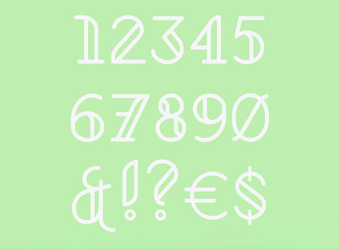

Kielo là một phông chữ tiêu đề viết hoa, miễn phí với bộ glyphs lớn.

<a  href="https://www.behance.net/gallery/70249547/Kielo-Free-font" class="btn btn-primary margin-bottom" target="_blank" rel="noopener noreferrer">
Download
</a>

Tham khảo: [20+ Awesome Free Double & Multi Line Fonts](https://bashooka.com/freebie/free-double-multi-line-fonts/)
