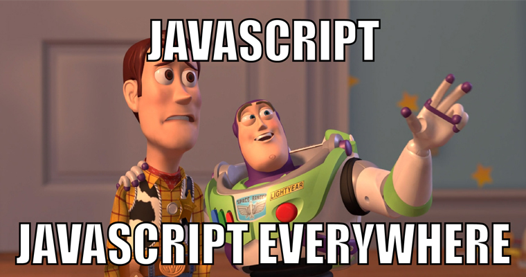

Ngôn ngữ lập trình Javascript được giới thiệu đầu tiên vào năm 1995. Mục đích là để đưa những chương trình vào trang web ở trình duyệt Netscape Navigator - một trình duyệt web phổ biến những năm 1990.

JavaScript được phát triển bởi [Brendan Eich](https://en.wikipedia.org/wiki/Brendan_Eich) tại Hãng truyền thông Netscape với cái tên đầu tiên là Mocha, rồi sau đó đổi tên thành LiveScript, và cuối cùng thành JavaScript. Có lẽ việc đổi tên như vậy là để giúp JavaScript được chú ý nhiều hơn. Bởi tại thời điểm này, Java đang được coi là một hiện tượng và trở nên phổ biến.

Trên thực tế, JavaScript không được phát triển dựa trên Java. Và chúng là hai ngôn ngữ hoàn toàn khác biệt. Các bạn sẽ thấy rõ hơn điều này ở phần sau của bài viết.

## Chuẩn hoá ngôn ngữ lập trình JavaScript

Sau khi ngôn ngữ lập trình JavaScript được chấp nhận sử dụng bên ngoài Netscape, nó được chuẩn hoá bởi một tài liệu tên là ECMAScript bởi [Ecma International](https://www.ecma-international.org/default.htm). Do đó, bạn có thể gọi nó là JavaScript hay ECMAScript. Riêng với bản thân thì mình thích gọi nó là JavaScript hơn. Đơn giản vì mình thấy JavaScript phát âm dễ hơn và nhanh hơn.

Tại thời điểm bài viết này được xuất bản (04/2017), phiên bản ECMAScript mới nhất là ECMAScript 2016 hay ECMA-262. Do đó, đã có rất nhiều sự khác biệt giữa JavaScript hiện tại so với phiên bản đầu tiên của nó.

Trong các bài viết sau, mình sẽ chủ yếu giới thiệu với bạn những kiến thức nguyên thuỷ về JavaScript. Qua đó, bạn có thể tự tìm hiểu những chuẩn mới của JavaScript [một cách dễ dàng](/sau-meo-don-gian-giup-hoc-lap-trinh-javascript-nhanh-hon).

## Đặc điểm chung của JavaScript

- Là ngôn ngữ lập trình bậc cao (high-level) giống như: C/C++, Java, Python, Ruby,... Nó rất gần với ngôn ngữ tự nhiên của con người. Trong khi ngôn ngữ lập trình bậc thấp (low-level) như: Assembly... sẽ gần với máy tính hơn.
- Là ngôn ngữ lập trình động (dynamic programming language): như Python, Ruby, Perl,... Chúng được tối ưu hoá nhằm nâng cao hiệu suất cho lập trình viên. Trong khi ngôn ngữ lập trình tĩnh (static programming language): như C/C++,... lại được tối ưu hoá để nâng cao hiệu suất cho phần cứng máy tính.
- Là ngôn ngữ lập trình kịch bản (scripting language): nghĩa là không cần biên dịch (compile) hay liên kết (linked) giống như ngôn ngữ lập trình biên dịch (C/C++, Java,...) mà nó sẽ được dịch tại thời điểm chạy.
- Là ngôn ngữ [dựa trên đối tượng](/lap-trinh-huong-doi-tuong-voi-javascript) (object-based): tức nó gần giống như ngôn ngữ lập trình hướng đối tượng, ngoại trừ JavaScript không hỗ trợ tính kế thừa và đa hình.
- Là ngôn ngữ dựa trên nguyên mẫu (prototype-based): là một kiểu của [lập trình hướng đối tượng](/cac-khia-canh-lap-trinh-huong-doi-tuong-trong-javascript), trong đó các hành vi của đối tượng được sử dụng lại.

## Ứng dụng của JavaScript

_Tham khảo: https://github.com/vigetlabs/javascript-everywhere_

JavaScript có rất nhiều ứng dụng trên nhiều môi trường và nền tảng khác khau:

- JavaScript cùng với [HTML](/tag/html), [CSS](/tag/css) trở thành ngôn ngữ không thể thiếu đối với website
- Ngoài ra, có rất nhiều [framework JavaScript](/top-5-framework-javascript-moi-nhat-cho-phat-trien-web-va-app) khác nhau phía front-end: Angular.js, Angular2, [ReactJS](/tag/react), Vue.js, Ember.js, Meteor.js, backbone, ...
- JavaScript có thể sử dụng phía server với framework : [Node.js](/tag/nodejs)
- Một số database sử dụng JavaScript như là kịch bản và là ngôn ngữ query: MongoDB, CouchDB
- JavaScript có thể dùng để xây dựng ứng dụng Desktop với framework: Electron. Những ứng dụng nổi tiếng có thể kể đến là: Atom, Visual Studio Code, GitKraken, Wordpress.com,...
- Để xây dựng ứng dụng điện thoại đa nền tảng (Android, IOS) có thể dùng: React-native

Rõ ràng, JavaScript đã trở thành một trong những ngôn ngữ phát triển rất mạnh cùng với độ phổ biến của nó hiện nay. Xứng đáng trở thành [ngôn ngữ lập trình nên học nhất năm 2017](/nhung-ngon-ngu-lap-trinh-nen-hoc-nam-2017).

Trên đây là giới thiệu tổng quan về ngôn ngữ lập trình JavaScript. Trong các bài viết sau, mình sẽ bắt đầu đi sâu vào các khía cạnh của ngôn ngữ này (thành phần cơ bản, [cấu trúc chương trình](/cau-truc-chuong-trinh-trong-javascript), [hàm](/tim-hieu-function-javascript), [đối tượng](/javascript-object-last-but-not-least), [quản lý lỗi](/debug-javascript-de-hay-kho), JavaScript với trình duyệt,... và một số ứng dụng).

Xin chào và hẹn gặp lại bạn ở [bài viết sau](/values-types-va-operators-trong-javascript-phan-1), thân ái!

## Tham khảo

- [JavaScript](https://en.wikipedia.org/wiki/JavaScript)
- [Introduction Eloquent JavaScript](http://eloquentjavascript.net/00_intro.html)

★ Nếu bạn thấy bài viết này hay thì hãy theo dõi mình trên Facebook để nhận được thông báo khi có bài viết mới nhất nhé:

- Facebook Fanpage: [Complete JavaScript](https://www.facebook.com/completejavascript/)
- Facebook Group: [Hỏi đáp JavaScript VN](https://www.facebook.com/groups/HoiDapJavascriptVN)
- Portfoflio : [Lam Pham](http://about.phamvanlam.com/)
