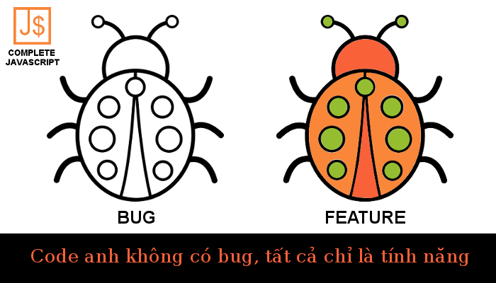

Trong lập trình, việc có [bug](/debug-javascript-de-hay-kho) là điều hết sức bình thường. Tuy nhiên, nhiều lập trình viên lại hay sử dụng câu nói này khi bị bạn bè, đồng nghiệp chỉ ra bug trong code của mình.

Thực ra, nghe thì cũng [vui](/category/anh-che-vui) tai. Nhưng theo quan điểm của mình, nếu có bug thì mình cứ nhận thôi, sau đó fix bug.

Fix xong bug thì tất cả đều vui.

## Kết luận

> Code không bug, sướng nhiều bậc.

Xin chào và hẹn gặp lại bạn ở [bài viết tiếp theo](/anh-che-vui-3-how-i-met-javascript-parody), thân ái!

## Bài viết cùng chuyên mục

- [Ảnh chế vui #1: Cách lập trình viên chạy hằng ngày](/anh-che-vui-1-cach-lap-trinh-vien-chay-hang-ngay)
- [Ảnh chế vui #3: How I met JavaScript – Parody](/anh-che-vui-3-how-i-met-javascript-parody)
- [Ảnh chế vui #4: People life vs Programmer life](/anh-che-vui-4-people-life-vs-programmer-life)
- [Ảnh chế vui #5: Specialist vs Generalist – who is the winner?](/anh-che-vui-5-specialist-vs-generalist-winner)
- [Ảnh chế vui #6: A type of programmer](/anh-che-vui-6-type-programmer)
- [Ảnh chế vui #7: IP man 4 phiên bản lập trình viên](/anh-che-vui-7-ip-man-4-phien-ban-lap-trinh-vien)
