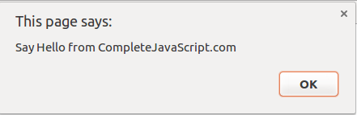
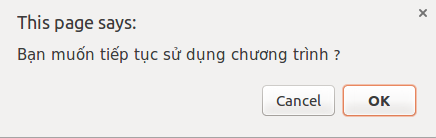
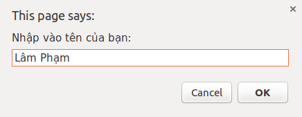
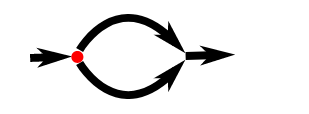
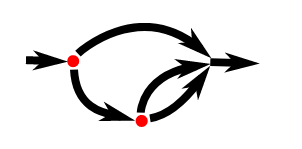
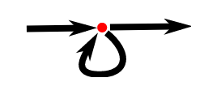

Trong các bài viết trước, mình đã giới thiệu với bạn những thành phần cơ bản của JavaScript ([values](/values-types-va-operators-trong-javascript-phan-1), [types và operators](/values-types-va-operators-trong-javascript-phan-2)). Nhưng đây mới chỉ là những nguyên liệu thô. Vậy làm thế nào để kết hợp những thành phần này thành một chương trình hoàn chỉnh. Để giải quyết vấn đề này, chúng ta sẽ cùng tìm hiểu về cấu trúc chương trình trong JavaScript.

## Biểu thức (expressions)

Theo wikipedia: _[Expression](https://en.wikipedia.org/wiki/Expression) (computer science), an instruction to execute something that will return a value_. Tạm dịch như sau: _biểu thức là một chỉ dẫn để thực hiện một vài công việc và trả về một giá trị_.

Do đó, mỗi giá trị được viết trực tiếp (66, 'hello', true, NaN,...) là một biểu thức (**expression**). Hay việc kết hợp những giá trị với toán tử (1 + 5, 'I' + ' love' + ' you', !false, ...) cũng là những biểu thức.

Biểu thức có thể đơn giản là những phép cộng, trừ,... Hoặc có thể là những công thức toán học, vật lý,... phức tạp. Và trong một biểu thức có thể chứa nhiều biểu thức con.

## Câu lệnh (statements)

Một biểu thức hoàn chỉnh (tương ứng với một câu) được gọi là một câu lệnh (**statement**). Chương trình thực chất là tập hợp của những câu lệnh.

Trong hầu hết các ngôn ngữ lập trình, một câu lệnh thường được kết thúc bởi dấu chấm phẩy (;). JavaScript cũng vậy. Ngoài ra, JavaScript còn cho phép bạn bỏ qua dấu chấm phẩy. Khi đó, mỗi câu lệnh sẽ ở trên một dòng.

Theo mình, tốt nhất là chúng ta nên sử dụng dấu chấm phẩy để kết thúc một câu lệnh. Điều này đảm bảo rằng chương trình của chúng ta hoạt động theo đúng ý muốn.

```js
true;
1 + ((2 * 4) % 3) - 6;
"JavaScript " + "is " + " good";
```

## Biến số (variables)

Mình đã đưa ra 3 ví dụ về câu lệnh. Các bạn thấy rằng, các câu lệnh được thực hiện. Nhưng chúng hoàn toàn vô nghĩa. Để giải quyết vấn đề này, JavaScript đưa ra khái niệm: biến số (**variable**).

Biến số dùng để lưu giữ giá trị. Qua đó, chúng ta có thể sử dụng giá trị này ở những nơi khác của chương trình.

Cách sử dụng biến số: var &lt;tên biến&gt; = &lt;biểu thức&gt;;

```js
var isFriday = true;
var result = 1 + ((2 * 4) % 3) - 6;
var str = "JavaScript " + "is " + " good";
```

Trong ví dụ trên, mình sử dụng từ khoá (**keyword**) là _var_, theo sau là tên biến số (_isFriday_, _result_, _str_), toán tử gán (=) và cuối cùng là các biểu thức.

Sau khi đã khai báo như trên, chúng ta có thể sử dụng biến số trong biểu thức thay vì dùng giá trị:

```js
var result = 1 + ((2 * 4) % 3) - 6; // => result = -3;
var t = result * result;
console.log(t); // => 9
```

Ngoài ra, sau khi bạn gán giá trị cho một biến số thì bạn vẫn có thể gán biến số đó với một giá trị khác.

```js
var x = 5;
console.log(x); // => 5
x = 10;
console.log(x); // => 10
```

### Từ khoá (keywords) và từ dự trữ (reserved words)

Từ khoá (**keywords**) là những từ mang ý nghĩa đặc biệt. Từ _var_ là một từ khoá. Từ khoá _var_ theo sau nó sẽ là một biến số (_var_ là viết tắt của variable).

Từ dự trữ (**reserved words**) là những từ sẽ được dùng làm từ khoá cho những phiên bản sau của JavaScript. Bạn sẽ không thể sử dụng từ khoá hay từ dự trữ để đặt tên cho biến số.

Danh sách những từ khoá và những từ dự trữ:

```js
break case catch class const continue debugger
default delete do else enum export extends false
finally for function if implements import in
instanceof interface let new null package private
protected public return static super switch this
throw true try typeof var void while with yield
```

Mỗi từ khoá sẽ mang một ý nghĩa khác nhau. Và mình sẽ giới thiệu chúng trong những bài viết sau.

### Cách đặt tên cho biến số

JavaScript có những quy tắc đặt tên cho biến số như sau:

- Bắt đầu bằng chữ cái, dấu gạch dưới (\_) hoặc kí tự "đô la" (\$)
- Sau kí tự đầu tiên, ngoài những kí tự trên, bạn có thể sử dụng thêm số (number)
- Không sử dụng từ khoá và từ dự trữ

Ví dụ những tên hợp lệ:

```js
var temp = 100;
var _result3 = 10;
var $_$ = "hehehe";
var I_AM_HUNGRY = true;
var dientichao = 999;
```

Ví dụ những tên không hợp lệ:

```js
var point% = 50;       // sử dụng kí tự đặc biệt %
var 2you = 'passtion'; // bắt đầu bằng số
var null = 'oh no';    // sử dụng từ khoá
```

Trong ví dụ về cách đặt tên hợp lệ, mình có một ví dụ là: var dientichao = 999. Về nguyên tắc, cách đặt tên này không sai. Tuy nhiên, khi nhìn vào tên này, có thể bạn sẽ phải mất vài giây để dịch ra ý nghĩa của nó là: diện tích ao. (ví dụ hơi không liên quan một tí)

#### Chuẩn hoá cách đặt tên biến số

Vấn đề mình muốn đề cập ở đây là cách đặt tên làm sao để khi nhìn vào, bạn biết ngay ý nghĩa của nó. Để giải quyết vấn đề này, có hai trường phái đặt tên như sau:

- Sử dụng dấu gạch dưới để phân tách các từ: dien_tich_ao
- Sử dụng Camel Case (đơn giản là bạn viết hoa chữ cái đầu tiên của mỗi từ, trừ từ đầu tiên): dienTichAo


Theo kinh nghiệm của bản thân, mình sẽ sử dụng kết hợp cả hai cách trên. Thường thì mình sẽ sử dụng cách thứ hai (Camel Case). Tuy nhiên, khi muốn sử dụng một biến số như là một hằng số thì mình sẽ sử dụng cách một. Vì lúc này, mình sẽ viết hoa tất cả các kí tự.

```js
var MAX_LENGTH = 100001;
var DEFAULT_TITLE = "Hello World";
```

Việc đặt tên theo chuẩn giúp code của bạn giữ được tính thống nhất. Đặc biệt, trong một dự án gồm nhiều lập trình viên tham gia, thử tưởng tượng xem nếu mỗi người đặt tên theo một phong cách khác nhau thì sao? Trời ơi, mình sẽ không muốn đọc thứ code tạp nham đó!

## Môi trường (enviroment)

Tập hợp những biến số và giá trị của chúng tại một thời điểm được gọi là môi trường (**enviroment**). Khi chương trình bắt đầu, môi trường của nó không phải trống rỗng. Luôn luôn có những biến số giúp chương trình tương tác với môi trường xung quanh.

Ví dụ như trình duyệt. Luôn có những biến số và hàm giúp chương trình đọc được trạng thái của chuột và bàn phím.

## Hàm (functions)

Để giúp cho việc lập trình dễ dàng hơn, trình duyệt cung cấp sẵn một số hàm sau đây.

### Hàm alert

Cú pháp: alert(message);

Hàm này giúp đưa ra một thông báo tới người dùng. Ví dụ:

```js
alert("Say Hello from CompleteJavaScript.com");
```

Kết quả:



### Hàm console.log

Khác với hàm _alert_, hàm _console.log_ sẽ không đưa ra thông báo trực tiếp tới người dùng. Thông thường hàm này chỉ được sử dụng để ghi lại **log**.

Cú pháp: console.log(message);

Ở hầu hết các trình duyệt, để xem được log của hàm này, bạn chỉ cấn nhấn **F12** hoặc **Ctr Shift I** hay trên Mac là **Command Option I**. Nếu những phím tắt này không có tác dụng thì bạn có thể tìm trên **menu** thành phần **web console** hay **developer tools**.

Trong hầu hết các ví dụ, mình đều sử dụng hàm _console.log_ để kiểm tra kết quả.

### Hàm confirm

Tương tự như hàm _alert_, hàm _confirm_ cũng đưa ra một thông báo trực tiếp tới người dùng. Tuy nhiên, hàm này sẽ yêu cầu người dùng xác nhận bằng cách chọn _OK/Cancel_. Nếu người dùng chọn _OK_ thì hàm này sẽ trả về _true_. Ngược lại, nếu người dùng chọn _Cancel_ thì kết quả trả về sẽ là _false_.

Ví dụ:

```js
confirm("Bạn muốn tiếp tục sử dụng chương trình?");
```

Kết quả:



### Hàm prompt

Hàm _prompt_ cũng lại tương tự như hàm _confirm_ nhưng cho phép người dùng nhập vào string.

Ví dụ:

```js
prompt("Nhập vào tên của bạn:");
```

Kết quả:



Hai hàm _confirm_ và _prompt_ thường không được sử dụng ở trên trình duyệt hiện đại. Bởi bạn không thể quyết định được giao diện của nó sẽ như thế nào. Tuy nhiên, với mục đích để kiểm tra hay trong một vài chương trình đơn giản thì bạn vẫn có thể sử dụng chúng.

## Luồng điều khiển (control flow)

Như mình đã nói ở trên, chương trình là tập hợp của những câu lệnh. Thông thường, chương trình sẽ được thực hiện tuần tự từ trên xuống dưới.

Ví dụ: chương trình sau yêu cầu người dùng nhập vào một số và sau đó hiển thị ra bình phương của số đó.

```js
var theNumber = Number(prompt("Nhập vào một số: "));
alert("Bình phương của số đó là: " + theNumber * theNumber);
```

Chương trình sẽ thực hiện tuần tự từng câu lệnh. Và luồng điều khiển của chương trình sẽ như sau:


### Điều kiện rẽ nhánh (conditional execution)

Thỉnh thoảng chúng ta sẽ muốn chỉ thực hiện câu lệnh nếu một hay nhiều điều kiện thoả mãn. Lúc này chúng ta sẽ sử dụng điều kiện rẽ nhánh.

#### Từ khoá if

Phương pháp hay được sử dụng nhất để rẽ nhánh trong JavaScript là sử dụng _if._

Tiếp tục với ví dụ trên, nếu như bây giờ mình chỉ muốn hiển thị kết quả khi người dùng nhập số. Nếu người dùng nhập vào không phải là số thì mình sẽ không hiển thị thông báo.

```js
var theNumber = Number(prompt("Nhập vào một số: "));
if (!isNaN(theNumber)) {
  alert("Bình phương của số đó là: " + theNumber * theNumber);
}
```

Nếu người dùng nhập vào số thì hàm _isNaN(theNumber)_ sẽ trả về false. Sau đó !false =&gt; true. Tức là lúc này điều kiện được thoả mãn, nên hàm thông báo _alert_ được thực hiện, ngược lại sẽ không có thông báo nào.

Lúc này luồng điểu khiển:



#### Kết hợp if và else

Trường hợp, mình vẫn muốn hiển thị thông báo khi người dùng không nhập số. Mình sẽ sử dụng thêm từ khoá _else_:

```js
var theNumber = Number(prompt("Nhập vào một số: "));
if (!isNaN(theNumber)) {
  alert("Bình phương của số đó là: " + theNumber * theNumber);
} else {
  alert("Bạn nhập vào không phải là số!");
}
```

Nếu như mình có nhiều lựa chọn thì sao. Mình sẽ kết hợp nhiều cặp if/else.

```js
var theNumber = Number(prompt("Nhập vào một số: "));
if (!isNaN(theNumber)) {
  if (theNumber < 10) {
    alert("Small");
  } else if (theNumber < 100) {
    alert("Medium");
  } else {
    alert("Big");
  }
} else {
  alert("Bạn nhập vào không phải là số!");
}
```

Nếu bạn không nhập vào số thì sẽ có một thông báo hiện lên: _Bạn nhập vào không phải là số_. Ngược lại nếu đó là số thì mình lại kiểm tra tiếp. Nếu số đó &lt; 10 thì thông báo: _Small_. Nếu số đó &gt;= 10 và &lt; 100 thì thông báo: _Medium_. Còn nếu số đó &gt;= 100 thì thông báo: _Big_.

Lúc này luồng điểu khiển có thể được biểu diễn đơn giản như sau:



#### Từ khoá switch

Ngoài sử dụng từ khoá _if/else_, chúng ta còn có thể sử dụng _switch_. Tuy nhiên, theo như một số tài liệu mình đọc được, trong JavaScript bạn không nên sử dụng _switch_. Do đó, mình sẽ không trình bày chi tiết về phần này. Về lí do thì bạn có thể tự tìm hiểu thêm.

### Vòng lặp (loop)

Một bài toán đặt ra là: mình muốn in ra các số từ 1 đến 100. Mình sẽ phải viết ra 100 câu lệnh:

```js
console.log(1);
console.log(2);
console.log(3);
...
console.log(100);
```

_Nhanh mà, copy-paste một lúc là xong thôi._

Nhưng bây giờ mình muốn in ra các số từ 1 đến 1000000000. Cứ tính trung bình 1 dòng lệnh hết 1 giây để copy-paste. Suy ra thời gian để viết hết các câu lệnh là 1000000000 / (365 _ 24 _ 60 \* 60) = 31 (năm). Nghĩ đến đây là đã muốn bỏ cuộc rồi.

Nhưng không. Chúng ta có một công cụ rất mạnh mẽ đó là: vòng lặp (**loop**).

Vòng lặp giúp giải quyết những bài toán có tính lặp lại theo quy luật. Với bài toán trên, quy luật là số sau sẽ bằng số đằng trước nó cộng thêm 1.

Luồng điều khiển lúc này sẽ là:



Như vậy, khi áp dụng vòng lặp thì bài toán trên sẽ giải quyết thế nào?

#### Vòng lặp while

```js
var number = 1;
while (number <= 100) {
  console.log(number);
  number = number + 1;
}
```

Đoạn code trên có thể diễn tả bằng lời như sau: _Cho number = 1. Kiểm tra điều kiện nếu number &lt;= 100 thì sẽ ghi ra log số number. Rồi sau đó, tăng number lên 1 đơn vị. Tiếp tục quá trình kiểm tra điều kiện, log, tăng number cho đến khi nào number &gt; 100 thì dừng lại._

Ở đây, từ khoá _while_ chính là đại diện cho vòng lặp. Tiếp sau, trong cặp dấu ngoặc đơn là điều kiện để vòng lặp được thực hiện. Do đó, nếu như điều kiện trong dấu ngoặc kép luôn luôn đúng thì vòng lặp sẽ chạy vô hạn. Ngược lại, nếu ngay từ đầu điều kiện đã sai thì những lệnh trong vòng lặp sẽ không được thực hiện, dù chỉ một lần.

#### Vòng lặp do/while

Vòng lặp _do/while_ cũng tương tự vòng lặp _while_. Chỉ khác là nó sẽ chắc chắn thực hiện ít nhất một lần.

```js
var number = 1;
do {
  console.log(number);
  number = number + 1;
} while (number <= 100);
```

Nhìn chung, hai cách trên không khác nhau. Bạn có thể lựa chọn một trong hai cách trong từng trường hợp cụ thể sao cho hợp lý (còn riêng mình thì hầu như không sử dụng vòng lặp _do/while_).

#### Vòng lặp for

Nếu để ý thì bạn sẽ thấy cấu trúc chung khi sử dụng vòng lặp là:

- Khởi tạo giá trị đếm (number = 1)
- So sánh giá trị đếm với giới hạn tối đa (number &lt;= 100)
- Tăng giá trị đếm (number = number + 1)
  Để ngắn gọn, JavaScript sinh ra vòng lặp _for_.

```js
for (var number = 1; number <= 100; number = number + 1) {
  console.log(number);
}
```

Bạn có thể thấy là cấu trúc của vòng lặp vẫn được duy trì mà nhìn code gọn gàng hơn rất nhiều.

Cấu trúc chung của vòng lặp for như sau:

```js
for([khởi tạo]; [điều kiện]; [cập nhật]){
  statement1;
  statement2;
  ...
}
```

- [Khởi tạo]: được thực hiện một lần lúc bắt đầu vòng lặp
- [Điều kiện]: được kiểm tra mỗi lần vòng lặp được lặp lại
- [Cập nhật]: Thực hiện ở cuối mỗi vòng lặp.

#### Thoát vòng lặp

Trong các ví dụ trên, ta luôn luôn có điều kiện để thoát khỏi vòng lặp. Tuy nhiên, nếu như mình không biết trước khi nào sẽ thoát vòng lặp thì sao. Lúc này, mình sẽ phải sử dụng **vòng lặp vô hạn**. Nghĩa là điều kiện thực hiện vòng lặp luôn là true.

Vậy khi nào thì vòng lặp được dừng lại? Và dừng lại bằng cách nào?

Câu trả lời là: khi gặp điều kiện thoả mãn để kết thúc vòng lặp. Và sử dụng từ khoá **break** để thoát vòng lặp.

Ví dụ sau, mình sẽ tìm bội số nhỏ nhất của 7 bắt đầu từ 8:

```js
for (var number = 8; ; number++) {
  if (number % 7 == 0) {
    console.log(number); // => 14
    break;
  }
}
```

Trong vòng lặp _for_ trên, mình bỏ qua phần điều kiện. Lúc này có thể hiểu là: sẽ không kiểm tra điều kiện trước khi thực hiện vòng lặp. Hay vòng lặp luôn luôn được thực hiện. Mỗi vòng lặp mình sẽ kiểm tra xem nếu số đó chia hết cho 7 (số dư khi chia cho 7 == 0) thì đó chính là số cần tìm. Cuối cùng, mình dùng *break* để thoát khỏi vòng lặp.

Tương tự, bạn cũng có thể áp dụng từ khoá _break_ đối với vòng lặp _while_, _do/while_.

##### Từ khoá continue

Có một từ khoá khác gần giống break cũng hay được sử dụng là _continue_. Nếu như _break_ là để thoát khỏi vòng lặp thì _continue_ dùng để dừng lượt lặp hiện tại và chuyển tới lượt tiếp theo.

Ví dụ mình muốn tìm bội số nhỏ nhất của 7, bắt đầu từ 8 và là số lẻ.

```js
for (var number = 8; ; number++) {
  if (number % 2 == 0) continue;
  if (number % 7 == 0) {
    console.log(number); // => 21
    break;
  }
}
```

Khác với ví dụ trước, ví dụ này cần phải tìm ra bội số là số lẻ. Do đó, trước tiên mình sẽ kiểm tra xem số hiện tại là chẵn hay lẻ. Nếu _number % 2 == 0_, suy ra đó là số chẵn. Chắc chắn trường hợp này không thoả mãn nên mình không cần phải chạy tiếp các câu lệnh tiếp theo, mà chuyển ngay sang lượt lặp tiếp theo.

## Chú thích (comments)

Khi viết code, có những lúc bạn khó có thể sử dụng code của mình để diễn tả cho người khác hiểu. Hoặc thậm chí là chính bạn, khi đọc lại code của mình cũng sẽ không hiểu tại sao mình viết như vậy.

Lúc này, bạn phải viết lại chú thích (**comment**).

Có 2 kiểu viết chú thích là:

- Chú thích 1 dòng, sử dụng //
- Chú thích nhiều dòng, sử dụng /\*\*/

Khi chạy chương trình, trình duyệt sẽ bỏ qua thành phần chú thích này.

Có nhiều quan điểm về việc có nên viết chú thích hay không. Bản thân mình thì mình sẽ chỉ viết chú thích khi cần thiết. Một vài trường hợp mình viết chú thích:

- Việc đặt tên biến không diễn tả được hết ý nghĩa của nó (muốn đầy đủ ý nghĩa thì nó lại quá dài)
- Sử một công thức đã được chứng minh (nếu không chú thích lại sẽ không biết công thức đó ở đâu ra)
- Giải thích ý nghĩa của một hàm (tại sao lại phải viết hàm này...)
- ...

## Kết luận

Trên đây là những thành phần cơ bản trong cấu trúc chương trình JavaScript. Nếu bạn đã từng biết một ngôn ngữ lập trình nào khác thì bạn sẽ thấy chúng chẳng khác gì nhau. Ngược lại, nếu đây là lần đầu tiên bạn tiếp xúc với ngôn ngữ lập trình thì mình khuyên bạn nên thực hành nhiều để làm quen với những thành phần cơ bản này.

Dưới đây là một số ví dụ từ cơ bản đến nâng cao để giúp bạn làm quen với những thành phần cơ bản trong cấu trúc chương trình JavaScript.

Các cụ ta có câu: _Học đi đôi với hành_. Thực hành sẽ giúp bạn nhanh làm chủ ngôn ngữ lập trình hơn. Tin mình đi.

## Bài tập thực hành

### Bài 1:

Sử dụng _console.log_ để in ra hình tam giác như sau:

```
#
##
###
####
#####
######
#######
```

Xem code tại [đây](https://github.com/completejavascript/practical-javascript/blob/master/program_structure/program_structure_triangle_1.js).

### Bài 2:

Sử dụng _prompt_ để yêu cầu người dùng nhập vào một số. Nếu người dùng nhập vào không phải là số thì hiển thị ra thông báo: _Bạn nhập vào không phải là số_. Nếu người dùng nhập vào là số thì hiển thị ra thông báo: _Số bạn nhập vào quá nhỏ_ khi số đó &lt; 10. Ngược lại thì dừng thông báo.

Xem code tại [đây](https://github.com/completejavascript/practical-javascript/blob/master/program_structure/program_structure_prompt_2.js).

### Bài 3:

1. Sử dụng _console.log_ để in ra hình bàn cờ vua kích thước (8 x 8) như sau:

```
#_#_#_#_
_#_#_#_#
#_#_#_#_
_#_#_#_#
#_#_#_#_
_#_#_#_#
#_#_#_#_
_#_#_#_#
```

Xem code tại [đây](https://github.com/completejavascript/practical-javascript/blob/master/program_structure/program_structure_chess_board_3_1.js).

2. Yêu cầu người dùng nhập vào một số **size (size &gt; 0)**. Sau đó hiển thị ra hình bàn cờ vua như trên với kích thước là **size x size**.

Xem code tại [đây](https://github.com/completejavascript/practical-javascript/blob/master/program_structure/program_structure_chess_board_3_2.js).

### Bài 4:

Yêu cầu người dùng nhập vào một số. Nếu người dùng nhập vào một số &gt; 0 thì hiển thị ra thông báo xem số đó có phải số nguyên tố hay không.

Xem code tại [đây](https://github.com/completejavascript/practical-javascript/blob/master/program_structure/program_structure_prime_4.js).

**Chú ý:**

Bạn nên tự [thực hành](/sau-meo-don-gian-giup-hoc-lap-trinh-javascript-nhanh-hon) để giải quyết bài toán trước khi tham khảo code. Khi đấy bạn sẽ hiểu và nhớ kiến thức lâu hơn.

Nếu bạn đã giải quyết được hết những bài toán cơ bản này thì chúc mừng bạn đã nắm được những thành phần cơ bản trong cấu trúc chương trình JavaScript rồi.

Hẹn gặp lại bạn ở [bài viết tiếp theo](/tim-hieu-function-javascript), thân ái!

## Tham khảo

- [Program Structure](http://eloquentjavascript.net/02_program_structure.html)

<hr class="border-color-light-grey" />

★ Nếu bạn thấy bài viết này hay thì hãy theo dõi mình trên Facebook để nhận được thông báo khi có bài viết mới nhất nhé:

- Facebook Fanpage: [Complete JavaScript](https://www.facebook.com/completejavascript/)
- Facebook Group: [Hỏi đáp JavaScript VN](https://www.facebook.com/groups/HoiDapJavascriptVN)
- Portfoflio: [Lam Pham](http://about.phamvanlam.com/)
