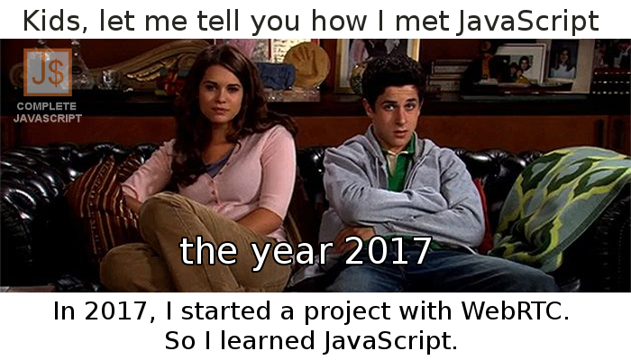

## How I met JavaScript

The story is about _How I met JavaScript (How I met your mother parody)._

In the beginning, JavaScript seems to be cluttered.

But when I learned it carefully and deeply, it would become more easily.

With JavaScript, you can do some font-ends, back-ends, mobile apps, desktop apps,...([more details](/gioi-thieu-tong-quan-ve-ngon-ngu-lap-trinh-javascript))

Like Barney Stinson usually said:_ It's gonna be Java - wait for it - script. JavaScript._

Finally, I decided to stick with [JavaScript](/category/javascript-co-ban).

That's _how I met JavaScript_.

See you in the [next post,](/anh-che-vui-4-people-life-vs-programmer-life) thank you!

## Similar posts

- [Ảnh chế vui #1: Cách lập trình viên chạy hằng ngày](/anh-che-vui-1-cach-lap-trinh-vien-chay-hang-ngay)
- [Ảnh chế vui #2: Code anh không có bug, tất cả chỉ là tính năng](/anh-che-vui-2-code-anh-khong-co-bug-tat-ca-chi-la-tinh-nang)
- [Ảnh chế vui #4: People life vs Programmer life](/anh-che-vui-4-people-life-vs-programmer-life)
- [Ảnh chế vui #5: Specialist vs Generalist – who is the winner?](/anh-che-vui-5-specialist-vs-generalist-winner)
- [Ảnh chế vui #6: A type of programmer](/anh-che-vui-6-type-programmer)
- [Ảnh chế vui #7: IP man 4 phiên bản lập trình viên](/anh-che-vui-7-ip-man-4-phien-ban-lap-trinh-vien)

★ Follow [Lam Pham](/gioi-thieu/) to receive a notification when having the lastest post:

- Facebook Fanpage: [Complete JavaScript](https://www.facebook.com/completejavascript/)
- Facebook Group: [Hỏi đáp JavaScript VN](https://www.facebook.com/groups/HoiDapJavascriptVN)
- Portfoflio: [Lam Pham](http://about.phamvanlam.com/)
