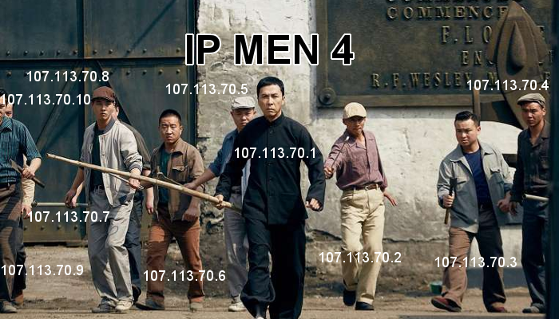

## IP man 4 phiên bản lập trình viên

[Châu Tử Đan](https://vi.wikipedia.org/wiki/Ch%C3%A2n_T%E1%BB%AD_%C4%90an) - Chung Tử Đơn (Donnie Yen): 107.113.70.1

Cùng các anh em: 107.113.70.2 - 107.113.70.9.

Xin chào và hẹn gặp lại bạn ở bài viết tiếp, thân ái!

## Bài viết cùng chuyên mục

- [Ảnh chế vui #1: Cách lập trình viên chạy hằng ngày](/anh-che-vui-1-cach-lap-trinh-vien-chay-hang-ngay)
- [Ảnh chế vui #2: Code anh không có bug, tất cả chỉ là tính năng](/anh-che-vui-2-code-anh-khong-co-bug-tat-ca-chi-la-tinh-nang)
- [Ảnh chế vui #3: How I met JavaScript – Parody](/anh-che-vui-3-how-i-met-javascript-parody)
- [Ảnh chế vui #4: People life vs Programmer life](/anh-che-vui-4-people-life-vs-programmer-life)
- [Ảnh chế vui #5: Specialist vs Generalist – who is the winner?](/anh-che-vui-5-specialist-vs-generalist-winner)
- [Ảnh chế vui #6: A type of programmer](/anh-che-vui-6-type-programmer)

★ Nếu bạn thấy bài viết này hay thì hãy theo dõi mình trên Facebook để nhận được thông báo khi có bài viết mới nhất nhé:

- Facebook Fanpage: [Complete JavaScript](https://www.facebook.com/completejavascript)
- Facebook Group: [Hỏi đáp JavaScript VN](https://www.facebook.com/groups/HoiDapJavascriptVN)
- Portfoflio: [Lam Pham](http://about.phamvanlam.com/)
