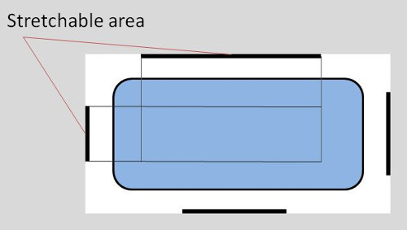
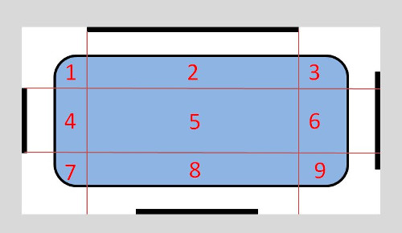
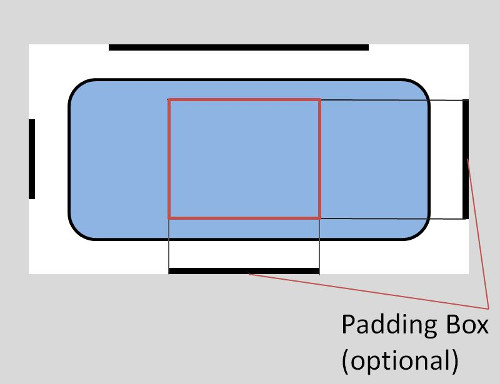
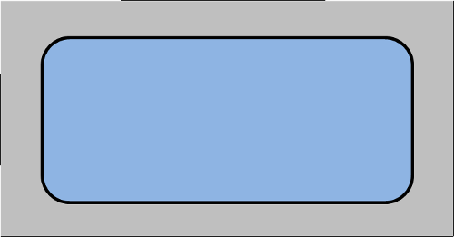

Có thể bạn đã từng nghe đến ảnh Vector rồi. Ảnh Vector có một ưu điểm lớn nhất là có thể kéo to, nhỏ tùy ý mà không bị vỡ ảnh. Bên cạnh đó, có một loại ảnh khác cũng có ưu điểm tương tự, chính là ảnh nine-patch (hay 9patch). Vậy ảnh nine-patch là gì? Cách sử dụng ảnh nine-patch trong [JavaScript](/category/javascript-co-ban) như thế nào? Bài viết này sẽ giúp bạn tìm hiểu về xử lý ảnh nine-patch trong JavaScript.

## Ảnh nine-patch là gì?

Ảnh nine-patch (hay 9-patch, tạm dịch là 9 miếng vá) là ảnh có thể thay đổi kích thước mà không bị vỡ ảnh. Android sẽ tự động thay đổi kích thước của ảnh để tương thích với View. Theo như định nghĩa trên, ảnh nine-patch được tạo ra bởi Android (không rõ).

Ảnh nine-patch thực chất là một ảnh PNG có cấu tạo đặc biệt hơn với border 1-pixel để xác định phần co dãn (stretchable), phần cố định (static) và phần chứa nội dung (drawable).

Ngoài ra, ảnh nine-patch có tên dạng: **\*.9.png**

## Cấu tạo ảnh nine-patch

### Phần co dãn, cố định

Theo định nghĩa ở trên, ảnh nine-patch sẽ sử dụng border có độ rộng 1 pixel để xác định phần co dãn và phần cố định của ảnh.

Trong đó, phần co dãn được xác định bởi 2 đường kẻ màu đen ở phía trên (**top**) và phía bên trái (**left**), những pixel còn lại ở top và left phải để transparent hoặc màu trắng hoàn toàn.



Hai đường kẻ này chia bức ảnh thành 9 phần như sau:



Trong 9 phần đó:

- Số 1, 3, 7 và 9 là các phần cố định
- Số 2 và 8 là các phần được kéo dãn theo chiều ngang (horizontal)
- Số 4 và 6 là các phần được kéo dãn theo chiều dọc (vertical)
- Số 5 là phần được kéo dãn theo 2 chiều (cả ngang và dọc)

### Phần chứa nội dung

Ngoài việc định nghĩa phần co dãn và phần cố định của ảnh, ta có thể định nghĩa phần chứa nội dung, tương đương với việc định nghĩa padding.

Phần này được xác định bởi 2 đường kẻ màu đen ở phía bên phải (**right**) và phía dưới (**bottom**).



Nghĩa là chỉ có hình chữ nhật màu hồng được phép chứa nội dung. Nếu nội dung lớn hơn vùng này thì ảnh nine-patch sẽ được kéo dãn ra để chứa đủ nội dung đó.

## Tạo ảnh nine-patch

Bạn có thể dùng hầu hết các công cụ chỉnh sửa ảnh để tạo ảnh nine-patch: Photoshop, GIMP, ...

Ngoài ra, bạn cũng có thể dùng các công cụ chuyên biệt như [WYSIWYG](https://developer.android.com/studio/write/draw9patch.html) của Android Studio hoặc [Simple nine-patch generator](https://romannurik.github.io/AndroidAssetStudio/nine-patches.html).

## Áp dụng ảnh nine-patch cho web

Để đơn giản, ta sẽ không quan tâm đến padding (padding = 0), nghĩa là phần đường kẻ màu đen phía dưới và bên phải kéo dài đến hết bức ảnh (trừ đi 1 pixel là border).



Để scale ảnh nine-patch, mình sẽ xử dụng Canvas với ý tưởng chung như sau:

- Sử dụng canvas để xác định đường kẻ màu đen phía trên và bên trái,
- Từ đó, suy ra phần cố định và phần được co dãn,
- Vẽ lại ảnh lên 1 canvas khác,
- Chuyển canvas thành dạng **dataURL** để sử dụng.

Sau một thời gian nghiên cứu, mình đã viết lại thành một thư viện đơn giản là [NinePatch.js](https://github.com/completejavascript/nine-patch-js). Tuy nhiên, thư viện này vẫn chưa hoàn thiện và chỉ có thể xử lý được những ảnh nine-patch có cấu tạo đơn giản.

Các API mà bạn có thể áp dụng:

### Hàm getSize

Hàm này trả về một Promise. Trong trường hợp thành công thì kết quả là một [object](/javascript-object-last-but-not-least) với 3 thông số là url, width, height của bức ảnh gốc, như sau:

```js
{url: dataUrl, width: image.width, height: image.height}
```

### Hàm scaleImage

Cũng tương tự như hàm **getSize** nhưng hàm này sẽ trả về object là thông tin của ảnh mới sau khi scale.

Để hiểu hơn về cách sử dụng NinePatch.js, mời bạn xem ví dụ sau đây:

### Ví dụ sử dụng NinePatch.js

https://codepen.io/completejavascript/pen/opOvaP

Trước tiên, mình sẽ hiển thị ảnh gốc, bằng cách áp dụng hàm getSize:

```js
new NinePatch()
  .getSize(srcImg)
  .then((result) =>
    setImage($("#ninePatchImg"), result.url, result.width, result.height)
  )
  .catch((error) => console.log(error));
```

Hàm setImage() áp dụng [DOM](/co-ban-ve-dom-javascript) để set lại giá trị width, height, url cho thẻ div hiển thị bức ảnh.

```js
function setImage(divElement, srcURL, width, height) {
  divElement.style.width = width + "px";
  divElement.style.height = height + "px";
  divElement.style.backgroundSize = "" + width + "px " + height + "px";
  divElement.style.backgroundImage = "url('" + srcURL + "')";
}
```

Tiếp theo, sử dụng hàm scaleImage để scale bức ảnh:

```js
new NinePatch()
  .scaleImage(srcImg, WIDTH, HEIGHT)
  .then((result) => setImage($("#normalImg"), result, WIDTH, HEIGHT))
  .catch((error) => console.log(error));
```

Trên đây là những kiến thức cơ bản về ảnh nine-path, cũng như cách xử lý ảnh nine-patch trong JavaScript. Tuy nhiên, còn rất nhiều thứ cần phải cải tiến. Vì vậy, mình rất mong nhận được sự góp ý từ bạn.

Xin chào và hẹn gặp lại bạn ở [bài viết tiếp theo](/javascript-indexeddb-tai-sao-khong), thân ái!

## Tham khảo

- [NinePatch drawables](https://developer.android.com/guide/topics/graphics/2d-graphics.html#nine-patch)
- [Create Resizable Bitmaps (9-Patch files)](https://developer.android.com/studio/write/draw9patch.html)
- [What are 9-patch images ?](https://viblo.asia/p/what-are-9-patch-images-MLzkObPoepq)
- [Android Bài 21: Sử Dụng Drawable – Ảnh 9-Patch & Ảnh Vector](https://yellowcodebooks.com/2017/06/21/android-bai-21-su-dung-drawable-anh-9-patch-anh-vector)
- [JavaScript Tint Color – thay đổi màu sắc bức ảnh](/javascript-tint-color-thay-doi-mau-sac-buc-anh)

<hr class="border-color-light-grey" />

★ Nếu bạn thấy bài viết này hay thì hãy theo dõi mình trên Facebook để nhận được thông báo khi có bài viết mới nhất nhé:

- Facebook Fanpage: [Complete JavaScript](https://www.facebook.com/completejavascript/)
- Facebook Group: [Hỏi đáp JavaScript VN](https://www.facebook.com/groups/HoiDapJavascriptVN)
- Portfoflio: [Lam Pham](http://about.phamvanlam.com/)
