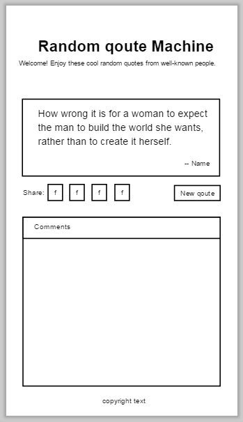
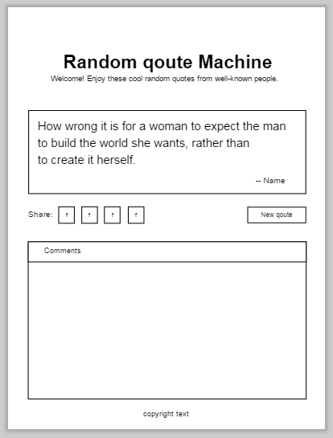
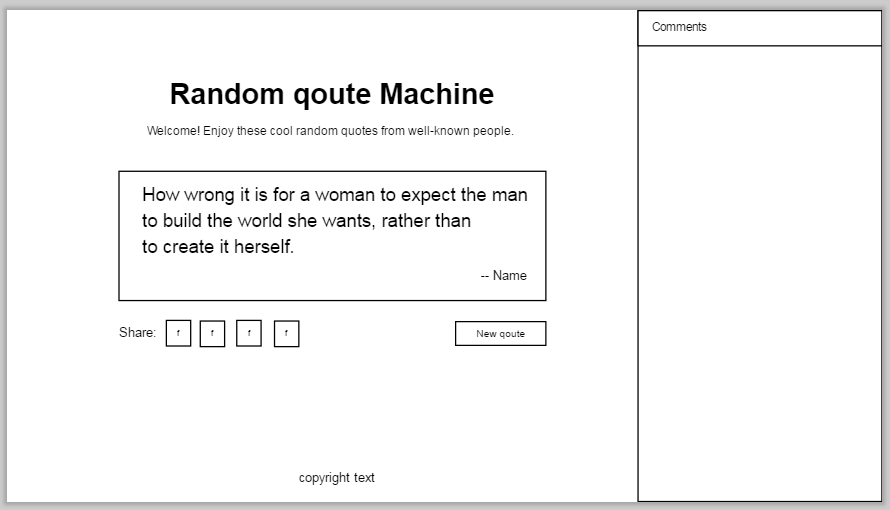

Tiếp tục series lập trình JavaScript với FCC, hôm nay mình sẽ giới thiệu một project thuộc chuyên mục Intermediate Front-End là **Random Quote Machine**. Nhưng khác các bài viết trước, lần này mình muốn chia sẻ quy trình từng bước thực hiện, bắt đầu từ phân tích yêu cầu bài toán, thiết kế UX/UI và xử lý logic trong JavaScript.

Dưới đây là demo trên Codepen. Ngoài ra, bạn cũng có thể xem bản demo đầy đủ hơn tại [đây](http://about.phamvanlam.com/fcc-random-quote-machine).

https://codepen.io/completejavascript/pen/xWZyRy

## Phân tích yêu cầu bài toán Random Quote Machine

Mình tóm tắt lại yêu cầu bài toán như sau:

- Có một button cho phép nhấn vào thì hiển thị một random quote mới.
- Có các button để chia sẻ quote lên mạng xã hội Twitter.

Ngoài ra, mình xác định sẽ đưa thêm một số tính năng khác như:

- Chia sẻ lên các mạng xã hội khác: Facebook, Google Plus, Linkedin,...
- Tích hợp phần bình luận Facebook.

Dựa vào yêu cầu như trên thì những phần tử cần phải có trên ứng dụng là:

- 1 vùng hiển thị quote + tên tác giả.
- 1 button để tải quote mới.
- 4 button để chia sẻ quote lên Twitter, Facebook, Google Plus, Linkedin.
- 1 vùng để hiển thị bình luận Facebook.

**Vấn đề tiếp theo là lấy quote ở đâu?**

Theo mình sẽ có 3 cách để bạn thực hiện:

- Sưu tầm quote trên internet, sau đó lưu lại dạng dữ liệu tĩnh trong code.
- Lưu quote trong database như (firebase, mongodb,...)
- Sử dụng REST API cung cấp bởi bên thứ 3.

Vậy là tạm thời phân tích xong các yêu cầu của bài toán Random Quote Machine. Tiếp theo đến phần thiết kế UX/UI.

## Thiết kế UX/UI cho Random Quote Machine

Vì không phải dân chuyên thiết kế UX/UI, nên chẳng may có bạn nào là chuyên gia trong mảng này mà đọc được thì xin chém nhẹ tay thôi nhé, tội nghiệp mình! ...

Trước tiên, bàn về công cụ thiết kế. Trong đầu mình hiện ra 3 công cụ: PowerPoint, [GIMP](https://phamvanlam.com/category/gimp-28-tutorial), Giấy và bút. Mình loại bỏ GIMP vì thấy nó hơi phức tạp. Sau đó, mình có thiết kế thử sử dụng PowerPoint (mình khá là rành về mảng này, và có một channel nho nhỏ là [đây](https://www.youtube.com/channel/UCGLAVGAzZlYAKYsxg9N0Zcw)) và vẽ tay.

Kết quả cũng được, tuy nhiên, mình muốn sử dụng một công cụ chuyên biệt hơn. Sau một hồi tìm kiếm thì mình phát hiện ra một phần mềm của Việt Nam luôn là [Pencil](http://pencil.evolus.vn/).

### Thiết kế UX/UI sử dụng Pencil

Hướng dẫn sử dụng bạn có thể xem trên mạng, rất nhiều. Mình sẽ chỉ chia sẻ lại kết quả sau khi sử dụng phần mềm này.

Giao diện Random Quote Machine trên Mobile:



Giao diện trên Tablet:



Giao diện trên PC:



Thực tế, những thứ trên chỉ nên gọi là UX. Tuy nhiên, mình tạm hài lòng và dừng bước này tại đây. Việc thiết kế màu sắc, font chữ,... sẽ làm luôn trên CSS.

### Triển khai UX/UI với HTML5 và CSS3

Có lẽ phần triển khai website sử dụng HTML5 và CSS3 mình sẽ không giải thích gì thêm. Ngoài ra, về phần lựa chọn màu sắc sao cho phù hợp thì bạn có thể tham khảo tại các link sau đây (rất hay luôn):

- [27 Beautiful Color Gradients For Your Next Design Project](https://digitalsynopsis.com/design/beautiful-color-gradient-hues-backgrounds/)
- [33 Beautiful Color Schemes For Your Next Design Project](https://digitalsynopsis.com/design/beautiful-color-schemes-marketing-design-psychology/)
- [34 Beautiful Color Palettes For Your Next Design Project](https://digitalsynopsis.com/design/beautiful-color-schemes-combinations-palettes/)
- [36 Beautiful Color Gradients For Your Next Design Project](https://digitalsynopsis.com/design/beautiful-color-ui-gradients-backgrounds/)
- [36 Beautiful Color Palettes For Your Next Design Project](https://digitalsynopsis.com/design/beautiful-color-palettes-combinations-schemes/)
- [30 Beautiful Color Gradients For Your Next Design Project](https://digitalsynopsis.com/design/beautiful-color-gradients-backgrounds/)

Cách tích hợp comment Facebook vào trang web, xem trên trang của Facebook tại [đây](https://developers.facebook.com/docs/plugins/comments) nhé. Phần hướng dẫn khá dễ hiểu, bạn chỉ cần đọc qua là biết làm ngay.

Nếu bạn có thắc mình gì cần hỏi, chẳng hạn như cách thiết kế website responsive,... thì có thể đặt câu hỏi ở phần bình luận nhé.

## Xử lý logic với JavaScript

Có 2 thứ quan trọng cần làm trong phần này là: lấy ra quote ngẫu nhiên và chia sẻ quote lên mạng xã hội.

- Về phần xử lý qoute: trong 3 cách đã nêu ở phần phân tích yêu cầu bài toán, mình thấy rằng cách 1 và 2 đều khá mất công vì đều phải đi sưu tầm quote. Riêng cách thứ 2 thì phải triển khai trên database, khá phức tạp. Vì vậy mình chọn cách thứ 3, đó là sử dụng [Forismatic API](https://forismatic.com/en/api/) (trang này có hướng dẫn rõ ràng).
- Về phần share lên mạng xã hội: sau thời gian tìm hiểu google, mình thấy rằng chỉ có Twitter cho phép chia sẻ text, còn những mạng xã hội kia cần phải chia sẻ link, nên không phù hợp. Thay vào đó, mình tìm ra một mạng xã hội khác cho phép chia sẻ text là: **Tumblr**. Tóm lại, mình sẽ chia sẻ lên Twitter và Tumblr.

### Lấy random quote trên Forismatic

Bạn có thể tự đọc hướng dẫn trên trang chủ để triển khai. Sau đây là cách mình thực hiện.

**Xây dựng URL để request**

```js
let requestURL =
  "https://api.forismatic.com/api/1.0/?method=getQuote&format=jsonp&lang=en&jsonp=?";
```

Request này kiểu GET, với các tham số là phần phía sau dấu hỏi (?). Và kết quả trả về sẽ là một [JSON](/tim-hieu-ve-json-trong-javascript), với ngôn ngữ là tiếng anh.

**Tiến hành request**

Để thực hiện request lên server, bạn có thể sử dụng [XMLHttpRequest](/xmlhttprequest-tao-http-request-den-server-trong-javascript). Tuy nhiên, trong project này mình sử dụng jQuery, nên sử dụng luôn phương thức [getJSON](http://api.jquery.com/jquery.getjson/) của nó.

```js
function requestRandomQoute() {
  $.getJSON(requestURL, function (data) {
    animateText("#quote-text", data.quoteText);
    animateText("#quote-name", "-- " + data.quoteAuthor);
    animateText("#quote-symbol");
    updateShares(data.quoteText, data.quoteAuthor);
  });
}
```

Sau khi thực hiện phương thức trên, kết quả thu được là data, gồm 2 trường thông tin quan trọng là **quoteText** và **quoteAuthor**. Sau đó, mình sử dụng nó để cập nhật lên giao diện.

Ngoài ra, ở đây mình có thêm animation cho phần thay đổi nội dung text.

```js
function animateText(element, content) {
  $(element).animate({ opacity: 0 }, 500, function () {
    $(this).animate({ opacity: 1 }, 500);
    if (content) $(this).text(content);
  });
}
```

Hàm này có nhiệm vụ làm mờ (opacity = 0) phần nội dung cũ trong 500 ms. Sau đó, hiện nội dung mới (opacity = 1) cũng trong thời gian 500 ms.

### Chia sẻ quote lên mạng xã hội Twitter và Tumblr

Tư tưởng của phần này là thay thế giá trị thuộc tính **href** của các thẻ **a** tương ứng với share Twitter hay Tumblr. Nội dung link đã được quy định sẵn bởi Twitter hoặc Tumblr, bạn chỉ cần áp dụng đúng là được.

```js
let currentQuote = qoute || $("#quote-text").text();
let currentAuthor = author || $("#quote-name").text();

let twitterShareURL =
  "https://twitter.com/intent/tweet?hashtags=quotes&related=freecodecamp&text=" +
  encodeURIComponent('"' + currentQuote + '" ' + currentAuthor);

$("#share-twitter").attr("href", twitterShareURL);

let tumblrShareURL =
  "https://www.tumblr.com/widgets/share/tool?posttype=quote&tags=quotes,freecodecamp&caption=" +
  encodeURIComponent(currentAuthor) +
  "&content=" +
  encodeURIComponent(currentQuote) +
  "&canonicalUrl=https%3A%2F%2Fwww.tumblr.com%2Fbuttons&shareSource=tumblr_share_button";

$("#share-tumblr").attr("href", tumblrShareURL);
```

## Kết luận

Trên đây là quy trình các bước mình thực hiện để hoàn thành project Random Quote Machine. Hy vọng quy trình này có thể giúp bạn áp dụng vào các project của mình. Ngoài ra, nếu bạn có góp ý gì vui lòng để lại phần bình luận nhé.

Xin chào và hẹn gặp lại bạn ở [bài viết tiếp theo](/lap-trinh-javascript-voi-fcc-local-weather), thân ái!

<hr class="border-color-light-grey" />

★ Nếu bạn thấy bài viết này hay thì hãy theo dõi mình trên Facebook để nhận được thông báo khi có bài viết mới nhất nhé:

- Facebook Fanpage: [Complete JavaScript](https://www.facebook.com/completejavascript/)
- Facebook Group: [Hỏi đáp JavaScript VN](https://www.facebook.com/groups/HoiDapJavascriptVN)
- Portfoflio: [Lam Pham](http://about.phamvanlam.com/)
