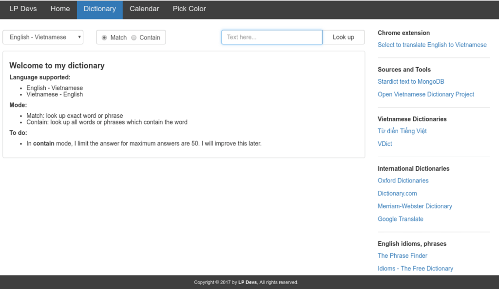
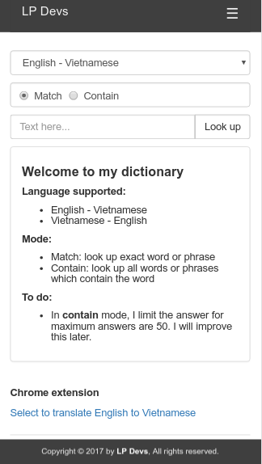
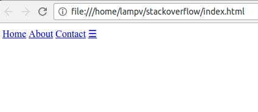
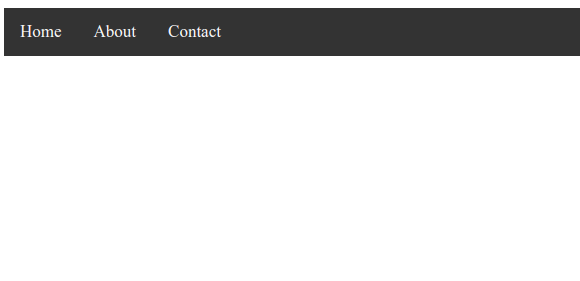
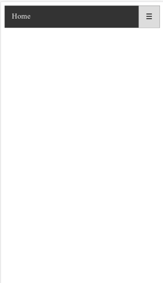
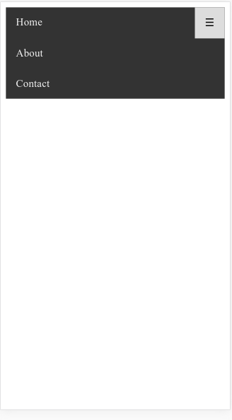

Trước đây, việc truy cập internet chủ yếu là từ máy vi tính (desktop). Do đó, website thường chỉ được thiết kế để tương thích với kích thước màn hình desktop. Tuy nhiên, hiện nay, mọi người có thể truy cập vào website từ rất nhiều các thiết bị khác nhau: máy tính, máy tính bảng (tablet), điện thoại (smart phone),...với nhiều kích thước màn hình khác nhau. Do đó, website cần phải được thiết kế sao cho tương thích với mọi thiết bị. Vì vậy, mình sẽ hướng dẫn các bạn thiết kế website responsive với CSS.

## Thiết kế website responsive là gì?

Thiết kế website responsive là làm cho website tương thích với tất cả các thiết bị (desktops, tablets, phones). Công việc này bao gồm thay đổi kích thước, ẩn-hiện, di chuyển phần tử,...

Ví dụ: Bạn có thể tham khảo tại [đây](https://lpdevs.herokuapp.com/).

Giao diện trang web trên desktop:



Giao diện trang web trên phone:



## Các phương pháp thiết kế website responsive

Để thiết kế website responsive, bạn có thể sử một số phương pháp sau đây:

- CSS Float, thiết kế theo cột
- Flex Container
- Sử dụng Framework responsive như: [Bootstrap](http://getbootstrap.com/), [W3.CSS](https://www.w3schools.com/w3css/),...

Mỗi cách sẽ có những ưu nhược điểm riêng.

Với hai cách đầu tiên:

- Ưu điểm là: bạn có thể tự ý tuỳ biến, mã nguồn nhẹ.
- Nhược điểm là: sẽ mất thời gian hơn và không phải ai cũng có thể thiết kế đẹp được.

Với cách sử dụng Framework:

- Ưu điểm là: thiết kế nhanh, đẹp
- Nhược điểm là: mã nguồn sẽ nặng hơn do bạn phải tải toàn bộ thư viện, nếu không tuỳ biến thì website của bạn trông rất giống với những website khác.

Trong bài hướng dẫn thiết kế website responsive này, mình sẽ sử dụng CSS Float để thiết kế. Những cách khác, hẹn gặp lại bạn ở những phần sau.

## Thiết kế website responsive với menu

Menu là một thành phần không thể thiếu cho website. Đối với kích thước màn hình desktop, menu thường để dàn trải theo chiều ngang. Nhưng với kích thước màn hình tablet hay phone, bạn sẽ không có đủ kích thước để hiển thị. Do đó, cách tốt nhất là hiển thị menu theo chiều dọc màn hình.

Sau đây sẽ là các bước thực hiện thiết kế website responsive với menu:

### Bước 1: Code HTML (index.html)

```html
<!DOCTYPE html>
<html>
  <head>
    <title>Responsive website</title>
    <meta name="viewport" content="width=device-width, initial-scale=1" />
    <link rel="stylesheet" href="responsive.css" />
    <script src="responsive.js"></script>
  </head>
  <body>
    <div class="topnav" id="myTopnav">
      <a href="#">Home</a>
      <a href="#">About</a>
      <a href="#">Contact</a>
      <a href="javascript:void(0);" class="icon" onclick="myFunction()">☰</a>
    </div>
  </body>
</html>
```

Phần **responsive.js** và **responsive.css** mình sẽ giới thiệu sau. Ở đây, Menu sẽ được đóng gói trong thẻ &lt;div&gt;. Mỗi mục của menu sẽ là một thẻ &lt;a&gt; (link). Ngoài ra, thẻ &lt;a&gt; với class="icon" dùng để đóng mở menu khi kích thước màn hình nhỏ.

> **Chú ý**: Thành phần quan trọng ở đây đó là thẻ &lt;meta&gt;. Ý nghĩa của thẻ này là dùng để xác định kích thước của viewport (vùng hiển thị) dựa theo chiều rộng của màn hình. Nếu không có thẻ này thì website sẽ không thể responsive theo chiều rộng của màn hình.

Hiện tại, mình chưa thiết kế file **responsive.js** và **responsive.css** nên bạn có thể comment 2 dòng đó lại để xem kết quả hiện tại:



### Bước 2: Thêm CSS (responsive.css)

```css
/* Add a black background color to the top navigation */
.topnav {
  background-color: #333;
  overflow: hidden;
}

/* Style the links inside the navigation bar */
.topnav a {
  float: left;
  display: block;
  color: #f2f2f2;
  text-align: center;
  padding: 14px 16px;
  text-decoration: none;
  font-size: 17px;
}

/* Change the color of links on hover */
.topnav a:hover {
  background-color: #ddd;
  color: black;
}

/* Hide the link that should open and close the topnav on small screens */
.topnav .icon {
  display: none;
}

/* 
* When the screen is less than 600 pixels wide, 
* hide all links, except for the first one ("Home"). 
* Show the link that contains should open and close the topnav (.icon) 
*/
@media screen and (max-width: 600px) {
  .topnav a:not(:first-child) {
    display: none;
  }
  .topnav a.icon {
    float: right;
    display: block;
  }
}

/* 
* The "responsive" class is added to the topnav with JavaScript 
* when the user clicks on the icon. This class makes the topnav 
* look good on small screens (display the links vertically instead of horizontally) 
*/
@media screen and (max-width: 600px) {
  .topnav.responsive {
    position: relative;
  }
  .topnav.responsive a.icon {
    position: absolute;
    right: 0;
    top: 0;
  }
  .topnav.responsive a {
    float: none;
    display: block;
    text-align: left;
  }
}
```

Giải thích chi tiết từng đoạn code:

#### Cấu hình thanh menu

```css
.topnav {
  background-color: #333;
  overflow: hidden;
}
```

- **topnav**: chính là class  ứng với thẻ &lt;div&gt; - chính là thanh menu
- **background-color: #333**: cài đặt màu nền cho thanh menu. Bạn có thể thay đổi tuỳ thích.
- **overflow: hidden**: Thực tế, thuộc tính **overflow** sẽ có các giá trị là: visible, hidden, scroll, auto, inherit (bạn có thể tham khảo về overflow tại [đây](http://hocwebchuan.com/reference/cssSection/pr_overflow.php)). Còn ở đây, khi mình đặt giá trị của overflow là hidden thì chiều cao của thanh menu sẽ được xác định bằng với phần tử trong nó - là các link. (Mình không đặt giá trị cho thuộc tính height).

#### Cấu hình các mục (link) trên thanh menu

```css
.topnav a {
  float: left;
  display: block;
  color: #f2f2f2;
  text-align: center;
  padding: 14px 16px;
  text-decoration: none;
  font-size: 17px;
}
```

- **float: left**: để dồn các mục về phía tay trái. Bạn cũng có thể dùng **float: right** để dồn menu về phía tay phải.
- **display: block**: cấu hình các mục của menu là một block chứ không phải chỉ mỗi dòng chữ (link).
- **color**, **text-align**, **padding**, **text-decoration**, **font-size**: những phần này đơn giản là để trang trí cho menu.

#### Tạo hiệu ứng khi di chuyển chuột đến các mục của menu

```css
.topnav a:hover {
  background-color: #ddd;
  color: black;
}
```

- **a:hover**: dùng để cấu hình cho thẻ &lt;a&gt; khi chuột **hover**.
- Mình thay đổi **background-color** (màu nền) và **color** (màu chữ).

#### Ẩn icon (đóng mở menu) khi ở màn hình rộng

```css
.topnav .icon {
  display: none;
}
```

Trong đó, **display: none**: để ẩn **class="icon"**.

#### Ẩn các mục của menu khi màn hình nhỏ

```css
@media screen and (max-width: 600px) {
  .topnav a:not(:first-child) {
    display: none;
  }
  .topnav a.icon {
    float: right;
    display: block;
  }
}
```

- Ở bài này, mình thiết kế theo kiểu desktop trước.
- Mình dùng **@media screen and (max-width: 600px)** để cấu hình menu khi độ rộng màn hình tối đa là 600px - nghĩa là màn hình điện thoại
- **.topnav a:not(:first-child) {display: none;}**: tất cả các thẻ &lt;a&gt; đều ẩn đi, trừ thẻ đầu tiên (home)
- **float: right**: dùng để đưa link với class="icon" sang bên phải màn hình.
- **display: block**: hiển thị link dạng block

#### Hiển thị menu khi người dùng nhấn vào icon phía bên phải

```css
@media screen and (max-width: 600px) {
  .topnav.responsive {
    position: relative;
  }
  .topnav.responsive a.icon {
    position: absolute;
    right: 0;
    top: 0;
  }
  .topnav.responsive a {
    float: none;
    display: block;
    text-align: left;
  }
}
```

Mình vẫn dùng **@media screen and (max-width: 600px)** để cấu hình menu khi độ rộng màn hình tối đa là 600px. Vì trường hợp nhấn vào icon bên phải chỉ xảy ra với trường hợp màn hình nhỏ.

Ở đây, xuất hiện một lớp mà trong html không có. Đó là "responsive". Thực tế là khi nhấn vào icon, mình sẽ sử dụng Javascript để add thêm class cho "topnav" (mình sẽ trình bày sau đây). Nghĩa là phần này chỉ có ý nghĩa khi người dùng nhấn vào icon bên phải màn hình.

Lúc này, menu để **position:relative** để các phần tử bên trong nó có thể sử dụng **position:absolute**.

Đối với icon, mình sẽ cho nó ở phía trên bên phải của thanh menu (**position: absolute; top: 0; right: 0;**)

Đối với các mục menu (link), mình cho **float:none** lúc này các mục menu sẽ không dồn sang trái nữa, kết hợp với **display: block** thì chúng sẽ chiếm trọn chiều ngang màn hình.

Chữ trên các mục menu để phía bên trái: **text-align: left**

#### Kết quả

Giao diện trên máy tính:



Giao diện trên điện thoại:



Lúc này, nếu bạn nhấn vào icon phía bên phải thanh menu thì vẫn chưa có hiện tượng gì xảy ra. Tiếp theo mình sẽ thêm phần xử lý javascript.

### Bước 3: Xử lý Javascript (responsive.js)

```js
function myFunction() {
  var x = document.getElementById("myTopnav");
  if (x.className === "topnav") {
    x.className += " responsive";
  } else {
    x.className = "topnav";
  }
}
```

Trong phần HTML mình đã xét:

```html
<a href="javascript:void(0);" class="icon" onclick="myFunction()">☰</a>
```

Nghĩa là class="icon" sẽ thực hiện hành động trong hàm **myFunction()** khi nó được click.

Trước tiên, lấy phần tử với id là "myTopnav" dùng **document.getElementById("myTopnav")**

Lúc đầu, phần tử này chỉ thuộc lớp "topnav". Ta sẽ gán thêm giá trị lớp cho nó là "responsive": **x.className += " responsive"**. Lúc này, các mục menu sẽ được hiển thị (theo phần css ở trên)

Khi menu đã được mở ra, nghĩa là nó sẽ thuộc 2 lớp là "topnav" và "responsive". Nếu ta nhấn vào icon phía bên phải một lần nữa thì lúc này giá trị của thuộc tính lớp sẽ chỉ là "topnav": **x.className = "topnav"**. Và menu sẽ lại bị ẩn đi.

Kết quả khi nhấn vào icon:



## Lời kết

Trên đây là hướng dẫn thiết kế website responsive. Hy vọng bài viết này có thể giúp ích cho bạn.

Ngoài ra, bạn có thể thực hành thêm với các [mẫu website có sẵn](/figma-templates-cho-web-va-di-dong) để thành thạo hơn trong việc chuyển hóa một bản thiết kế thành code hoàn chỉnh.

Xin chào và hẹn gặp lại bạn trong [bài viết tiếp theo](/ma-mau-logo-cac-thuong-hieu-noi-tieng), thân ái!

<hr class="border-color-light-grey" />

★ Nếu bạn thấy bài viết này hay thì hãy theo dõi mình trên Facebook để nhận được thông báo khi có bài viết mới nhất nhé:

- Facebook Fanpage: [Complete JavaScript](https://www.facebook.com/completejavascript/)
- Facebook Group: [Hỏi đáp JavaScript VN](https://www.facebook.com/groups/HoiDapJavascriptVN)
- Portfoflio: [Lam Pham](http://about.phamvanlam.com/)
