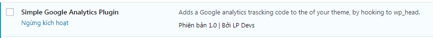

Đối với mỗi trang web, việc tìm hiểu và phân tích hành vi người dùng là vô cùng quan trọng. Trong đó, Google Analytics là một công cụ miễn phí nhưng khá tốt để giúp bạn làm được việc này. Bài viết hôm nay, mình sẽ chia sẻ với các bạn cách tạo Google Analytics Plugin cho Wordpress.

## Chuẩn bị

Trước tiên, bạn cần vào trang [https://analytics.google.com](https://analytics.google.com) để đăng ký tài khoản. Bạn có thể sử dụng bất kỳ tài khoản google nào cũng được.

Bạn cứ làm theo hướng dẫn, khá đơn giản, nên mình sẽ không giải thích nhiều phần này.

**Chú ý**: với mỗi tài khoản google, bạn có thể tạo ra nhiều **property**, hiểu đơn giản là có thể quản lý nhiều trang web khác nhau.

Kết quả của bạn cần thu được là **Google-Analytics-ID**, ví dụ: UA-96584615-1. Nó đại diện cho mỗi trang web mà bạn cần quản lý.

## Code tạo Google Analytics Plugin cho Wordpress

**Bước 1**: Tạo một file mới có tên dạng \*.php.

**Bước 2**: Copy đoạn code của mình sau đây vào file vừa rồi

```php
<?php
// Plugin Name: Simple Google Analytics Plugin for Wordpress
// Description: Adds a Google analytics tracking code to the <head> of your theme, by hooking to wp_head.
// Author: LP Devs
// Version: 1.0
function wp_lpdevs_google_analytics() {
  ?>
<script>
  (function(i,s,o,g,r,a,m){i['GoogleAnalyticsObject']=r;i[r]=i[r]||function(){
  (i[r].q=i[r].q||[]).push(arguments)},i[r].l=1*new Date();a=s.createElement(o),
  m=s.getElementsByTagName(o)[0];a.async=1;a.src=g;m.parentNode.insertBefore(a,m)
  })(window,document,'script','https://www.google-analytics.com/analytics.js','ga');
  ga('create', 'Google-Analytics-ID', 'auto');
  ga('send', 'pageview');
</script>
  <?php
}
add_action( 'wp_head', 'wp_lpdevs_google_analytics');
```

**Bước 3: Tùy biến file plugin**

- Plugin Name: tên của plugin mà bạn muốn đặt
- Description: một đoạn mô tả ngắn cho plugin
- Author: tên tác giả
- Version: phiên bản plugin
- Thay đổi **Google-Analytics-ID** bằng ID của bạn đã tạo ở phần trước.

**Bước 4: Sử dụng plugin**

- Copy file trên vào thư mục **/wp-content/plugins.**
- Login vào trình quản lý Wordpress, rồi chọn mục Plugin. Nếu như các bước trên thực hiện đúng thì đến đây bạn sẽ nhìn thấy plugin của bạn. Giờ chỉ cần kích hoạt nó lên là xong rồi.



Đây là kết quả khi sử dụng Google Analytics Plugin trên với trang web của mình:

## Kết luận

Trên đây là các bước mình tạo Google Analytics Plugin cho Wordpress. Nếu có góp ý hoặc thắc mắc gì, vui lòng để lại cho mình trong phần bình luận.

Xin chào và hẹn gặp lại trong [bài viết tiếp theo](/phan-biet-arrow-function-va-function-trong-javascript), thân ái!

## Tham khảo

- [LẬP TRÌNH PLUGIN WORDPRESS](https://thachpham.com/series/lap-trinh-plugin-wordpress)

<hr class="border-color-light-grey" />

★ Nếu bạn thấy bài viết này hay thì hãy theo dõi mình trên Facebook để nhận được thông báo khi có bài viết mới nhất nhé:

- Facebook Fanpage: [Complete JavaScript](https://www.facebook.com/completejavascript/)
- Facebook Group: [Hỏi đáp JavaScript VN](https://www.facebook.com/groups/HoiDapJavascriptVN)
- Portfoflio: [Lam Pham](http://about.phamvanlam.com/)
