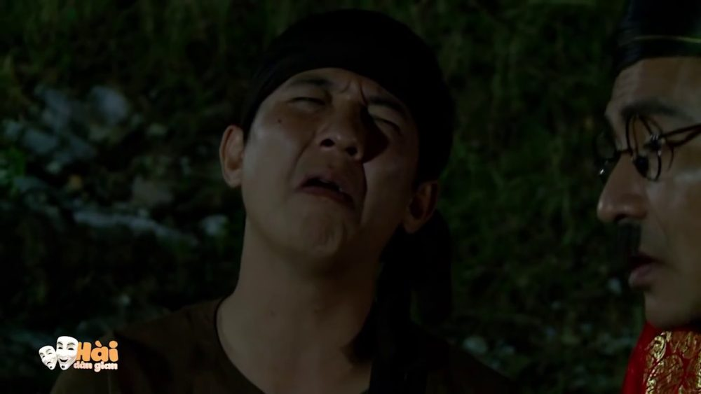

Xin chào bạn, gần đây mình có thử làm chơi một video tên là [K Tigers - Taekwondo Save Me](https://www.youtube.com/watch?v=tp6t8eKo7e4). Và có một bạn đã hỏi mình làm sao để kiếm được ảnh chị tóc vàng xinh thế (ảnh thumbnail video). Thực ra, mình đã sử dụng ảnh thumbnail của video gốc. Nói đến đây có thể nhiều bạn đã hiểu ra vấn đề rồi. Đó là mình đã lấy ảnh thumbnail của video trên youtube.

## Vấn đề là làm sao mình có thể lấy ảnh thumbnail của video trên Youtube?

Hôm nay mình sẽ chia sẻ với bạn một số cách để lấy được ảnh thumbnail đó. Đầu tiên, bạn phải có được ID của video trên youtube. Thật đơn giản, khi bạn nhấn vào một video thì video đó sẽ có link, ví dụ như sau:

```
https://www.youtube.com/watch?v=id_video
```

Phần **id_video** bên trên chính là ID của video trên youtube. Bạn copy lại ID đó và tiếp tục với bước tiếp theo mà mình sẽ trình bày ngay sau đây.

### Cách 1

Với cách này bạn sẽ thu được ảnh thumbnail với độ phân giải lớn nhất. Bạn chỉ cần copy link sau lên trình duyệt:

```
https://i.ytimg.com/vi/id_video/maxresdefault.jpg
```

Trong đó: id_video là id của video mà bạn đã có được ở phía trên. Ví dụ với link sau:

```
https://i.ytimg.com/vi/dSs3ya1ppp4/maxresdefault.jpg
```

Bạn sẽ thu được ảnh sau:



### Cách 2

Với cách này bạn sẽ thu được ảnh thumbnail của video trên youtube với các độ phân giải khác nhau.

**Ảnh thumbnail kích thước 480x360**

- img.youtube.com/vi/id_video/0.jpg

**Một số ảnh thumbnail khác kích thước 120x90**

- img.youtube.com/vi/id_video/1.jpg
- img.youtube.com/vi/id_video/2.jpg
- img.youtube.com/vi/id_video/3.jpg

## Lời kết

Trên đây là 2 cách để lấy ảnh thumbnail của video trên youtube. Hy vọng nó giúp ích được cho bạn. Nếu bạn thấy hay thì không ngại để chia sẻ cho mọi người cùng biết nhé. Còn nếu bạn có thắc mắc gì thì vui lòng để lại bình luận phía dưới hoặc gửi mail cho mình. Mình sẽ cố gắng giải đáp giúp bạn.

**Lưu ý**: cách này chỉ lấy được ảnh thumbnail của video. Nếu bạn muốn lấy ảnh từ video youtube (bất kỳ tại mọi thời điểm) thì có thể tải video đó về rồi sử dụng [code FFmpeg để chuyển video thành ảnh](/huong-dan-tim-hieu-ffmpeg-co-ban/#Code_ffmpeg_chuyen_doi_video_thanh_anh).

Xin chào và hẹn gặp lại bạn ở [bài viết tiếp theo](/cac-cau-lenh-thuong-dung-tren-cmd-windows), thân ái!

<hr class="border-color-light-grey" />

★ Nếu bạn thấy bài viết này hay thì hãy theo dõi mình trên Facebook để nhận được thông báo khi có bài viết mới nhất nhé:

- Facebook Fanpage: [Complete JavaScript](https://www.facebook.com/completejavascript/)
- Facebook Group: [Hỏi đáp JavaScript VN](https://www.facebook.com/groups/HoiDapJavascriptVN)
- Portfoflio: [Lam Pham](http://about.phamvanlam.com/)
