Xin chào bạn! Như vậy là đã qua hơn 2 tháng mình học và thực hành React với các project như: [Markdown Editor](http://about.phamvanlam.com/markdown-editor/), [Drum Machine](http://about.phamvanlam.com/drum-machine/), [Standard Calculator](http://about.phamvanlam.com/calculator/), [Pomodoro Clock](http://about.phamvanlam.com/pomodoro-clock/),... Với những thứ mình đã học và thực hành thì có lẽ là chưa đủ, nhưng hiện tại mình cảm thấy khá thoải mái, tự tin khi viết code React. Do đó, mình muốn bắt tay vào học những những công cụ, thư viện hay framework sử dụng React để có thể làm thêm được nhiều thứ hay ho hơn nữa. Và cái mình chọn đầu tiên đó là [Gatsby.js](https://www.gatsbyjs.org/). Nhờ vậy, mình đã chuyển 2 blog khác của mình từ [Wordpress.org](https://wordpress.org/) sang sử dụng Gatsby.js, đó là: <del>[Lam Pham Blog](https://phamvanlam.com/)</del> và [Ôn luyện thuật toán](https://thuattoan.phamvanlam.com/). Bài viết này, mình sẽ tổng hợp lại những kiến thức tích luỹ được, qua đó giúp bạn biết cách tạo trang blog với Gatsby.js và thậm chí là nhiều static website khác nữa.

Mời bạn theo dõi bài viết!

## Những kiến thức cần thiết trước khi tạo trang blog với Gatsby.js

Trước khi bắt đầu tạo trang blog với Gatsby.js, có một số kiến thức cơ bản mà bạn cần phải nắm vững như:

- [HTML](https://www.tutorialspoint.com/html/) và [CSS](https://www.tutorialspoint.com/css/).
- [JavaScript cơ bản](/category/javascript-co-ban).
- Một số đặc điểm cơ bản của [ES6](/tag/es6).
- Những tư tưởng chính của [React](https://www.taniarascia.com/getting-started-with-react/).
- Cú pháp [Markdown](https://guides.github.com/features/mastering-markdown/) cơ bản
- [Node.js và npm](https://www.taniarascia.com/how-to-install-and-use-node-js-and-npm-mac-and-windows/).

_Đây là những kiến thức cơ bản và nền tảng. Nếu như bạn đã thành thạo chúng thì khi học một thư viện hay framework mới sẽ rất dễ dàng._

## Mục đích của bài viết

Bài viết này giúp bạn:

- Xây dựng được trang blog với Gatsby.js dạng static website bao gồm: trang chủ (liệt kê danh sách bài viết), trang giới thiệu, trang liên hệ, phân loại bài viết theo chuyên mục, thẻ và hiển thị nội dung mỗi bài viết...
- Deploy blog lên Netlify.

<a href="https://github.com/completejavascript/gatsby-tutorial" class="btn btn-primary margin-bottom">
  Xem code trên Github
</a>

<a href="https://gatsby-tutorial-demo.netlify.com/" class="btn btn-primary margin-bottom">
  Xem Demo
</a>

## Cách theo dõi bài viết tốt nhất

Đây là một bài viết khá dài. Vì vậy, cách tốt nhất để theo dõi là bạn nên vừa đọc và vừa làm theo những gì mình chia sẻ. Nếu chỉ đọc xuông thì bạn sẽ rất khó để hiểu và nhớ được mọi thứ.

## Gatsby.js là gì?

- Gatsby.js là một framework khá nổi tiếng với hơn [25.000 stars trên Github](https://github.com/gatsbyjs/gatsby).
- Gatsby.js là một [site generator](https://www.staticgen.com/) tương tự như [Jekyll](https://jekyllrb.com/), [Next.js](https://nextjs.org/), [Hugo](https://gohugo.io/),...
- Gatsby.js sử dụng [ngôn ngữ JavaScript](/gioi-thieu-tong-quan-ve-ngon-ngu-lap-trinh-javascript) với template là [React](/lam-tuong-tai-hai-ve-react).
- Gatsby.js có thể được sử dụng để xây dựng trang blog, [portfolio](https://about.phamvanlam.com/), trang thương mại điện tử, Static PWA (Progressive Web Apps),...
- Gatsby.js hỗ trợ nhiều plugins giúp bạn xây dựng và deploy trang web một cách nhanh chóng mà không cần phải triển khai database, cài đặt server.
- Gatsby.js có thể load dữ liệu từ nhiều nơi như: các file dạng Markdown, các CMS ([Contentful](https://www.contentful.com/), Wordpress), REST hay GraphQL API,...

## Cài đặt môi trường trước khi tạo trang blog với Gatsby.js

Mục đích của Gatsby.js là build ra trang web dưới dạng các file tĩnh. Vì vậy, điều quan trọng cần làm trước tiên là phải cài đặt môi trường làm việc với những công cụ cần thiết.

### Cài đặt Node.js

Node.js là thứ không thể thiếu vì Gatsby được xây dựng dựa trên Node.js. Để cài đặt Node.js trên Windows, bạn có thể tham khảo bài viết [Hướng dẫn tìm hiểu Node.js cơ bản](/huong-dan-tim-hieu-node-js-co-ban).

### Cài đặt Git

Git cũng là một thành phần không thể thiếu. Mình cần cài đặt Git để tạo mới Gatsby project và giúp quản lý code dễ dàng hơn trên Local cũng như trên Github. Để cài đặt Git trên Windows, bạn có thể tham khảo bài viết [Hướng dẫn cài đặt và cấu hình Git trên Windows](https://o7planning.org/vi/11707/huong-dan-cai-dat-va-cau-hinh-git-tren-windows).

### Cài đặt Gatsby CLI

Gatsby CLI là công cụ cần thiết để tạo mới một trang blog với Gatsby.js, cũng như là chạy các câu lệnh phục vụ cho việc phát triển, [deploy](/deploy-ung-dung-react-len-github-pages) trang web. Để cài đặt Gatsby CLI bạn có thể sử dụng npm bằng [câu lệnh](/tag/command-line):

```bash
npm install --global gatsby-cli
```

_Câu lệnh trên cài đặt Gatsby CLI ở phạm vi global. Nghĩa là bạn có thể sử dụng Gatsby ở bất kỳ vị trí nào trên máy tính của bạn._

Sau khi cài đặt Gatsby CLI, bạn có thể kiểm tra xem việc cài đặt có thành công hay chưa bằng 2 câu lệnh:

```bash
gatsby --version
gatsby --help
```

#### Kiểm tra Gatsby CLI sau khi cài đặt

Nếu việc cài đặt thành công thì câu lệnh <code>gatsby --version</code> sẽ in ra phiên bản của Gatsby CLI và câu lệnh <code>gatsby --help</code> sẽ in ra những câu lệnh mà Gatsby CLI hỗ trợ bạn như:

- <code>gatsby develop</code>: dùng để tạo server cho quá trình dev, có hỗ trợ **rebuild** và hot-reload trình duyệt khi nội dung các file liên quan thay đổi.
- <code>gatsby build</code>: build Gatsby project ra trang web dạng các file tĩnh.
- <code>gatsby serve</code>: giả lập môi trường server cho trang web vừa mới build ra.
- <code>gatsby info</code>: lấy thông tin của môi trường.
- <code>gatsby new [rootPath] [starter]</code>: tạo mới Gatsby project tại vị trí _rootPath_ bằng cách clone một project mẫu _starter_.

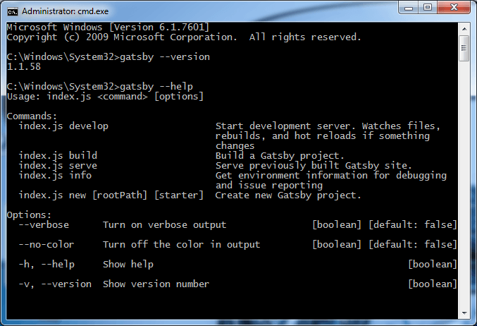

### Tạo trang blog với Gatsby.js cơ bản

Như mình đã nói ở phần trên, Gatsby hỗ trợ bạn tạo mới Gatsby project từ một _starter_ thông qua câu lệnh:

```bash
gatsby new [rootPath] [starter]
```

Trong đó, _starter_ là các project mẫu mà bạn có thể tham khảo tại [Gatsby Starters](https://www.gatsbyjs.org/starters). Với khoảng trên 60 starters khác nhau bao gồm các loại như: blog cơ bản đến nâng cao, portfolio, hỗ trợ Contentful, [Wordpress](/tag/wordpress), Firebase,... Nhờ vậy, bạn có thể dễ dàng lựa chọn một mẫu starter phù hợp, sau đó nhanh chóng tuỳ chỉnh nó theo sở thích và yêu cầu của mình, tương tự như _theme_ của Wordpress hay _template_ của Blogger.

#### Tạo Gatsby project từ Hello-world starter

Việc sử dụng các starter nâng cao chỉ phù hợp khi mình đã thành thạo và hiểu rõ Gatsby.js rồi. Còn đối với người mời bắt đầu như mình, cần hiểu rõ về quy trình xây dựng Gatsby project, thì mình sẽ lựa chọn starter _Hello World_ như sau:

```bash
gatsby new gatsby-tutorial https://github.com/gatsbyjs/gatsby-starter-hello-world
```

Câu lệnh này sẽ tạo mới một thư mục tên là _gatsby-tutorial_. Sau đó, Gatsby CLI clone project từ Github tại địa chỉ: [https://github.com/gatsbyjs/gatsby-starter-hello-world](https://github.com/gatsbyjs/gatsby-starter-hello-world) và đưa vào thư mục vừa tạo ra.

Sau khi lệnh trên hoàn thành, bạn đi vào thư mục mới tạo ra _gatsby-tutorial_:

```bash
cd gatsby-tutorial
```

rồi chạy lệnh sau để tạo server cho quá trình develop:

```bash
gatsby develop
```

Đợi lệnh trên hoàn tất, bạn mở trình duyệt và đi đến địa chỉ: **_http:\/\/localhost:8000/_** thì sẽ thấy trang blog với Gatsby.js đã được tạo ra thành công.

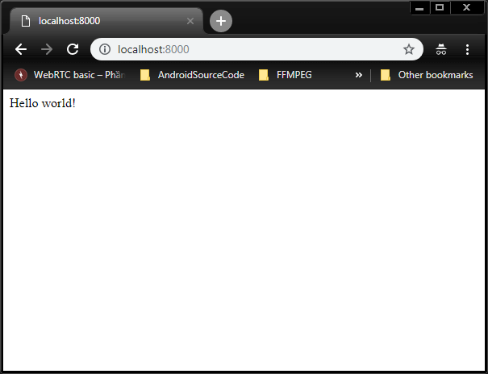

#### Cấu trúc thư mục của Gatsby project

Nếu bạn nhìn vào thư mục **gatsby-tutorial** vừa mới tạo ra thì sẽ thấy các thư mục: **/src, /.cache, /node_modules, /public** và các tệp tin: **.gitignore, package.json, package-lock.json, yarn.lock, README.md, LICENSE**.

Lúc này, bạn chỉ cần quan tâm đến thư mục /src. Vì bạn sẽ cần phải thêm file hay tuỳ chỉnh các file có trong thư mục này để tuỳ chỉnh giao diện trang blog với Gatsby.js.

Để xem Gatsby project tự **rebuild** và **hot-loading** như thế nào, bạn mở file **/src/pages/index.js** với nội dung ban đầu là:

```jsx
import React from "react";

export default () => <div>Hello world!</div>;
```

Bạn sửa file này thành:

```jsx
import React from "react";

export default () => <div>Hello Gatsby!</div>;
```

Sau khi nhấn _Save_, bạn sẽ thấy Gatsby project được build lại (xem ở giao diện dòng lệnh, nơi bạn chạy lệnh <code>gatsby develop</code> trước đó) và trình duyệt tự động reload.

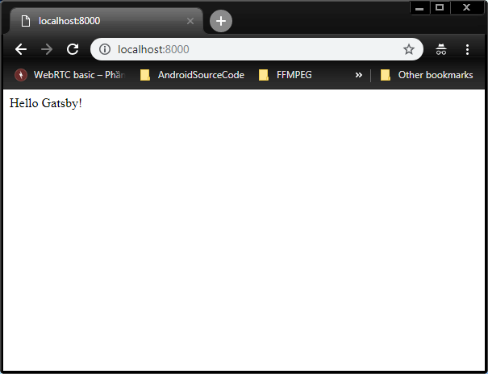

Nếu làm được đến đây thì có nghĩa là bạn đã cài đặt môi trường thành công để sử dụng Gatsby. Còn về mặt nội dung thì blog của mình vẫn trống rỗng, chưa có nội dung gì hết. Vì vậy, phần tiếp theo, mình sẽ bắt đầu xây dựng những thành phần cơ bản mà một trang blog cần phải có.

## Những thành phần cơ bản của một trang blog

### Tạo trang giới thiệu, liên hệ

Mặc định, Gatsby sẽ lấy các file _.js_ được định nghĩa trong thư mục _/src/pages/_ làm các trang của blog. Trong đó, file _/src/pages/index.js_ sẽ được lấy làm trang chủ.

> **Chú ý**: các file này phải **export default** một [React Component](https://reactjs.org/docs/react-component.html) để Gatsby sử dụng. Ngược lại, sẽ bị lỗi.

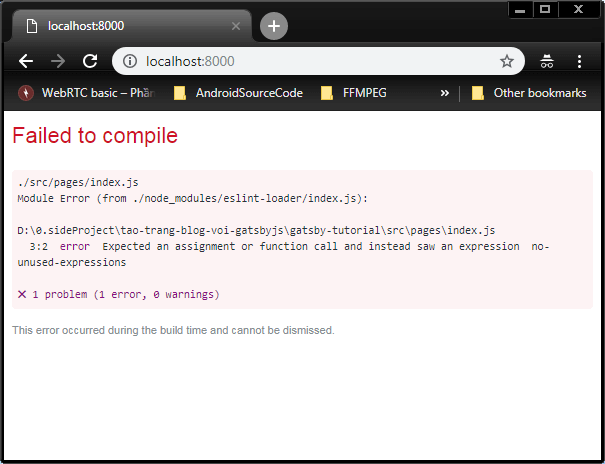

Để tạo thêm trang giới thiệu và liên hệ, mình tạo thêm 2 file mới trong thư mục này là _gioi-thieu.js_ và _lien-he.js_. Với nội dung tương tự như file _index.js_:

**/src/pages/gioi-thieu.js**

```jsx
import React from "react";

export default () => <div>Giới thiệu</div>;
```

**/src/pages/lien-he.js**

```jsx
import React from "react";

export default () => <div>Liên hệ</div>;
```

Sau khi lưu lại, bạn có thể vào 2 địa chỉ **http:\/\/localhost:8000/gioi-thieu/** và **http:\/\/localhost:8000/lien-he/** sẽ thấy kết quả 2 trang lần lượt là:

Kết quả trang giới thiệu:

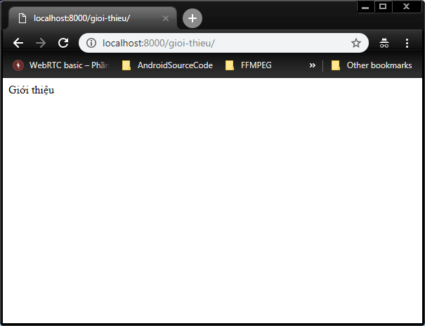

Kết quả trang liên hệ:

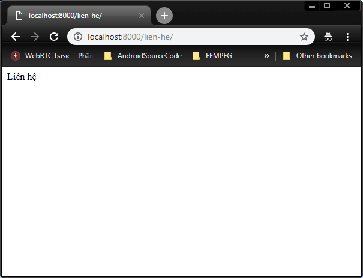

#### Cách xem các trang đang tồn tại từ trang 404 mặc định

Ngoài ra, nếu bạn chưa biết chắc trang blog với Gatsby.js hiện tại gồm những trang nào thì bạn có thể vào 1 địa chỉ bất kì, ví dụ **_http:\/\/localhost:8000/abc/_** (*abc* là giá trị bất kỳ nhé).

Ở chế độ phát triển, khi bạn vào một trang bất kỳ mà trang này không tồn tại thì Gatsby sẽ hiển thị ra một trang **404** mặc định, trong đó sẽ có thông tin về những trang đang tồn tại:

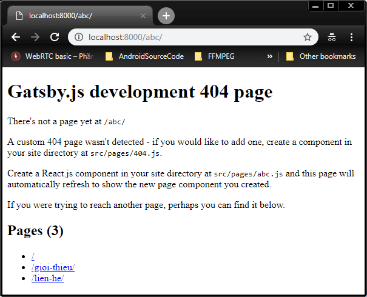

Hình trên cho thấy blog của mình đang có 3 trang là:

- _/_: trang chủ
- _/gioi-thieu/_: trang giới thiệu
- _/lien-he/_: trang liên hệ

> **Chú ý:** Trang này chỉ tồn tại ở chế độ phát triển, khi deploy ra thực tế, bạn cần phải implement trang này. Hay nói cách khác là bạn phải tạo thêm 1 file *404.js* trong thư mục */src/pages/*. Tạm thời mình chưa quan tâm đến trang này vội.

Tóm lại, để tạo thêm một trang bất kì, bạn cần định nghĩa nó trong thư mục <code>/scs/pages/</code>. Trong đó, mỗi trang sẽ là một file *.js* được *export default* React Component. Tiếp theo, mình sẽ bất đầu xây dựng layout cho trang blog với Gatsby.js.

### Thiết kế layout

Thông thường, một trang blog nào cũng sẽ có các thành phần như: menu (đường dẫn tới các trang), sidebar (chứa danh sách các chuyên mục, thẻ, bài viết mới nhất,...),... Nếu làm theo cách thông thường, nghĩa là mình phải copy-paste code liên quan đến menu, sidebar,... vào các file _/src/pages/index.js_, */src/pages/gioi-thieu.js* và */src/pages/lien-he.js*. Như vậy, thật là thừa code và còn khó maintain nếu như mình muốn thay đổi Layout của blog.

Nhưng không, với Gatsby v2, bạn có thể định nghĩa Layout dạng React Component. Khi đó bạn chỉ cần định nghĩa Layout ở một nơi và sử dụng nó ở bất kỳ trang nào bạn muốn.

_Xem thêm: [Migrating from v1 to v2](https://www.gatsbyjs.org/docs/migrating-from-v1-to-v2/) - nếu trước đây bạn sử dụng Gatsby v1 và cần chuyển sang Gatsby v2_.

Dĩ nhiên, bạn có thể định nghĩa nhiều loại Layout khác nhau để sử dụng cho các trang khác nhau (vì có thể Layout trang chủ khác với Layout trang giới thiệu, liên hệ). Nhưng để đơn giản, mình sẽ chỉ sử dụng 1 loại Layout chung cho tất cả các trang.

#### Tạo layout chính

Để dễ dàng quản lý các Component, mình sẽ tạo mới thư mục _components_ trong thư mục */src*. Và trong đó, tạo thêm file *layout.js* để định nghĩa Layout Component và file *layout.css* để định nghĩa style cho layout.

**/src/components/layout.js**

```jsx
import React from "react";
import "./layout.css";
import Menu from "./menu";

export default ({ children }) => {
  return (
    <div className="app">
      <Menu />
      {children}
    </div>
  );
};
```

**/src/components/layout.css**

```css
* {
  box-sizing: border-box;
}

body {
  padding: 0;
  margin: 0;
  color: #222;
  background-color: #eeeeef;
  font: normal normal normal 1rem/1.6 Nunito Sans, Helvetica, Arial, sans-serif;
}

.app {
  margin: 0 auto;
  max-width: 992px;
  padding: 1.25rem 1rem;
}
```

**Có thể bạn đang thắc mắc đối tượng *children* ở trên là cái gì?**

Nếu đúng ra, mình cần phải viết code như này thì có thể bạn sẽ dễ hiểu hơn:

```jsx
import React from "react";
import "./layout.css";

export default (props) => {
  const children = props.children;
  // Hoặc: const { children } = props;
  return <div>{children}</div>;
};
```

Thực ra, đối tượng *children* là mặc định, được truyền vào *props* khi bạn sử dụng component Layout. Giả sử bạn sử dụng Layout như sau:

```jsx
<Layout>
  <div>This is children</div>
</Layout>
```

Khi đó giá trị *children* là:

```jsx
<div>This is children</div>
```

Bây giờ, mình sẽ sử dụng Layout Component trong 3 trang mà mình đã định nghĩa (đồng thời sửa thẻ *div* thành *h1* cho nổi bật).

**/src/pages/index.js**

```jsx
import React from "react";
import Layout from "../components/layout";

export default () => {
  return (
    <Layout>
      <h1>Hello Gatsby!</h1>
    </Layout>
  );
};
```

**/src/pages/gioi-thieu.js**

```jsx
import React from "react";
import Layout from "../components/layout";

export default () => {
  return (
    <Layout>
      <h1>Giới thiệu</h1>
    </Layout>
  );
};
```

**/src/pages/lien-he.js**

```jsx
import React from "react";
import Layout from "../components/layout";

export default () => {
  return (
    <Layout>
      <h1>Liên hệ</h1>
    </Layout>
  );
};
```

Cuối cùng lưu lại trang, bạn sẽ thấy sự khác biệt (cụ thể là: font chữ, màu chữ, background color đã thay đổi).

Như vậy là mình đã thiết lập Layout cơ bản cho các trang. Tiếp theo, mình sẽ thêm menu vào Layout để có thể chuyển hướng giữa các trang một cách dễ dàng.

#### Tạo menu

Mình sẽ tạo Menu dạng React Component. Trước tiên, mình tạo mới 2 file **/src/components/menu.js** và **/src/components/menu.css**.

**/src/components/menu.js**:

```jsx
import React from "react";
import "./menu.css";

export default () => {
  return (
    <header>
      <h3 className="nav-brand">
        <a href={`/`}>Gatsby Blog Demo</a>
      </h3>
      <ul>
        <li className="nav-item">
          <a href={`/lien-he/`}>Liên hệ</a>
        </li>
        <li className="nav-item">
          <a href={`/gioi-thieu/`}>Giới thiệu</a>
        </li>
        <li className="nav-item">
          <a href={`/`}>Trang chủ</a>
        </li>
      </ul>
    </header>
  );
};
```

**/src/components/menu.css**:

```css
header {
  display: flex;
  display: -webkit-flex;
  align-items: center;
  justify-content: space-between;
}

header ul {
  list-style-type: none;
  margin: 0;
  padding: 0;
}

.nav-item {
  float: right;
  margin-left: 35px;
}

.nav-brand a,
.nav-item a {
  text-decoration: none;
}

.nav-item a:hover {
  text-decoration: underline;
}
```

Mình sẽ không giải thích nhiều về nội dung 2 file này, vì nó là kiến thức cơ bản của React, JavaScript, HTML, CSS.

Bây giờ, mình sẽ thêm Menu vào Layout:

**/src/components/layout.js**

```jsx
import React from "react";
import "./layout.css";
import Menu from "./menu";

export default ({ children }) => {
  return (
    <div>
      <Menu />
      {children}
    </div>
  );
};
```

Lưu lại, bạn sẽ thấy kết quả:

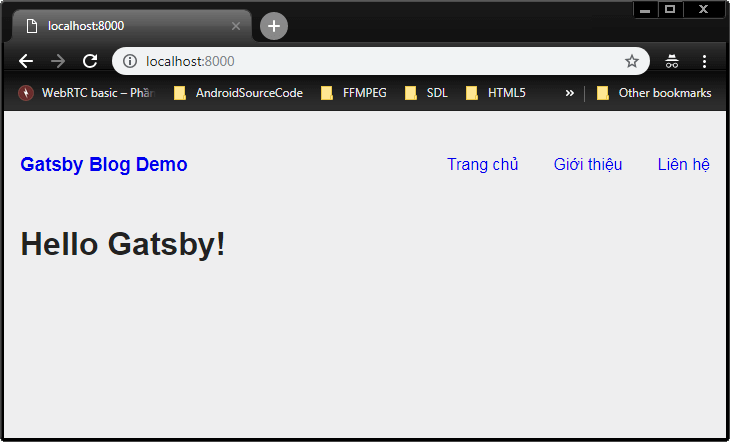

Bạn có thể thử nhấn vào mỗi Menu item thì sẽ thấy trang web có chuyển hướng đến các trang tương ứng.

Tuy nhiên, bạn cũng thấy là khi chuyển sang các trang khác (giới thiệu, liên hệ) thì trang blog bị reload. Dĩ nhiên, đây là điều bình thường đối với các trang web thông thường. Nhưng Gatsby thì khác, Gatsby.js cho phép bạn chuyển qua lại giữa các trang (thuộc blog) mà trình duyệt không cần phải reload - theo kiểu Single Page Application. Vì vậy mà các trang web viết bằng Gatsby thường tải rất nhanh. Để làm được việc này, bạn cần phải thay thế thẻ *a* bằng component *Link* của Gatsby.js.

#### Tạo liên kết giữa các trang thông qua Link component

Bạn mở file */src/components/menu.js* và sửa lại thành:

**/src/components/menu.js**:

```jsx
import React from "react";
import "./menu.css";
import { Link } from "gatsby";

export default () => {
  return (
    <header>
      <h3 className="nav-brand">
        <Link to={`/`}>Gatsby Blog Demo</Link>
      </h3>
      <ul>
        <li className="nav-item">
          <Link to={`/lien-he/`}>Liên hệ</Link>
        </li>
        <li className="nav-item">
          <Link to={`/gioi-thieu/`}>Giới thiệu</Link>
        </li>
        <li className="nav-item">
          <Link to={`/`}>Trang chủ</Link>
        </li>
      </ul>
    </header>
  );
};
```

Trong đó, tất cả thẻ *a* đã được thay bằng *Link* component và thuộc tính _href_ được thay bằng *to*.

Bạn thử lưu lại và kiểm tra thì sẽ thấy giao diện trang blog không hề thay đổi. Nhưng khi mình nhấn vào các Menu item để di chuyển giữa các trang thì trang blog không bị reload lại. Thậm chí là khi bạn dừng server lại thì trang blog vẫn hoạt động bình thường (trừ khi bạn nhấn F5).

#### Tạo sidebar

Hiện tại, mình chưa thêm bài viết nào, nên cũng chưa có chuyên mục hay thẻ nào hết. Do đó, sidebar nếu có thì cũng trống rống. Tuy nhiên, mình cứ thiết kế layout để đấy trước, rồi sẽ thêm nội dung sau.

Để tạo sidebar mình tạo thêm 2 file là: */src/components/sidebar.js* và  _/src/components/sidebar.css_.

**/src/components/sidebar.js**:

```jsx
import React from "react";
import "./sidebar.css";

export default () => {
  return (
    <aside>
      <div>This is Sidebar</div>
    </aside>
  );
};
```

**/src/components/sidebar.css**:

```css
/* Tạm thời chưa có gì */
```

Sau đó, thêm Sidebar vào layout:

**/src/components/layout.js**

```jsx
import React from "react";
import "./layout.css";
import Menu from "./menu";
import Sidebar from "./sidebar";

export default ({ children }) => {
  return (
    <div className="app">
      <Menu />
      <div className="main">
        <div className="content">{children}</div>
        <div className="sidebar">
          <Sidebar />
        </div>
      </div>
    </div>
  );
};
```

Sửa lại giao diện layout một chút:

**/src/components/layout.css**

```css
/*
* Mình chỉ trích dẫn phần thay đổi thôi nhé!
*/

.main {
  display: flex;
  display: -webkit-flex;
}

.sidebar {
  width: 280px;
}

.content {
  width: calc(100% - 280px);
}
```

Trong bài demo này, mình không thiết kế giao diện Responsive. Phần này, nếu muốn, bạn phải tự xử lý thôi!

Bây giờ lưu lại và kiểm tra giao diện một chút:

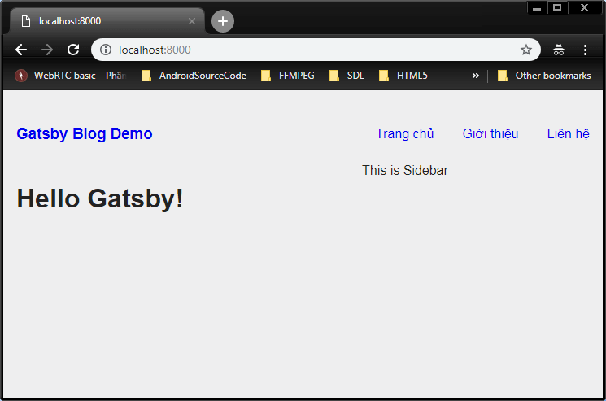

Mình nghĩ bạn có thể tưởng tượng được giao diện sau khi hoàn thiện sẽ như thế nào rồi phải không?

### Thêm bài viết vào blog

Trước khi đến các phần tiếp phía dưới, mình sẽ thêm 3 bài viết minh hoạ vào blog. Nội dung mình sẽ tham khải tại [đây](https://github.com/gatsbyjs/gatsby-starter-blog).

Đầu tiên, mình sẽ tạo mới một thư mục */posts* bên trong thư mục */src*. Thư mục này sẽ được sử dụng để lưu trữ nội dung các bài viết.

Tiếp theo, mình tải starter kia trên Github về, rồi vào thư mục *\gatsby-starter-blog-master\src\pages*, copy-paste 3 thư mục (_hello-world_, *hi-folks*, *my-second-post*) vào thư mục */posts* mới tạo. Rồi sau đó, mình sẽ đổi tên 3 thư mục này thành: *2015-05-01---hello-world*, *2015-05-28---hi-folks*, *2015-05-06---my-second-post*. Mục đích của mình khi đổi tên như vậy là để dễ dàng theo dõi thứ tự bài viết theo trình tự thời gian.

Nếu xem qua các thư mục mình vừa copy-paste xong thì bạn sẽ thấy mỗi thư mục tương ứng với một bài viết. Tên thư mục sẽ sử dụng làm **slug** cho bài viết đó. Bên trong thư mục có một file `index.md` chứa nội dung bài viết và có thể có **ảnh** (tuỳ thuộc nội dung từng bài).

Còn nội dung từng bài viết thì sao?

Ví dụ bài */src/posts/2015-05-01---hello-world*:

```md
---
title: Hello World
date: "2015-05-01T22:12:03.284Z"
---

This is my first post on my new fake blog! How exciting!

I'm sure I'll write a lot more interesting things in the future.

Oh, and here's a great quote from this Wikipedia on
[salted duck eggs](https://en.wikipedia.org/wiki/Salted_duck_egg).

> A salted duck egg is a Chinese preserved food product made by soaking duck
> eggs in brine, or packing each egg in damp, salted charcoal. In Asian
> supermarkets, these eggs are sometimes sold covered in a thick layer of salted
> charcoal paste. The eggs may also be sold with the salted paste removed,
> wrapped in plastic, and vacuum packed. From the salt curing process, the
> salted duck eggs have a briny aroma, a gelatin-like egg white and a
> firm-textured, round yolk that is bright orange-red in color.


```

#### Cấu trúc bài viết trong file Markdown

Mỗi bài viết trong blog với Gatsby.js sẽ có 2 phần.

- Phần 1 nằm ở đầu bài viết, bên trong cặp dấu (---), gọi là *frontmatter*. Phần này chứa thông tin liên quan đến bài viết, như: tiêu đề, thời gian, chuyên mục, thẻ,... Những thông tin này hoàn toàn do mình định nghĩa. Mình cần cái gì thì thêm cái đó.
- Phần 2 nằm kế tiếp, chứa nội dung của bài viết, được viết bằng cú pháp Markdown.

À mà, bài viết này chưa có thông tin về chuyên mục và thẻ. Mà mình cần 2 thông tin này cho các phần sau nên mình sẽ thêm 2 thông tin này vào mỗi bài viết.

**/src/posts/2015-05-01---hello-world**

```md
---
title: Hello World
date: "2015-05-01T22:12:03.284Z"
categories: ["cat1"]
tags: ["greeting", "egg"]
---
```

**/src/posts/2015-05-06---my-second-post**

```md
---
title: My Second Post!
date: "2015-05-06T23:46:37.121Z"
categories: ["cat2"]
tags: ["egg", "wiki"]
---
```

**/src/posts/2015-05-28---hi-folks**

```md
---
title: New Beginnings
date: "2015-05-28T22:40:32.169Z"
categories: ["cat1"]
tags: ["greeting"]
---
```

Vì chuyên mục và thẻ có thể có nhiều nên mình để chúng vào một mảng cho tiện quản lý và sử dụng sau này. Đến đây, coi như mình đã có đầy đủ thông tin cần thiết về các bài viết. Tiếp theo, mình sẽ thiết kế template để hiển thị danh sách bài viết lên trang chủ.

### Tạo template hiển thị danh sách bài viết tại trang chủ

Như mình đã nói ở trên, file */src/pages/index.js* được sử dụng làm trang chủ. Do đó, để hiển thị danh sách bài viết tại trang chủ thì mình phải sửa file này. Nhưng trước tiên mình cần phải tìm hiểu cơ chế lấy dữ liệu của Gatsby.js trước đã. Cụ thể, Gatsby.js sẽ sử dụng GraphQL (Graph Query Language).

Hiện tại, mình nghĩ bạn chưa cần tìm hiểu kỹ về GraphQL, vì mình chỉ sử dụng nó một cách cơ bản thôi. Bản thân mình cũng không rành về GraphQL lắm, chỉ đủ dùng thôi. Chỗ nào không biết thì lại Google (dĩ nhiên, nếu bạn master GraphQL rồi thì quá tốt).

#### Thử query đầu tiên với GraphQL

Trước tiên, thử một query đơn của GraphQL xem cách sử dụng nó như thế nào nhé! Bây giờ, bạn tạo mới một file *gatsby-config.js* - ngay tại thư mục gốc, ngang hàng với *package.json* ấy. Rồi sửa nội dung file đó thành:

**/gatsby-config.js**

```js
module.exports = {
  siteMetadata: {
    title: `Gatsby Blog Tutorial Demo`,
  },
};
```

Trong đó, mình thêm thuộc tính *siteMetadata* vào để lưu những thông tin cần thiết của trang blog. Tiếp theo, mình định nghĩa *title* là tên của blog. Vì hiện tại tên blog đang là *Gatsby Blog Demo* nên mình sửa nó thành *Gatsby Blog Tutorial Demo* xem thế nào.

Dĩ nhiên, bây giờ trang blog vẫn chưa có gì thay đổi. Để áp dụng *title* mới này cho toàn bộ trang blog mình sẽ thêm nó vào */src/components/layout.js*. Tuy nhiên, Layout không phải là một Page nên sẽ không thể query bình thường được, mà phải dùng [StaticQuery](https://www.gatsbyjs.org/docs/static-query/) - đây là API mới có ở Gatsby v2.

#### Cách sử dụng query GraphQL thông thường

Nếu không dùng StaticQuery, mình sẽ phải query data trong 3 file  _/src/pages/index.js_, */src/pages/gioi-thieu.js*, */src/pages/lien-he.js*, tương ứng với 3 trang (sử dụng cách này sẽ dễ tiếp cận hơn nhưng code sẽ bị lặp lại). Mà bạn đừng vội thay đổi code giống 3 đoạn phía dưới nhé, mình chỉ nói nếu dùng cách này thì mới sửa thôi. Nên 3 đoạn sau chỉ dùng để tham khảo.

**/src/pages/index.js**:

```jsx
import React from "react";
import Layout from "../components/layout";
import { graphql } from "gatsby";

export default ({ data }) => {
  return (
    <Layout title={data.site.siteMetadata.title}>
      <h1>Bài viết mới nhất</h1>
    </Layout>
  );
};

export const query = graphql`
  query {
    site {
      siteMetadata {
        title
      }
    }
  }
`;
```

**/src/pages/gioi-thieu.js**

```jsx
import React from "react";
import Layout from "../components/layout";
import { graphql } from "gatsby";

export default ({ data }) => {
  return (
    <Layout title={data.site.siteMetadata.title}>
      <h1>Giới thiệu</h1>
    </Layout>
  );
};

export const query = graphql`
  query {
    site {
      siteMetadata {
        title
      }
    }
  }
`;
```

**/src/pages/lien-he.js**

```jsx
import React from "react";
import Layout from "../components/layout";
import { graphql } from "gatsby";

export default ({ data }) => {
  return (
    <Layout title={data.site.siteMetadata.title}>
      <h1>Liên hệ</h1>
    </Layout>
  );
};

export const query = graphql`
  query {
    site {
      siteMetadata {
        title
      }
    }
  }
`;
```

Trong đó, mình đã import thêm *graphql* từ *gatsby*. Rồi viết câu lệnh query *title* ở phía dưới cùng. Ngoài ra, trong phần định nghĩa React Component, mình bổ sung thêm thuộc tính *data*. Thuộc tính này tương ứng với dữ liệu đã query ở phía dưới.

Bạn thấy đó, code bị lặp lại ở cả 3 file. Điều này là không nên. Vì vậy, mình sẽ sử dụng StaticQuery.

#### Query GraphQL sử dụng StaticQuery

Mình sẽ sửa lại file */src/components/layout.js*:

**/src/components/layout.js**:

```jsx
import React from "react";
import "./layout.css";
import Menu from "./menu";
import Sidebar from "./sidebar";
import { StaticQuery, graphql } from "gatsby";

export default (props) => {
  const { children } = props;

  return (
    <StaticQuery
      query={graphql`
        query {
          site {
            siteMetadata {
              title
            }
          }
        }
      `}
      render={(data) => (
        <div className="app">
          <Menu title={data.site.siteMetadata.title} />
          <div className="main">
            <div className="content">{children}</div>
            <div className="sidebar">
              <Sidebar />
            </div>
          </div>
        </div>
      )}
    />
  );
};
```

Tương tự như bên trên, nhưng bây giờ mình viết thẳng query của GraphQL bên trong StaticQuery luôn. Để truy cập đến giá trị *title* mình sử dụng  _data.site.siteMetadata.title_.

Rồi trong đó, mình lại truyền *title* đến Menu. Và để hiển thị *title* mới này trong Menu, mình sửa file */src/components/menu.js* như sau.

**/src/components/menu.js**:

```jsx
import React from "react";
import "./menu.css";
import { Link } from "gatsby";

export default (props) => {
  const { title } = props;

  return (
    <header>
      <h3 className="nav-brand">
        <Link to={`/`}>{title}</Link>
      </h3>
      <ul>
        <li className="nav-item">
          <Link to={`/lien-he/`}>Liên hệ</Link>
        </li>
        <li className="nav-item">
          <Link to={`/gioi-thieu/`}>Giới thiệu</Link>
        </li>
        <li className="nav-item">
          <Link to={`/`}>Trang chủ</Link>
        </li>
      </ul>
    </header>
  );
};
```

Để xem kết quả như nào, lần này bạn phải **Restart** lại server. Nhớ là mỗi khi thay đổi file ngoài thư mục */src* như */gatsby-config.js* hay thay đổi cú pháp query trong phần *graphql* thì bạn phải **Restart** lại server. Kết quả là *title* mới đã được áp dụng:

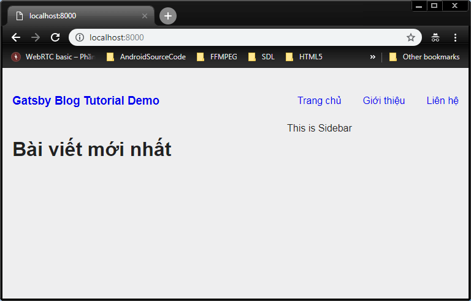

#### Sử dụng công cụ đồ hoạ GraphiQL

Ngoài ra, để biết kết quả câu lệnh query graphQL kia như thế nào, bạn có thể sử dụng công cụ GraphiQL bằng cách vào địa chỉ  *http:\/\/localhost:8000/\_\_\_graphql* và copy-paste đoạn query trên vào:

```jsx
{
  site {
    siteMetadata {
      title
    }
  }
}
```

Rồi nhấn vào nút Excute Query (hình tròn, có tam giác ở giữa) sẽ thấy kết quả:

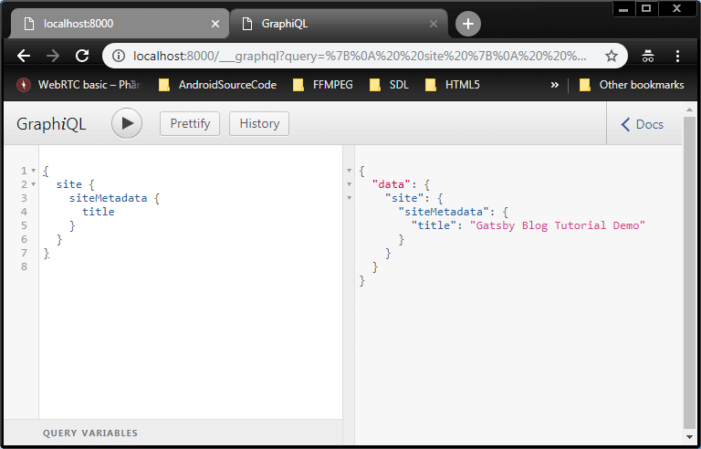

Kết quả trả về là một Object:

```js
{
  "data": {
    "site": {
      "siteMetadata": {
        "title": "Gatsby Blog Tutorial Demo"
      }
    }
  }
}
```

Điều này giải thích tại sao mình lại truy cập đến *title* bằng cách  *data.site.siteMetadata.title* như trên.

#### Query danh sách các bài viết để hiển thị lên trang chủ

Như mình đã nói ở trên, Gatsby có thể lấy dữ liệu từ các file Markdown hoặc từ CMS (Contentful, Wordpress) hay REST API,... Nhưng ở đây, mình sẽ lấy dữ liệu bài viết từ các file Markdown trên hệ thống. Để làm được việc này, mình cần sử dụng một plugin của Gatsby là *gatsby-source-filesystem*.

Trước tiên, cài đặt plugin này bằng câu lệnh:

```bash
npm install --save gatsby-source-filesystem
```

Sau khi cài đặt xong, bạn khai báo plugin này trong file */gatsby-config.js*:

**/gatsby-config.js**:

```js
module.exports = {
  siteMetadata: {
    title: `Gatsby Blog Tutorial Demo`,
  },
  plugins: [
    {
      resolve: `gatsby-source-filesystem`,
      options: {
        name: `src`,
        path: `${__dirname}/src/`,
      },
    },
  ],
};
```

Trong đó, phần *options.path*, mình khai báo giá trị của nó đến thư mục */src* (hay <code>${\_\_dirname}/src/</code>). Vì các page, post của mình chỉ nằm trong thư mục này.

Tuy nhiên, đến đây mình mới chỉ quét được hết các file trong thư mục */src*. Cái mình cần phải cụ thể hơn, đó là quét được các file Markdown. Vì các bài viết của mình được viết dưới dạng Markdown. Vì vậy, mình cài tiếp plugin *gatsby-transformer-remark* bằng câu lệnh:

```bash
npm install --save gatsby-transformer-remark
```

Rồi lại add nó vào file */gatsby-config.js*:

**/gatsby-config.js**

```js
module.exports = {
  siteMetadata: {
    title: `Gatsby Blog Tutorial Demo`,
  },
  plugins: [
    {
      resolve: `gatsby-source-filesystem`,
      options: {
        name: `src`,
        path: `${__dirname}/src/`,
      },
    },
    `gatsby-transformer-remark`,
  ],
};
```

Lưu lại và restart server rồi thử query các file Markdown trên GraphiQL xem sao:

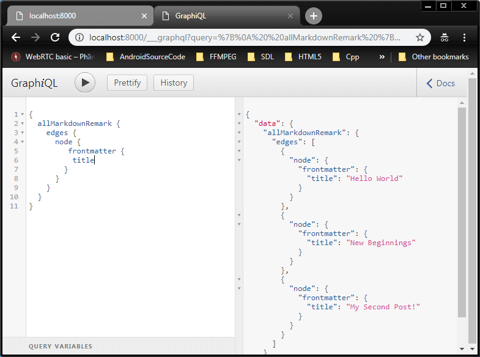

Kết quả là mình tìm thấy 3 file Markdown - tương ứng với 3 bài viết mà mình đã copy-paste vào phía trên.

Bây giờ, mình sẽ sửa file */src/pages/index.js* để hiển thị danh sách các bài viết lên trang chủ:

**/src/pages/index.js**

```jsx
import React from "react";
import Layout from "../components/layout";
import { graphql } from "gatsby";

export default ({ data }) => {
  return (
    <Layout>
      <h1>Bài viết mới nhất</h1>

      {data.allMarkdownRemark.edges.map(({ node }, index) => (
        <div key={index}>
          <h3>
            {node.frontmatter.title}
            <span style={{ color: `#BBB` }}>— {node.frontmatter.date}</span>
          </h3>
          <p>{node.excerpt}</p>
        </div>
      ))}
    </Layout>
  );
};

export const query = graphql`
  query {
    allMarkdownRemark(
      sort: { order: DESC, fields: [frontmatter___date] }
      limit: 1000
    ) {
      edges {
        node {
          frontmatter {
            title
            date(formatString: "DD/MM/YYYY")
          }
          excerpt
        }
      }
    }
  }
`;
```

Kết quả là mình đã thu được một danh sách các bài viết trên trang chủ:

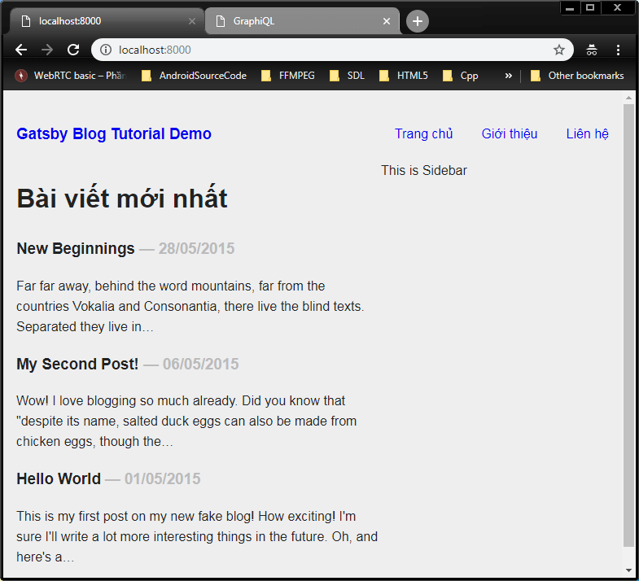

Tuy nhiên, hiện tại mình muốn click vào mỗi bài viết thì phải nhảy đến nội dung bài viết tương ứng thì lại chưa làm được. Vì vậy, mình cần phải tạo thêm *slug* cho mỗi bài viết.

#### Tạo slug cho mỗi bài viết

Mình cần phải tạo slug cho mỗi bài viết để có thể link đến chúng. Để làm việc này, đầu tiên mình phải tạo mới file */gatsby-node.js* và sửa file:

**/gatsby-node.js**

```js
const path = require(`path`);

exports.onCreateNode = ({ node, getNode, actions }) => {
  const { createNodeField } = actions;

  if (node.internal.type === `File`) {
    const parsedFilePath = path.parse(node.absolutePath);
    const slug = `/${parsedFilePath.dir.split("---")[1]}/`;
    createNodeField({ node, name: `slug`, value: slug });
  } else if (
    node.internal.type === `MarkdownRemark` &&
    typeof node.slug === "undefined"
  ) {
    const fileNode = getNode(node.parent);
    createNodeField({
      node,
      name: `slug`,
      value: fileNode.fields.slug,
    });
  }
};
```

Trong đó, *onCreateNode* là một Gatsby API được gọi mỗi khi có một node mới thêm vào hay chỉnh sửa (mỗi node chính là một file). Mục đích của hàm này là mình sẽ tạo thêm trường *slug* cho mỗi node với *slug* có được bằng cách lấy tên thư mục và tách lấy phần bên phải của dấu (---).

Ví dụ bài viết ứng với thư mục *2015-05-01---hello-world*, mình sẽ lấy thành phần bên phải dấu (---) làm *slug* cho bài viết. Do đó, bài viết ứng với thư mục này sẽ có địa chỉ là **_http:\/\/localhost:8000/hello-world/_** (tương tự với các bài viết khác).

Bây giờ mình sẽ sửa file */src/pages/index.js* thành:

**/src/pages/index.js**

```jsx
import React from "react";
import Layout from "../components/layout";
import { graphql, Link } from "gatsby";

export default ({ data }) => {
  return (
    <Layout>
      <h1>Bài viết mới nhất</h1>

      {data.allMarkdownRemark.edges.map(({ node }, index) => (
        <div key={index}>
          <h3>
            <Link to={node.fields.slug}>{node.frontmatter.title}</Link>
            <span style={{ color: `#BBB` }}>— {node.frontmatter.date}</span>
          </h3>
          <p>{node.excerpt}</p>
        </div>
      ))}
    </Layout>
  );
};

export const query = graphql`
  query {
    allMarkdownRemark(
      sort: { order: DESC, fields: [frontmatter___date] }
      limit: 1000
    ) {
      edges {
        node {
          frontmatter {
            title
            date(formatString: "DD/MM/YYYY")
          }
          excerpt
          fields {
            slug
          }
        }
      }
    }
  }
`;
```

Bây giờ, *title* của mỗi bài viết đã được đặt trong *Link* component.

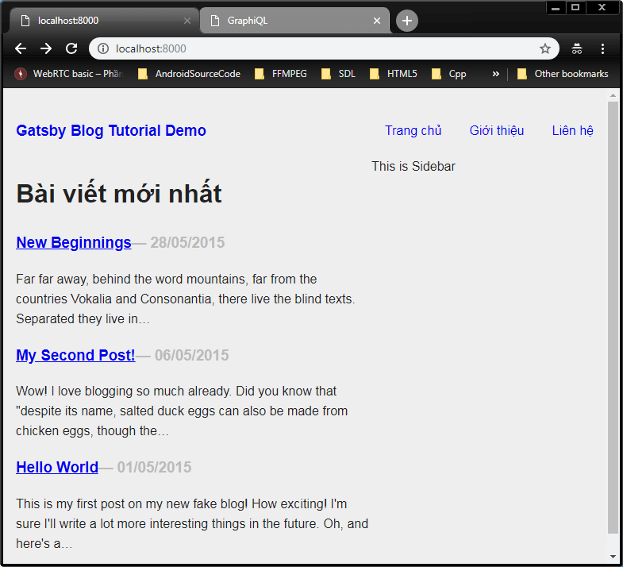

Lưu lại và restart server. Rồi sau đó bạn có thể nhấn thử vào *title* của mỗi bài viết để xem nó có nhảy đến đúng địa chỉ của mỗi bài viết không.

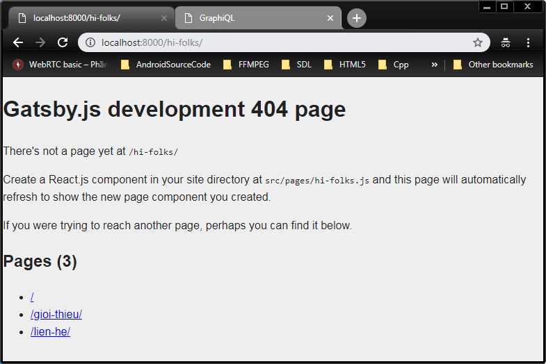

Đến đây thì bạn thấy rằng địa chỉ là đúng. Nhưng tiếc là Gatsby thông báo rằng trang này vẫn chưa tồn tại. Do đó, phần tiếp theo mình sẽ tạo ra các trang tương ứng với mỗi bài viết.

### Hiển thị nội dung bài viết

#### Tạo ra trang tương ứng với mỗi bài viết

Để làm việc này, mình cần phải sử dụng một Gatsby API khác là _createPages_. Mình tiếp tục sửa file */gatsby-node.js*.

**/gatsby-node.js**

```js
/*
 * phần trước không thay đổi, mình bổ sung thêm đoạn sau
 */

exports.createPages = ({ graphql, actions }) => {
  const { createPage } = actions;
  return new Promise((resolve, reject) => {
    graphql(`
      {
        allMarkdownRemark {
          edges {
            node {
              fields {
                slug
              }
            }
          }
        }
      }
    `).then((result) => {
      result.data.allMarkdownRemark.edges.forEach(({ node }) => {
        createPage({
          path: node.fields.slug,
          component: path.resolve(`./src/templates/blog-post.js`),
          context: {
            slug: node.fields.slug,
          },
        });
      });
      resolve();
    });
  });
};
```

Đoạn này có ý nghĩa là mình sẽ tạo ra các trang tương ứng với mỗi file Markdown, với đường dẫn *path* chính là *slug* của mỗi node, và nội dung được sử dụng dựa trên một template ở file */src/templates/blog-post.js*.

Dĩ nhiên, đến đây thì mọi thứ vẫn chưa có gì thay đổi. Vì mình chưa tạo file template kia.

#### Tạo template cho mỗi bài viết

Đầu tiên, tạo file */src/templates/blog-post.js* và sửa nội dung nó thành:

**/src/templates/blog-post.js**

```jsx
import React from "react";
import { graphql } from "gatsby";
import Layout from "../components/layout";

export default ({ data }) => {
  const post = data.markdownRemark;
  return (
    <Layout>
      <div>
        <h1>{post.frontmatter.title}</h1>
        <div dangerouslySetInnerHTML={{ __html: post.html }} />
      </div>
    </Layout>
  );
};

export const query = graphql`
  query ($slug: String!) {
    markdownRemark(fields: { slug: { eq: $slug } }) {
      html
      frontmatter {
        title
      }
    }
  }
`;
```

Câu lệnh query phần này có vẻ hơi khác so với phần trước. Đó là nó chứa tham số *\$slug*. Cũng đúng thôi, vì với mỗi bài viết khác nhau thì *slug* cũng khác. Vì vậy, mình cần thông tin này để query đúng bài viết tương ứng.

Vấn đề là giá trị *\$slug* ở đây lấy ở đâu ra?

Xem lại phần trước, chỗ *createPage*:

```js
createPage({
  path: node.fields.slug,
  component: path.resolve(`./src/templates/blog-post.js`),
  context: {
    slug: node.fields.slug,
  },
});
```

Ở đây, thuộc tính *slug* bên trong phần *context* sẽ được truyền sang template kia và đóng vai trò là *\$slug* trong câu lệnh GraphQL phía trên.

Bây giờ, bạn lưu lại và restart server thì sẽ thấy kết quả:

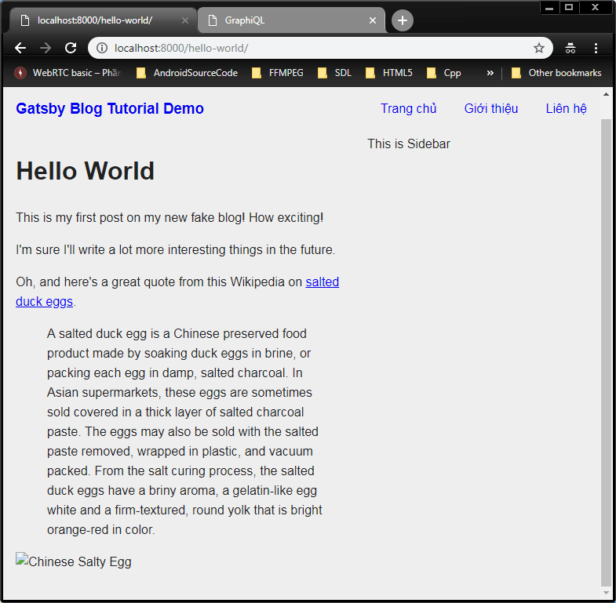

Đợi chút, trong nội dung bài viết, phần hiển thị ảnh (dưới cùng) bị lỗi. Nghĩa là hiện tại mình mới chỉ xử lý được trường hợp nội dung bài viết dạng text. Còn có những dạng khác như ảnh, video, iframe,... mình vẫn chưa xử lý.

#### Xử lý hình ảnh trong file Markdown

Trong demo này, mình sẽ chỉ xử lý thêm trường hợp nội dung bài viết chứa ảnh. Các trường hợp khác bạn có thể tự tìm kiếm plugin của Gatsby có hỗ trợ để làm.

Để xử lý phần hiển thị ảnh trong Markdown, mình cần cài thêm plugin *gatsby-remark-images* bằng câu lệnh:

```bash
npm install --save gatsby-remark-images gatsby-plugin-sharp
```

_Ở đây mình có cài thêm plugin gatsby-plugin-sharp vì gatsby-remark-images cần sử dụng plugin này._

Tiếp theo mình sửa lại file */gatsby-config.js*:

```js
module.exports = {
  siteMetadata: {
    title: `Gatsby Blog Tutorial Demo`,
  },
  plugins: [
    {
      resolve: `gatsby-source-filesystem`,
      options: {
        name: `src`,
        path: `${__dirname}/src/`,
      },
    },
    {
      resolve: "gatsby-transformer-remark",
      options: {
        plugins: [
          {
            resolve: `gatsby-remark-images`,
            options: {
              maxWidth: 590,
            },
          },
        ],
      },
    },
  ],
};
```

Vì plugin *gatsby-remark-images* để xử lý ảnh sử dụng trong Markdown nên mình phải đặt nó trong phần *plugins* của *gatsby-transformer-remark*.

Bây giờ, chạy lại server và bạn sẽ thấy kết quả như mong đợi:

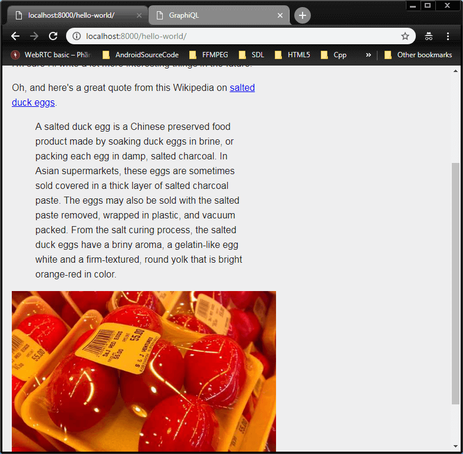

Đúng ra, theo dự định ban đầu mình sẽ giới thiệu phần tích hợp bình luận và chia sẻ lên mạng xã hội. Tuy nhiên, phần này khá đơn giản vì có nhiều React Component hỗ trợ sẵn. Bạn cứ search Google thì sẽ ra. Còn nếu bạn không biết search kiểu gì thì để lại câu hỏi trong phần bình luận mình sẽ giải đáp sau.

Như vậy là đã gần xong rồi. Tiếp theo mình sẽ chia sẻ phần phân loại bài viết theo chuyên mục và thẻ.

### Tạo template hiển thị danh sách bài viết theo chuyên mục, thẻ

#### Liệt kê các chuyên mục và thẻ lên sidebar

Trước khi hiển thị danh sách các bài viết theo chuyên mục hay thẻ thì mình cần phải liệt kê chúng và cho lên sidebar trước đã. Để làm được việc này, mình sẽ sửa trong file */src/components/layout.js*.

Ý tưởng của mình là sẽ duyệt hết tất cả các bài viết và lấy ra mảng các chuyên mục và thẻ ở mỗi bài, rồi sử dụng chúng để liệt kê chúng lên sidebar. Nhưng trước tiên mình sẽ cài đặt một node module tên là *slug* - để chuyển tên chuyên mục, thẻ thành *slug*.

Module này có hỗ trợ tiếng việt. Ví dụ: chuyên mục "Lập trình JavaScript" sẽ chuyển thành "lap-trinh-javascript".

Câu lệnh cài đặt như sau:

```bash
npm install --save slug
```

Sau đó mình bắt đầu sửa file */src/components/layout.js*.

**/src/components/layout.js**:

```js
import React from "react";
import "./layout.css";
import Menu from "./menu";
import Sidebar from "./sidebar";
import { StaticQuery, graphql } from "gatsby";

export default (props) => {
  const { children } = props;

  return (
    <StaticQuery
      query={graphql`
        query {
          site {
            siteMetadata {
              title
            }
          }
          topics: allMarkdownRemark(
            sort: { order: DESC, fields: [frontmatter___date] }
          ) {
            edges {
              node {
                frontmatter {
                  categories
                  tags
                }
              }
            }
          }
        }
      `}
      render={(data) => (
        <div className="app">
          <Menu title={data.site.siteMetadata.title} />
          <div className="main">
            <div className="content">{children}</div>
            <div className="sidebar">
              <Sidebar edges={data.topics.edges} />
            </div>
          </div>
        </div>
      )}
    />
  );
};
```

Trong phần query GraphQL, mình đã thêm vào phần duyệt tất cả file Markdown. Dữ liệu thu được mình sẽ truyền nó vào Sidebar.

Tiếp theo, sử dụng chúng trong Sidebar, bằng cách sửa file _/src/components/sidebar.js_.

**/src/components/sidebar.js**:

```js
import React from "react";
import "./sidebar.css";
import slug from "slug";
import { Link } from "gatsby";

export default (props) => {
  const { edges } = props;
  let tags = [];
  let categories = [];

  edges.forEach(({ node }) => {
    tags = Array.from(new Set([...tags, ...node.frontmatter.tags]));
    categories = Array.from(
      new Set([...categories, ...node.frontmatter.categories])
    );
  });

  return (
    <aside>
      <div>
        <h3>Chuyên mục</h3>
        {categories.map((category, index) => (
          <p key={index}>
            <Link to={`/category/${slug(category).toLowerCase()}/`}>
              {category}
            </Link>
          </p>
        ))}
      </div>

      <div>
        <h3>Thẻ</h3>
        {tags.map((tag, index) => (
          <span key={index}>
            <Link to={`/tag/${slug(tag).toLowerCase()}/`}>{tag}</Link>{" "}
          </span>
        ))}
      </div>
    </aside>
  );
};
```

**/src/components/sidebar.css**:

```css
aside {
  padding: 0 15px;
}
```

Có một điều cần chú ý ở đây là các chuyên mục và thẻ có thể xuất hiện ở nhiều bài viết. Vì vậy, mình cần phải sử dụng kiểu dữ liệu [Set](https://developer.mozilla.org/en-US/docs/Web/JavaScript/Reference/Global_Objects/Set) để tạo ra mảng các chuyên mục và thẻ với các phần tử là duy nhất.

```js
let tags = [];
let categories = [];

edges.forEach(({ node }) => {
  tags = Array.from(new Set([...tags, ...node.frontmatter.tags]));
  categories = Array.from(
    new Set([...categories, ...node.frontmatter.categories])
  );
});
```

Sau khi đã có mảng các chuyên mục và thẻ với các phần tử là duy nhất rồi, mình render chúng lên sidebar như bình thường. Kết quả mình thu được:

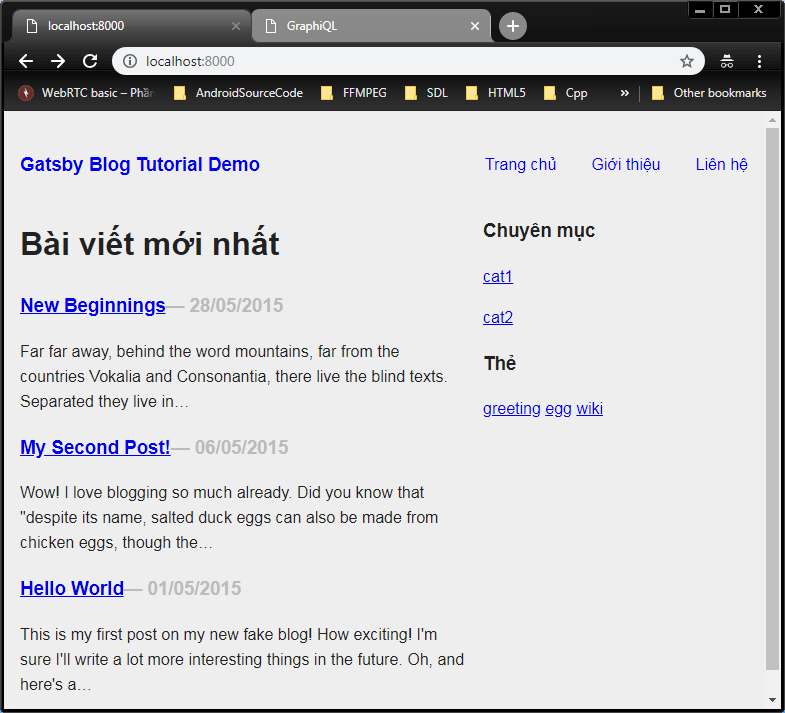

Cũng tương tự như phần liệt kê danh sách cách bài viết tại trang chủ, lúc này mình mới chỉ liệt kê ra các thẻ với *Link* đến trang tương ứng mà chưa định nghĩa các trang đó. Phần tiếp theo mình sẽ thực hiện việc này.

#### Tạo các trang tương ứng với chuyên mục và thẻ

Để tạo ra các trang tương ứng với chuyên mục và thẻ mình cần phải thực hiện trong Gatsby API *createPages* ở file */gatsby-node.js*.

**/gatsby-node.js**:

```js
const path = require(`path`);
const slug = require(`slug`);

/*
 * onCreateNode không thay đổi
 */

exports.createPages = ({ graphql, actions }) => {
  const { createPage } = actions;
  return new Promise((resolve, reject) => {
    graphql(`
      {
        allMarkdownRemark {
          edges {
            node {
              frontmatter {
                categories
                tags
              }
              fields {
                slug
              }
            }
          }
        }
      }
    `).then((result) => {
      let tags = [];
      let categories = [];

      result.data.allMarkdownRemark.edges.forEach(({ node }) => {
        tags = Array.from(new Set([...tags, ...node.frontmatter.tags]));

        categories = Array.from(
          new Set([...categories, ...node.frontmatter.categories])
        );

        createPage({
          path: node.fields.slug,
          component: path.resolve(`./src/templates/blog-post.js`),
          context: {
            // Data passed to context is available in page queries
            // as GraphQL variables.
            slug: node.fields.slug,
          },
        });
      });

      categories.forEach((category) => {
        createPage({
          path: `/category/${slug(category).toLowerCase()}/`,
          component: path.resolve(`./src/templates/categories.js`),
          context: {
            // Data passed to context is available in page queries
            // as GraphQL variables.
            category,
          },
        });
      });

      tags.forEach((tag) => {
        createPage({
          path: `/tag/${slug(tag).toLowerCase()}/`,
          component: path.resolve(`./src/templates/tags.js`),
          context: {
            // Data passed to context is available in page queries
            // as GraphQL variables.
            tag,
          },
        });
      });

      resolve();
    });
  });
};
```

Trong phần query GraphQL mình cũng thêm phần query _categories_ và _tags_ để sử dụng trong phần *then*. Trong phần *then*, đầu tiên mình cũng thêm phần duyệt để tạo ra mảng các chuyên mục và thẻ với các phần tử là duy nhất bên trên.

Phần tạo ra các trang với thẻ và chuyên mục cũng tương tự như phần tạo ra các trang với mỗi bài viết. Trong đó mình định nghĩa lại phần đường dẫn *path* tương ứng. Trang để hiển thị các chuyên mục sử dụng template tại file *./src/templates/categories.js* và trang hiển thị các thẻ sử dụng template tại file _./src/templates/tags.js_. Và mình cũng không quên truyền tham số trong phần *context* để có thể sử dụng trong các file template.

Khi đó, các file template sẽ được triển khai như sau đây:

**/src/templates/categories.js**

```js
import React from "react";
import Layout from "../components/layout";
import { graphql, Link } from "gatsby";

export default ({ data, pageContext }) => {
  const { category } = pageContext;
  const categoryEdges = data.allMarkdownRemark.edges.filter(({ node }) =>
    node.frontmatter.categories.includes(category)
  );

  return (
    <Layout>
      <h1>Chuyên mục {category}</h1>

      {categoryEdges.map(({ node }, index) => (
        <div key={index}>
          <h3>
            <Link to={node.fields.slug}>{node.frontmatter.title}</Link>
            <span style={{ color: `#BBB` }}>— {node.frontmatter.date}</span>
          </h3>
          <p>{node.excerpt}</p>
        </div>
      ))}
    </Layout>
  );
};

export const query = graphql`
  query {
    allMarkdownRemark(
      sort: { order: DESC, fields: [frontmatter___date] }
      limit: 1000
    ) {
      edges {
        node {
          frontmatter {
            title
            date(formatString: "DD/MM/YYYY")
            categories
          }
          excerpt
          fields {
            slug
          }
        }
      }
    }
  }
`;
```

**/src/template/tags.js**

```js
import React from "react";
import Layout from "../components/layout";
import { graphql, Link } from "gatsby";

export default ({ data, pageContext }) => {
  const { tag } = pageContext;
  const tagEdges = data.allMarkdownRemark.edges.filter(({ node }) =>
    node.frontmatter.tags.includes(tag)
  );

  return (
    <Layout>
      <h1>Thẻ {tag}</h1>

      {tagEdges.map(({ node }, index) => (
        <div key={index}>
          <h3>
            <Link to={node.fields.slug}>{node.frontmatter.title}</Link>
            <span style={{ color: `#BBB` }}>— {node.frontmatter.date}</span>
          </h3>
          <p>{node.excerpt}</p>
        </div>
      ))}
    </Layout>
  );
};

export const query = graphql`
  query {
    allMarkdownRemark(
      sort: { order: DESC, fields: [frontmatter___date] }
      limit: 1000
    ) {
      edges {
        node {
          frontmatter {
            title
            date(formatString: "DD/MM/YYYY")
            tags
          }
          excerpt
          fields {
            slug
          }
        }
      }
    }
  }
`;
```

Thực ra, nội dung của 2 file này gần giống như */src/pages/index.js*, chỉ khác ở chỗ là mình không sử dụng tham số được truyền từ */gatsby-node.js* vào phần query GraphQL như phần *\$slug* ở phía trên. Lần này mình sử dụng nó trong phần React Component.

Giá trị của các tham số *category* và *tag* được lấy từ đối tượng *pageContext*:

```js
const { category } = pageContext;
const categoryEdges = data.allMarkdownRemark.edges.filter(({ node }) =>
  node.frontmatter.categories.includes(category)
);

const { tag } = pageContext;
const tagEdges = data.allMarkdownRemark.edges.filter(({ node }) =>
  node.frontmatter.tags.includes(tag)
);
```

Khi đã có được giá trị *category* hay *tag* hiện tại rồi, thì mình chỉ cần sử dụng phương thức [filter](/javascript-foreach-la-cai-quai-gi) để lọc lấy những bài viết chứa *category* và những bài viết chứa *tag* hiện tại. Vì mục đích của mình là phân loại các bài viết theo chuyên mục và thẻ mà.

Bây giờ, bạn lưu lại và restart server thì sẽ thấy mọi thứ hoạt động khá ổn định và đúng như mong đợi rồi. Công việc tiếp theo sẽ là deploy trang blog lên Netlify nữa là xong.

## Deploy trang blog lên Netlify

Trước khi đi vào phần chính mình muốn trả lời câu hỏi: *tại sao mình lựa chọn Netlify mà không phải Github Pages hay một số nền tảng khác?*

Theo như tài liệu, Gatsby hỗ trợ deploy sản phẩm lên: [Netlify](https://v1.gatsbyjs.org/docs/deploy-gatsby/#netlify), [S3/Cloudfront](https://v1.gatsbyjs.org/docs/deploy-gatsby/#amazon-s3-and-cloudfront), [GitHub Pages](https://v1.gatsbyjs.org/docs/deploy-gatsby/#github-pages), [GitLab Pages](https://v1.gatsbyjs.org/docs/deploy-gatsby/#gitlab-pages), [Heroku](https://v1.gatsbyjs.org/docs/deploy-gatsby/#heroku), [Now](https://v1.gatsbyjs.org/docs/deploy-gatsby/#now).

Tuy nhiên, sau khi đọc qua thì mình thấy chỉ có Netlify và Github Pages là đơn giản nhất. Trong đó, Github Pages thì mình đã sử dụng khá nhiều nên rất quen thuộc.

### Nhược điểm khi deploy Gatsby lên Github Pages

Nhưng bạn biết đấy, với mỗi tài khoản Github thì mình chỉ có thể tạo ra một trang chính thôi. Ví dụ: tài khoản của mình là *username*. Khi đó, trang chính của mình sẽ là **_username.github.io_**.

Bây giờ, nếu mình deploy một project *gatsby-tutorial* lên thì địa chỉ trang web tương ứng với nó sẽ là **_username.github.io/gatsby-tutorial/_**. Tuy nhiên, nếu mình muốn custom domain thành *gatsby-tutorial.phamvanlam.com* (vì [phamvanlam.com](https://phamvanlam.com) là tên miền của mình), thì lại không được.

Không lẽ mình phải tạo mới một tài khoản Github với tên *gatsby-tutorial*. Khi đó, địa chỉ trang blog là *gatsby-tutorial.github.io*. Lúc này, mình có thể custom domain được. Nhưng làm như vậy thì quá mất công.

### Netlify có ưu điểm gì nổi bật?

Đó là lý do mình chuyển sang sử dụng Netlify. Khi deploy lên Netlify thì tên miền của blog dự định sẽ là **_gatsby-tutorial.netlify.com_** (nếu như tên miền này còn tồn tại). Nghĩa là mình có thể custom domain được.

Không những thế, Netlify còn hỗ trợ cài đặt SSL miễn phí, tốc độ cũng khá nhanh, ổn định và mỗi khi bạn commit code lên Github thì Netlify sẽ tự động build lại trang blog cho bạn. Như vậy thì còn gì bằng phải không.

### Submit project lên Github

Trước tiên, mình sẽ tạo mới một respository trên Github với tên là *gatsby-tutorial*.

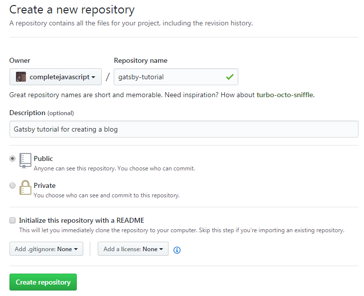

Sau khi nhấn vào button *Create repository* thì bạn sẽ được dẫn đến một gợi ý:

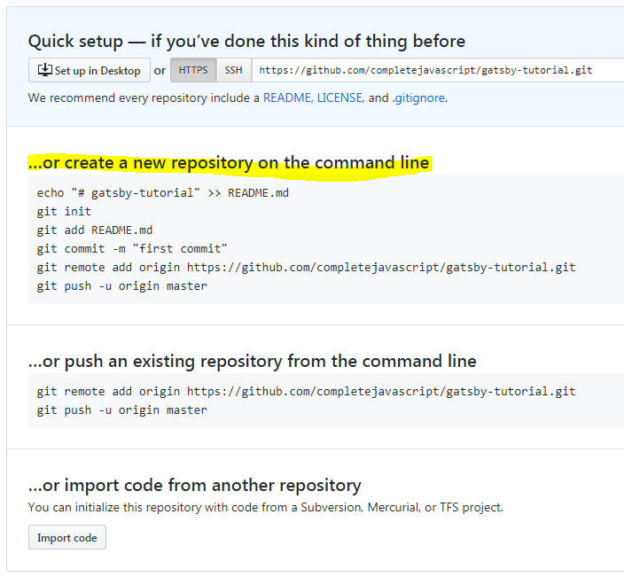

Đối với trường hợp này, mình sẽ lựa chọn cách thứ 2 (bôi vàng ở trên). Mình sẽ làm theo hướng dẫn để upload code lên github nhé. Tuy nhiên, vì project của mình đã có code rồi nên mình sẽ sửa lại một chút, như sau:

```bash
echo "# gatsby-tutorial" >> README.md
git init
git add .
git commit -m "first commit"
git remote add origin https://github.com/completejavascript/gatsby-tutorial.git
git push -u origin master
```

Sau khi việc upload code lên Github thành công. Mình bắt đầu deploy nó lên Netlify.

### Deploy lên Netlify

#### Tạo trang Netlify mới và deploy

Đầu tiên, bạn vào trang [create a new site](https://app.netlify.com/start).

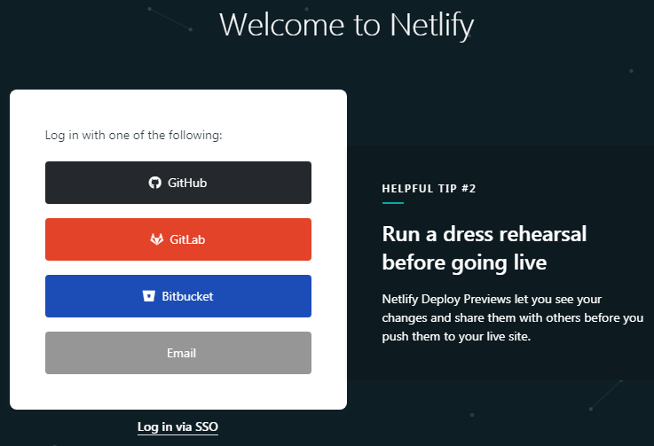

Netlify sẽ yêu cầu đăng nhập. Và bạn có thể lựa chọn bất kì cách nào. Tuy nhiên, mình đã upload code lên Github và deploy code ở Github lên Netlify. Do đó, mình sẽ chọn đăng nhập bằng Github.

Vì mình đang làm demo trên tab ẩn danh - tương đương với việc mình chưa đăng nhập Github trước đó. Lúc này, Netlify sẽ yêu cầu mình nhập thông tin để đăng nhập Github.

Sau khi đăng nhập thành công, bạn bắt đầu được chuyển đến trang để tạo mới một site.

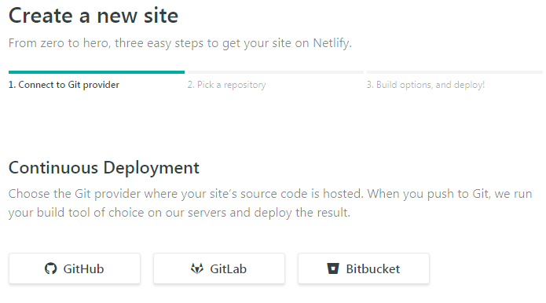

Mình sẽ chọn mục *GitHub*. Sau đó, Netlify sẽ yêu cầu Authorize Github.

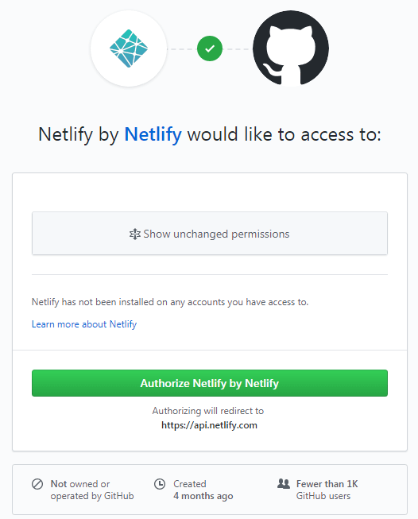

Bạn nhấn vào button màu xanh để đồng ý là OK.

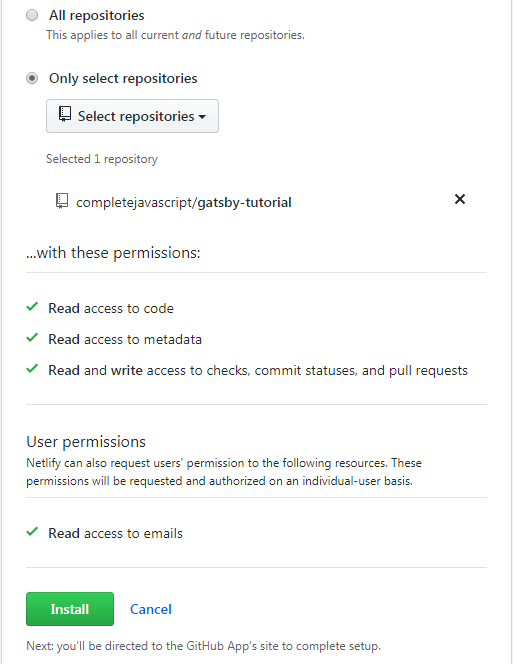

Tiếp theo, mình chọn repository vừa upload lên github, rồi nhấn *Install*.

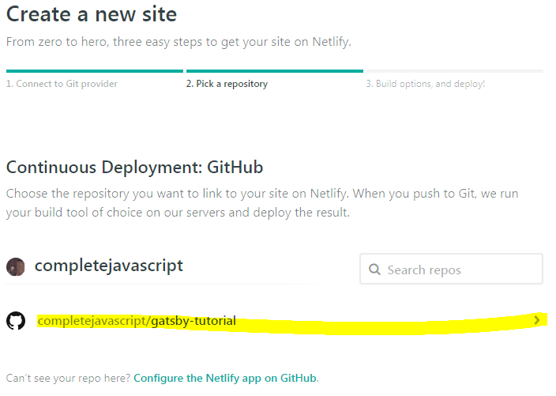

Tiếp theo, mình chọn vào phần gạch vàng như trong hình trên, rồi nhấn vào *Deploy Site*.

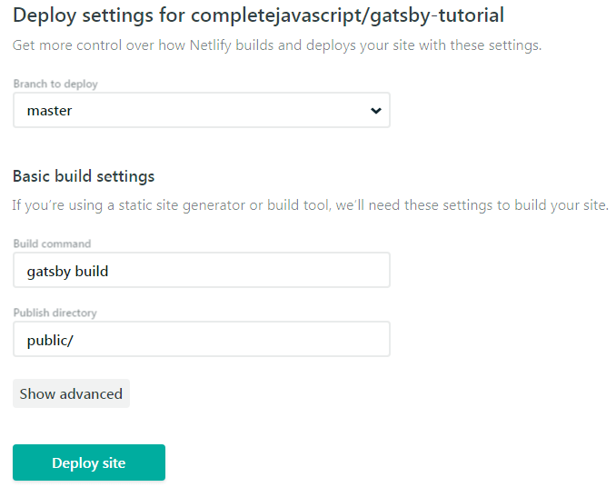

Chọn nhánh để deploy

Công việc cuối cùng là chờ đợi cho đến khi Netlify cài đặt xong.

#### Thay đổi cài đặt trang Netlify

Trong lúc chờ cài đặt thành công, mình sẽ thay đổi tên của blog mặc định. Bạn thấy đấy, tên mặc định khá xấu xí:

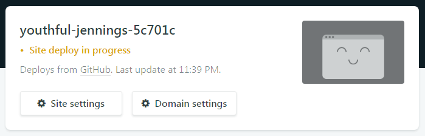

Mình sẽ nhấn vào *Site settings* để thay đổi *Site name*. Phần tiếp theo khá đơn giản, bạn cứ làm theo hướng dẫn như trên giao diện là được.

Lúc đầu mình định lấy tên *gatsby-tutorial* nhưng tiếc là tên này đã tồn tại, nên mình lấy tên *gatsby-tutorial-demo*.

Kết quả trang blog của mình bây giờ có địa chỉ: *[https://gatsby-tutorial-demo.netlify.com](https://gatsby-tutorial-demo.netlify.com)*.

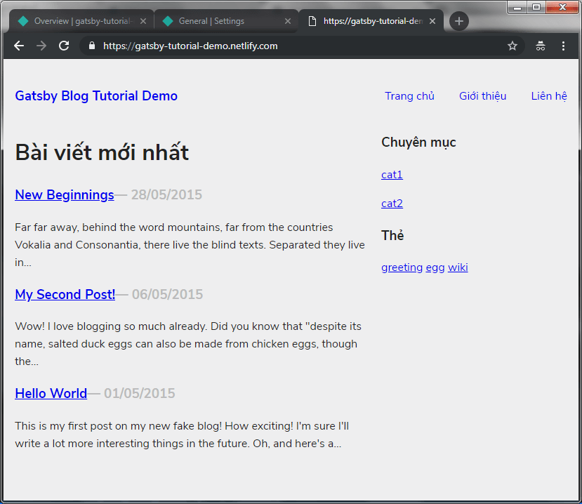

Kết quả khá ngon lành phải không bạn (còn phần custom domain, bạn có thể tự nghiên cứu thêm, cũng khá đơn giản, nếu cần bạn có thể để lại bình luận, mình sẽ support).

## Đánh giá ưu nhược điểm của Gatsby.js

Cái gì thì cũng có ưu nhược điểm của nó. Đối Gatsby.js thì sao?

### Ưu điểm

- Trang blog tạo bằng Gatsby chạy khá nhanh. Thậm chí bạn chỉ cần load trang web một lần, sau đó, dù mất mạng thì bạn vẫn có thể sử dụng trang web bình thường.
- Hỗ trợ nhiều plugin, giúp tạo trang blog nhanh mà tốn ít công sức (bài viết sau mình sẽ liệt kê ra các plugin thường hay được sử dụng nhất)
- Khả năng tái sử dụng tốt. Sự thật là mình đã tạo ra 2 trang blog với cùng một core, chỉ biến tấu đi một chút.
- Không yêu cầu cài đặt server, thay vào đó có thể deploy ở nhiều nền tảng miễn phí

### Nhược điểm

- Vì Gatsby.js chuyên để tạo static website, nên việc triển khai hệ thống bình luận đều phải dựa vào service bên thứ 3 như: Disqus, Facebook, Google Plus,...
- Nếu bạn không rành về lập trình thì sử dụng Gatsby có vẻ khá khó khăn. Mặc dù, Gatsby hỗ trợ nhiều starter rất hay.

## Lời kết

Trên đây là cách để tạo trang blog với Gatsby.js mà mình đã đúc kết lại được sau khi thực hành nó một thời gian. Dĩ nhiên, còn nhiều thứ mà mình chưa đề cập đến ở đây như: phần bình luận, chia sẻ mạng xã hội, tìm kiếm trên trang web, SEO,... Nhưng dù sao thì mình tin rằng, với những thứ mình trình bày ở đây, bạn có thể tạo cho mình một trang blog đơn giản. Sau đó, nếu cần thêm các chức năng phức tạp hơn thì công việc sẽ đơn giản hơn rất nhiều.

<a href="https://github.com/completejavascript/gatsby-tutorial" class="btn btn-primary margin-bottom">
  Xem code trên Github
</a>

<a href="https://gatsby-tutorial-demo.netlify.com/" class="btn btn-primary margin-bottom">
  Xem Demo
</a>

Bài viết đến đây cũng khá dài rồi, xin chào và hẹn gặp lại bạn trong [bài viết tiếp theo](/mot-so-plugin-gatsby-js-hay-dung), thân ái!

<hr class="border-color-light-grey" />

★ Nếu bạn thấy bài viết này hay thì hãy theo dõi mình trên Facebook để nhận được thông báo khi có bài viết mới nhất nhé:

- Facebook Fanpage: [Complete JavaScript](https://www.facebook.com/completejavascript/)
- Facebook Group: [Hỏi đáp JavaScript VN](https://www.facebook.com/groups/HoiDapJavascriptVN)
- Portfoflio: [Lam Pham](http://about.phamvanlam.com/)
