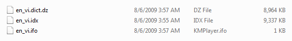
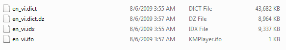
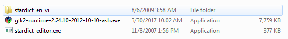
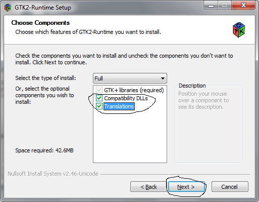
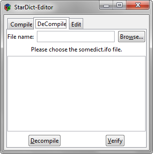
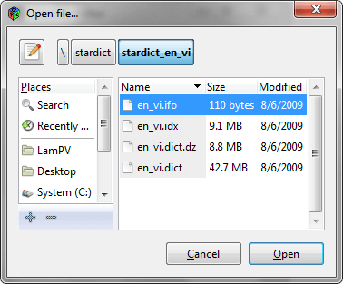
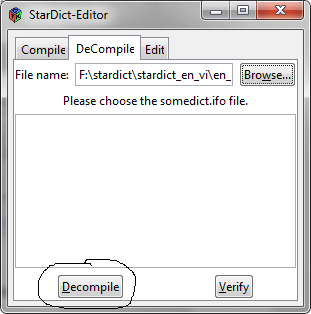
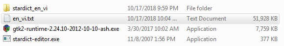

Gần đây, trên diễn đàn nổi tiếng **DayNhauHoc**, có một bạn hỏi [xin file .text kho từ vựng Tiếng anh](https://daynhauhoc.com/t/xin-file-text-kho-tu-vung-tieng-anh/37916/15). Mà thực tế, cách đây khoảng một năm, mình đã từng dành thời gian nghiên cứu, tìm tòi để tìm ra cách tạo bộ dữ liệu từ điển dạng text từ cơ sở dữ liệu của [StarDict](http://stardict-4.sourceforge.net/).

**Tại sao mình làm việc này?**

À, lúc đó mình đang học về [Node.js](https://nodejs.org/en/) nên cũng mày mò làm cho được một cái Dictionary trên web.

Mà cơ sở dữ liệu cho Node.js thì mình lại dùng [MongoDB](https://www.mongodb.com/), nên mình phải convert cái database của StarDict thành dạng text.

_Sau đó, mình làm một cái tool để chuyển dữ liệu dạng text này thành kiểu của MongoDB._

Vì vậy, mình quyết định viết bài này để chia sẻ với bạn cách mà mình đã làm để tạo bộ dữ liệu từ điển dạng text này.

Mời bạn theo dõi bài viết!

## Download công cụ cần thiết

### Download bộ từ điển StarDict

Dĩ nhiên rồi, đầu tiên bạn phải download bộ từ điển của StarDict tại [đây](https://sourceforge.net/projects/ovdp/files/Stardict/).

Tại trang download, bạn sẽ thấy có rất nhiều loại từ điền khác nhau liên quan tới English, Italian, Spanish, French,...

Giả sử mình tải bộ từ điển Anh Việt về. Rồi sau khi giải nén xong, mình thu được 3 tệp tin như sau:

Tiếp theo, mình sử dụng [7zip](https://www.7-zip.org/) để giải nén **en_vi.dict.dz** để thu được **en_vi.dict**.

Kết quả:

### Download công cụ chuyển đổi

Tiếp theo mình tải 2 công cụ về, bao gồm:

- [gtk2-runtime-2.24.10-2012-10-10-ash.exe](http://bit.ly/download_gtk2_runtime)
- [stardict-editor.exe](http://bit.ly/download_stardict_editor)

Trong đó, **gtk2-runtime** sẽ cài đặt một số **dll** cần thiết để cho thằng **stardict-editor** chạy. Và thằng stardict-editor này chính là thằng sẽ tạo bộ dữ liệu từ điển dạng text cho mình.

_Vì hai tệp tin này mình tải từ rất lâu rồi, nên không còn nhớ link gốc ở đâu nữa._

Kết quả mình có những công cụ như sau:

## Cài đặt môi trường

Đầu tiên bạn chạy **gtk2-runtime**. Cài đặt dễ lắm. Bạn chỉ cần chú ý là có một bước như này:

Bạn phải **nhấn vào 2 checkbox** phía trên, rồi nhấn **Next**. Sau đó, bạn cứ chọn **Next**, hoặc **Install**,... cho đến khi **Finish** là cài đặt xong.

## Bắt đầu tạo bộ dữ liệu từ điển dạng text

Đầu tiên, bạn click vào **stardict-editor.exe**. Phần mềm này sẽ chạy luôn mà không cần cài đặt.

Sau khi chương trình xuất hiện, bạn chọn vào tab **DeCompile** như hình dưới.

Tiếp theo là nhấn vào **Browse** và chọn đến file **en_vi.ifo** ở bên trong thư mục chứa bộ dữ liệu từ điển mà mình tải về lúc đầu rồi nhấn **Open**.

Sau đó, bạn chỉ cần nhấn vào **Decompile**.

Nếu bạn thấy thông báo **Done!**, thì nghĩa là bạn đã tạo bộ dữ liệu từ điển dạng text thành công.

Nếu cẩn thận hơn thì bạn có thể nhấn thêm vào **Verify** để kiểm tra lại kết quả một lần nữa.

Kết quả là mình đã có bộ dữ liệu từ điển dạng text rồi!

## Lời kết

Trên đây là cách mà mình đã dùng để tạo bộ dữ liệu từ điển dạng text từ database của StarDict.

Nếu có bước nào khó hiểu, bạn có thể đặt câu hỏi trong phần bình luận phía dưới. Mình sẽ cố gắng giải đáp nhé!

Xin chào và hẹn gặp lại!

★ Nếu bạn thấy bài viết này hay thì hãy theo dõi mình trên Facebook để nhận được thông báo khi có bài viết mới nhất nhé:

- Facebook Fanpage: [Complete JavaScript](https://www.facebook.com/completejavascript/)
- Facebook Group: [Hỏi đáp JavaScript VN](https://www.facebook.com/groups/HoiDapJavascriptVN)
- Portfoflio: [Lam Pham](http://about.phamvanlam.com/)
