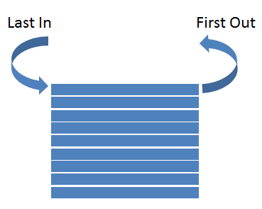
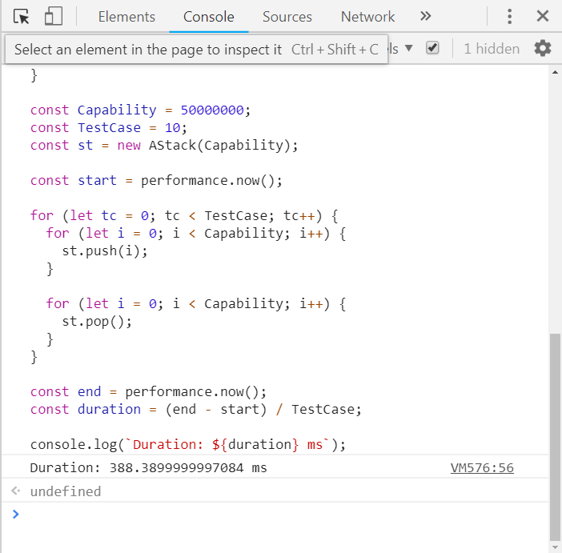

Ý tưởng của bài viết này xuất phát từ một bài viết trên Medium là [DS — Stack implement in JS](https://medium.com/@mayashavin/ds-stack-implement-in-js-c75ccc254e27). Trong đó, tác giả bài viết đã triển khai Stack trong JavaScript với Object và khẳng định cách này nhanh hơn so với việc sử dụng Array.

Mình thì không tin điều này lắm. Vì vậy, mình quyết định thử triển khai Stack với cả Array, Object và Map luôn. Sau đó, mình test thử xem liệu cách triển khai nào sẽ cho thời gian chạy là nhanh nhất.

Trước khi bắt đầu bài viết mình muốn nhấn mạnh về mục đích của bài viết:

- Giúp bạn hiểu cơ bản về cấu trúc dữ liệu Stack.
- Biết cách triển khai Stack trong JavaScript với Array, Object và Map.
- So sánh tốc độ giữa 3 cách triển khai.

Và những kiến thức cơ bản mà bạn cần phải nắm vững:

- [Array](/javascript-array-co-ban)
- [Object](/javascript-object-last-but-not-least)
- [Map](/map-trong-javascript-thi-sao)

Nếu bạn đã nắm vững kiến thức thì mình sẽ bắt đầu luôn nhé!

## Cơ bản về Stack

### Stack là gì?

Stack là một kiểu cấu trúc dữ liệu tuyến tính, tuân theo quy luật LIFO (Last In First Out) hay FILO (First In Last Out). Hay nói nôm na là "vào sau thì ra trước, mà vào trước thì ra sau".

Ví dụ như khi bạn xếp sách thành một chồng. Rõ ràng, cuốn sách xếp trước sẽ ở dưới cùng, nên nó sẽ phải ra sau cùng. Và cuốn sách xếp cuối cùng thì ở trên cùng, nên nó sẽ được lấy ra đầu tiên.



### Ứng dụng Stack trong lập trình

Stack là một cấu trúc dữ liệu cơ bản nhưng được áp dụng khá nhiều trong lập trình:

- [Triển khai thuật toán Undo-Redo](/trien-khai-thuat-toan-undo-redo-trong-javascript) cho các ứng dụng (soạn thảo văn bản, chỉnh sửa ảnh, video,...)
- [Chuyển biểu thức trung tố thành biểu thức hậu tố](https://yinyangit.wordpress.com/2011/01/26/algorithm-chuy%E1%BB%83n-bi%E1%BB%83u-th%E1%BB%A9c-trung-t%E1%BB%91-sang-ti%E1%BB%81n-t%E1%BB%91-va-h%E1%BA%ADu-t%E1%BB%91-b%E1%BA%B1ng-stack/) cho việc tính toán giá trị biểu thức
- Tính năng tiến, lùi trang trên trình duyệt web
- Cấu trúc Call Stack trong một chương trình
- ...

### Các phép toán cơ bản

Một số phép toán cơ bản có thể làm trên Stack là:

- **Push**: thêm một phần tử vào đỉnh Stack khi nó chưa **Full** (đầy). Nếu thành công thì trả về **true**, ngược lại trả về **false**.
- **Pop**: lấy ra một phần tử ở đỉnh Stack khi nó không **Empty** (rỗng). Nếu thành công thì trả về **giá trị của phần tử** đó, ngược lại trả về **undefined**.
- **Peek**: trả về giá trị phần tử ở đỉnh Stack khi nó không Empty (phần tử đó **vẫn tồn tại** trong Stack).
- **IsEmpty**: kiểm tra xem Stack có rỗng hay không. Nếu đúng trả về **true**, ngược lại trả về **false**.
- **IsFull**: kiểm tra xem Stack có đầy hay chưa. Nếu Stack đầy thì trả về **true**, ngược lại trả về **false**.
- **Clear**: xoá **hết tất cả các phần tử** khỏi Stack.

## Triển khai Stack trong JavaScript

### Triển khai Stack trong JavaScript với Array

```js
class AStack {
  constructor(capability) {
    this.data = [];
    this.capability = capability;
  }

  isEmpty() {
    return this.data.length === 0;
  }

  isFull() {
    return this.data.length === this.capability;
  }

  push(item) {
    if (this.isFull()) return false;

    this.data.push(item);
    return true;
  }

  pop() {
    if (this.isEmpty()) return undefined;
    return this.data.pop();
  }

  peek() {
    if (this.isEmpty()) return undefined;
    return this.data[this.data.length - 1];
  }

  clear() {
    this.data.length = 0;
  }
}
```

### Triển khai Stack trong JavaScript với Object

```js
class OStack {
  constructor(capability) {
    this.data = {};
    this.size = 0;
    this.capability = capability;
  }

  isEmpty() {
    return this.size === 0;
  }

  isFull() {
    return this.size === this.capability;
  }

  push(item) {
    if (this.isFull()) return false;

    this.data[this.size] = item;
    this.size++;
    return true;
  }

  pop() {
    if (this.isEmpty()) return undefined;

    let item = this.data[this.size - 1];
    delete this.data[this.size - 1];
    this.size--;
    return item;
  }

  peek() {
    if (this.isEmpty()) return undefined;
    return this.data[this.size - 1];
  }

  clear() {
    while (!this.isEmpty()) this.pop();
    this.size = 0;
  }
}
```

### Triển khai Stack trong JavaScript với Map

```js
class MStack {
  constructor(capability) {
    this.data = new Map();
    this.capability = capability;
  }

  isEmpty() {
    return this.data.size === 0;
  }

  isFull() {
    return this.data.size === this.capability;
  }

  push(item) {
    if (this.isFull()) return false;

    this.data.set(this.data.size, item);
    return true;
  }

  pop() {
    if (this.isEmpty()) return undefined;

    let item = this.data.get(this.data.size - 1);
    this.data.delete(this.data.size - 1);
    return item;
  }

  peek() {
    if (this.isEmpty()) return undefined;
    return this.data.get(this.data.size - 1);
  }

  clear() {
    this.data.clear();
  }
}
```

## So sánh hiệu năng 3 cách triển khai Stack trong JavaScript

### Kịch bản test

Để test 3 cách triển khai Stack trong JavaScript với Array, Object và Map, mình viết một đoạn code như sau:

```js
const Capability = 50000000;
const TestCase = 10;

// Test dành cho Array
const st = new AStack(Capability);

/*
 * // Test dành cho Object
 * const st = new OStack(Capability);
 *
 * // Test dành cho Map
 * const st = new MStack(Capability);
 */

const start = performance.now();

for (let tc = 0; tc < TestCase; tc++) {
  for (let i = 0; i < Capability; i++) {
    st.push(i);
  }

  for (let i = 0; i < Capability; i++) {
    st.pop();
  }
}

const end = performance.now();
const duration = (end - start) / TestCase;

console.log(`Duration: ${duration} ms`);
```

Ở đây, mình khởi tạo Stack với kích thước tối đa là **Capability = 50000000**. Kích thước này theo mình là hợp lý vì nếu kích thước Stack nhỏ quá thì kết quả có thể sẽ không chính xác lắm. Ngược lại, nếu kích thước tối đa mà quá lớn thì có thể làm cho trình duyệt hoặc máy bạn bị đơ vì thiếu bộ nhớ hoặc thời gian chạy quá lâu.

Tiếp theo, giá trị **TestCase = 10**, nghĩa là mình thực hiện một công việc 10 lần, sau khi hoàn thành, tính được tổng thời gian thực thi thì mình sẽ chia cho 10 để lấy giá trị trung bình.

Công việc ở đây là mình sẽ push liên tục một số lượng bằng **Capability** phần tử vào Stack. Sau đó, mình pop liên tiếp để xoá hết các phần tử đó khỏi Stack.

Để tính thời gian, mình sử dụng phương thức [performance.now()](https://developer.mozilla.org/en-US/docs/Web/API/Performance/now). Phương thức này trả về giá trị thời gian hiện tại theo **milliseconds**. Mình sẽ lấy giá trị thời gian **trước** và **sau** khi thực hiện công việc, rồi trừ cho nhau sẽ suy ra giá trị tổng thời gian. Cuối cùng chia nó cho số lượng **Testcase** để suy ra giá trị trung bình và hiển thị.

### Môi trường test

Mình thực hiện test trên Console của Google Chrome. Bạn có thể mở Console này bằng cách nhấn tổ hợp phím (Ctrl + Shift + I) hoặc F12.

Nếu bạn test trên trình duyệt khác thì cũng tương tự.



Bạn chỉ cần copy-paste toàn bộ phần code (bao gồm code triển khai Stack và Code test) vào tab **Console** rồi nhấn Enter là được. Nhớ là nếu bạn test Stack với Array thì trong phần code test bạn phải khởi tạo Stack ứng với Array (**AStack**). Tương tự như Stack với Object (**OStack**) và Stack với Map (**MStack**).

### Kết quả

Sau một hồi kiểm tra mình thu được kết quả:

- Stack với Array: **~388 ms/testcase**
- Stack với Object: **~7637 ms/testcase**
- Stack với Map: **~3193 ms/testcase**

Dĩ nhiên, thời gian test có thể khác nhau giữa các lần test, giữa các trình duyệt và giữa các máy tính. Tuy nhiên, suy cho cùng thì mình thấy rằng triển khai Stack bằng Array vẫn là nhanh nhất.

Nếu bạn test trên máy mà thấy kết quả khác xa với kết quả trên thì có thể để lại comment xuống phía dưới giúp mình nhé! (Để mình nghiên cứu lại)

## Lời kết

Trên đây là cách triển khai Stack trong JavaScript với Array, Object và Map.

Hy vọng qua bài viết này bạn thu được:

- Kiến thức cơ bản về cấu trúc dữ liệu Stack.
- Biết cách triển khai Stack trong JavaScript với Array, Object và Map.
- So sánh tốc độ giữa 3 cách triển khai.

Ngoài 3 cách triển khai trên thì bạn còn có cách nào khác nữa không. Chia sẻ lại với mình và mọi người nhé!

Xin chào và hẹn gặp lại!

<hr class="border-color-light-grey" />

★ Nếu bạn thấy bài viết này hay thì hãy theo dõi mình trên Facebook để nhận được thông báo khi có bài viết mới nhất nhé:

- Facebook Fanpage: [Complete JavaScript](https://www.facebook.com/completejavascript/)
- Facebook Group: [Hỏi đáp JavaScript VN](https://www.facebook.com/groups/HoiDapJavascriptVN)
- Portfoflio: [Lam Pham](http://about.phamvanlam.com/)
