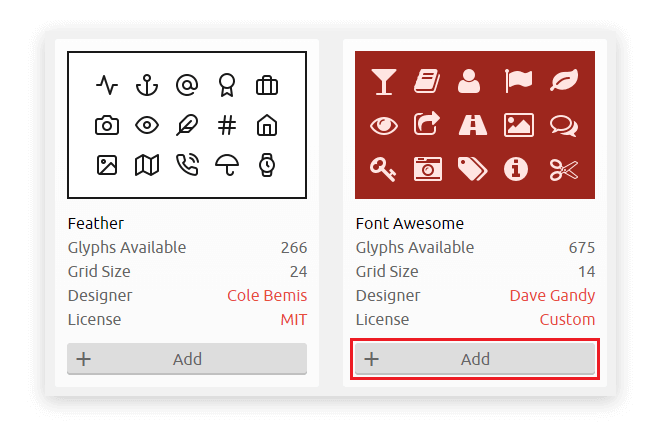
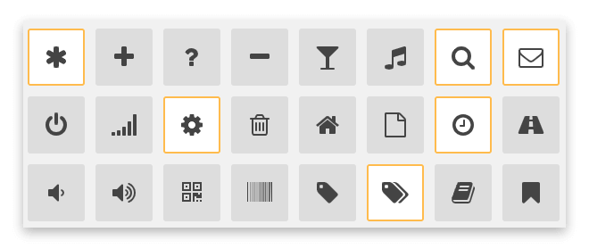
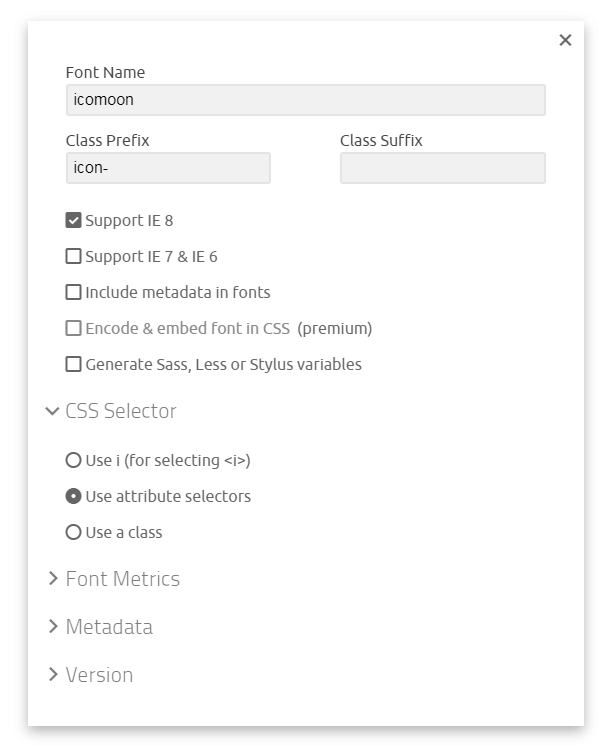

[Font Awesome](https://fontawesome.com/) là một trong những icon font phổ biến nhất hiện nay. Với phiên bản mới nhất hiện tại 5.5.0, Font Awesome hỗ trợ trên 1400 icon free. Tuy nhiên, nếu bạn **chỉ muốn sử dụng khoảng 10 đến 20 icon** trong đó... thì bạn vẫn phải tải toàn bộ style của Font Awesome. Điều này quả thật là chưa tối ưu. Một câu hỏi đặt ra bây giờ là: làm sao mình vẫn sử dụng được Font Awesome mà chỉ cần tải về style của những icon mình dùng? Sau khi tìm hiểu một số phương pháp thì mình thấy cách tối ưu Font Awesome với IcoMoon là đơn giản và hiệu quả nhất.

## Vậy IcoMoon là gì?

[IcoMoon](https://icomoon.io) thực chất là một ứng dụng cho phép bạn **tuỳ chỉnh icon font**, **import SVG để tạo ra font riêng, convert font sang SVG, PDF, XAML, CSH,**... Và IcoMoon cung cấp hơn 5000 icon free bằng cách tối ưu các thư viện miễn phí như:

- [IcoMoon - Free](https://icomoon.io/#icons)
- [Brands](https://simpleicons.org/)
- [Zondicons](http://www.zondicons.com/)
- [Hawcons](http://hawcons.com/)
- [Linecons](http://designmodo.com/linecons-free/)
- [Broccolidry](http://dribbble.com/shots/587469-Free-16px-Broccolidryiconsaniconsetitisfullof-icons)
- [60 Vicons](https://dribbble.com/shots/1663443-60-Vicons-Free-Icon-Set)
- [Steadysets](http://dribbble.com/shots/929153-Steady-set-of-icons)
- [Entypo+](http://www.entypo.com/)
- [Feather](https://feathericons.com/)
- [Font Awesome](https://github.com/FortAwesome/Font-Awesome)
- [Material Icons](https://www.google.com/design/icons/)
- [Typicons](http://typicons.com/)
- [Brankic 1979](http://brankic1979.com/icons/)
- [Eighty Shades](http://dribbble.com/shots/928458-80-Shades-of-White-Icons)
- [Meteocons](http://www.alessioatzeni.com/meteocons/)
- [wpzoom](http://www.wpzoom.com/wpzoom/new-freebie-wpzoom-developer-icon-set-154-free-icons/)
- [Iconic](https://github.com/somerandomdude/Iconic)
- [Elegant Themes - Line Icons](http://www.elegantthemes.com/blog/freebie-of-the-week/free-line-style-icons)
- [Afiado](http://www.toicon.com/series/afiado)

Và quan trọng hơn cả, IcoMoon cho phép bạn lựa chọn icon mà mình sẽ sử dụng và chỉ tải về style cho những icon đó. Vì vậy, bạn sẽ tối ưu được dung lượng file icon tải về cho trang web của mình.

## Tối ưu Font Awesome với IcoMoon

### Bước 1: thêm Font Awesome vào IcoMoon

Trước tiên, bạn cần phải vào danh sách các [thư viện hỗ trợ](https://icomoon.io/app/#/select/library) của IcoMoon.



Trong đó, bạn tìm đến phần Font Awesome rồi nhấn vào nút **Add** để thêm thư viện này vào IcoMoon App.

### Bước 2: lựa chọn các icon sử dụng

Bạn vào trang [Select](https://icomoon.io/app/#/select) để lựa chọn các icon font sử dụng, bằng cách click vào mỗi icon:



### Bước 3: tuỳ chỉnh và tải về package

Sau khi đã lựa chọn được các icon sử dụng rồi, bạn nhấn vào phần **Generate Font** phía dưới - bên phải của trang web hoặc vào trang [Font](https://icomoon.io/app/#/select/font) để tải các icon font về máy tính.

Nếu để ý phía dưới bên phải, bạn sẽ nhìn thấy button **Download**. Bạn chỉ cần nhấn vào đó thì một file **.zip** chứa icon font, cùng với ví dụ và cách sử dụng demo sẽ được tải về máy tính.

Tuy nhiên, mình khuyến khích bạn nhấn vào biểu tượng **bánh răng** bên cạnh để cài đặt một chút trước khi tải package về máy.



Trong đó:

- **Font Name**: tên package sẽ được tải về. Mặc định là _icomoon_.
- **Class Prefix** và **Class Suffix**: thêm tiền tố và hậu tố vào tên class của icon. Bạn có thể tuỳ chọn giá trị này nếu cần thiết để tránh xung đột về tên class với các thành phần khác. Mặc định, tiền tố là _icon-_ và hậu tố để trống.
- Tiếp theo là các tuỳ chọn:
  - **Support IE 8**: hỗ trợ IE8
  - **Support IE 7 và IE6**: hỗ trợ IE 7 và IE 6
  - **Include metadata in fonts**: thêm metadata vào fonts
  - **Encode & embed font in CSS**: chỉ hỗ trợ gói Premium
  - **Generate Sass, Less or Stylus variables**: sinh ra các biến số dành cho Sass, Less hoặc Stylus
- **CSS Selector**: lựa chọn cách sử dụng font trong [CSS](/tag/css/) với 3 loại CSS [Selector](https://developer.mozilla.org/en-US/docs/Web/CSS/CSS_Selectors).
  - **Use i (for selecting <>)**: sử dụng thẻ _i_. Ví dụ: <code>&lt;i class="icon-asterisk"&gt;&lt;/i&gt;</code>
  - **Use attribute selectors**. Ví dụ: <code>&lt;span class="icon-asterisk"&gt;&lt;/span&gt;</code>
  - **Use a class**. Ví dụ: <code>&lt;span class="icon icon-asterisk"&gt;&lt;/span&gt;</code>
- **Font metrics**, **Metadata** và **Version**: điều chỉnh kích thước cho font, thêm metadata và thông tin version (cái này mình để mặc định).

Sau khi tuỳ chỉnh xong các cài đặt, bạn tắt cửa sổ này đi và nhấn vào button **Download** như mình đã nói ở trên để tải về package của font.

### Bước 4: sử dụng

Bên trong package này, bạn sẽ thấy hai phần quan trọng như:

- **fonts**: thư mục chứa font.
- **style.css**: tệp tin khai báo và cài đặt cho các font sử dụng.

Khi sử dụng các font tuỳ chỉnh này, bạn cần phải copy thư mục **fonts** và tệp tin **style.css** vào project, rồi cấu hình file **html** như bình thường:

```html
<!doctype html>
<html>
<head>
  <link rel="stylesheet" href="style.css">
</head>
<body>
</body>
</html>
```

Còn việc sử dụng các icon này trong HTML như thế nào thì bạn có thể tham khảo thêm trong file **demo.html** (trong package tải về).

> **Bạn chú ý**: với mỗi cách sử dụng **CSS Selector** khác nhau thì cách sử dụng sẽ khác nhau (như mình đã nói ở bước 3).

## Lời kết

Trên đây là cách tối ưu Font Awesome với IcoMoon mà bạn có thể sử dụng. Với cách này bạn có thể giảm dung lượng Font Awesome tải về từ trên 50KB, xuống còn khoảng vài KB. Nếu có phần nào thắc mắc hoặc khó hiểu thì bạn có thể để lại câu hỏi trong phần bình luận phía dưới, mình sẽ cố gắng giải đáp.

_Bình thường bạn sử dụng Font Awesome như thế nào? Có tối ưu hay không? Nếu tối ưu thì tối ưu như thế nào? Chia sẻ với mình và mọi người nhé!_

Xin chào và hẹn gặp lại, thân ái!

<hr class="border-color-light-grey" />

★ Nếu bạn thấy bài viết này hay thì hãy theo dõi mình trên Facebook để nhận được thông báo khi có bài viết mới nhất nhé:

- Facebook Fanpage: [Complete JavaScript](https://www.facebook.com/completejavascript/)
- Facebook Group: [Hỏi đáp JavaScript VN](https://www.facebook.com/groups/HoiDapJavascriptVN)
- Portfoflio: [Lam Pham](http://about.phamvanlam.com/)
