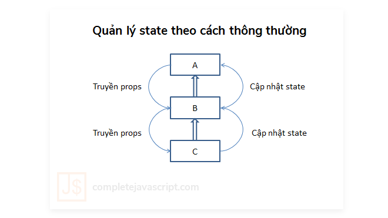
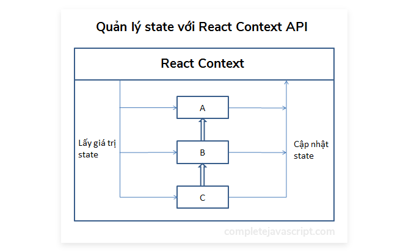

Bình thường bạn quản lý state trong React bằng cách nào? Đặt chúng trong Component gốc rồi truyền property từ Component cha sang Component con? Hay sử dụng một thư viện vô cùng quen thuộc, đó là [Redux](https://redux.js.org/)? Thật lòng mà nói thì mình chưa từng sử dụng Redux bao giờ. Mình mới chỉ tìm hiểu qua về concept của nó thôi. Nhưng khi áp dụng, mình thấy Redux khá phức tạp. Do đó, mình quyết định sẽ không sử dụng Redux nữa. Và điều này lại càng được khẳng định khi **React Context API** (version mới) được chính thức support ở [React phiên bản 16.3](https://github.com/facebook/react/blob/master/CHANGELOG.md#1630-march-29-2018). Vì vậy, bài viết này sẽ tìm hiểu về React Context API và cách sử dụng nó để quản lý state trong React.

## React Context API cơ bản

Theo như thông tin [trang chủ Reactjs](https://reactjs.org/docs/context.html) thì:

> Context provides a way to pass data through the component tree without having to pass props down manually at every level.

Điều đó có nghĩa là bạn có thể truyền các props đến một Component bất kỳ mà không cần phải truyền thủ công tại mọi Component.

Để làm rõ sự khác nhau khi sử dụng React Context API với cách quản lý state thông thường, mời bạn theo dõi ví dụ dưới đây.

Giả sử mình có 3 component (A, B, C) với quan hệ là: component A chứa component B và component B chứa component C.

### Cách quản lý state thông thường

Nếu quản lý state theo cách thông thường thì tất cả biến state mình phải đặt trong component A. Sau đó, mình phải truyền props sang B, rồi từ B sang C.

Kể cả trong trường hợp component B không cần sử dụng đến các thuộc tính này, mà chỉ component C cần thôi, thì mình vẫn phải truyền chúng xuống B. Chứ mình không thể truyền trực tiếp từ A đến C.

Ngược lại, khi cần cập nhật state từ C lên A, mình cũng cần phải cập nhật từ C lên B, rồi mới cập nhật từ B lên A được.



Thử tưởng tượng bạn đang có hàng chục component khác nhau. Nếu mà cứ truyền props với cập nhật state như thế này thì quả thật sẽ rất lằng nhằng và thừa code không cần thiết.

Đó là lý do, React Context API đã ra đời để giải quyết vấn đề này!

### Cách quản lý state với React Context API

Ý tưởng của React Context API là nó sẽ tập trung dữ liệu vào một nơi. Sau đó, nó cung cấp cơ chế cho phép mỗi component có thể lấy state cũng như cập nhật state trực tiếp tại đó mà không cần qua các component trung gian.



So với cách quản lý state thông thường, mình thấy cách này có ưu, nhược điểm là:

- **Ưu điểm**: hạn chế lặp lại code, hạn chế việc truyền props không cần thiết và quản lý state dễ dàng hơn.
- **Nhược điểm**: khó tái sử dụng component vì state tập trung tại một chỗ, tương tự như việc bạn sử dụng biến toàn cục vậy.

Như vậy là mình đã tìm hiểu về cơ chế làm việc của React Context API xong rồi. Tiếp theo là các API có thể sử dụng với React Context.

## Tìm hiểu các API của React Context

### React.createContext

```js
const MyContext = React.createContext(defaultValue);
```

Đây là API đầu tiên **bắt buộc** phải sử dụng. API này sẽ tạo mới một [object](/javascript-object-last-but-not-least/) đóng vai trò là Context. Và khi một component đăng ký sử dụng Context này thì nó sẽ đọc giá trị context từ **Provider** gần nhất.

Ngược lại, khi bên ngoài nó không có một **Provider** nào thì giá trị của context sẽ ứng với giá trị **defaultValue** bên trên.

### Context.Provider

```js
<MyContext.Provider value={/* some value */}>
```

Với mỗi một đối tượng Context sẽ tồn tại một đối tượng Provider. Đối tượng này có một property là **value**. Giá trị của **value** được hiểu là giá trị của Context.

Mỗi khi giá trị của **value** này thay đổi thì các thành phần bên trong Provider này sẽ bị render lại. Vì vậy, giá trị của **value** sẽ tương ứng là state của chương trình.

### Class.contextType

```js
class MyClass extends React.Component {
  componentDidMount() {
    let value = this.context;
    /* perform a side-effect at mount using the value of MyContext */
  }
  componentDidUpdate() {
    let value = this.context;
    /* ... */
  }
  componentWillUnmount() {
    let value = this.context;
    /* ... */
  }
  render() {
    let value = this.context;
    /* render something based on the value of MyContext */
  }
}

MyClass.contextType = MyContext;
```

Nếu như hai API trên là để khởi tạo Context và truyền giá trị cho Context thì API này dùng để sử dụng giá trị của Context.

Ở đây, thuộc tính **contextType** được gán giá trị là **MyContext** - thành phần được khởi tạo bởi _React.createContext()_ bên trên.

Sau đó, mình có thể truy cập đến giá trị của Context thông qua **this.context** ở bất kỳ phương thức nào thuộc [React Lifecycle](/tim-hieu-react-component-lifecycle/) và cả phương thức **render()** nữa.

### Context.Consumer

```js
<MyContext.Consumer>
  {value => /* render something based on the context value */}
</MyContext.Consumer>
```

Tương tự **Class.contextType**, API này giúp sử dụng giá trị của Context. Tuy nhiên hơi khác một chút là API này chỉ sử dụng ở phần JSX.

Trong đó, **value** chính là giá trị của Context. Và dĩ nhiên, khi bên ngoài component hiện tại không có Provider nào thì **value **chính là **defaultValue**.

Trên đây là những thông tin cơ bản về các API của React Context. Tiếp theo, mình sẽ làm một ví dụ cụ thể để demo cho các API này.

## Ví dụ Demo sử dụng React Context API

### Khởi tạo Project

Ở đây mình sử dụng [CodeSanbox.io](https://codesandbox.io) để làm Demo. Tuy nhiên, bạn cũng có thể sử dụng [Create-react-app](/tag/create-react-app/) để làm ví dụ ngay trên máy tính.

Để tạo mới một project React với Creat-react-app, bạn có thể tham khảo thêm bài viết: [Tạo và deploy ứng dụng React lên Github Pages](/deploy-ung-dung-react-len-github-pages/).

**Chú ý**: React Context API chính thức được hỗ trợ trên phiên bản React 16.3. Vì vậy, bạn cần phải sử dụng phiên bản React >= 16.3. Để đơn giản, bạn có thể nâng cấp React lên phiên bản mới nhất luôn bằng câu lệnh sau:

```bash
npm install --save react@latest
npm install --save react-dom@latest
```

<a href="https://vqlrp2xry3.codesandbox.io/" class="btn btn-primary margin-bottom">
  Xem Demo
</a>

<a href="https://codesandbox.io/s/vqlrp2xry3" class="btn btn-primary margin-bottom">
  Xem code
</a>

### Kịch bản Demo

Ở ví dụ này, mình có 3 Component là: Red, Blue và Green - theo đúng thứ tự component Red chứa component Blue và component Blue chứa component Green.

Component Red và Green hiển thị giá trị của state - number. Component Blue chứa 2 button để thay đổi giá trị state (tăng hoặc giảm 1 đơn vị).

Với mỗi component, mình sẽ sử dụng một cách khác nhau để đọc giá trị của context. Và sau đây là cách mình triển khai code.

### Khởi tạo Context

```js
const AppContext = React.createContext();
```

Ở đây mình không sử dụng giá trị **defaultValue** vì mình luôn sử dụng Provider.

### Định nghĩa AppProvider

```js
class AppProvider extends React.Component {
  state = {
    number: 10,
    inc: () => {
      this.setState({ number: this.state.number + 1 });
    },
    dec: () => {
      this.setState({ number: this.state.number - 1 });
    }
  };

  render() {
    return (
      <AppContext.Provider value={this.state}>
        {this.props.children}
      </AppContext.Provider>
    );
  }
}
```

**AppProvider** chính là một [Higher-Order Component](https://reactjs.org/docs/higher-order-components.html) dùng để đóng gọi lại _AppContext.Provider_. Mà khi mình luôn sử dụng **Provider**, thì có nghĩa là _AppProvider_ chính là Component lớn nhất chứa tất cả các Component còn lại. Do đó, mình sẽ định nghĩa state của App tại đây.

Như bạn thấy, **state** bao gồm:

- Biến **number**: dùng để hiển thị ở component Red và Green.
- Phương thức **inc()**: dùng để tăng giá trị biến state _number_ lên 1 đơn vị.
- Phương thức **dec()**: dùng để giảm giá trị biến state _number_ đi 1 đơn vị.

Cuối cùng, bên trong hàm _render(),_ mình truyền giá trị _this.state_ vào _value_ của _AppContext.Provider_.

### Sử dụng AppProvider

```js
const App = () => (
  <AppProvider>
    <Red />
  </AppProvider>
);

const rootElement = document.getElementById("root");
ReactDOM.render(<App />, rootElement);
```

Sử dụng AppProvider cũng không khác gì so với sử dụng các React Component khác nên mình sẽ để đây mà không giải thích gì thêm.

### Sử dụng contextType với component Red

```js
class Red extends React.Component {
  render() {
    return (
      <div className="red">
        {this.context.number}
        <Blue />
      </div>
    );
  }
}

Red.contextType = AppContext;
```

Ở đây, mình sử dụng **Class.contextType** nên cần khai báo _Red_ dạng class component. Và cách sử dụng thì khá đơn giản như mình đã đề cập ở trên.

Mình xin nhấn mạnh lại, **this.context** tương ứng với giá trị của context tại Provider gần nhất. Đó chính là giá trị **this.state** mà mình truyền vào _AppContext.Provider_ bên trên.

### Sử dụng consumer tại component Blue

```js
const Blue = () => (
  <div className="blue">
    <AppContext.Consumer>
      {context => (
        <>
          <button onClick={context.inc}>INC</button>
          <button onClick={context.dec}>DEC</button>
        </>
      )}
    </AppContext.Consumer>
    <Green />
  </div>
);
```

Ở component Blue, mình chỉ cần khai báo dạng Functional Component vì mình không sử dụng state cũng như các phương thức lifecycle tại đây.

Bạn chú ý bên trong _AppContext.Consumer_ là function dùng để render. Với context chính là giá trị của context tại Provider gần nhất. Đó cũng chính là giá trị **this.state** mà mình truyền vào _AppContext.Provider_ bên trên.

Bên trong hàm render trên, mình sử dụng thẻ rỗng <>. Tuy nhiên, bạn cũng có thể sử dụng [React.Fragment](https://reactjs.org/docs/fragments.html). Như vậy là hợp lý vì mình không muốn thêm một thẻ **div** vô nghĩa tại đây.

### Sử dụng consumer tại component Green

```js
class Green extends React.Component {
  render() {
    return (
      <div className="green">
        <AppContext.Consumer>
          {context => context.number}
        </AppContext.Consumer>
      </div>
    );
  }
}
```

Với mục đích demo, mình khai báo component Green dạng Class Component. Chứ thực tế là mình có thể khai báo nó dạng Functional Component.

Về cách sử dụng Context thì hoàn toàn giống bên trên rồi nhỉ?

## Lời kết

Như vậy là mình đã tìm hiểu và làm Demo xong về React Context API. Dĩ nhiên, đây mới chỉ là một ví dụ đơn giản. Nên chưa thể khẳng định rằng mình có thể sử dụng React Context để thay thế hoàn toàn cho Redux. Tuy nhiên, tại thời điểm hiện tại mình thấy React Context API vẫn rất ổn.

<a href="https://vqlrp2xry3.codesandbox.io/" class="btn btn-primary margin-bottom">
  Xem Demo
</a>

<a href="https://codesandbox.io/s/vqlrp2xry3" class="btn btn-primary margin-bottom">
  Xem code
</a>

Bạn thấy React Context API thế nào? Liệu nó có thể thay thế hoàn toàn cho các thư viện quản lý State trong React được không? Chia sẻ với mình nhé!

Còn bây giờ thì xin chào và hẹn gặp lại.

Tham khảo:

- [How to use the new React context API](https://hackernoon.com/how-to-use-the-new-react-context-api-fce011e7d87)
- [Context](https://reactjs.org/docs/context.html)

<hr class="border-color-light-grey" />

★ Nếu bạn thấy bài viết này hay thì hãy theo dõi mình trên Facebook để nhận được thông báo khi có bài viết mới nhất nhé:

- Facebook Fanpage: [Complete JavaScript](https://www.facebook.com/completejavascript/)
- Facebook Group: [Hỏi đáp JavaScript VN](https://www.facebook.com/groups/HoiDapJavascriptVN)
- Portfoflio : [Lam Pham](http://about.phamvanlam.com/)
