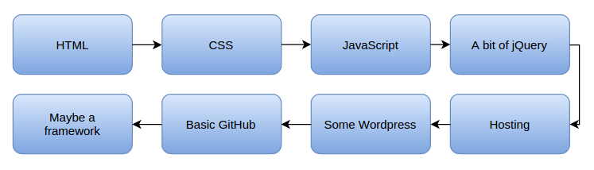
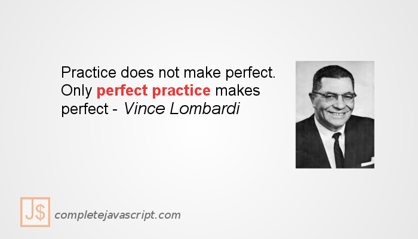

Khi mọi người cố gắng học lập trình Javascript, hay bất kỳ kĩ năng lập trình nào, họ thường trải qua những thử thách giống nhau như:

- Một vài ý tưởng có thể khó hiểu, đặc biệt nếu như bạn sử dụng một ngôn ngữ lập trình khác trước đó.
- Rất khó để tìm ra một khoảng thời gian (và thỉnh thoáng đó là động lực) để học.
- Một khi bạn đã hiểu một vài thứ, nó là rất dễ để bạn quên nó một lần nữa.
- Những công cụ là rất nhiều và luôn luôn thay đổi, rất khó để biết được nên bắt đầu học từ đâu.

May mắn là, những thử thách này có thể được nhận ra và cuối cùng được chinh phục. Trong bài viết này, tôi sẽ trình bày sáu mẹo đơn giản giúp học lập trình [Javascript](/javascript) nhanh hơn và giúp bạn trở thành một lập trình viên [hạnh phúc hơn](/tag/anh-che), hiệu quả hơn.

## Đừng để những quyết định tương lai làm bạn dừng bước từ những tiến bộ hôm nay

Với nhiều người học lập trình Javascript, một trong những câu hỏi đầu tiên họ hỏi đó là: nên sử dụng Framework nào (và công bằng mà nói thì có rất nhiều). Nhưng nếu như bạn chưa thành thạo với [Javascript nguyên thuỷ](/values-types-va-operators-trong-javascript-phan-1), đó sẽ là một câu hỏi sai. Bạn sẽ dành tất cả thời gian của mình để tìm kiếm những Framework khác nhau. Và thực sự, bạn không hề tiến bộ.

Một cách để giúp bạn thoát khỏi cái bẫy của sự do dự, đó là việc có một bản đồ về những gì bạn cần phải học. Ví dụ, để trở thành một lập trình viên front-end, tấm bản đồ của bạn có thể như sau:

Cụ thể hơn nữa, bạn có thể làm một trang web với [HTML](/tag/html) và [CSS](/tag/css). Hãy xem xét từng bước riêng rẽ như này. Nó sẽ giúp bạn thấy được những gì bạn cần tập trung vào, và bạn sẽ không phải mất thời gian lo lắng về những thứ sẽ đến sau này.

## Đừng để sự tự tin làm bạn quên đi những thứ đã học

Hiểu một ý tưởng nhanh có thể là một trong những thứ có hại nhất đến sự tiến bộ của bạn trong việc học lập trình Javascript. Hãy để tôi giải thích.

Khi bạn đọc vài thứ và hoàn toàn hiểu ý nghĩa. Nó sẽ xúi giục bạn tiếp tục với những thứ tiếp theo ngay lập tức. Có thể bạn sẽ lại hiểu và lại tiếp tục với những thứ tiếp theo một lần nữa. Nhưng chẳng bao lâu, bạn sẽ đến một điểm mà bạn nhận ra rằng mình đã quên những thứ đã học trước đó. Vì vậy bạn quay lại. Bạn xem qua những thứ đã học để nhớ lại chúng. Rồi bạn lại tiếp tục học những thứ mới. Nhưng bây giờ, bạn lại quên một vài thứ khác. Cứ như thế cho đến khi bạn nhận ra rằng mình đã hoàn toàn quên hết những gì đã học. Bạn thất vọng, nghỉ ngơi, rồi sau đó cố gắng quay lại. Cuối cùng bạn thật sự đã quên hết tất cả.

**May mắn là có một cách đơn giản gồm 2 bước cho vấn đề này:**

- Giới hạn những thứ bạn sẽ học trong một lần.
- Thực sự thực hành - bắt tay vào viết code.

Mỗi khi bạn học một ý tưởng mới, hãy chắc chắn rằng bạn nghiên cứu nó, chơi với nó, trở nên thoải mái với nó. Thậm chí kết hợp nó với những ý tưởng khác. Một điều thật sự quan trọng đó là viết ra những đoạn code ở bất kì ví dụ nào mà bạn học. Bởi vì, đây là những thứ giúp bạn hấp thu kiến thức mới. Và việc giới hạn những thứ bạn học trong một lần sẽ giúp bạn ghi nhớ những thứ cần thiết. Một lý do đơn giản hơn, đó là việc nhớ ít thứ hơn sẽ dễ dàng hơn.

Quá trình này có cảm giác sẽ lâu hơn việc đọc lướt qua mọi thứ, rồi tiếp tục với những thứ khác. Nhưng nó thực sự tốn ít thời gian hơn, vì bạn không cần phải quay lại để xem lại những gì mình đã học.

_Có thể bạn quan tâm:_

- _[Xoắn não với phỏng vấn JavaScript 1](/xoan-nao-voi-phong-van-javascript-1)_
- _[Xoắn não với phỏng vấn JavaScript 2](/xoan-nao-voi-phong-van-javascript-2)_
- _[Xoắn não với phỏng vấn JavaScript 3](/xoan-nao-voi-phong-van-javascript-3)_
- _[Xoắn não với phỏng vấn JavaScript 4](/xoan-nao-voi-phong-van-javascript-4)_
- _[Xoắn não với phỏng vấn JavaScript 5](/xoan-nao-voi-phong-van-javascript-5)_
- _[Xoắn não với phỏng vấn JavaScript 6](/xoan-nao-voi-phong-van-javascript-6)_
- _[Xoắn não với phỏng vấn JavaScript 7](/xoan-nao-voi-phong-van-javascript-7)_
- _[Xoắn não với phỏng vấn JavaScript 8](/xoan-nao-voi-phong-van-javascript-8)_
- _[Xoắn não với phỏng vấn JavaScript 9](/xoan-nao-voi-phong-van-javascript-9)_

## Tiếp cận việc thực hành với tư duy đúng đắn

Rất nhiều người xem việc thực hành là buồn tẻ và lặp lại. Vì vậy, họ thường bỏ qua hoặc rút gọn nó. Nếu bạn cố gắng rút gọn việc thực hành Javascript, thì cuối cùng bạn sẽ mất nhiều thời gian hơn để học nó. Nhưng làm sao để việc thực hành Javascript thú vị hơn. Và bạn sẽ thực sự làm việc đó.

Thử thay đổi tư duy như sau:

Như nào nếu bạn đã được học một kiến thức mới về Javascript và bạn không được phép dùng nó? Bạn cảm thấy thế nào? Với cá nhân, tôi thật sự thấy khó chịu, đặc biệt là sau khi mất một thời gian để hiểu nó. Điều đó sẽ giống như một đứa trẻ được cho một đồ chơi mới, và không được phép chơi với nó.

Khi bạn học được một kiến thức mới ở Javascript, cố gắng đối xử với nó như một đồ chơi mới, một chiếc xe mới, một đôi giày mới hay bất kì một thứ gì khác bạn thấy vui khi khám phá nó. Và rồi đừng thực hành như là bạn đang làm việc, hãy thực hành như thể bạn đang chơi với nó. Hãy làm thứ gì đó hay ho với những kĩ năng mới của bạn. Làm ngạc nhiên chính mình. Trình diễn cho bạn bè.

Với một tư duy đúng, bạn sẽ học nhanh hơn. Bạn sẽ nhớ mọi thứ lâu hơn. Và quan trọng, bạn sẽ thấy vui hơn.

## Tìm thời gian học lập trình JavaScript sử dụng mẹo Facebook

Một trong những vấn đề phổ biến với mọi người là họ không có thời gian để lập trình. Thông thường, mọi người sẽ đều dành hàng giờ đồng hồ trên các trang như Facebook, Youtube, Wikipedia, hay Reddit. Điều này có thể đúng hay không đúng với bạn, thì đây vẫn sẽ là một bài học đáng để học.

Tôi đã thật sự có thời gian khi tôi chỉ định vào lướt Facebook một chút. Nhưng rốt cục, tôi đã dành thời gian hàng giờ đồng đồ cho nó. Chuyện này xảy ra như nào? Nó thực sự xảy ra vì tôi không có ý định vào Facebook một thời gian dài. Bắt đầu với một số thứ là một phần khó khăn nhất. Tuy nhiên, giữ cho cam kết ban đầu nhỏ, tôi đã dễ dàng để thực hiện nó. Nếu ai đó hỏi tôi rằng đã chuẩn bị gì để dành hàng giờ trên Facebook, tôi sẽ trả lời là **Không**, vì tôi thật sự không có thời gian. Tuy nhiên, tôi đã lĩnh hội ý tưởng của việc kiểm tra một thứ gì đó nhanh. Và thật sự tôi đã bị thu hút vào đó.

Tin tốt là bạn có thể sử dụng hiệu ứng tâm lý này khi học lập trình. Đừng cam kết sẽ học lập trình trong hàng giờ đồng hồ, bạn sẽ không có thời gian. Chỉ cần nói với bản thân rằng bạn sẽ thử một vài đoạn code trong vòng ba phút. Bạn sẽ không bao giờ phải đi tìm kiếm thời gian một lần nữa.

## Nghĩ chậm hơn và bạn sẽ học nhanh hơn

Điều này nghe có vẻ trái ngược với trực giác của bạn. Tuy nhiên hãy để tôi giải thích nó với một câu chuyện.

Khi bắt đầu học lập trình JavaScript, một người bạn của tôi đã thấy mơ hồ về một tính năng trong đó. Tôi đã yêu cầu anh ấy chỉ cho tôi những gì anh ấy biết, rồi sau đó giải thích phần mà anh ta khó hiểu. Nhưng anh ấy đã thật sự lướt qua nó, rất vội vàng.

Tôi nói: "Bình tĩnh! Chậm lại và giải thích cho tôi từng bước một."

Bạn tôi bắt đầu đưa cho tôi một bản tóm tắt về những gì xảy ra ở trong đoạn code đó.

Tôi dừng anh ấy lại một lần nữa. Tôi nói: "Bạn lại quá vội vàng. Thử lại một lần nữa. Nhưng lần này, tôi muốn bạn thực sự chỉ cho tôi từng dòng code trong đó xem chuyện gì sẽ xảy ra với nó."

Lần này, bạn tôi đã có thể giải thích được những gì xảy ra với đoạn code đó tốt hơn. Chìa khoá ở đây là anh ấy dành thời gian cho từng bước ở trong đó, thay vì cố gắng hiểu toàn bộ nó trong một lần.

Trong những trường hợp tương tự, suy nghĩ chậm hơn thực sự giúp bạn học nhanh hơn.

## Viết những code phức tạp bằng ngôn ngữ dễ hiểu trước

Khi học lập trình JavaScript, nếu những đoạn code trở nên phức tạp, hay khó hiểu, hãy viết nó ra bằng ngôn ngữ dễ hiểu trước. Bằng cách đó, bạn có thể hiểu được những gì bạn muốn ở đoạn code đó trước khi thực sự viết nó. Đây là hai lợi ích của cách tiếp cận này:

- Code của bạn sẽ dễ hiểu hơn và nhanh hơn để viết. Bởi vì bạn sẽ không mất thời gian để dừng lại và suy nghĩ về những gì đoạn code đó sẽ làm.
- Bạn sẽ phát hiện ra lỗi trước khi nó xảy ra. Bởi vì bạn có một ý tưởng rõ ràng về đoạn code đó.

> Make the complex simple - Simple programmer

## Kết luận

Chúng ta đã đi qua một số cách để học lập trình Javascript nhanh hơn. Tuy nhiên, bạn hoàn toàn có thể áp dụng chúng ở bất kì một kĩ năng nào. Đây là tóm tắt lại những mẹo trên:

- Dừng lo lắng về những quyết định tương lai và cứ lao vào học.
- Thực hành một cách vui vẻ với những kĩ năng mới giống như một đồ chơi mới.
- Tìm thời gian để code bằng việc cam kết lúc đầu nhỏ, giống như cách bạn vào các trang Facebook, Youtube, Wikipedia hay Reddit.
- Chậm lại, thực hiện những bước nhỏ hơn, bạn sẽ học lập trình JavaScript nhanh hơn.

Vậy bạn tiếp cận việc học như thế nào? Bạn có bất kì mẹo hay kinh nghiệm nào mà tôi chưa kể ra ở đây. Hoặc có thể bạn nghĩ rằng đây toàn là những thứ vớ vẩn, cách tốt nhất để học là dành 12 giờ một ngày để lập trình. Dù sao, tôi cũng muốn lắng nghe ý kiến của bạn thông qua những bình luận phía dưới.

Xin chào và hẹn gặp lại bạn ở bài viết tiếp theo, thân ái!

_(Bài viết được dịch từ [Sitepoint.com](https://www.sitepoint.com/mind-tricks-to-learn-javascript-faster/))_
