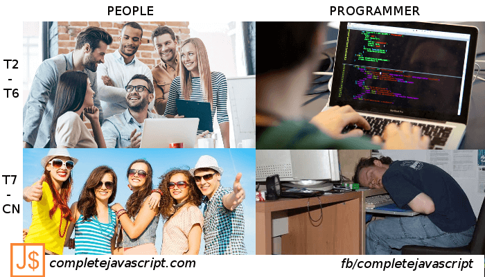

## People

who work every monday to friday and [**relax**](/tag/anh-che/) at the weekend.

## Programmers

who work every monday to friday and **work** **hard** at the weekend.

- Programmers aren't people, they are **heroes**.
- That's programmer life.

See you in the next post, thank you!

## Similar posts

- [Ảnh chế vui #1: Cách lập trình viên chạy hằng ngày](/anh-che-vui-1-cach-lap-trinh-vien-chay-hang-ngay/)
- [Ảnh chế vui #2: Code anh không có bug, tất cả chỉ là tính năng](/anh-che-vui-2-code-anh-khong-co-bug-tat-ca-chi-la-tinh-nang/)
- [Ảnh chế vui #3: How I met JavaScript – Parody](/anh-che-vui-3-how-i-met-javascript-parody/)
- [Ảnh chế vui #5: Specialist vs Generalist – who is the winner?](/anh-che-vui-5-specialist-vs-generalist-winner/)
- [Ảnh chế vui #6: A type of programmer](/anh-che-vui-6-type-programmer/)
- [Ảnh chế vui #7: IP man 4 phiên bản lập trình viên](/anh-che-vui-7-ip-man-4-phien-ban-lap-trinh-vien/)
