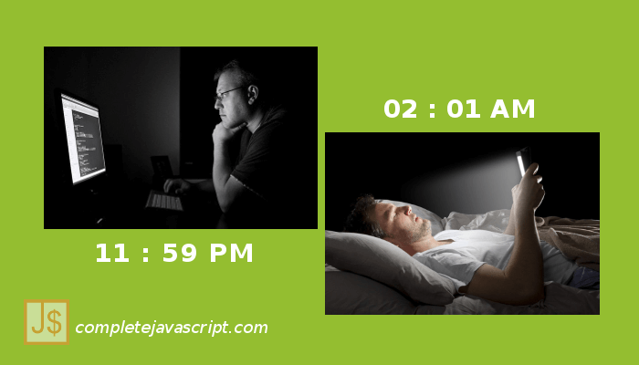

## A type of programmer:

There's a type of [programmer](/anh-che-vui-4-people-life-vs-programmer-life/) who's always working late. And before sleeping, he always check his phone until tired.

Actually, It's not [funny](/tag/anh-che). Don't like that, just:

> Sleep earlier, code better.

See you in the next post, thank you,

## Similar posts

- [Ảnh chế vui #1: Cách lập trình viên chạy hằng ngày](/anh-che-vui-1-cach-lap-trinh-vien-chay-hang-ngay/)
- [Ảnh chế vui #2: Code anh không có bug, tất cả chỉ là tính năng](/anh-che-vui-2-code-anh-khong-co-bug-tat-ca-chi-la-tinh-nang/)
- [Ảnh chế vui #3: How I met JavaScript – Parody](/anh-che-vui-3-how-i-met-javascript-parody/)
- [Ảnh chế vui #4: People life vs Programmer life](/anh-che-vui-4-people-life-vs-programmer-life/)
- [Ảnh chế vui #5: Specialist vs Generalist – who is the winner?](/anh-che-vui-5-specialist-vs-generalist-winner/)
- [Ảnh chế vui #7: IP man 4 phiên bản lập trình viên](/anh-che-vui-7-ip-man-4-phien-ban-lap-trinh-vien/)
