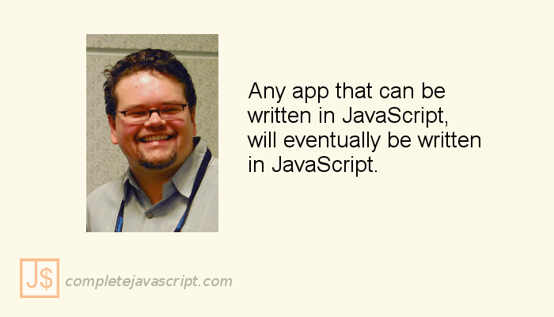
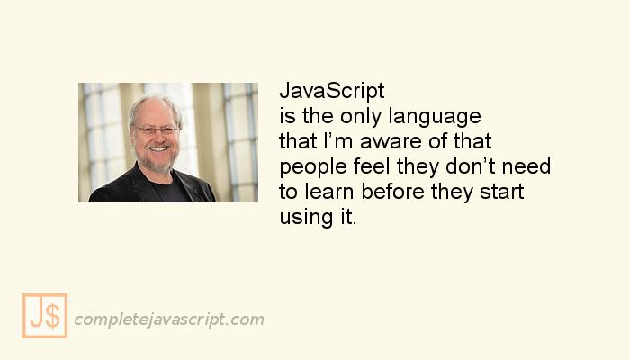

Danh ngôn *là những tinh hoa trí tuệ chắt lọc, đúc kết lâu đời; những trải nghiệm cuộc sống phong phú, sâu sắc tích lũy qua bao thế hệ được diễn đạt bằng những câu ngắn gọn, ý nghĩa hàm súc, đan kết với nhau thành những "chuỗi hạt giống tâm hồn" quý hiếm như đang chờ bạn chọn lựa, gieo trồng cho "mảnh vườn trí tuệ" của chính mình*.

Đọc nghe có vẻ hơi **sến sẩm**. Theo tôi, danh ngôn đơn giản là "phát ngôn" của những danh nhân (người nổi tiếng) - là những kinh nghiệm được đúc kết qua quá trình học tập, lao động,...

Bài viết này tôi sẽ giới thiệu với bạn 3 danh ngôn lập trình JavaScript của những lập trình viên "huyền thoại".

## Brendan Eich

[Brendan Eich](https://vi.wikipedia.org/wiki/Brendan_Eich) chính là cha đẻ của ngôn ngữ lập trình [JavaScript](/javascript). Câu danh ngôn lập trình này dịch ra là "luôn luôn đặt cược vào JavaScript".

Câu nói này cho thấy sự tin tưởng tuyệt đối của Brendan Eich vào đứa con đẻ của mình. Ông tin rằng JavaScript sẽ trở thành một trong những [ngôn ngữ lập trình phổ biến và đáng học nhất](/nhung-ngon-ngu-lap-trinh-nen-hoc-nam-2017).

## Jeff Atwood

[Jeff Atwood](https://vi.wikipedia.org/wiki/Jeff_Atwood) là nhà phát triển phần mềm, tác giả, blogger,... Anh ta chính là người đồng sáng lập nên trang web nổi tiếng mà mọi lập trình viên đều phải biết là Stack Overflow và Stack Exchange.

Hiện nay, Jeff Atwood cũng đang viết blog tại trang [Coding Horror](https://blog.codinghorror.com/).

Câu danh ngôn lập trình trên có thể được dịch là: "Bất kì một ứng dụng nào có thể được viết bằng JavaScript thì cuối cùng nó sẽ được viết bằng JavaScript".

Theo tôi hiểu thì Jeff Atwood muốn đề cập tới vấn đề tốc độ triển khai phần mềm. JavaScript được thiết kế giúp nâng cao [hiệu suất làm việc](/hoc-lap-trinh-javascript-nhanh-hon) của lập trình viên.

## Douglas Crockford

[Douglas Crockford](https://en.wikipedia.org/wiki/Douglas_Crockford) là một nhà phát triển phần mềm. Ông chính là người phát triển nên kiểu dữ liệu rất phổ biến là [JSON](/tim-hieu-ve-json-trong-javascript), và nhiều công cụ khác liên quan đến JavaScript như [JSLint](https://en.wikipedia.org/wiki/JSLint) and [JSMin](<https://en.wikipedia.org/wiki/Minification_(programming)>). Hiện tại, ông đang là kiến trúc sư trưởng về JavaScript tại PayPal.

Câu danh ngôn trên dịch ra là: "JavaScript là thứ ngôn ngữ duy nhất mà tôi thấy rằng người ta cảm thấy họ không cần phải học trước khi bắt đầu sử dụng nó".

Điều này có nghĩa là JavaScript rất dễ để viết. Đây là ngôn ngữ lập trình bậc cao và khá gần với ngôn ngữ tự nhiên.

## Kết luận

Trên đây là những danh ngôn lập trình của những lập trình viên "huyền thoại": Brendan Eich, Jeff Atwood, Douglas Crockford. Nếu bạn biết danh ngôn nào khác, vui lòng chia sẻ ở phần bình luận phía dưới. Tôi rất vui và cám ơn bạn.

Xin chào và hẹn gặp lại bạn ở bài viết tiếp theo, thân ái!
