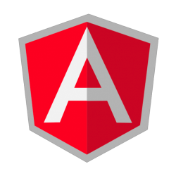
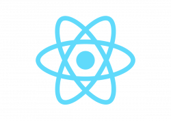
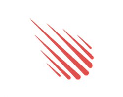

Bài viết được dịch từ website [Technotification](https://www.technotification.com/2017/06/best-modern-javascript-frameworks.html) của tác giả [Vicky Singh Rao](https://www.technotification.com/author/vicky) về top 5 Framework JavaScript mới nhất cho phát triển web và app.

Những năm gần đây, sự phổ biến của [JavaScript](/javascript/) đã được gia tăng rất nhiều. Có một bằng chứng để chứng tỏ sự thay đổi đó. Vào đầu năm nay, IBM đã công nhận JavaScript là một trong [những ngôn ngữ lập trình tốt nhất](/nhung-ngon-ngu-lap-trinh-nen-hoc-nam-2017/) của năm.

Họ lập luận rằng bí mật sự thành công của một chương trình là nằm ở cả hai phía client và server được thiết kế tốt và cũng như trang web được tuỳ biến hợp lý. Và có nhiều ưu điểm khi sử dụng các Framework JavaScript là an toàn, hiệu quả cao, chi phí giữa các lợi thế khác.

Vào năm 2017, có một vài Framework JavaScript đã được hoàn thành. Do đó, ở bài viết này, mình sẽ giới thiệu tóm tắt với bạn về chúng.

## AngularJS

AngularJS được biết đến là một Framework JavaScript kiểu Model-View Whatever (MVW). Kể từ khi framework này ra đời, nó đã trải qua một số sự thay đổi quan trọng. Hiện tại, sẽ là hợp lý nếu chúng ta gọi đây là một trong những framework hay sử dụng nhất dành cho phát triển ứng dụng kiểu trang web đơn.

Ngoài ra, Framework JavaScript này cũng được hỗ trợ từ một cộng đồng lớn nhất các lập trình viên. Và có hai loại AngularJS, bạn có thể tìm hiểu thêm về chúng.

## ReactJS

Framework JavaScript này dựa trên thư viện nhiều hơn. Nó thường cho thấy hiệu quả cao ở những chương trình động - nhiều tương tác như Facebooks và Instagram.

Đây cũng là một trong những framework phát triển mạnh trên thị trường hiện nay. Người ta ước tính là có khoảng 1000 thành viên tích cực tham gia vào nó. Nếu so sánh với AngularJS thì ReactJS chính xác hơn và cung cấp hiệu suất cao hơn vì nó sử dụng [DOM](/co-ban-ve-dom-javascript/) ảo.

## Vue.js

Trong năm 2016, chúng mình đã trải nghiệm phiên bản Vue 2.0. Phiên bản này tốt hơn so với Ember, AngularJS và ReactJS (tính đến thời điểm hiện tại). Thêm nữa, chúng mình thấy rằng người học sẽ học Vue.js nhanh hơn so với các Framework JavaScript khác.

Vue.js đã nâng cấp sâu hơn bằng cách cung cấp 2 cách binding dữ liệu và một cải tiến tuyệt vời khác. Điều này được xem như là tốt nhất cho sự phát triển nhanh hơn. Còn nhiều thông tin về Vue.js mà bạn có thể tự tìm hiểu thêm trên Internet.

## Ember.js

Vào những năm đầu của thế kỉ 21, Ember được cho là một Framework JavaScript tốt nhất cho tất cả các ứng dụng web. Tuy nhiên, framework này vẫn không thay đổi. Ngày nay, Ember.js được xem là sự thúc đẩy cho cộng đồng online, với sự cập nhật thường xuyên và thông qua đó, JavaScript được coi là đúng.

## Meteor.js

Đây là một Framework JavaScript phổ biến nhất với nhiều người. Từ năm 2013, Meteor.js đã trải qua nhiều sự thay đổi khác nhau, đã làm nó phát triển và nâng cao tỉ lệ việc làm.

Xin chào và hẹn gặp lại bạn ở bài viết tiếp theo, thân ái!
