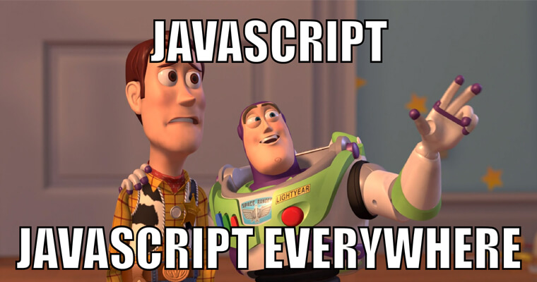

JavaScript là một trong những ngôn ngữ lập trình phổ biến nhất hiện nay. Sau đây, mình sẽ cùng tìm hiểu xem cụ thể JavaScript là gì. JavaScript có thể và không thể làm được gì nhé!

## JavaScript là gì?

JavaScript là ngôn ngữ lập trình website phổ biến nhất hiện nay. Đây là [ngôn ngữ thông dịch](https://vi.wikipedia.org/wiki/Ng%C3%B4n_ng%E1%BB%AF_th%C3%B4ng_d%E1%BB%8Bch), được tích hợp vào HTML giúp trang web trở nên sống động hơn.

Vì JavaScript là ngôn ngữ thông dịch nên bạn không cần chuẩn bị công cụ nào để [biên dịch](https://vi.wikipedia.org/wiki/Tr%C3%ACnh_bi%C3%AAn_d%E1%BB%8Bch) chương trình trước khi chạy. Đây là đặc điểm khác biệt so với ngôn ngữ lập trình [Java](<https://vi.wikipedia.org/wiki/Java_(ng%C3%B4n_ng%E1%BB%AF_l%E1%BA%ADp_tr%C3%ACnh)>) mà nhiều bạn hay nhầm.

**Tại sao có tên <u>Java</u>Script?**

JavaScript được phát triển bởi [Brendan Eich](https://vi.wikipedia.org/wiki/Brendan_Eich) (tại Hãng truyền thông Netscape) với cái tên đầu tiên là "Mocha", sau đó đổi tên thành "LiveScript", và cuối cùng thành "JavaScript".

Có lẽ việc đổi tên như vậy để giúp JavaScript được chú ý nhiều hơn. Bởi tại thời điểm đó, Java đang được coi là một hiện tượng và trở nên phổ biến.

Giờ đây, JavaScript là một ngôn ngữ hoàn toàn độc lập và được chuẩn hóa bởi tài liệu [ECMAScript](https://vi.wikipedia.org/wiki/ECMAScript) (gọi tắt là ES). Đôi khi bạn thấy một số tài liệu nói về ES6, ES7, ES Next,... thì chúng đều là JavaScript.

Ngoài ra, bạn cũng sẽ thấy những cái tên khác như [Vanilla JS](https://vanilla.js.org/) hay JS. Thực chất, đó cũng là JavaScript - nhưng nhấn mạnh về JavaScript nguyên thủy, không sử dụng thư viện hay framework nào cả.

## Ứng dụng của JavaScript

Ban đầu, JavaScript được sinh ra để sử dụng trên web phía người dùng (frontend). Nhưng giờ đây, bạn có thể thấy JavaScript được sử dụng ở hầu hết mọi nơi:

- Frontend: JavaScript cùng với [HTML](https://vi.wikipedia.org/wiki/HTML) và [CSS](https://vi.wikipedia.org/wiki/CSS) trở thành ba thứ không thể thiếu khi lập trình website. Ngoài ra, có rất nhiều thư viện / framework JavaScript được tạo ra giúp việc lập trình trở nên đơn giản hơn như: [React](https://vi.reactjs.org/), Angular, Vue,...
- Backend: với sự ra đời của [Node.js](https://vi.wikipedia.org/wiki/Node.js), bạn đã có thể sử dụng JavaScript phía server.
- Ứng dụng máy tính: bạn có thể sử dụng framework Electron để tạo nên ứng dụng đa nền tảng cho máy tính. Một số ứng dụng nổi tiếng có thể kể đến là: Atom, Visual Studio Code, GitKraken, Wordpress.com,...
- Ứng dụng điện thoại: React-Native, NativeScript,... giúp xây dựng ứng dụng điện thoại trên Android và iOS.
- Ngoài ra, một số database sử dụng JavaScript là kịch bản và [ngôn ngữ truy vấn](https://vi.wikipedia.org/wiki/Ng%C3%B4n_ng%E1%BB%AF_truy_v%E1%BA%A5n) như: MongoDB, CouchDB,...

Để JavaScript có thể chạy được ở một nơi, thì nơi đó phải có một thứ gọi là: **JavaScript engine**.

## JavaScript engine là gì?

JavaScript engine là một chương trình máy tính thực thi các đoạn code JavaScript.

Có một vài JavaScript engine khác nhau như:

- [V8](https://vi.wikipedia.org/wiki/Chrome_V8): trên trình duyệt Chrome, Opera, Edge.
- SpiderMoney: trên trình duyệt Firefox.
- Chakra: trên trình duyệt IE
- JavaScriptCore, Nitro and SquirrelFish: trên trình duyệt Safari
- Và còn nhiều loại khác nữa...

Để chạy được JavaScript ở các môi trường khác trình duyệt, ta chỉ cần tích hợp một trong các engine này vào môi trường.

Ví dụ: Node.js sử dụng V8 engine để chạy được JavaScript phía server.

**Vậy, JavaScript engine hoạt động như thế nào?**

JavaScript engine thực sự rất phức tạp, nhưng cách hoạt động của engine lại vô cùng đơn giản.

1. Engine đọc kịch bản từ JavaScript.
2. Sau đó, engine dịch kịch bản sang mã máy.
3. Cuối cùng, mã máy thực thi.

Trong mỗi bước, JavaScript engine đều phải tối ưu code làm sao để chương trình chạy tốt nhất.

Đó là cách JavaScript hoạt động. Nhưng cụ thể thì JavaScript có thể làm được những gì? Sau đây, mình sẽ tập trung vào JavaScript trên trình duyệt - mục đích đầu tiên mà JavaScript được sinh ra.

## JavaScript làm được gì trên trình duyệt?

Mục đích JavaScript được sinh ra là dành cho trình duyệt. Vì vậy, những thứ JavaScript có thể làm trên trình duyệt liên quan đến việc thay đổi nội dung trang web, tương tác với người dùng và web server.

Cụ thể những thứ JavaScript có thể làm trên trình duyệt:

- Tạo thêm HTML cho trang web, thay đổi những phần tử có sẵn, điều chỉnh style (màu sắc, kích thước, hiệu ứng di chuyển,...).
- Tương tác với người dùng qua việc nhấn chuột, di chuyển chuột, gõ bàn phím,...
- Tương tác với web server qua việc gọi [web API](https://vi.wikipedia.org/wiki/Web_API) để tải xuống dữ liệu, tải lên dữ liệu,...
- Hiển thị thông báo cho người dùng.
- Lưu dữ liệu phía người dùng để sử dụng lại khi người dùng tải lại trang.

Đây là những thứ JavaScript làm được trên trình duyệt. Tiếp theo là những thứ JavaScript không thể làm được trên trình duyệt.

## JavaScript không làm được gì trên trình duyệt?

Khi bạn vào một trang web, bạn sẽ phải tải về trình duyệt nội dung của trang web bao gồm HTML, CSS và JavaScript...

Tưởng tượng nếu JavaScript trên trình duyệt có toàn quyền khai thác thông tin (đọc / ghi) trên máy người dùng, thì chắc chắn sẽ có nhiều trang web độc hại sinh ra để đánh cắp thông tin cá nhân một cách dễ dàng.

Do đó, JavaScript sẽ không làm được những thứ sau trên trình duyệt:

- Đọc, ghi, sao chép, thực thi một chương trình trên máy người dùng. Để đọc một tệp tin, bạn phải tải nó lên trang web thông qua thẻ **input** (chứ không đọc trực tiếp từ tệp tin).
- Mặc định, trang web sẽ không có quyền truy cập trực tiếp vào Camera/Microphone. Để sử dụng chúng, bạn cần phải viết code JavaScript để gọi hàm yêu cầu cấp quyền từ người dùng.
- Các trang web ở các tab khác nhau trên trình duyệt không biết nhau. Ví dụ, bạn đang mở hai trang web ở hai tab khác nhau trên trình duyệt. Khi đó, code JavaScript từ một trang không thể truy cập và lấy thông tin từ trang còn lại.
- JavaScript có thể dễ dàng giao tiếp với server thông qua gọi API nếu như trang web và server cùng tên miền. Trường hợp khác tên miền thì bạn sẽ bị lỗi [CORS](https://codeaholicguy.com/2018/05/07/cors-la-gi/) nếu như server không cho phép truy cập.

## Vậy học JavaScript có khó không?

Câu trả lời sẽ tùy thuộc vào con người.

Vì JavaScript là ngôn ngữ thông dịch, không phải biên dịch. Nên nhiều khi bạn sẽ gặp tình huống viết code xong nhưng không biết mình viết đúng hay sai, và phải chạy thử mới biết.

Trong khi với những ngôn ngữ lập trình kiểu biên dịch khác thì chỉ cần bạn gõ sai cú pháp thôi là trình soạn thảo đã thông báo, và chỉ bạn chỗ sai để sửa.

Vì vậy, gần đây đã có rất nhiều ngôn ngữ lập trình mới, có thể biên dịch sang JavaScript như:

- [CoffeeScript](https://coffeescript.org/): cú pháp ngắn gọn hơn và cho phép viết code rõ ràng hơn.
- [TypeScript](https://vi.wikipedia.org/wiki/TypeScript) của Microsoft: tập trung vào việc đảm bảo kiểu dữ liệu chặt chẽ hơn, dễ dàng bảo trì code hơn với những dự án lớn.
- [Dart](<https://vi.wikipedia.org/wiki/Dart_(ng%C3%B4n_ng%E1%BB%AF_l%E1%BA%ADp_tr%C3%ACnh)>) của Google: ngôn ngữ không thể thiếu khi dùng Flutter để tạo ra ứng dụng điện thoại, nhưng nó cũng có thể dịch ra JavaScript.
- [Kotlin](<https://vi.wikipedia.org/wiki/Kotlin_(ng%C3%B4n_ng%E1%BB%AF_l%E1%BA%ADp_tr%C3%ACnh)>): ngôn ngữ hiện đại, an toàn - là ngôn ngữ hàng đầu thay thế cho Java để lập trình ứng dụng Android. Nhưng Kotlin cũng có thể hướng tới lập trình cho web.

Còn rất nhiều ngôn ngữ lập trình khác nữa. Mỗi ngôn ngữ lập trình có những đặc điểm riêng. Nhưng dù thế nào thì JavaScript vẫn có vai trò quan trọng trong lập trình web. Và bạn cũng nên hiểu rõ về JavaScript.

## Tổng kết

Vậy JavaScript là gì?

- JavaScript là ngôn ngữ lập trình website phổ biến. Mục đích ban đầu của JavaScript là dành cho trình duyệt. Nhưng sau đó, JavaScript có thể được dùng ở nhiều môi trường khác nhau (chỉ cần có JavaScript engine).
- JavaScript có thể làm được nhiều thứ trên trình duyệt như: tạo, thay đổi nội dung trang web; tương tác với người dùng qua chuột, bàn phím; tương tác với web server thông qua gọi API.
- JavaScript cũng bị hạn chế một số thứ trên trình duyệt liên quan đến máy người dùng như: đọc, ghi, thực thi tệp tin; thao tác trực tiếp với Camera/Microphone.
- Có nhiều ngôn ngữ có thể dịch ra JavaScript. Nhưng JavaScript vẫn có vai trò quan trọng trong lập trình web. Bạn nên hiểu rõ về JavaScript trước khi học các ngôn ngữ khác.
