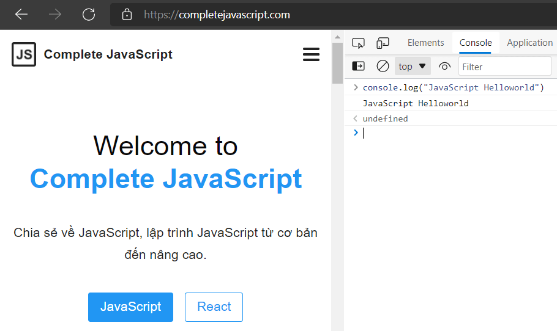
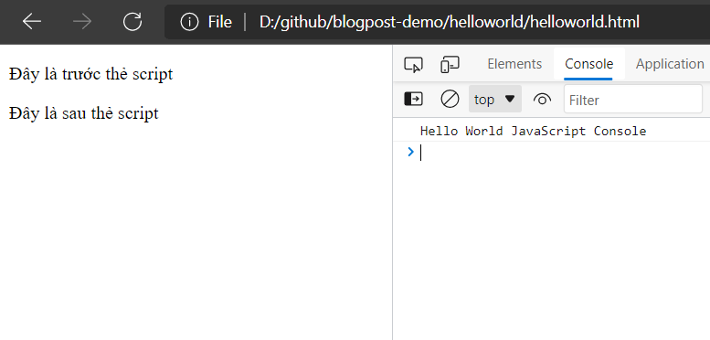
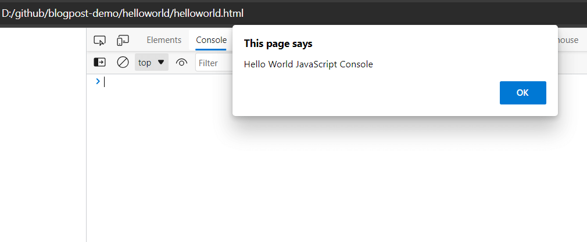

Trong những bài viết trước, bạn đã biết các kiến thức tổng quan về JavaScript rồi. Hôm nay, mình sẽ bắt đầu viết chương trình JavaScript đầu tiên.

> Trường hợp bạn chưa đọc qua thì đây là những kiến thức tổng quan:
>
> - [JavaScript là gì?](/javascript-la-gi)
> - [IDE là gì?](/ide-la-gi)
> - [Dev Tools là gì?](/dev-tools-la-gi)

## Hello World JavaScript Console

Cách đơn giản nhất để viết và chạy chương trình JavaScript đầu tiên là sử dụng tiện ích **console** của Dev Tools trên trình duyệt.

> Tùy thuộc vào trình duyệt bạn đang sử dụng, bạn có thể nhấn **F12** hoặc tổ hợp phím **Ctrl Shift I** (Windows) hoặc **Ctrl Opt J** (macOS),...

Sau đó, bạn chọn tab **console** rồi gõ lệnh sau: `console.log("JavaScript Helloworld")`. Tiếp theo, bạn nhấn **Enter** (để viết nhiều dòng code, bạn nhấn tổ hợp **Shift Enter**).

Bạn sẽ thấy kết quả hiển thị:



**Console.log là gì?**

Console.log trong JavaScript là một hàm được sử dụng để in ra bất kể thứ gì (với trình duyệt thì nơi hiển thị kết quả đó là tab console của Dev Tools).

> Trong các bài viết sau, mình chủ yếu dùng hàm [console.log()](/thu-thuat-su-dung-console-hieu-qua) để in ra kết quả của biến, phép tính, đoạn chương trình,...

Bạn sẽ không cần phải cài đặt thêm bất cứ phần mềm nào khác. Bạn chỉ cần mở trình duyệt, vừa đọc hướng dẫn và thực hành trên tab console của Dev Tools.

Sau khi bạn đã nắm hết kiến thức cơ bản về ngôn ngữ JavaScript, mình sẽ bắt đầu học về trình duyệt, [HTML](/tag/html), và cách JavaScript giao tiếp với HTML,...

## Chương trình JavaScript đầu tiên với HTML

Để viết chương trình JavaScript đầu tiên với HTML, bạn nên cài đặt một IDE (code editor) để viết code dễ dàng hơn. Dĩ nhiên, bạn có thể dùng Notepad / Notepad++. Nhưng về lâu dài, bạn nên chọn editor chuyên dụng cho lập trình web (JavaScript).

> 💡 Mình gợi ý bạn sử dụng [Visual Studio Code](https://code.visualstudio.com/). Vì nó miễn phí, hỗ trợ đa nền tảng Windows, macOS, Linux, và có nhiều extension hỗ trợ code nhanh hơn, tốt hơn.
>
> Ngoài ra, mình cũng đang sử dụng Visual Studio Code. Do đó, nếu bạn gặp khó khăn liên quan đến code editor thì mình sẽ dễ dàng hỗ trợ hơn.

Để tích hợp JavaScript vào HTML bạn cần sử dụng thẻ `<script>`. Ví dụ, bạn tạo file **helloworld-console.html** với nội dung như sau:

```html:title=helloworld-console.html
<!DOCTYPE html>
<html lang="vi">

<body>
    <p>Đây là trước thẻ script</p>

    <script>
        console.log("Hello World JavaScript Console")
    </script>

    <p>Đây là sau thẻ script</p>
</body>

</html>
```

Sau đó, bạn mở file trên bằng trình duyệt, rồi mở tab console trên Dev Tools sẽ thấy kết quả:



### Thẻ `<script>` là gì?

Thẻ `<script>` trong HTML là nơi chứa code JavaScript. Code JavaScript được thực thi ngay sau khi trình duyệt tiến hành xử lý đoạn code này.

Thẻ `<script>` có thể đặt ở bất kỳ đâu trên trang HTML. Ví dụ trên mình đặt thẻ `<script>` ở trong thẻ `<body>`. Nhưng bạn cũng có thể đặt nó ở trong thẻ `<head`> như sau:

```html:title=helloworld-console.html
<!DOCTYPE html>
<html lang="vi">

<head>
    <script>
        console.log("Hello World JavaScript Console")
    </script>
</head>

<body>
    <p>Đây là trong body</p>
</body>

</html>
```

> Tạm thời bạn không cần quan tâm đến các thẻ HTML, vì mình đang tập trung chủ yếu vào JavaScript.

Ngoài việc sử dụng `console.log()` ra, bạn có thể sử dụng hàm `alert()`. Hàm `alert()` sẽ không in kết quả ra tab console mà hiển thị dạng hộp thoại (dialog).

Khi đó, bạn có thể sửa lại đoạn code trên như sau:

```html:title=helloworld-alert.html
<!DOCTYPE html>
<html lang="vi">

<body>
    <p>Đây là trước thẻ script</p>

    <script>
        alert("Hello World JavaScript Console")
    </script>

    <p>Đây là sau thẻ script</p>
</body>

</html>
```

Bạn mở lại hoặc refresh trang web trên sẽ thấy kết quả:



### Viết code JavaScript ở file riêng biệt

Đối với trang web thực tế, bạn thường sẽ có rất nhiều code JavaScript. Lúc này, bạn nên viết code JavaScript ra các file riêng biệt để dễ dàng quản lý logic code.

Để tích hợp file code JavaScript vào HTML, bạn cần sử dụng thuộc tính **src** của thẻ `<script>`, ví dụ:

```html
<script src="/path/to/script.js"></script>
```

Ở đây, `/path/to/script.js` là đường dẫn tuyệt đối tính từ gốc của trang web (thư mục chứa file .html trên). Ngoài ra, bạn cũng có thể cung cấp đường dẫn tương đối đến file, ví dụ:

```html
<script src="script.js"></script>
```

Lúc này, file `script.js` được hiểu là đặt cùng thư mục với file HTML của trang web.

Ngoài ra, bạn cũng có thể truyền vào một URL đầy đủ, ví dụ:

```html
<script src="https://code.jquery.com/jquery-3.6.0.min.js"></script>
```

Để thêm nhiều file code JavaScript vào HTML, bạn sử dụng nhiều thẻ script như sau:

```html
<script src="/path/to/script1.js"></script>
<script src="/path/to/script2.js"></script>
```

> 📝 **Chú ý**: việc tách code JavaScript ra các file riêng biệt, ngoài việc giúp dễ dàng quản lý code ra thì nó còn giúp trình duyệt [cache](https://vi.wikipedia.org/wiki/Web_caching) lại nội dung các file đó.
>
> Các trang web khác nhau sử dụng chung file JavaScript sẽ lấy nội dung từ cache của trình duyệt, thay vì tải lại file. Nói cách khác, các file JavaScript thường chỉ cần tải về một lần.
>
> Điều này giúp tăng tốc độ tải trang web từ lần thứ hai.

### Một lưu ý khi sử dụng thẻ `<script>`

Một thẻ `<script>` không thể chứa cả thuộc tính **src** và code JavaScript bên trong nó. Nếu điều đó xảy ra thì code bên trong thẻ `<script>` sẽ bị bỏ qua. Chỉ có code trong file JavaScript được liên kết qua thuộc tính **src** là có tác dụng.

```html
<script src="main.js">
  alert("Hello World JavaScript from alert"); // đoạn code này sẽ bị bỏ qua
</script>
```

Bạn phải chọn một trong hai cách là sử dụng file JavaScript riêng biệt rồi liên kết qua thuộc tính **src** hoặc viết code JavaScript trực tiếp trong thẻ `<script>`.

Với ví dụ trên, bạn có thể tách ra thành hai thẻ `<script>`:

```html
<script src="main.js"></script>
<script>
  alert("Hello World JavaScript from alert");
</script>
```

## Tổng kết

Sau đây là một số kiến thức cần nhớ để viết chương trình JavaScript đầu tiên:

- Cách đơn giản nhất là dùng tab **console** trên Dev Tools của trình duyệt.
  - Bạn chỉ cần mở trình duyệt, nhấn **F12** hoặc tổ hợp phím **Ctrl Shift I** (Windows) hoặc **Ctrl Opt J (macOS)** để mở Dev Tools (tùy thuộc trình duyệt, hệ điều hành).
  - Chọn tab console rồi viết code JavaScript trực tiếp trên đó (để viết nhiều dòng code thì nhấn tổ hợp **Shift Enter**).
  - Nhấn **Enter** để chạy code JavaScript đã viết.
- Ngoài ra, bạn có thể viết code JavaScript với HTML.
  - Code JavaScript phải đặt trong thẻ `<script>`
  - Bạn có thể viết code JavaScript ra file riêng biệt rồi tích hợp vào HTML qua thuộc tính **src** của thẻ `<script>`.
  - Đường dẫn đến file JavaScript có thể là tuyệt đối (tính từ gốc trang web), tương đối (tính từ file html hiện tại) hoặc URL đầy đủ.
  - Để tích hợp nhiều file JavaScript, bạn sử dụng nhiều thẻ `<script>`.

Đây chỉ là hai cách trong số nhiều cách để viết chương trình JavaScript. Tuy nhiên, đó là đủ để bạn có thể thực hành viết code JavaScript trong những bài sau.

## Thực hành

### Bài 1: Hiển thị hộp thoại

Tạo trang web (html) hiển thị đồng thời ra console và hộp thoại với nội dung: **I'am a JavaScript developer**.

[Xem đáp án](https://github.com/completejavascript/blogpost-demo/tree/main/helloworld/task1) | [Xem demo](https://blogpost-demo.pages.dev/helloworld/task1/helloworld1)

### Bài 2: Hiển thị hộp thoại file JS riêng biệt

Tương tự như bài 1, nhưng lần này bạn tách code JavaScript ra một file khác là **main.js**. Sau đó, bạn tích hợp file JavaScript vào file html thông qua thuộc tính **src** của thẻ `<script>`.

[Xem đáp án](https://github.com/completejavascript/blogpost-demo/tree/main/helloworld/task2) | [Xem demo](https://blogpost-demo.pages.dev/helloworld/task1/helloworld2)
