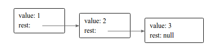

Nếu bạn theo dõi các bài viết của mình từ đầu tới giờ thì có thể thấy mình đã giới thiệu với bạn về [number, string, boolean](/kieu-du-lieu-trong-javascript/) và [array](/javascript-array-co-ban/). Hôm nay, mình sẽ tiếp tục với thành phần cơ bản cuối cùng, đó là object trong Javascript (đối tượng). Tiêu đề của bài viết: _last but not least_, tức là _cuối cùng nhưng không kém phần quan trọng_. Thực tế, JavaScript là ngôn ngữ dựa trên đối tượng ([object-based](/javascript-la-gi/)), nên việc hiểu rõ về JavaScript Object sẽ giúp bạn dễ dàng chinh phục ngôn ngữ lập trình JavaScript.

Để hiểu JavaScript object là gì, mình xin đưa ra một ví dụ. Máy tính của mình có những đặc điểm sau:

- Loại: laptop
- Hãng: Sony
- Hệ điều hành: Windows 7
- Card đồ hoạ: NVIDIA
- Hoạt động: Đang chạy (running), sleep, hibernate, shut down.
- ...

Ở đây, _máy tính của mình_: chính là một JavaScript *object*. Đối tượng này có các _thuộc tính (properties)_: _loại, hãng, hệ điều hành, card đồ hoạ_ với các giá trị tương ứng là _laptop, Sony, Windows 7, NVIDIA_. Tiếp theo, các hoạt động (_phương thức_) là: _running, sleep, hibernate, shut down_.

## Vậy JavaScript Object là gì?

_Object trong JavaScript là một khái niệm trừu tượng dùng để biểu diễn một vật thể (cụ thể). Trong đó, các thuộc tính dùng để miêu tả đặc điểm, tính chất của đối tượng. Và các phương thức dùng để chỉ các hoạt động của đối tượng._

**Chú ý:**

- Object có thể chỉ tồn tại thuộc tính hoặc chỉ có phương thức, không nhất thiết phải có cả hai.
- Object phải là một danh từ **riêng**, không phải danh từ **chung**. Trong ví dụ trên, nếu chỉ nói **máy tính** thì đó không phải đối tượng, mà phải là **máy tính của mình**.

## Biểu diễn JavaScript Object

JavaScript sử dụng cặp dấu ngoặc nhọn {} để biểu diễn object:

```js
{
  key1: value1,
  key2: value2,
  key3: value3,
  ...
}
```

Trong đó: _key1, key2, key3,..._ là tên thuộc tính với các giá trị tương ứng là *value1, value2, value3,...* Nếu value là một [function](/ham-la-gi-ham-trong-javascript/) thì đó chính là phương thức của object JS.

Áp dụng cho ví dụ trên:

```js
var myComputer = {
  type: "laptop",
  brand: "Sony",
  os: "Windows 7",
  graphicCard: "NVIDIA",
  running: {...},
  sleep: {...},
  hibernate: {...},
  shutDown: {...}
};
```

**Chú ý:**

- Key: có thể đặt theo quy tắc của biến số, hoặc có thể là một string. Nếu key là một string thì phải được đặt trong cặp dấu ngoặc đơn hoặc ngoặc kép.
- Value: có thể là một trong các loại numbers, strings, Boolean, array, function, null,... hay thậm chí là một object khác.

## Cách sử dụng Object trong JavaScript

Khi đã biểu diễn được object rồi thì vấn đề tiếp theo là làm sao sử dụng được nó. Cụ thể là cách thức để truy cập vào thuộc tính của Object. Có 2 cách để lấy ra giá trị của một thuộc tính trong object:

- Sử dụng toán tử _chấm_ (.) theo sau là tên thuộc tính (theo kiểu biến số
- Sử dụng toán tử [], bên trong là tên thuộc tính (theo kiểu biến số hoặc kiểu string)

Ví dụ sau đây mô tả cách sử dụng Object:

```js
var myComputer = {
  type: "laptop",
  brand: "Sony",
  "operating system": "Windows 7",
  "graphic card": "NVIDIA",
};

console.log(myComputer.type); // => laptop
console.log(myComputer.brand); // => Sony

console.log(myComputer["type"]); // => laptop
console.log(myComputer["brand"]); // => Sony
console.log(myComputer["operating system"]); // => Windows 7
console.log(myComputer["graphic card"]); // => NVIDIA
```

## Thay đổi giá trị của thuộc tính

Để thay đổi giá trị thuộc tính của object, bạn chỉ cần sử dụng cách truy cập ở trên và gán giá trị mới cho thuộc tính đó.

```js
var myComputer = {
  type: "laptop",
  brand: "Sony",
  "operating system": "Windows 7",
  "graphic card": "NVIDIA",
};
console.log(myComputer.type); // => laptop
console.log(myComputer["operating system"]); // => Windows 7

myComputer.type = "desktop";
myComputer["operating system"] = "Ubuntu";
console.log(myComputer.type); // => desktop
console.log(myComputer["operating system"]); // => Ubuntu
```

## Cách duyệt tất cả các thuộc tính của object

Đối với array, bạn có thể sử dụng vòng lặp [for, while, do/while](/vong-lap-trong-javascript/) với chỉ số là number để duyệt từng phần tử của mảng. Nhưng với object thì hơi khác một chút.

Để duyệt các thuộc tính của object, bạn có thể sử dụng vòng lặp _for_ với từ khoá _in_ như ví dụ sau:

```js
var myComputer = {
  type: "laptop",
  brand: "Sony",
  "operating system": "Windows 7",
  "graphic card": "NVIDIA",
};

for (var prop in myComputer) {
  console.log(prop, myComputer[prop]);
}

/*
 * type laptop
 * brand Sony
 * operating system Windows 7
 * graphic card NVIDIA
 */
```

Khi đó biến _prop_ sẽ chạy hết tất cả các thuộc tính của object _myComputer_.

## So sánh JavaScript object

JavaScript cung cấp cho chúng ta 2 toán tử so sánh là == và ===. Trong đó:

- Toán tử === trả về **true** khi và chỉ khi hai biến số có **cùng kiểu dữ liệu** và **cùng giá trị**, ngược lại thì trả về **false**.
- Toán tử == trả về **true** khi hai biến số có **cùng giá trị** và có thể **có kiểu dữ liệu khác nhau** (JavaScript sẽ cố gắng convert về cùng kiểu dữ liệu để so sánh), ngược lại thì trả về false.

Hãy xem ví dụ sau để thấy sự khác biệt giữa hai toán tử

```js
var x = 1;
var y = true;

console.log(x == y); // => true
console.log(x === y); // => false
```

Khi sử dụng ==, JavaScript sẽ convert x = 1 thành giá trị true, nên kết quả trả về là true. Ngược lại, khi sử dụng toán tử ===, kết quả trả về sẽ là false vì x có kiểu number và y có kiểu Boolean.

### Áp dụng toán tử == và === để so sánh object

Bây giờ, mình sẽ thử áp dụng hai toán tử trên để so sánh object:

```js
var obj1 = {
  x: 10,
  y: 10,
};

var obj2 = {
  x: 10,
  y: 10,
};

var obj3 = obj1;

console.log(obj2 == obj1); // => false
console.log(obj2 === obj1); // => false

console.log(obj3 == obj1); // => true
console.log(obj3 === obj1); // => true
```

Qua ví dụ trên, bạn có thể thấy rằng: hai object bằng nhau khi và chỉ khi chúng trỏ vào cùng địa chỉ bộ nhớ (obj3 và obj1). Trường hợp obj1 và obj2, mặc dù các thuộc tính và giá trị hoàn toàn giống nhau nhưng hai object này không bằng nhau.

### Xây dựng hàm so sánh object

Trường hợp, bạn muốn quy định obj1 và obj2 như trên là bằng nhau thì bạn có thể tự viết một hàm riêng để so sánh hai đối tượng này:

```js
function isEqual(obj1, obj2) {
  for (var prop in obj1) {
    if (obj1[prop] !== obj2[prop]) return false;
  }
  for (var prop in obj2) {
    if (obj2[prop] !== obj1[prop]) return false;
  }
  return true;
}

var obj1 = {
  x: 10,
  y: 10,
};

var obj2 = {
  x: 10,
  y: 10,
};

var obj3 = {
  x: 10,
  y: 11,
};

var obj4 = {
  x: 10,
  y: 11,
  z: 12,
};

console.log(isEqual(obj2, obj1)); // => true
console.log(isEqual(obj3, obj1)); // => false
console.log(isEqual(obj4, obj1)); // => false
```

Hàm _isEqual_ trả về **true** khi và chỉ khi hai object **có các thuộc tính và giá trị của chúng giống nhau**, ngược lại thì trả về **false**.

## Một số đối tượng sẵn có trong JavaScript

JavaScript cung cấp sẵn cho chúng ta một số đối tượng. Qua đó, việc lập trình sẽ trở nên dễ dàng hơn.

### Đối tượng Arguments

Mỗi khi hàm số được gọi, có một biến số đặc biệt có tên là _arguments_ được thêm vào bên trong phạm vi của function. Biến số này chứa một thuộc tính là _length_, để xác định số lượng tham số truyền vào.

Bởi lẽ, bạn có thể truyền vào nhiều hơn, hay ít hơn số lượng tham số mặc định. Nên việc biết số lượng tham số truyền vào là vô cùng cần thiết.

Ví dụ sau miêu tả cách sử dụng _arguments_ để xác định số lớn nhất trong tất cả các số truyền vào:

```js
function maxOf() {
  var max = -1;
  for (var i = 0; i < arguments.length; i++) {
    if (arguments[i] > max) max = arguments[i];
  }
  return max;
}

console.log(maxOf(1, 2));
// => 2

console.log(maxOf(1, 2, 3, 4, 5, 6, 7));
// => 7
```

Rõ ràng, hàm _maxOf_ của mình không chứa một tham số nào. Nhưng khi sử dụng, mình lại có thể truyền tham số với số lượng tuỳ ý.

### Đối tượng Math

_Cái tên đã nói lên tất cả_. Đúng vậy, đối tượng _Math_ chứa các hàm số phục vụ cho tính toán số học như: _Math.min, Math.max, Math.sqrt, Math.abs,..._

Sử dụng Math giúp giảm thiểu đáng kể thời gian viết code, vì bạn không cần phải viết lại những hàm số cực kì cơ bản.

Mình sẽ không giới thiệu nhiều về đối tượng này. Bạn có thể tham khảo thêm về Math tại [đây](https://www.w3schools.com/js/js_math.asp).

### Đối tượng Global

Trong JavaScript, cụ thể là đối với browser, đối tượng lớn nhất chính là _window_. Mọi biến global đều thuộc đối tượng này.

```js
var x = 6;
console.log("x" in window);
// => true
console.log(window.x);
// => 6
```

Trên đây là một số kiến thức cơ bản về JavaScript object. Nếu bạn đã hiểu hết những nội dung ở trên, bạn có thể tìm hiểu sâu hơn về object JS. Còn bây giờ thì tạm dừng lại và thực hành một chút về những gì đã học được về Object trong JavaScript nhé.

> Dục tốc bất đạt.

## Thực hành

Giả sử, ta định nghĩa cấu trúc dữ liệu dạng **List** như sau:



Trong đó, value1, value2, value3 là những phần tử của mảng.

Cho mảng array = [1, 2, 3, 4, 5, 6].

- Viết hàm **arrayToList(array)** trả về một object dạng list như trên. ([tham khảo](https://github.com/completejavascript/practical-javascript/blob/master/object/arrayToList.js))
- Từ object dạng list trên, viết hàm **listToArray(list)** trả về array ban đầu. ([tham khảo](https://github.com/completejavascript/practical-javascript/blob/master/object/listToArray.js))

Chúc bạn thực hành vui vẻ và hẹn gặp lại ở [bài viết tiếp theo](/javascript-foreach-la-cai-quai-gi/), thân ái!

## Tham khảo

- [Data Structures: Objects and Arrays](http://eloquentjavascript.net/04_data.html)
