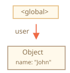
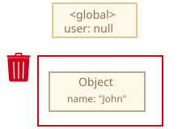
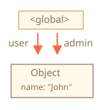
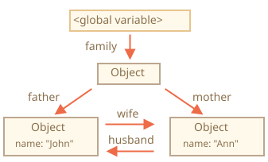
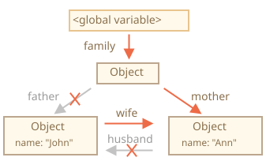
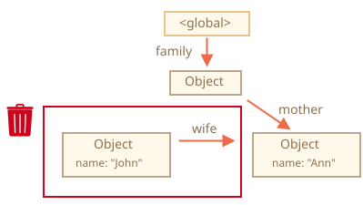
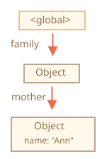
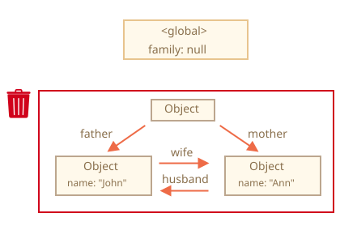
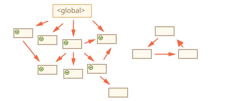
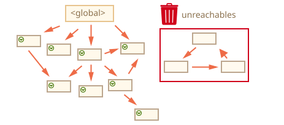

Quản lý bộ nhớ trong JavaScript được thực hiện tự động và trong suốt với người dùng. Khi bạn khởi tạo [dữ liệu nguyên thủy](/kieu-du-lieu-trong-javascript/), [object](/object-la-gi-object-trong-javascript/) hay [hàm](/ham-la-gi-ham-trong-javascript/)... thì chúng đều chiếm bộ nhớ (RAM).

Điều gì sẽ xảy ra nếu một vùng nhớ không còn sử dụng? [JavaScript engine](/javascript-la-gi/#javascript-engine-l%C3%A0-g%C3%AC) sẽ làm gì để phát hiện và giải phóng vùng nhớ đó?

> Bài viết này được dịch từ: [Garbage collection](https://javascript.info/garbage-collection). Bạn có thể tham khảo bài viết gốc nếu bạn thành thạo tiếng Anh.

## Khả năng tiếp cận

Ý tưởng chính của việc quản lý bộ nhớ trong JavaScript là **khả năng tiếp cận**.

Những giá trị "có thể tiếp tận" là những giá trị được lưu trong bộ nhớ theo một cách nào đó, để có thể truy cập và sử dụng.

► JavaScript có một số giá trị là luôn luôn "có thể tiếp cận", nên chắc chắn không bao giờ bị xóa, ví dụ:

- Hàm đang thực thi, các biến cục bộ và tham số của hàm.
- Các hàm được gọi từ trong hàm khác, các biến cục bộ và tham số của hàm đó.
- Biến toàn cục.
- ...

Các giá trị này được gọi là **root** (gốc).

► Các giá trị khác được gọi là "có thể tiếp cận" nếu chúng được truy cập từ **root** qua tham chiếu (địa chỉ) hoặc chuỗi các tham chiếu.

> Luôn có một tiến trình chạy ngầm trong JavaScript engine gọi là [garbage collector](<https://en.wikipedia.org/wiki/Garbage_collection_(computer_science)>) hay **trình thu gom rác**. Garbage collector theo dõi toàn bộ object và xóa đi các object không thể truy cập.

## Ví dụ đơn giản về Garbage collection

Sau đây là ví dụ đơn giản về garbage collection trong JavaScript:

```js
// Biến user có tham chiếu đến một object
let user = {
  name: "John",
};
```



Trong hình trên, kí hiệu mũi tên biểu thị tham chiếu. Biến toàn cục `user` có tham chiếu đến object `{ name: "John"}` (sau đây mình sẽ gọi là "John" cho ngắn gọn). Thuộc tính `name` của John có giá trị là kiểu nguyên thủy nên được vẽ bên trong object.

Nếu giá trị của biến `user` được ghi đè thì tham chiếu sẽ bị mất:

```js
user = null;
```



Lúc này, John là "không thể tiếp cận". Không có cách nào để truy cập đến John vì không có tham chiếu đến nó. Do đó, **Garbage collector** sẽ xóa John khỏi bộ nhớ.

## Hai tham chiếu đến object

Giả sử bạn [copy object](/copy-object-trong-javascript/) dạng tham chiếu từ `user` sang `admin`.

```js{5}
let user = {
  name: "John",
};

let admin = user;
```



Lúc này, tồn tại hai tham chiếu đến John. Và nếu giá trị của biến `user` được ghi đè:

```js
user = null;
```

Tham chiếu từ `user` đến John bị mất, nhưng vẫn còn tham chiếu từ `admin` đến John. Nói cách khác, John vẫn "có thể tiếp cận" được. Nên vùng nhớ của John không bị xóa.

Chi khi nào giá trị của `admin` cũng bị ghi đè thì vùng nhớ của John mới bị xóa.

## Object có liên kết nội bộ

Hãy xem một ví dụ phức tạp hơn:

```js
function marry(man, woman) {
  woman.husband = man;
  man.wife = woman;

  return {
    father: man,
    mother: woman,
  };
}

let family = marry(
  {
    name: "John",
  },
  {
    name: "Ann",
  }
);
```

Hàm `marry` đã móc nối hai object `man` và `woman` bằng cách để hai object tham chiếu đến lẫn nhau. Rồi trả về một object mới chứa cả hai object `man` và `woman`.

Kết quả thu được như sau:



Trong hình trên, tất cả các object đều là "có thể tiếp cận".

Bây giờ, mình xóa đi hai tham chiếu:

```js
delete family.father;
delete family.mother.husband;
```



Bạn thấy rằng, John không có tham chiếu nào **đi đến**. Nói cách khác là không thể truy cập đến John từ **root**. Do đó, vùng nhớ của John sẽ bị xóa.



Sau khi xóa vùng nhớ của John, kết quả còn lại là:



## Nhóm các object không thể tiếp cận

Có trường hợp mà cả một nhóm các object là "không thể tiếp cận" và bị xóa khỏi bộ nhớ.

Ví dụ với object ban đầu, mình ghi đè giá trị của `family`:

```js
family = null;
```

Khi đó, bản đồ bộ nhớ sẽ như sau:



Mặc dù, John và Ann đều có tham chiếu nội bộ đến nhau. Thậm chí, John và Ann còn có **tham chiếu đi đến**. Nhưng như vậy là chưa đủ.

Vì quan trọng hơn cả, những object này lại không có tham chiếu từ **root**. Nên tất cả chúng đều "không thể tiếp cận".

Kết quả là nhóm các object này bị xóa khỏi bộ nhớ.

## Thuật toán Garbage collection trong JavaScript

Thuật toán cơ bản của Garbage collection trong JavaScript gọi là "mark-and-sweep" ("đánh dấu-và-xóa").

Các bước thực hiện của thuật toán này như sau:

- Garbage collector bắt đầu từ root `<global>` và đánh dấu root là "có thể tiếp cận".
- Sau đó, garbage collector đi đến tất cả các object "có thể tiếp cận" từ root.
- Tại mỗi object này, garbage collector lại đi tiếp để đánh dấu tất cả các object tham chiếu từ nó. Với chú ý là những object đã được đánh dấu sẽ không duyệt lại (để tránh lặp vô hạn).
- Cứ như vậy cho đến khi tất cả các object "có thể tiếp cận" được đánh dấu hết.
- Những object còn lại, không được đánh dấu là "không thể tiếp cận" sẽ bị xóa khỏi bộ nhớ.

Ví dụ:


Dễ thấy, nhóm object bên phải là "không thể tiếp cận". Hãy xem thuật toán "mark-and-sweep" hoạt động thế nào.

Bước đầu tiên là đánh dấu root:


Sau đó, đánh dấu các tham chiếu từ root:



Tại mỗi object được đánh dấu từ bước trước, tiếp tục đánh dấu các tham chiếu từ nó:


Cuối cùng, nhóm object bên phải là "không thể tiếp cận" nên sẽ bị xóa:



Đó là cơ bản về thuật toán của Garbage collection trong JavaScript thực hiện.

Dĩ nhiên, JavaScript Engine có tối ưu để tiến trình này thực hiện nhanh hơn và không ảnh hưởng tới hoạt động của trang web.

Sau đây là một vài tối ưu:

► **Generational collection**:

Object được chia ra làm hai loại là "cũ" và "mới". Nhiều object được tạo ra mới, rồi sau khi thực hiện xong sẽ bị xóa khỏi bộ nhớ luôn.

Nghĩa là những object nào "sống đủ lâu" sẽ được coi là object "cũ" nên ít bị kiểm tra hơn.

► **Incremental collection**:

Trường hợp có nhiều object mà xử lý "mark-and-sweep" trong một lần luôn thì sẽ mất rất nhiều thời gian. Điều này có thể làm ảnh hưởng tới luồng hoạt động chính của các tiến trình khác.

Để tránh điều này, JavaScript Engine chia các object ra thành nhiều nhóm nhỏ. Mỗi nhóm sẽ được kiểm tra bởi một tiến trình độc lập.

Và các tiến trình xử lý "mark-and-sweep" là **song song** nên tổng thời gian kiểm tra được rút ngắn.

► **Idle-time collection**:

Garbage collection sẽ cố gắng xử lý khi CPU đang trong trạng thái rảnh rỗi (**idle**) để không ảnh hưởng tới các tiến trình khác.

## Tổng kết

Sau đây là những kiến thức cơ bản cần nhớ về Garbage collection trong JavaScript:

- Garbage collection trong JavaScript là quá trình dọn rác bộ nhớ. Quá trình này được thực hiện ngầm và trong suốt với người dùng. Vì vậy, bạn không thể can thiệp vào quá trình này.
- Object tồn tại trong bộ nhớ cho đến khi nó "không thể tiếp cận".
- Việc object **có tham chiếu đi đến** không đồng nghĩa với khả năng "có thể tiếp cận" từ **root**. Một nhóm object có tham chiếu nội bộ đến lẫn nhau, những vẫn có thể bị xóa vì không có tham chiếu từ **root**.

Ngày nay, JavaScript Engine thực hiện nhiều thuật toán nâng cao hơn dành cho Garbage collection.

Nếu bạn thành thạo với ngôn ngữ lập trình cấp thấp thì có thể tham khảo thêm bài viết [A tour of V8: Garbage Collection](http://jayconrod.com/posts/55/a-tour-of-v8-garbage-collection) để hiểu hơn về Garbage collection trong **V8 Engine**.
