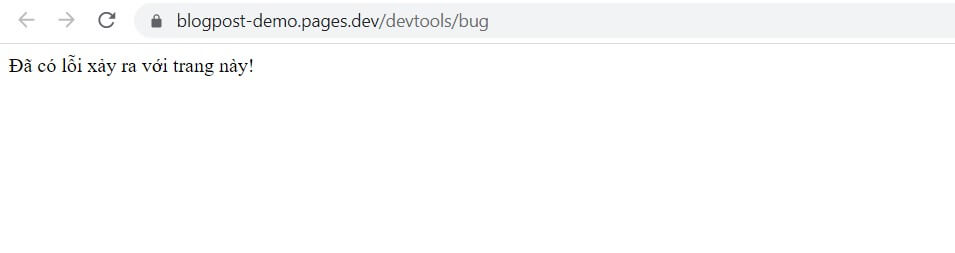
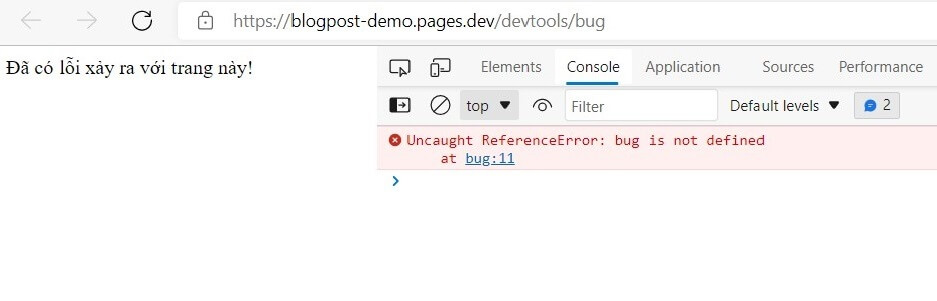
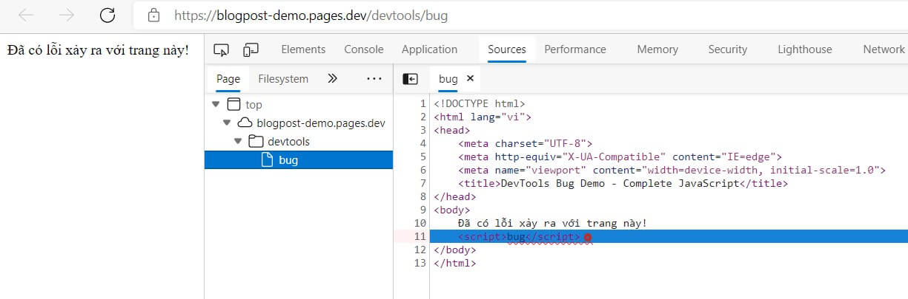
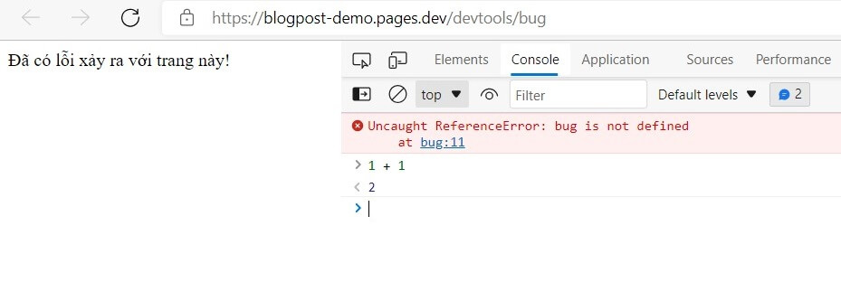

Trong lập trình, việc code lỗi là không thể tránh khỏi. Nhưng trên trình duyệt, bạn thường sẽ không nhìn thấy những lỗi này. Mà thay vào đó, bạn cần xem thông qua một công cụ. Đó chính là Dev Tools.

## Dev Tools là gì?

Dev Tools (developer tools) là công cụ được tích hợp sẵn trong trình duyệt, giúp các lập trình viên có thể dễ dàng truy cập vào nội bộ của trình duyệt và ứng dụng trang web của họ.

Dev Tools có nhiều tính năng. Nhưng trong phạm vi bài viết này, mình sẽ tìm hiểu cơ bản về cách mở Dev Tools, cách xem lỗi, và cách để chạy code JavaScript trên đó.

Ngoài ra, vì dev tools trên các trình duyệt cũng gần giống nhau nên mình sẽ tập trung vào một loại trình duyệt phổ biến, hỗ trợ đa nền tảng (Windows, macOS và Linux). Đó là "Google Chrome Developer Tools" hay gọi tắt là "Chrome Dev Tools".

## Chrome Dev Tools

Trước tiên, bạn hãy mở trang demo này: <a target="_blank" rel="noopener noreferrer" href="https://blogpost-demo.pages.dev/devtools/bug">bug.html</a>.

Trong trang này, mình đã cố tình tạo ra một lỗi. Nhưng rõ ràng là bạn vẫn nhìn thấy trang web hiển thị bình thường phải không?

Để xem lỗi chi tiết, bạn cần mở Chrome Dev Tools lên bằng cách nhấn phím **F12** hoặc tổ hợp phím **Ctrl Shift I** trên Windows (**Ctrl Opt J** trên macOS).

Chrome Dev Tools sẽ mở tab "Console" đầu tiên (hoặc nếu không thì bạn chủ động nhấn vào tab đó). Kết quả sẽ như sau:

Giao diện chính xác có thể khác nhau đôi chút tùy theo phiên bản trình duyệt Chrome. Nhưng thường thì nội dung sẽ bao gồm:

- Dòng màu đỏ: thông báo lỗi ("Uncaught ReferenceError: bug is not defined").
- Bên phải và/hoặc ở dưới: hiển thị vị trí lỗi, chính xác với số dòng ("bug:11" - ở đây là dòng 11). Bạn có thể nhấn vào đó. Chrome Dev Tools sẽ hiển thị chính xác dòng bị lỗi trong mã nguồn.

Bên dưới dòng lỗi màu đỏ là kí tự `>` màu xanh. Đó là nơi bạn có thể gõ lệnh JavaScript vào và chạy trực tiếp bằng cách nhấn **Enter**. Kết quả sẽ hiển thị ngay lập tức ở dưới.

Ngoài ra, để gõ mã nguồn trên nhiều dòng, bạn hãy nhấn tổ hợp phím **Shift Enter**.

Đến đây là bạn đã biết mở Dev Tools, xem lỗi và chạy code JavaScript trên đó rồi. Chi tiết hơn về các tính năng "bá đạo" của Chrome Dev Tools sẽ được trình bày ở các bài viết sau nhé!

## Tổng kết

Vậy Dev Tools là gì?

- Dev Tools là công cụ tích hợp sẵn trong trình duyệt, hỗ trợ lập trình viên xem lỗi, chạy code JavaScript,...
- Dev Tools trên các trình duyệt tương tự nhau. Bạn có thể làm quen với Chrome Dev Tools. Sau đó, bạn dễ dàng chuyển sang Dev Tools của các trình duyệt khác.
- Với đa phần các trình duyệt, bạn có thể nhấn **F12** hoặc tổ hợp phím **Ctrl Shift I** trên Windows (**Ctrl Opt J** trên macOS) để mở Chrome Dev Tools.
