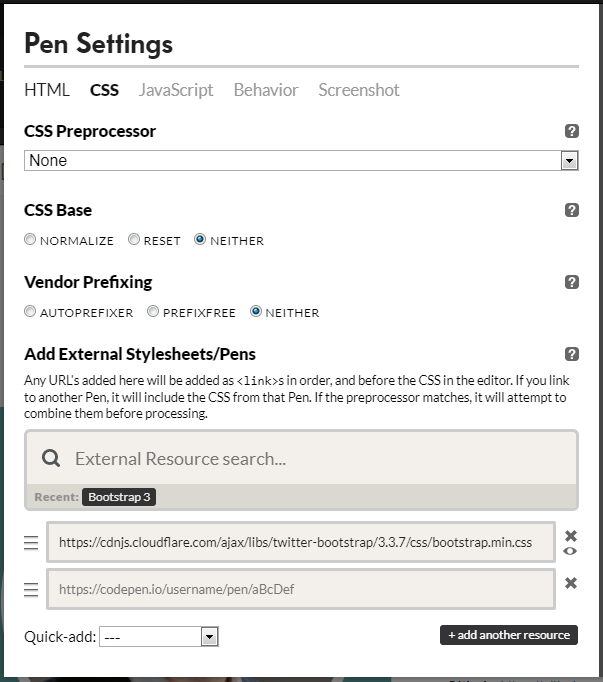
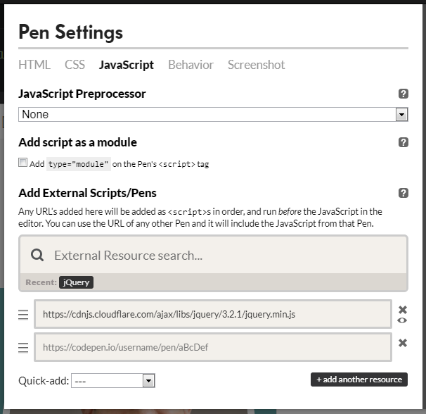
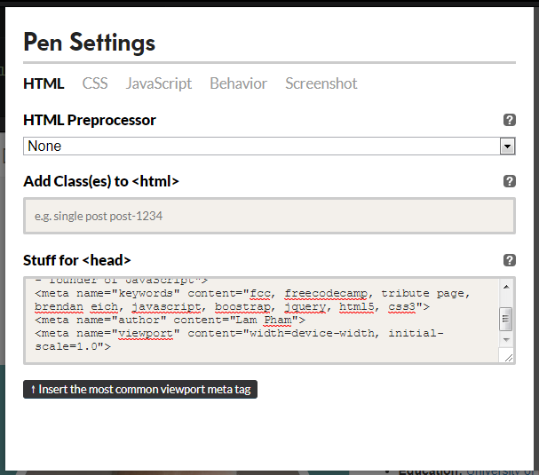
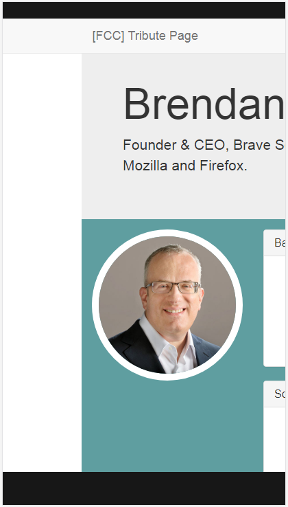
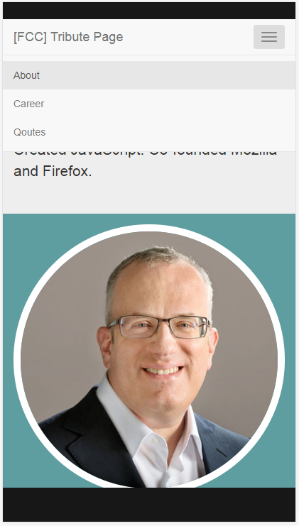

Có thể bạn đã nghe thấy câu **practice makes perfect** rồi. Tuy nhiên, có một câu mà mình thấy đúng hơn cả. Đó là **perfect practice makes perfect**. Câu đó nói rằng, nếu bạn có một chiến thuật thực hành hoàn hảo, thì bạn sẽ trở nên hoàn hảo. Vì vậy, gần đây mình đã tìm và thấy một trang web rất hay, là [freecodecamp.org](https://www.freecodecamp.org/). Mình đang thực hành và sẽ chia sẻ lại với bạn. Bài viết này nói về project đầu tiên **Build a tribute page** thuộc chuyên mục **Basic Front End**.

## Build a tribute page trên codepen

https://codepen.io/completejavascript/pen/baOYpa

## Một số điểm cần ghi nhớ

### Các thư viện sử dụng

Ngoài HTML, CSS, [JavaScript](/javascript-la-gi/), mình sử dụng thêm 2 thư viện khác là: Bootstrap (CSS) và jQuery (js). Để thêm chúng vào project trên codepen, bạn làm như sau:

- Bootstrap CSS: **Setting / CSS / Quick-add / Bootstrap 3**



- jQuery JS: **Setting / JavaScript / Quick-add / jQuery**



### Thông tin cho thẻ &lt;head&gt; của html

Phần HTML trên codepen chỉ bao gồm nội dung trong thẻ body. Vì vậy, nếu bạn muốn thêm thông tin vào thẻ <head> như **meta**, **link**, **script**... thì bạn chọn **Setting / HTML / Stuff for &lt;head&gt;**, sau đó thêm nội dung bạn muốn.

Đối với project này, mình chỉ thêm vào các thẻ **meta**:



```html
<meta charset="UTF-8" />
<meta
  name="description"
  content="A tribute page for Brendan Eich - founder of JavaScript"
/>
<meta
  name="keywords"
  content="fcc, freecodecamp, tribute page, brendan eich, javascript, bootstrap, jquery, html5, css3"
/>
<meta name="author" content="Lam Pham" />
<meta name="viewport" content="width=device-width, initial-scale=1.0" />
```

Trong đó:

- _charset="UTF-8"_: chỉ ra kiểu mã hoá kí tự cho Unicode là UTF-8
- _name="description"_: mô tả ngắn về nội dung trang web
- _name="keywords"_: các từ khoá của trang web
- _name="author"_: tên tác giả
- _name="viewport"_: xác định viewport (vùng nhìn thấy) của trang web. Thông số **_width=device-width_** để chỉ ra rằng chiều rộng của trang bằng với chiều rộng của màn hình. Và thông số **_initial-scale=1.0_** xác định mức độ zoom khi trang web được load lần đầu tiên, ở đây _1.0_ tức là không zoom.

Mục đích của việc xác định viewport để làm cho trang web trở nên responsive. Hình ảnh sau đây cho thấy sự khác nhau của 2 trường hợp: có thẻ meta viewport và không có thẻ này.

Có thẻ meta viewport:


Không có thẻ meta viewport:



Chi tiết cho phần nội dung của HTML và CSS mình sẽ không trình bày trong khuôn khổ của trang web này. Nếu bạn chưa biết gì về Bootstrap thì có thể tham khảo tại [đây](https://www.tutorialspoint.com/bootstrap/index.htm).

## Xử lý logic với jQuery

Trước tiên, mình muốn giải thích lý do tại sao lại chọn [jQuery](https://jquery.com/) thay vì nhiều thư viện JavaScript khác. Đơn giản, chương trình của freeCodeCamp bắt đầu với HTML5, CSS , Bootstrap và jQuery. Trong khi Bootstrap phục vụ mục đích Responsive thì jQuery dùng để xử lý phần logic - cụ thể đó là để xử lý hoạt động của menu (collapse) ứng với thiết bị là điện thoại.



Khi người dùng nhấn vào biểu tượng menu ở góc trên bên phải thì các thanh menu sẽ đổ xuống, sau khi lựa chọn xong thì chúng lại được kéo lên, nhằm tiết kiệm diện tích màn hình.

Ngoài ra, menu còn trỏ đến các mục tương ứng trên trang là: **About**, **Career** và **Qoutes**. Khi kéo trang đến mục nào thì menu ứng với mục đó sẽ được hiển thị đậm hơn (bạn có thể chạy thử phần demo phía trên để thấy rõ hơn). Logic phần này cũng sẽ được giải thích phía sau đây.

### Bắt đầu với \$(document).ready()

Hàm này dùng để phát hiện trạng thái khi toàn bộ các phần tử [DOM](/co-ban-ve-dom-javascript/) đã được load.

```js
// A $( document ).ready() block.
$(document).ready(function () {
  console.log("ready!");
});
```

### Kích hoạt menu item

Ở đây, mình gán tên class _.my-menu_ cho 3 menu item là About, Career và Qoutes:

```html
<li id="menu-about" class="my-menu active"><a href="#about">About</a></li>
<li id="menu-career" class="my-menu"><a href="#career">Career</a></li>
<li id="menu-qoute" class="my-menu"><a href="#qoute">Qoutes</a></li>
```

Khi một trong 3 menu item này được click thì hàm sau sẽ được gọi:

```js
// Navigation Bar Handling
$(".my-menu").click(function () {
  menuClicked = true;
  activateMenu(this);
  $("#my-navbar").slideUp();
});
```

Có 3 thứ cần làm khi menu item được click:

- Set giá trị **true** cho biến **menuClicked** để xác định trường hợp này là menu item được click, dùng để phân biệt với trường hợp trang được kéo (scroll).
- Kích hoạt menu item được click (bỏ **active** với các menu item còn lại) thông qua class **active** - xử lý bởi Bootstrap.

```js
function activateMenu(menuItem) {
  $(menuItem).parent().children().removeClass("active");
  $(menuItem).addClass("active");
}
```

### Smooth scrolling khi click menu item

Giả sử, trang web đang ở vị trí đầu trang (_About_). Nếu người dùng click vào menu _Qoutes_ thì mặc định trang web sẽ nhảy thẳng đến mục đó. Phần sau sẽ custom lại hoạt động này giúp cho việc _scrolling_ trở nên _smooth_ hơn.

```js
// Smooth scrolling
$("a[href*='#']:not([href='#'])").click(function () {
  if (
    location.pathname.replace(/^\//, "") == this.pathname.replace(/^\//, "") ||
    location.hostname == this.hostname
  ) {
    var target = $(this.hash);
    target = target.length ? target : $("[name=" + this.hash.slice(1) + "]");

    if (target.length) {
      $("html,body").animate(
        {
          scrollTop: target.offset().top,
        },
        1000
      );
    }
  }
});
```

Phần <code>$("a[href*='#']:not([href='#'])")</code> được hiểu là: lựa chọn tất cả các thẻ &lt;a&gt; bắt đầu bằng _#_ và không phải là chỉ _#_, cụ thể là _#about, #career, #qoute_ - 3 mục chính trên trang web.

Trong đó, sau khi đã xác định được _target_, sử dụng [.animate()](http://api.jquery.com/animate/) để tạo ra animation lúc chuyển động đến vị trí đích (code trên mình tham khảo tại [đây](https://css-tricks.com/snippets/jquery/smooth-scrolling/)).

### Xử lý khi người dùng kéo (scroll) trang

#### Bắt sự kiện scroll

Để [xử lý sự kiện](/xu-ly-mot-event-javascript-co-ban/) này, mình sử dụng hàm [.scroll()](https://api.jquery.com/scroll/) của jQuery.

```js
// Update menu while scrolling
$(window).scroll(function () {
  if (timer) {
    window.clearTimeout(timer);
  }
  timer = window.setTimeout(handleScrollEvent, 100);
});
```

Thực tế, khi người dùng kéo trang thì sự kiện này sẽ liên tục được gọi. Để tránh tình trạng đó, mình sẽ gọi đến hàm _handleScrollEvent_, sau thời gian timeout là 100 ms. Trong khoảng thời gian này, nếu như tiếp tục có sự kiện gọi đến thì hành động trước sẽ bị xoá đi, để tránh phải xử lý quá nhiều việc giống nhau:

```js
if (timer) {
  window.clearTimeout(timer);
}
```

#### Xử lý sự kiện scroll

Có một vấn đề phát sinh là khi người dùng click vào menu item, trang web được scroll đến một mục khác. Lúc này, **\$(window).scroll** cũng sẽ được gọi tới. Để tránh xung đột giữa hai trường hợp (người dùng kéo trang và người dùng click vào menu), mình đã sử dụng một biến [Boolean](/kieu-du-lieu-trong-javascript/) là **menuClicked** để phân biệt. Trường hợp, click menu item thì `menuClicked = true` và mình sẽ không xử lý gì trong [function](/ham-la-gi-ham-trong-javascript/) _handleScrollEvent_.

```js
function handleScrollEvent() {
  if (!menuClicked) {
    let about = $("#about");
    let career = $("#career");
    let qoute = $("#qoute");

    if (isInViewPort(about) && !about.hasClass("active")) {
      activateMenu($("#menu-about"));
      setHashLocation("#about");
    } else if (isInViewPort(career) && !career.hasClass("active")) {
      activateMenu($("#menu-career"));
      setHashLocation("#career");
    } else if (isInViewPort(qoute) && !qoute.hasClass("active")) {
      activateMenu($("#menu-qoute"));
      setHashLocation("#qoute");
    }
  } else {
    menuClicked = false;
  }
}
```

Trường hợp, không phải là click menu thì mình sẽ kiểm tra trong 3 mục chính, phần nào nằm trong viewport thì sẽ active menu tương ứng và set lại _hash location_ ở thanh địa chỉ URL. Sau đây là hàm kiểm tra xem 1 phần tử có nằm trong viewport hay không:

```js
function isInViewPort(element) {
  // get top and bottom of element
  let elementTop = $(element).offset().top;
  let elementBottom = elementTop + $(element).outerHeight();

  // get top and bottom of viewport
  let viewPortTop = $(window).scrollTop();
  let viewPortBottom = viewPortTop + $(window).height();

  return elementBottom > viewPortTop && elementTop < viewPortBottom;
}
```

#### Hash location

Giả sử địa chỉ trang **Build a tribute page** này là **127.0.0.1:8000**, khi đó, địa chỉ tương ứng với 3 mục about, career và qoutes là:

- **127.0.0.1:8000/#about**
- **127.0.0.1:8000/#career**
- **127.0.0.1:8000/#qoute**

Khi người dùng kéo trang web đến mục nào thì mình sẽ set lại địa chỉ ứng với mục đó, như sau:

```js
function setHashLocation(id) {
  var scrollmem = $("html,body").scrollTop();
  window.location.hash = id;
  $("html,body").scrollTop(scrollmem);
}
```

Khi mình gọi <code>window.location.hash = id</code>, địa chỉ URL sẽ được cập nhật, đồng thời trang web sẽ nhảy đến vị trí đầu tiên ứng với mục đó. Nghĩa là nếu như người dùng kéo trang web đến giữa hoặc cuối của một mục (giả sử là career), thì sau lệnh trên, trang web lại bị kéo lên vị trí đầu tiên của mục đó (career).

Đoạn code trên, nếu phân tích thì sẽ như sau:

- <code>var scrollmem = $('html,body').scrollTop</code> => lấy vị trí của trang web tại top của viewport, gọi là x
- <code>window.location.hash = id</code> => set lại hash location, và trang web nhảy đến vị trí y - là vị trí bắt đầu của một mục
- <code>$('html,body').scrollTop(scrollmem)</code> => kéo trang web quay trở về vị trí trước đó là x.

## Kết luận

Trên đây là toàn bộ những điều mình rút ra được từ project **Build a tribute page** trên freeCodeCamp. Hiện tại, project này đang có một issue khi scroll trang web trên trình duyệt của facebook. Mình sẽ sửa và cập nhật lại code sớm nhất có thể.

Không biết bạn đánh giá như thế nào? Vui lòng để lại bình luận phía dưới để mọi người cùng trao đổi nhé!

Xin chào và hẹn gặp lại bạn ở [bài viết tiếp theo](/lap-trinh-javascript-voi-fcc-personal-portfolio/), thân ái!

## Tham khảo

- [Smooth Scrolling](https://css-tricks.com/snippets/jquery/smooth-scrolling/)
- [Components Bootstrap 3.3](https://getbootstrap.com/docs/3.3/components/)
- [Build a tribute page full preview](https://codepen.io/completejavascript/full/baOYpa/)
