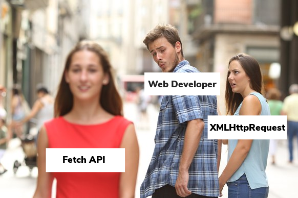

Tiếp tục với chủ đề Lập trình JavaScript với FCC, bài viết này mình sẽ tổng hợp lại những bài học kinh nghiệm, [thủ thuật](/21-thu-thuat-javascript-huu-ich) rút ra được từ project **Wikipedia Viewer**.

Tuy nhiên, trước khi bắt đầu, mình muốn **nhấn mạnh** rằng bài viết này sẽ không đi vào giải thích chi tiết từng bước để làm được project (theo kiểu tutorials, step-by-step,...).

Do đó, nếu bạn mới bắt đầu học JavaScript thì có thể bạn sẽ không hiểu nhiều chỗ. Lúc này, mình có hai giải pháp dành cho bạn. Đó là:

1. Bạn nên đọc trước series bài viết về [JavaScript cơ bản](/javascript) và nhớ thực hành thật kỹ, rồi quay lại bài viết này sau.
2. Bạn có thể tiếp tục đọc bài viết này và đặt câu hỏi cho mình trong phần bình luận phía dưới về những phần chưa hiểu rõ.

Nếu đọc đến đây, nghĩa là bạn đã có kiến thức về JavaScript rồi phải không! Vậy thì bắt đầu nhé!

## Demo Wikipedia Viewer

https://codepen.io/completejavascript/pen/WJxwgy

## **Wikipedia Viewer có tác dụng gì?**

Wikipedia Viewer giúp bạn tìm kiếm nội dung trên trang [Wikipedia](https://en.wikipedia.org) một cách dễ dàng hơn thay vì tìm kiếm trên Google.

Tuy nhiên, nói vậy không có nghĩa là bạn nên vào web app của mình để tìm kiếm (vì mình cũng chẳng bao giờ sử dụng cái này cả). Thực chất, đây chỉ là một project giúp bạn thực hành kĩ năng lập trình web (HTML5, CSS3, JS). Đơn giản vậy thôi.

Còn trong trường hợp bạn muốn tìm kiếm nội dung trên wikipedia thì bạn có thể sử dụng từ khóa **site:tên-trang-web nội-dung-muốn-tìm** với Google.

Ví dụ:

```
site:https://en.wikipedia.org Hồ Chí Minh
```

Khi đó, kết quả tìm kiếm sẽ chỉ đến từ trang _https://en.wikipedia.org_ mà thôi. Bạn có thể xem kết quả ở [đây](https://www.google.com.vn/search?q=site%3Ahttps%3A%2F%2Fen.wikipedia.org+H%E1%BB%93+Ch%C3%AD+Minh&oq=site%3Ahttps%3A%2F%2Fen.wikipedia.org+H%E1%BB%93+Ch%C3%AD+Minh&aqs=chrome..69i57j69i58.347j0j4&sourceid=chrome&ie=UTF-8).

Quay lại với nội dung chính của bài viết, đó là những bài học, kinh nghiệm và thủ thuật rút ra từ Wikipedia Viewer để áp dụng cho các project khác. Ngay sau đây, mình sẽ trình bày về vấn đề này.

## Những bài học rút ra từ Wikipedia Viewer

_Chú ý: project này mình không sử dụng jQuery như các project trước. Thay vào đó, mình chỉ sử dụng JavaScript thuần._

### Sử dụng event DOMContentLoaded hay load?

Đây là 2 [sự kiện](/xu-ly-mot-event-javascript-co-ban) quan trọng khi bắt đầu một trang web. Tuy nhiên, chúng khác nhau như thế nào và bạn nên sử dụng cái nào?

Mình có thể tóm tắt sự khác nhau như thế này:

- [DOMContentLoaded](https://developer.mozilla.org/en-US/docs/Web/Events/DOMContentLoaded) được gọi khi toàn bộ HTML được load và [DOM](/co-ban-ve-dom-javascript) tree đã được xây dựng, tuy nhiên, stylesheets, ảnh hay subframes có thể vẫn chưa được load xong. Và sự kiện này gắn liền với đối tượng [document](https://developer.mozilla.org/en/docs/Web/API/Document).
- [load](https://developer.mozilla.org/en-US/docs/Web/Events/load) được gọi sau DOMContentLoaded, cộng với stylesheets, ảnh hay subframes đã được load hết. Và đối tượng này gắn liền với [window](https://developer.mozilla.org/en-US/docs/Web/API/Window).

Do đó, sự kiện **DOMContentLoaded** sẽ được sử dụng khi bạn muốn truy vấn DOM, khởi tạo dữ liệu, chỉnh sửa giao diện,... Trường hợp bạn cần lấy kích thước ảnh, thì bạn phải xử lý việc này sau sự kiện **load**, vì lúc đó toàn bộ ảnh mới được tải xong.

Vì vậy, mình sử dụng event **DOMContentLoaded** trong project này:

```js
document.addEventListener("DOMContentLoaded", () => {
  // Toàn bộ code sẽ ở trong đoạn này.
});
```

### Sử dụng querySelector

Có thể, bạn đã quen sử dụng [Document.getElementById()](https://developer.mozilla.org/en-US/docs/Web/API/Document/getElementById) hay [Document.getElementsByClassName()](https://developer.mozilla.org/en-US/docs/Web/API/Document/getElementsByClassName) để truy vấn DOM. Nếu vậy mình nghĩ bạn nên chuyển sang sử dụng [document.querySelector()](https://developer.mozilla.org/en-US/docs/Web/API/Document/querySelector). Vì sao?

Vì khi sử dụng phương thức này, bạn không chỉ lấy được Element bởi **id**, **class** mà còn có thể truy vấn theo nhiều dạng khác nhau. Bởi phương thức này sử dụng [CSS Selector](https://www.w3schools.com/cssref/css_selectors.asp) để truy vấn DOM.

**Chú ý:**

- Phương thức này chỉ trả về 1 element đầu tiên thỏa mãn truy vấn. Nếu bạn muốn trả về một mảng của các element thỏa mãn thì có thể sử dụng [document.querySelectorAll()](https://developer.mozilla.org/en-US/docs/Web/API/Document/querySelectorAll).
- Ngoài ra, bạn có thể sử dụng [bind](/phan-biet-call-apply-va-bind-trong-javascript) để rút gọn phương thức này:

Thay vì:

```js
let ele1 = document.querySelector("#id1");
let ele2 = document.querySelector(".class2");
let ele3 = document.querySelector("div.user-panel.main input[name='login']");
```

Bạn có thể:

```js
let $ = document.querySelector.bind(document);

// Usage
let ele1 = $("#id1");
let ele2 = $(".class2");
let ele3 = $("div.user-panel.main input[name='login']");
```

Nhìn chả khác gì jQuery phải không bạn?


### Chỉ Query DOM một lần giúp nâng cao hiệu năng

Về nguyên tắc, việc query DOM sẽ tốn thời gian. Vì vậy, bạn chỉ nên query một lần duy nhất và lưu lại để sử dụng sau này. Không nên cứ khi cần dùng thì lại query.

Ví dụ như trong project này, những phần tử nào được sử dụng nhiều hơn một lần thì mình sẽ lưu lại:

```js
let $ = document.querySelector.bind(document);
let _input = $("#inp-search");
let _searchWrapper = $(".search-wrapper");
let _header = $("header");
let _resultWrapper = $(".result");
let _loading = $(".loading");
let _title = $("header");
```

Ngoài ra, mình sử dụng kí tự \_ đằng trước biến số, để quy định rằng đây là đại diện cho DOM chứ không phải biến số thông thường.

Cái này là tự mình quy định thôi nhé, để tránh nhầm lẫn với jQuery. Nếu như sử dụng jQuery thì mình hay sử dụng kí tự $, ví dụ: *$input, $searchWrapper\*,...

### Hai sự kiện quan trọng với input[type="search"]

Trong project Wikipedia Viewer này mình sử dụng [input[type="search"]](https://developer.mozilla.org/en-US/docs/Web/HTML/Element/input/search) để cho người dùng nhập dữ liệu tìm kiếm. Có 2 sự kiện mà mình cần phải xử lý là: **search** và **input**.

Sự kiện **search**: xảy ra khi người dùng nhấn phím Enter để bắt đầu tìm kiếm

```js
_input.addEventListener("search", (event) => {
  let _target = event.target;
  let searchText = _target.value;
  if (searchText !== "") search(searchText);
  else resetViewResult();
});
```

Sự kiện **input**: được gọi trong khi nội dung input thay đổi - nghĩa là chỉ cần bạn nhập vào 1 chữ cái hay xóa đi một chữ cái thôi thì sự kiện này cũng sẽ được gọi. Mình cần xử lý sự kiện này khi người dùng xóa hết sạch nội dung trong input. Khi đó, mình sẽ reset lại kết quả tìm kiếm trước đó, để trở về giao diện như ban đầu.

```js
_input.addEventListener("input", (event) => {
  let _target = event.target;
  let searchText = _target.value;
  if (searchText === "") resetViewResult();
});
```

### Sử dụng Fetch API thay vì XMLHttpRequest

Trong project này mình không sử dụng thằng [XMLHttpRequest](/xmlhttprequest-tao-http-request-den-server-trong-javascript). Thay vào đó, mình sử dụng [Fetch API](https://davidwalsh.name/fetch). Bởi vì, Fetch API được implement dưới dạng [Promises](https://davidwalsh.name/promises) nên sử dụng rất gọn.

```js
let api =
  "https://en.wikipedia.org/w/api.php?format=json&action=query&" +
  "generator=search&gsrnamespace=0&gsrlimit=10&prop=pageimages|extracts&" +
  "pilimit=max&exintro&explaintext&exsentences=1&exlimit=max&gsrsearch=";
let cors = "https://cors-anywhere.herokuapp.com/";

function search(text) {
  showLoading(true);

  fetch(cors + api + text)
    .then((response) => response.json())
    .then((json) => viewResult(json))
    .catch((error) => onSearchError());
}
```

Trong đó:

- _cors + api + text_ : chính là địa chỉ URL để request (kiểu mặc định là GET).
- Khi có kết quả trả về thành công, mình sẽ xử lý tiếp _.then(response => response.json())_ - tức là parse response thành [JSON](/tim-hieu-ve-json-trong-javascript).
- May mắn thay, hàm _json()_ cũng trả về Promises nên mình có thể xử lý tiếp _.then(json => viewResult(json))_ - tức là hiển thị kết quả tìm kiếm. Hàm _viewResult_ là do mình tự định nghĩa.
- Cuối cùng là xử lý khi có bất kì lỗi nào xảy ra với _.catch(error => onSearchError())_.

Rõ ràng, khi sử dụng Fetch API thì code trở nên rõ ràng và sáng sủa hơn rất nhiều.



_Ảnh tham khảo: ANTONIO GUILLEM/SHUTTERSTOCK_

### Sử dụng ES6 Template String để tạo HTML Template

Trong bài viết [Sử dụng ES6 Template String có gì hay?](/su-dung-es6-template-string-co-gi-hay), mình cũng đã giới thiệu với các bạn về cách sử dụng Template String để tạo HTML Template rồi. Các bạn có thể đọc bài viết đó để nắm được cách làm.

Ở đây mình thực hiện như sau:

```js
function itemHTMLTemplate(title, description, pageid) {
  let linkTarget = `${wikiPage}${pageid}`;

  return (
    `<div class="result-item my-transition" target="${linkTarget}">\n` +
    `<div class="content">\n` +
    `<h2><a href="${linkTarget}" target="_blank">${title}</a></h2>\n` +
    `<p>${description}</p>\n` +
    `</div>\n` +
    `</div>\n`
  );
}

function htmlToElement(html) {
  let template = document.createElement("template");
  html = html.trim(); // Never return a text node of whitespace as the result
  template.innerHTML = html;
  return template.content.firstChild;
}
```

Trong đó:

- Hàm _itemHTMLTemplate_ tạo ra HTML template tương ứng với mỗi kết quả tìm kiếm
- Hàm _htmlToElement_ dùng để tạo ra phần tử DOM tương ứng.

Qua đó, mình có thể sử dụng 2 [hàm số](/tim-hieu-function-javascript) này để hiển thị kết quả tìm kiếm:

```js
function viewResult(result) {
  showLoading(false);
  resetViewResult();

  if (result.query) {
    _searchWrapper.classList.add("view-result");
    _header.classList.add("view-result");

    let pages = result.query.pages;

    for (let key in pages) {
      let page = pages[key];
      let html = itemHTMLTemplate(page.title, page.extract, page.pageid);
      let _resultItem = htmlToElement(html);
      _resultWrapper.appendChild(_resultItem);
      _resultItem.addEventListener("click", onResultItemClicked);
    }
  }
}
```

### Hiển thị loading với Pure CSS Loaders

Nếu bạn để ý thì sẽ thấy khoảng thời gian khi bắt đầu tìm kiếm cho đến khi có kết quả trả về, mình có hiển thị một hình tròn - xoay, xoay, để biểu thị rằng: _chương trình đang thực hiện tìm kiếm_.

Cái này là cần thiết vì khi đó người dùng sẽ biết rằng: cần phải đợi kết quả trả về. Giả sử, mình không hiển thị cái đó lên, thì bạn sẽ không biết là _chương trình lỗi hay sao mà nhấn vào chả có hiện tượng gì xảy ra?_

Bạn có thể tìm kiếm rất nhiều hướng dẫn trên mạng về chủ đề này với từ khóa **loading css**. Ở đây, mình sử dụng [Pure CSS Loaders](https://loading.io/css/) - vừa đẹp lại vừa dễ sử dụng. Ngoài ra, trang này cho phép bạn sử dụng 12 mẫu hoàn toàn free - với License CC0.

Về cách sử dụng: bạn chỉ cần copy đoạn HTML và đoạn CSS về rồi nhét vào project là xong. Ví dụ:

https://codepen.io/completejavascript/pen/xjXwRr

### Sử dụng Gradient CSS

```css
.main-app {
  position: absolute;
  top: 0;
  left: 0;
  width: 100%;
  min-height: 100%;
  text-align: center;
  background: linear-gradient(
    to bottom right,
    rgb(115, 237, 241),
    rgb(81, 81, 229)
  );
}
```

Phần này mình sẽ không giải thích nhiều. Thay vào đó, bạn có thể đọc thêm ở các trang mình để dưới đây.

Về cách sử dụng Gradient CSS thì bạn có thể tham khảo tại [đây](https://www.w3schools.com/css/css3_gradients.asp) - rất chi tiết.

Về cách lựa chọn màu sao cho đẹp mắt, bạn có thể tham khảo ở các bài viết:

- [30 Beautiful Color Gradients For Your Next Design Project](https://digitalsynopsis.com/design/beautiful-color-gradients-backgrounds/)
- [36 Beautiful Color Gradients For Your Next Design Project](https://digitalsynopsis.com/design/beautiful-color-ui-gradients-backgrounds/)
- [27 Beautiful Color Gradients For Your Next Design Project](https://digitalsynopsis.com/design/beautiful-color-gradient-hues-backgrounds/)

## Kết luận

Trên đây là những bài học mà mình rút ra được sau khi hoàn thành project Wikipedia Viewer từ FCC. Mình có thể tóm tắt lại như sau:

- Sử dụng event DOMContentLoaded hay load?
- Sử dụng querySelector
- Chỉ Query DOM một lần giúp nâng cao hiệu năng
- Hai sự kiện quan trọng với input[type="search"]
- Sử dụng Fetch API thay vì XMLHttpRequest
- Sử dụng ES6 String Template để tạo HTML Template
- Hiển thị loading với Pure CSS Loaders
- Sử dụng Gradient CSS

Hy vọng bạn có thể tìm thấy được 1 chút hữu ích từ đây. Nếu có thắc mắc cần giải đáp hay góp ý gì với mình thì bạn có thể để lại trong phần bình luận phía dưới.

Xin chào và hẹn gặp lại bạn ở [bài viết tiếp theo](/lap-trinh-javascript-voi-fcc-twitch-tv-json-api), thân ái!
