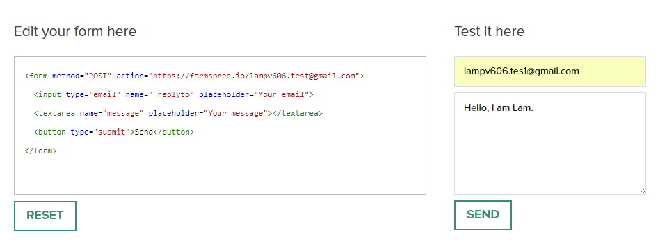
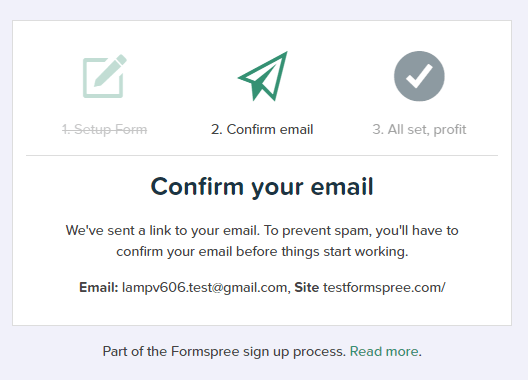

Xin chào bạn! Gần đây, mình có làm một số website static (chỉ gồm HTML5, CSS3 và [JavaScript](/javascript/)). Trong đó, website có một phần là contact form (liên hệ). Sau một hồi tìm kiếm google, mình đã tìm ra một phương pháp rất hay giúp bạn gửi email bằng HTML bằng cách sử dụng [Formspree.io](https://formspree.io/). Vậy cách này có những ưu điểm gì?

## Ưu điểm khi gửi email bằng HTML và Formspree

Sau đây là một vài ưu điểm khi gửi mail bằng HTML và Formspree:

- Chỉ cần triển khai form trên HTML
- Không cần xử lý trong JavaScript, PHP,...
- Không cần đăng ký tài khoản

Với những ưu điểm trên mình quyết định dùng nó ngay mà không cần tìm kiếm google thêm xem còn cách nào khác nữa hay không.

## Test thử trên test.formspree.io

Việc đầu tiên cần làm là phải dùng thử xem nó hoạt động như thế nào. Để dùng thử, bạn vào trang **test.formspree.io** và làm theo hướng dẫn sau:

### Bước 1: Sửa nội dung form

Bạn thay đổi giá trị của thuộc tính **action** trong form thành dạng:

```
https://formspree.io/your@email.com
```

Với **your@email** là địa chỉ mà bạn muốn dùng để nhận mail.

Ví dụ của mình là:

```
https://formspree.io/lampv606.test@gmail.com
```

Khi đó ta có:

```html
<form method="POST" action="https://formspree.io/lampv606.test@gmail.com">
  <input type="email" name="email" placeholder="Your email" />
  <textarea name="abc" placeholder="Your message"></textarea>
  <button type="submit">Send</button>
</form>
```

Như vậy là đã hoàn thành phần cài đặt form.



### Bước 2: Nhập nội dung vào form

Trong bước này, bạn sẽ đóng vai trò là người gửi email đến địa chỉ đã cấu hình trong form ở bước 1.

Bạn sẽ nhập địa chỉ email vào mục _Your email_ (chú ý là phải đúng chuẩn, có chữ @) và nội dung mà bạn muốn gửi vào phần _Your message_. Nhập xong, bạn chọn _Send_ để gửi.

Lúc này, trang web thông báo rằng bạn cần xác minh email.



### Bước 3: Xác minh email

Bạn sẽ cần vào email mà bạn muốn nhận (email đã cài đặt trong form ở bước 1, không phải email vừa nhập ở bước 2) để xác nhận. Bạn nhấn vào button **Confirm Form** là hoàn thành.

Từ nay về sau, mọi người có thể gửi email trực tiếp cho bạn thông qua form này mà không cần xác nhận nữa.

> **Chú ý**: với mỗi địa chỉ trang web chứa form (ví dụ ở đây là `http://test.formspree.io`), bạn cần phải test thử để xác minh một lần đầu tiên. Nghĩa là việc xác minh dựa trên địa chỉ trang web, không phải theo địa chỉ email. Vậy nên, khi bạn sử dụng form ở một địa chỉ khác (ví dụ `http://abc.com`), với cùng email như trên, thì bạn vẫn cần phải xác minh lại.

## Triển khai gửi email bằng HTML

Có lẽ bạn sẽ muốn test thử trên local trước khi làm trên website của mình. Nhưng khi áp dụng cách gửi email bằng HTML và Formspree này, bạn buộc phải triển khai trên một website thật mà không làm trên local được.

Giải pháp là bạn có thể sử dụng **github.io** hoặc **codepen.io**. Mình thì thích dùng Codepen hơn vì nó nhanh và có thể nhúng vào blog wordpress.

Demo đây nhé:

https://codepen.io/completejavascript/pen/yKOpLd

So với ví dụ trên, mình chỉ thêm phần _Name_ để ghi họ tên, còn lại thì hoàn toàn không khác gì hết. Về cơ bản, đến đây, bạn đã hoàn thành được nhiệm vụ gửi email bằng HTML. Sau đây, là một số tính năng nâng cao khác mà bạn có thể xem xét thêm vào.

## Một số tính năng nâng cao

Ngoài những tính năng cơ bản như trên, formspree còn hỗ trợ một vài các tính năng nâng cao khác như:

### \_replyto

Trường này có thể dùng để thay thế cho phần email. Khi đó, bạn có thể reply trực tiếp cho người đã submit form này.

```html
<input type="text" name="_replyto" placeholder="Your email" />
```

### \_next

Mặc định, sau khi gửi thành công sẽ có một trang thông báo mặc định của Formspree. Tuy nhiên, bạn có thể thay thế nó bằng một trang khác của riêng bạn.

```html
<input type="hidden" name="_next" value="//site.io/thanks.html" />
```

### \_subject

Dùng để thêm vào tiêu đề mail. Qua đó, bạn có thể reply lại người gửi mà không cần sửa lại phần subject.

```html
<input type="hidden" name="_subject" value="New submission!" />
```

### \_cc

Dùng để thêm địa chỉ email vào trường **cc**.

```html
<input type="hidden" name="_cc" value="another@email.com" />
```

Nếu bạn muốn mail này cc cho nhiều người thì có thể thêm vào nhiều email, phân cách nhau bởi dấu phẩy.

```html
<input
  type="hidden"
  name="_cc"
  value="another@email.com,yetanother@email.com"
/>
```

### \_format

Phần này cho phép bạn nhận email dạng plain text.

```html
<input type="hidden" name="_format" value="plain" />
```

### \_language

Sau khi bạn nhấn gửi, sẽ có phần hiện reCAPTCHA để xác minh bằng tiếng anh. Bạn có thể thay đổi ngôn ngữ tùy thích bằng cách sử dụng thuộc tính này.

```html
<input type="hidden" name="_language" value="es" />
```

Hiện tại, có nhiều ngôn ngữ được support, nhưng chưa có Tiếng Việt.

### \_gotcha

reCAPTCHA dùng để tránh spam. Tuy nhiên, bạn vẫn có thể sử dụng thuộc tính này để bỏ qua phần hiện reCAPTCHA.

```html
<input type="text" name="_gotcha" style="display:none" />
```

## Kết luận

Trên đây, mình đã trình bày cách gửi email bằng HTML sử dụng Formspree.

Trước khi kết thúc bài viết, mình muốn nhấn mạnh lại là: **ứng với mỗi website triển khai form này, bạn cần phải xác minh một lần đầu tiên**.

Hy vọng bài viết này có thể giúp bạn biết cách gửi email bằng HTML để có thể triển khai trên các website của mình.

Xin chào và hẹn gặp lại bạn trong [bài viết tiếp theo](/thiet-ke-website-responsive-voi-css-menu/), thân ái!
