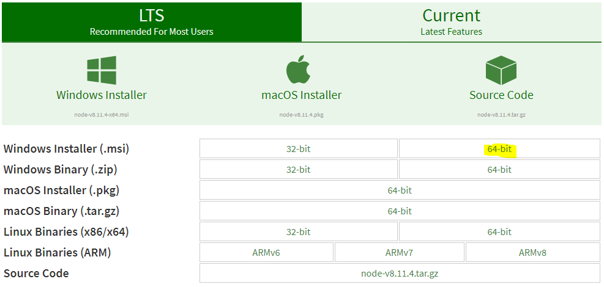
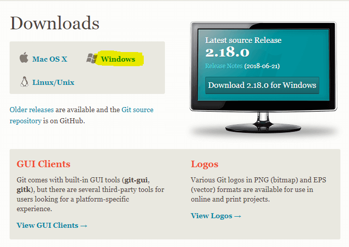
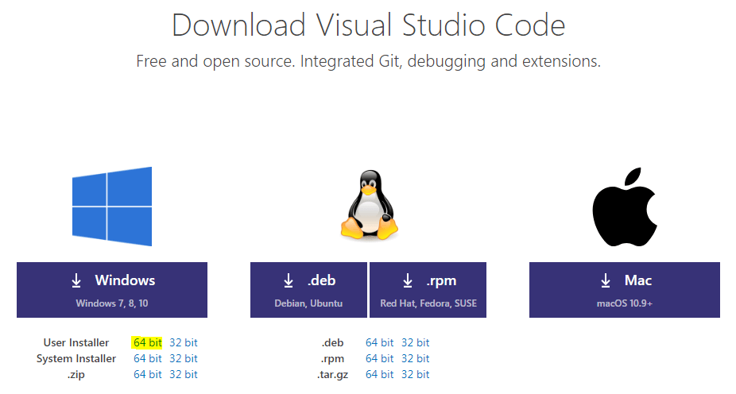
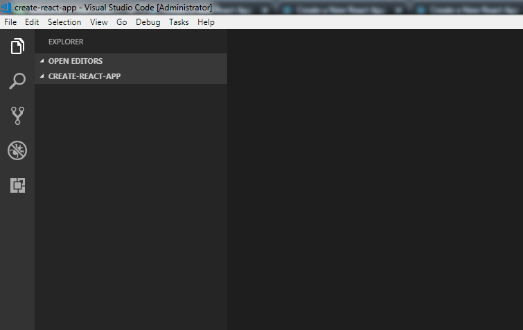
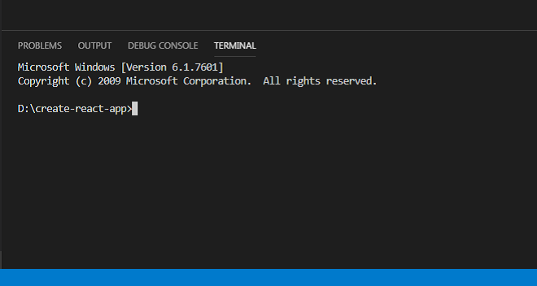
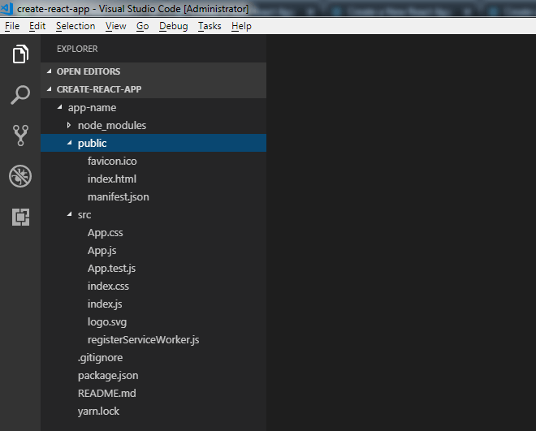
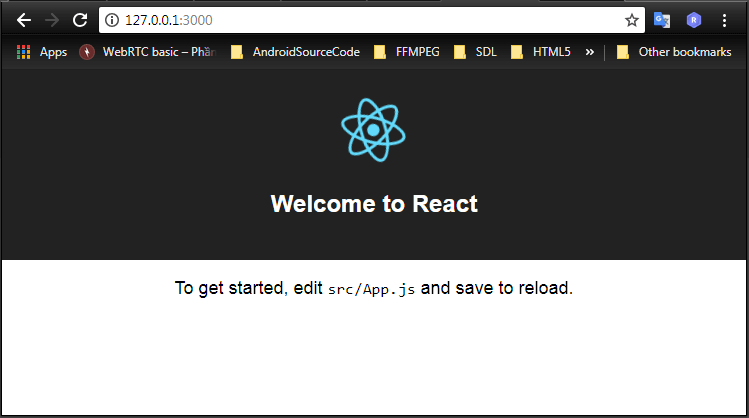

Chào bạn! Gần đây mình có dành thời gian tìm hiểu về React và cũng đã làm được một số project nho nhỏ như: [Markdown Editor](http://about.phamvanlam.com/markdown-editor/), [Drum Machine](http://about.phamvanlam.com/drum-machine/)... Trong những project này, mình đều sử dụng [create-react-app](https://reactjs.org/docs/create-a-new-react-app.html) để phát triển và deploy sản phẩm lên Github Pages.

Mình rất vui nếu bạn dùng thử chúng và cho mình một vài dòng đánh giá. Còn trong bài viết này, mình sẽ tổng hợp lại các bước thực hiện, để đảm bảo rằng bạn có thể tạo và deploy ứng dụng React lên Github Pages với create-react-app thành công **trong năm 2018**.

> **Chú ý:** Khi Create-react-app cập nhật lên **các phiên bản mới hơn**, một số bước trong bài viết này **có thể sẽ bị lỗi**. Nếu gặp bất kỳ lỗi nào, bạn vui lòng để lại bình luận xuống cuối bài viết. Mình sẽ cố gắng giải đáp.

## Một số vấn đề cần làm rõ

- **Create-react-app**: là một toolchain giúp bạn lập trình React một cách đơn giản và thoải mái mà không cần quan tâm đến việc **cấu hình môi trường**. Tool này của Facebook nên bạn hoàn toàn yên tâm sử dụng.
- **Github Pages**: cho phép bạn deploy static website (trang web tĩnh) lên đó với source code chính là Github repository.

Vì vậy, bài viết này chỉ phù hợp khi bạn muốn [deploy các trang web tĩnh](/hosting-mien-phi-cho-web-tinh/) đơn giản hoặc Single Page Application. Nếu bạn muốn deploy một trang web dạng blog, hay cần phải xử lý phía server, tương tác với database,... thì hẹn gặp bạn trong một bài viết khác phù hợp hơn nhé!

Nếu đọc đến đây, nghĩa là bài viết này phù hợp với bạn. Vậy thì bắt đầu thôi nào!

## Cài đặt môi trường

Bài viết này sẽ hướng dẫn bạn tạo và deploy ứng dụng React lên Github Pages với create-react-app trên môi trường Windows 7.

Nếu máy bạn sử dụng Windows 10 và bị lỗi ở bước nào đó thì có thể để lại bình luận ở phía dưới, mình sẽ cố gắng tìm cách khắc phục giúp bạn.

### Cài đặt Node.js

Phần đầu tiên và quan trọng nhất, đó là **Node.js**.

Node.js cung cấp môi trường để chạy JavaScript phía ngoài trình duyệt. Trong trường hợp này, Node.js cung cấp môi trường để phát triển - còn gọi là **môi trường dev**.

Để cài đặt Node.js, bạn cần vào [trang download](https://nodejs.org/en/download/) của Node.js với 2 tuỳ chọn là:

- **LTS (Recommended For Most Users)**: bản Long Term Support với đặc điểm là ổn định và được khuyên dùng.
- **Current (Lastest Features)**: bản mới nhất hiện tại (thường sẽ có nhiều lỗi, không ổn định bằng bản LTS).

Bạn có thể chọn bản tuỳ thích. Nhưng theo mình, bạn nên chọn bản LTS.

Tiếp theo, bạn có thể chọn tải bản **32-bit hoặc 64-bit**. Thường thì máy tính hiện giờ đều chạy được 64-bit, nên bạn cứ tải 64-bit mà cài đặt nhé.

Ngoài ra, bạn cũng có 2 lựa chọn là tải bản **Windows Installer (.msi)** hoặc **Windows Binary (.zip)**.

Trong đó:

- **Windows Installer (.msi)**: bạn chỉ việc **chọn và Next, chọn và Next**,... cực kì đơn giản.
- **Windows Binary (.zip)**: bạn phải cài đặt biến môi trường một cách thủ công để dùng Node.js.

Để đơn giản, mình chọn bản [Windows Installer (.msi) 64-bit](https://nodejs.org/dist/v8.11.4/node-v8.11.4-x64.msi). Phiên bản này là **8.11.4** đã bao gồm **npm 5.6.0**, nên thoả mãn yêu cầu của create-react-app hiện tại là **Node >= 6 and npm >= 5.2**.



> **Chú ý:**
>
> Các bản Create-react-app mới hơn thường **yêu cầu phiên bản của Node và npm cao hơn**. Nếu bạn tải và cài đặt Node với phiên bản LTS trên trang chủ thì yên tâm là phù hợp với Create-react-app.
>
> Trường hợp máy bạn đã có sẵn Node.js rồi thì xem xét **việc nâng cấp lên bản mới hơn** nếu cần.
>
> Các bước để cài đặt Node.js bạn có thể làm theo hướng dẫn trong bài viết: [Hướng dẫn tìm hiểu Node.js cơ bản](/huong-dan-tim-hieu-node-js-co-ban/)
>
> Xem thêm về Node.js tại: [SERIES LƯỢC SỬ LẬP TRÌNH WEB PHẦN 3.2 – NODEJS LÀM LOẠN GIỚI FRONT-END](https://toidicodedao.com/2018/08/07/series-luoc-su-lap-trinh-web-phan-3-2-nodejs-lam-loan-gioi-front-end/)

### Cài đặt Git cho Windows

[Git](/huong-dan-cac-cau-lenh-git-co-ban/) giúp quản lý source code dễ dàng hơn và deploy ứng dụng React lên Github Pages sau khi code xong. Để cài đặt Git cho Windows, bạn vào [trang download git](https://git-scm.com/download) và chọn phần **Windows**.



Việc cài đặt Git cũng khá đơn giản. Bạn có thể làm theo hướng dẫn trong bài viết: [Hướng dẫn cài đặt và cấu hình Git trên Windows](https://o7planning.org/vi/11707/huong-dan-cai-dat-va-cau-hinh-git-tren-windows)

### Cài đặt Visual Studio Code

**Visual Studio Code** là một trong những code editor tốt nhất hiện nay. Lý do mình thích sử dụng Visual Studio Code là vì nó tích hợp sẵn Git và Terminal, nên bạn có thể làm mọi thứ trên một màn hình của Visual Studio Code.

Để tải Visual Studio Code, bạn vào link: [https://code.visualstudio.com/Download](https://code.visualstudio.com/Download) và chọn bản **64-bit**.



Việc cài đặt Visual Studio Code không có gì đặc biệt, bạn chỉ cần cài đặt theo mặc định.

Để biết thêm các tính năng hấp dẫn của Visual Studio Code, bạn có thể tham khảo bài viết: [Visual Studio Code: Code Editor yêu thích mới của tôi](https://webdesign.tutsplus.com/vi/tutorials/visual-studio-code-my-new-favorite-code-editor--cms-28012)

Tạm thời xong về việc **cài đặt môi trường**. Tiếp theo, mình sẽ giới thiệu về cách tạo project **create-react-app**.

## Tạo ứng dụng React sử dụng Create-react-app

### Tạo workspace (vùng làm việc)

Trước tiên, mình tạo một thư mục - coi như là **workspace**, ví dụ:

```
D:\create-react-app
```

Sau đó, mình mở Visual Studio Code lên, chọn `File \ Open Folder...`, rồi chọn đến thư mục vừa tạo ở trên.



Tiếp theo, bạn mở Terminal trên Visual Studio Code bằng cách chọn `View \ Terminal`



Đến đây, bạn đã có thể sử dụng [câu lệnh](/cac-cau-lenh-thuong-dung-tren-cmd-windows/) ngay trên Visual Studio Code.

### Khởi tạo project

Bạn sử dụng câu lệnh sau để tạo mới một project create-react-app:

```bash
$ npx create-react-app app-name
```

Trong đó, `app-name` là tên project mà bạn muốn đặt. Kết quả của câu lệnh trên là một project mẫu như sau:



Để xem nó hoạt động như nào, bạn các chạy lệnh sau:

```bash
# Di chuyển đến vị trí bên trong thư mục chứa project
$ cd app-name

# Tạo server
$ yarn start
```

Sau đó, bạn vào địa chỉ `http://127.0.0.1:3000` trên trình duyệt để kiểm tra kết quả. Nếu mọi thứ hoạt động bình thường thì bạn sẽ thu được màn hình như sau:



## Tuỳ biến ứng dụng create-react-app

Đối với ứng dụng React sử dụng create-react-app, những thứ bạn cần phải quan tâm nhất là:

- File `package.json`: chứa thông tin cấu hình project, dependencies (các node modules cần thiết), scripts,...
- Thư mục `src`: chứa các file mã nguồn của project mà bạn sẽ thao tác trực tiếp lên các file trong thư mục này.
- Thư mục `public`: chứa file [html với template định sẵn](/chuyen-html-template-sang-dom-node/), `favicon.ico` và `manifest.json`.

Về cơ bản, để thay đổi ứng dụng, bạn **chỉ nên** thực hiện trong thư mục `src`. Và bạn **không nên** thay đổi nội dung trong thư mục `public`.

Tuy nhiên, có nhiều thứ mà mình thấy rằng nên thay đổi và việc thay đổi trực tiếp trong thư mục `public` sẽ đơn giản hơn nhất nhiều.

- Trước tiên là file `manifest.json`: File này cung cấp metadata để sử dụng khi bạn đưa ứng dụng lên màn hình chính của điện thoại Android. Trong đó, bạn nên thay đổi thông tin trường `short_name` và `name` theo ứng dụng của bạn,...
- Tiếp theo là file `favicon.ico`: Đó chính là icon được sử dụng cho app và bạn cũng nên thay thế.
- Quan trọng nhất là file `index.html`: Trong file này bạn có thể sửa **title**, **thêm các thẻ meta** tuỳ thích, hoặc link đến các file **css, js**.

Ví dụ file `index.html` trong 1 project của mình:

```html:title=index.html
<!DOCTYPE html>
<html lang="en">
  <head>
    <meta charset="utf-8" />
    <meta
      name="viewport"
      content="width=device-width, initial-scale=1, shrink-to-fit=no"
    />
    <meta name="theme-color" content="#000000" />
    <meta http-equiv="X-UA-Compatible" content="ie=edge" />
    <meta
      name="description"
      content="A very simple but useful Markdown Previewer and Markdown Editor with CodeMirror"
    />
    <meta
      name="keywords"
      content="markdown, previewer, markdown previewer, codemirror, markdown editor, editor"
    />
    <!--
      manifest.json provides metadata used when your web app is added to the
      homescreen on Android. See https://developers.google.com/web/fundamentals/engage-and-retain/web-app-manifest/
    -->
    <link rel="manifest" href="%PUBLIC_URL%/manifest.json" />
    <link rel="shortcut icon" href="%PUBLIC_URL%/favicon.ico" />
    <!--
      Notice the use of %PUBLIC_URL% in the tags above.
      It will be replaced with the URL of the `public` folder during the build.
      Only files inside the `public` folder can be referenced from the HTML.

      Unlike "/favicon.ico" or "favicon.ico", "%PUBLIC_URL%/favicon.ico" will
      work correctly both with client-side routing and a non-root public URL.
      Learn how to configure a non-root public URL by running `npm run build`.
    -->
    <title>Markdown Editor by Lam Pham</title>

    <link
      href="https://use.fontawesome.com/releases/v5.2.0/css/solid.css"
      rel="stylesheet"
      integrity="sha384-wnAC7ln+XN0UKdcPvJvtqIH3jOjs9pnKnq9qX68ImXvOGz2JuFoEiCjT8jyZQX2z"
      crossorigin="anonymous"
    />
    <link
      href="https://use.fontawesome.com/releases/v5.2.0/css/fontawesome.css"
      rel="stylesheet"
      integrity="sha384-HbmWTHay9psM8qyzEKPc8odH4DsOuzdejtnr+OFtDmOcIVnhgReQ4GZBH7uwcjf6"
      crossorigin="anonymous"
    />
    <link
      rel="stylesheet"
      href="%PUBLIC_URL%/lib/codemirror-5.39.2/lib/codemirror.css"
    />
  </head>

  <body>
    <noscript> You need to enable JavaScript to run this app. </noscript>
    <div id="root"></div>
    <!--
      This HTML file is a template.
      If you open it directly in the browser, you will see an empty page.

      You can add webfonts, meta tags, or analytics to this file.
      The build step will place the bundled scripts into the <body> tag.

      To begin the development, run `npm start` or `yarn start`.
      To create a production bundle, use `npm run build` or `yarn build`.
    -->
    <script src="https://cdnjs.cloudflare.com/ajax/libs/marked/0.4.0/marked.min.js"></script>
    <script src="%PUBLIC_URL%/lib/codemirror-5.39.2/lib/codemirror.js"></script>
    <script src="%PUBLIC_URL%/lib/codemirror-5.39.2/mode/markdown/markdown.js"></script>
  </body>
</html>
```

Bạn thấy rằng, nếu như **css, js từ CDN** thì bạn có thể sử dụng như bình thường.

Nhưng khi bạn include **css, js** - là thư viện bên thứ 3 mà bạn đặt trong thư mục `public`, bạn cần phải chèn thêm đoạn `%PUBLIC_URL%`.

`%PUBLIC_URL%` sẽ được thay thế bằng đường dẫn của thư mục public trong quá trình build.

Sau khi bạn đã tuỳ biến ứng dụng React theo ý mình, tiếp theo là bước deploy ứng dụng.

## Deploy ứng dụng React lên Github Pages

Có **5 bước** để deploy ứng dụng React lên Github Pages như sau:

► **Bước 1**: Tạo Github repository trên Github, giả sử đường dẫn của dự án là:

```
https://github.com/completejavascript/app-name.git
```

► **Bước 2**: Đồng bộ ứng dụng React ở local lên Github repository thông qua các câu lệnh sau:

```bash
# Tạo mới git repository
$ git init

# Thêm tất cả các file vào git
$ git add .

# Commit sự thay đổi
$ git commit -m 'initial commit'

# Add remote đến Github repository mà bạn đã tạo
$ git remote add origin https://github.com/completejavascript/app-name.git

# Push các file lên Github
$ git push origin -u master
```

► **Bước 3**: Cài đặt **gh-pages** sử dụng npm:

```bash
$ npm install --save gh-pages
```

► **Bước 4**: Cập nhật file `package.json`:

```json{5,13-14}:title=package.json
{
  "name": "app-name",
  "version": "0.1.0",
  "private": true,
  "homepage": "https://completejavascript.github.io/app-name/",
  "dependencies": {
    "gh-pages": "^2.0.1",
    "react": "^16.4.2",
    "react-dom": "^16.4.2",
    "react-scripts": "1.1.5"
  },
  "scripts": {
    "predeploy": "npm run build",
    "deploy": "gh-pages -d build",
    "start": "react-scripts start",
    "build": "react-scripts build",
    "test": "react-scripts test --env=jsdom",
    "eject": "react-scripts eject"
  }
}
```

Trong đó:

`homepage`: Là địa chỉ của ứng dụng sau khi được deploy, có dạng:

```
https://[your-user-name].github.io/[your-repo-name]/
```

`predeploy`: định nghĩa câu lệnh để build ứng dụng trước khi deploy.  
`deploy`: định nghĩa câu lệnh để deploy ứng dụng.

► **Bước 5**: Chạy câu lệnh sau để deploy ứng dụng:

```bash
$ npm run deploy
```

Sau khi deploy ứng dụng React thành công, bạn cần chờ một vài phút, rồi truy cập vào địa chỉ đã định nghĩa ở phần `homepage` trên để kiểm tra thành quả của mình, ví dụ:

```
https://completejavascript.github.io/app-name/
```

## Lời kết

Trên đây là những bước cơ bản để tạo và deploy ứng dụng React lên Github Pages với create-react-app mà mình đã thực hiện thành công trên môi trường Windows 7.

Tuy nhiên, nếu bạn sử dụng Windows 10 (hoặc cao hơn) thì có thể sẽ có lỗi xảy ra. Nếu bạn chưa thể tìm ra cách khắc phục, có thể để lại câu hỏi dưới phần bình luận, mình sẽ cố gắng tìm cách giải quyết giúp bạn.

Cuối cùng, xin chào và hẹn gặp lại bạn trong bài viết tiếp theo, thân ái!
