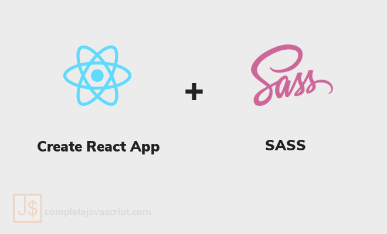

Có nhiều cách để style component trong ứng dụng React. Tuy nhiên, cách mà mình thấy cơ bản và hiệu quả nhất, đó là dùng SASS. Bài viết này sẽ giới thiệu với bạn cách đơn giản để sử dụng SASS với create-react-app.



## Tại sao lại là SASS và create-react-app?

Mình lựa chọn SASS vì những lý do sau:

- SASS hoàn toàn tương thích với CSS: nghĩa là bạn hoàn toàn có thể bê nguyên code CSS vào SASS mà không cần phải chỉnh sửa gì cả.
- SASS có cú pháp tương tự như CSS cộng thêm các tính năng mở rộng như: hỗ trợ khai báo **variables** giúp việc update chỉnh sửa code nhanh hơn; hỗ trợ **nesting** giúp code ngắn gọn hơn,...

Và còn nhiều tính năng thú vị khác của SASS nữa mà bạn có thể tham khảo trên [trang chủ SASS](https://sass-lang.com/).

Tiếp theo là **create-react-app**.

Đúng vậy, nếu bạn đã theo dõi blog của mình thì sẽ thấy các ứng dụng, ví dụ đều sử dụng [create-react-app](/tag/create-react-app/). Bởi lẽ, create-react-app có ưu điểm là cài đặt đơn giản và nhanh chóng.

Chỉ cần một câu lệnh <code>npx create-react-app app-name</code> mà không cần phải cấu hình gì thêm, bạn đã có đầy đủ các công cụ mới nhất để tập trung vào việc coding rồi.

Thêm nữa, create-react-app v2 trở đi đã hỗ trợ việc cấu hình cho SASS, nên việc cài đặt SASS lại càng trở nên vô cùng đơn giản.

## Sử dụng SASS với create-react-app

Dĩ nhiên, để có thể bắt đầu code được với React thì bạn phải cài đặt môi trường với Node.js, yarn hoặc npm và một editor (khuyên dùng) như Visual Studio Code.

Bạn có thể xem lại bài viết [tạo và deploy ứng dụng React lên Github Pages](/deploy-ung-dung-react-len-github-pages/) của mình để biết cách cài đặt đầy đủ môi trường trước khi bắt đầu sử dụng SASS với create-react-app nhé.

Sau khi cài đặt xong, bạn tạo mới React app bằng câu lệnh:

```shell
npx create-react-app app-name
```

Trong đó, **app-name** là tên project của bạn.

<a href="https://github.com/completejavascript/react-app-template/tree/01-add-sass" class="btn btn-primary margin-bottom">
  Xem code trên Github
</a>

Bây giờ, bạn mở file **package.json** ra để kiểm tra xem version của react-scripts là bao nhiêu. Ví dụ của mình là 3.3.0 - vesion mới nhất hiện tại.

Nếu version của bạn đang là 1.x.x thì hãy sửa lại giống mình rồi chạy lại lệnh <code>yarn</code> hoặc <code>npm install</code> để cập nhật lên phiên bản mới nhất của create-react-app.

Tiếp theo, bạn cần cài đặt module [node-sass](https://www.npmjs.com/package/node-sass):

```shell
yarn add node-sass
```

Sau khi cài đặt xong, bạn đổi toàn bộ file **.css** thành **.scss** để có thể bắt đầu sử dụng SCSS. Với project mới tạo, bạn có 2 file cần sửa là App.css và index.css. Rồi thay đổi phần import tương ứng trong file App.js và index.js.

```diff:title=App.js
- import "./App.css";
+ import "./App.scss";
```

```diff:title=index.js
- import "./index.css";
+ import "./index.scss";
```

Cuối cùng, chạy <code>yarn start</code> để khởi tạo môi trường DEV xem có lỗi gì không nhé. Nếu không có lỗi xảy ra thì nghĩa là bạn có thể sử dụng SASS với create-react-app được rồi.

Tuy nhiên, mình mới chỉ đổi tên file từ **.css** thành **.scss** chứ chưa áp dụng cú pháp nào của SASS để thay thế cho CSS.

## Áp dụng cú pháp của SASS

### Cơ bản về 2 loại cú pháp SASS

Thực ra SASS có 2 cách viết là: SCSS và Sass.

Ví dụ về SCSS - sử dụng dấu ngoặc nhọn để chứa block và dùng dấu chấm phẩy để ngắt dòng:

```scss
$font-stack: Helvetica, sans-serif;
$primary-color: #333;

body {
  font: 100% $font-stack;
  color: $primary-color;
}
```

Ví dụ tương ứng với Sass - sử dụng dấu cách hoặc tab (thụt lề) để tạo block, xuống dòng để ngắt dòng:

```scss
$font-stack:    Helvetica, sans-serif
$primary-color: #333

body
  font: 100% $font-stack
  color: $primary-color
```

Bạn có thể viết bằng cách SCSS hoặc Sass tùy thích. Tuy nhiên, mình sẽ chỉ sử dụng SCSS vì cách viết của SCSS giống với CSS hơn.

### Sử dụng SASS cơ bản với App component

Đây là code mặc định:

```jsx:title=App.js
function App() {
  return (
    <div className="App">
      <header className="App-header">
        
        <p>
          Edit <code>src/App.js</code> and save to reload.
        </p>
        <a
          className="App-link"
          href="https://reactjs.org"
          target="_blank"
          rel="noopener noreferrer"
        >
          Learn React
        </a>
      </header>
    </div>
  );
}
```

```css:title=App.css
.App {
  text-align: center;
}
.App-logo {
  height: 40vmin;
  pointer-events: none;
}
@media (prefers-reduced-motion: no-preference) {
  .App-logo {
    animation: App-logo-spin infinite 20s linear;
  }
}
.App-header {
  background-color: #282c34;
  min-height: 100vh;
  display: flex;
  flex-direction: column;
  align-items: center;
  justify-content: center;
  font-size: calc(10px + 2vmin);
  color: white;
}
.App-link {
  color: #61dafb;
}
@keyframes App-logo-spin {
  from {
    transform: rotate(0deg);
  }
  to {
    transform: rotate(360deg);
  }
}
```

Ở đây, bạn để ý className của các phần tử luôn bắt đầu bằng tiền tố _App-_. Cách này có ưu điểm là: khi viết CSS, bạn không cần phải **nesting class** mà vẫn đảm bảo không bị xung đột với tên class của các component khác.

Tuy nhiên, mình sẽ không sử dụng tiền tố này nữa, nên App.js và App.scss trở thành:

```js:title=App.js
function App() {
  return (
    <div className="App">
      <header className="header">
        
        <p>
          Edit <code>src/App.js</code> and save to reload.
        </p>
        <a
          className="link"
          href="https://reactjs.org"
          target="_blank"
          rel="noopener noreferrer"
        >
          Learn React
        </a>
      </header>
    </div>
  );
}
```

```scss:title=App.scss
.App {
  text-align: center;
}
.logo {
  height: 40vmin;
  pointer-events: none;
}
@media (prefers-reduced-motion: no-preference) {
  .logo {
    animation: App-logo-spin infinite 20s linear;
  }
}
.header {
  background-color: #282c34;
  min-height: 100vh;
  display: flex;
  flex-direction: column;
  align-items: center;
  justify-content: center;
  font-size: calc(10px + 2vmin);
  color: white;
}
.link {
  color: #61dafb;
}
@keyframes App-logo-spin {
  from {
    transform: rotate(0deg);
  }
  to {
    transform: rotate(360deg);
  }
}
```

Đến đây, mọi thứ vẫn hoạt động bình thường. Nhưng việc bỏ tiền tố _App-_ dẫn tới nguy cơ bị xung đột với className của các component khác sau này. Do đó, mình sẽ sử dụng **nesting** của SASS thì đoạn code trên sẽ trở thành:

```scss:title=App.scss
.App {
  text-align: center;
  .header {
    background-color: #282c34;
    min-height: 100vh;
    display: flex;
    flex-direction: column;
    align-items: center;
    justify-content: center;
    font-size: calc(10px + 2vmin);
    color: white;
    .logo {
      height: 40vmin;
      pointer-events: none;
    }
    .link {
      color: #61dafb;
    }
  }
}
@media (prefers-reduced-motion: no-preference) {
  .App {
    .header {
      .logo {
        animation: App-logo-spin infinite 20s linear;
      }
    }
  }
}
@keyframes App-logo-spin {
  from {
    transform: rotate(0deg);
  }
  to {
    transform: rotate(360deg);
  }
}
```

### Sử dụng variables với SASS

Trong phần trên, mình nhận thấy giá trị màu của class **link** chắc chắn sẽ được sử dụng ở nhiều nơi để đảm bảo tính đồng nhất. Vì vậy, mình sẽ sử dụng variables để khai báo nó, như sau:

```scss:title=App.scss
// Khai báo
$primaryColor: #61dafb;

.App {
  text-align: center;
  .header {
    background-color: #282c34;
    min-height: 100vh;
    display: flex;
    flex-direction: column;
    align-items: center;
    justify-content: center;
    font-size: calc(10px + 2vmin);
    color: white;
    .logo {
      height: 40vmin;
      pointer-events: none;
    }
    .link {
      color: $primaryColor; // Sử dụng
    }
  }
}
@media (prefers-reduced-motion: no-preference) {
  .App {
    .header {
      .logo {
        animation: App-logo-spin infinite 20s linear;
      }
    }
  }
}
@keyframes App-logo-spin {
  from {
    transform: rotate(0deg);
  }
  to {
    transform: rotate(360deg);
  }
}
```

Tuy nhiên, vì variable này có thể được sử dụng ở nhiều component khác nhau, nên mình sẽ tạo ra một file riêng để chứa các variable này. Rồi sau đó mình chỉ cần import là có thể sử dụng khi cần.

Đầu tiên mình tạo thư mục **scss** bên trong thự mục **src** để chứa file **variables.scss**. Trong file variables.scss mình sẽ định nghĩa các variable để sử dụng chung cho các file scss khác sau này:

```scss:title=scss/variables.scss
/**
* Variables
*/

// Color
$primaryColor: #61dafb;
```

Sau đó, ở file App.scss mình sửa phần khai báo thành import:

```diff:title=App.scss
- $primaryColor: #61dafb;
+ @import "./scss/variables.scss";
```

Bạn có thể thấy code chạy vẫn bình thường và không có lỗi xảy ra.

Về sau, nếu muốn định nghĩa thêm variable thì bạn chỉ cần cập nhật vào file variables.scss. Rồi ở file .scss nào muốn sử dụng thì gọi lệnh import như trên là được.

## Lời kết

Trên đây là cách sử dụng SASS với create-react-app của mình. Nếu bạn có thắc mắc hay góp ý gì thì vui lòng để lại trong phần bình luận phía dưới nhé.

<a href="https://github.com/completejavascript/react-app-template/tree/01-add-sass" class="btn btn-primary margin-bottom">
  Xem code trên Github
</a>

Xin chào và hẹn gặp lại bạn trong bài viết tiếp theo, thân ái!
