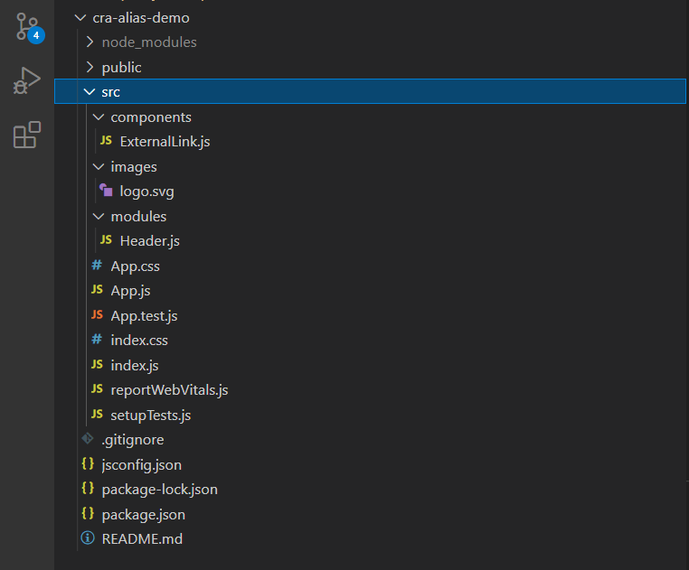
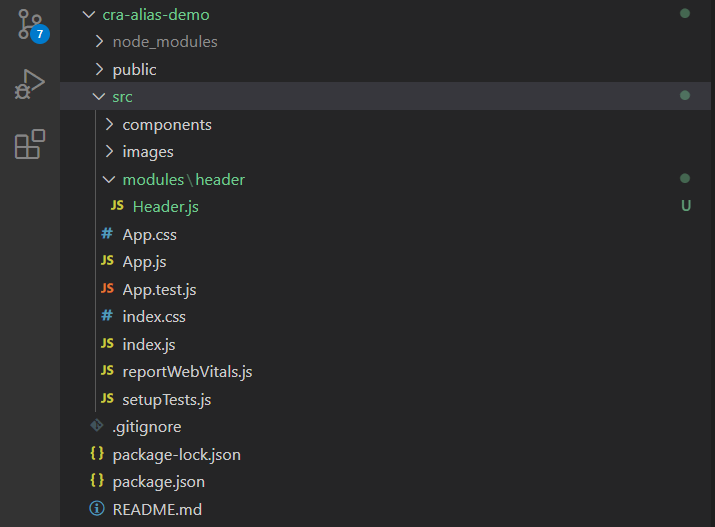

Như mình đã giới thiệu trong bài viết [deploy ứng dụng React lên Github Pages](/deploy-ung-dung-react-len-github-pages/), Create-react-app là một toolchain giúp bạn code React mà không cần quan tâm đến vấn đề cấu hình.

Mặc định, bạn cần sử dụng **đường dấn tương đối** để import các components hay modules. Và trong bài viết này, mình sẽ giới thiệu với bạn cách để sử dụng **đường dẫn tuyệt đối** hay **absolute import** với create-react-app.

## Vấn đề khi dùng đường dẫn tương đối

Khi xây dựng ứng dụng React, bạn thường phải **import các components hay modules với cấu trúc thư mục nhiều tầng lớp lồng nhau**, ví dụ:



Trong file `Header.js`, code sẽ giống như sau:

```js:title=Header.js
import logo from "../images/logo.svg";
import ExternalLink from "../components/ExternalLink";
```

Để viết các câu lệnh import trên, bạn **cần phải nhớ được cấu trúc thư mục** để trỏ được đến đúng đường dẫn các file.

Dĩ nhiên, ví dụ trên khá đơn giản nên đường dẫn đến file còn ngắn gọn. Nếu **cấu trúc thư mục phức tạp hơn** thì chắc chắn các câu lệnh import sẽ **dài dòng hơn rất nhiều**.

Hơn nữa, giả sử bạn muốn **thay đổi cấu trúc thư mục của modules**. Ví dụ bạn tạo thêm một thư mục `header` chứa `Header.js`.



Khi đó, bạn phải sửa lại toàn bộ các câu lệnh import trên như sau:

```js:title=Header.js
import logo from "../../images/logo.svg";
import ExternalLink from "../../components/ExternalLink";
```

Việc này **khá phiền và mất thời gian**.

Đó chính là lý do, bạn nên sử dụng cách **absolute import** mà mình giới thiệu sau đây.

## Về absolute import

Khi dùng absolute import thì các câu lệnh import components và modules sẽ như sau:

```js:title=Header.js
import logo from "images/logo.svg";
import ExternalLink from "components/ExternalLink";
```

Khi đó, việc bạn thêm thư mục `header` chứa file `Header.js` như trên cũng không ảnh hưởng đến các câu lệnh import.

## Absolute import với create-react-app

Thông thường để sử dụng absolute import với React, bạn cần cấu hình trong webpack.

Tuy nhiên, với create-react-app (từ version [3.0.0](https://github.com/facebook/create-react-app/releases/tag/v3.0.0)) bạn chỉ cần thêm file `jsconfig.json` từ root project với cấu hình như sau:

```json:title=jsconfig.json
{
  "compilerOptions": {
    "baseUrl": "src"
  },
  "include": ["src"]
}
```

Nếu bạn sử dụng **TypeScript**, bạn cũng cấu hình `baseUrl` tương tự trong file `tsconfig.json`.

> **Chú ý**: Hiện tại, create-react-app chỉ hỗ trợ cấu hình `baseUrl` là thư mục `node_modules` hoặc thư mục `src`.

Sau đây là ví dụ demo sử dụng absolute import trong create-react-app với `jsconfig.json`:

<a 
  href="https://github.com/completejavascript/cra-alias-demo" 
  class="btn btn-primary margin-bottom" 
  target="_blank"
  rel="noopener noreferrer">
Demo create-react-app aliases
</a>

Nếu bạn có vấn đề gì thắc mắc cần giải đáp, vui lòng để lại bình luận xuống phía dưới nhé!
