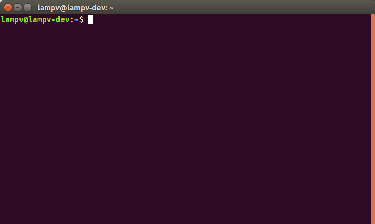
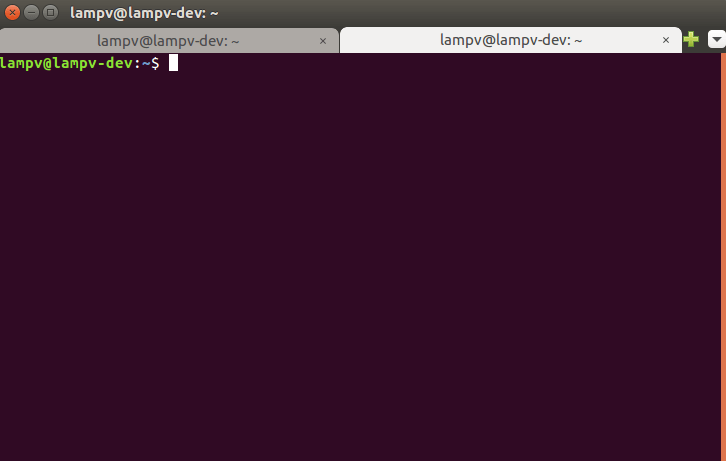

Ubuntu là một trong những phiên bản Linux phổ biến nhất. Vì vậy, hiện tại mình đang sử dụng hệ điều hành này. Theo mình, Ubuntu có những ưu điểm như: nhẹ, ổn định, an toàn, miễn phí và "nhanh". Từ "nhanh" ở đây mình đặt trong ngoặc kép vì nó không dùng để chỉ tốc độ xử lý phần cứng. Mà bởi vì, Ubuntu cung cấp rất nhiều các câu lệnh sử dụng trên Terminal giúp lập trình viên [làm việc nhanh chóng, đơn giản và hiệu quả](/hoc-lap-trinh-javascript-nhanh-hon/). Tin mình đi, một khi bạn đã biết sử dụng Ubuntu, bạn sẽ không muốn quay trở lại Windows nữa đâu.

Dĩ nhiên, với phiên bản Ubuntu Desktop, bạn hoàn toàn có thể sử dụng Ubuntu theo cách mà bạn đang dùng trên Windows - với chuột và bàn phím. Nhưng sẽ là thiếu sót nếu như bạn không biết về những câu lệnh cơ bản, đơn giản mà lại hiệu quả sau đây.

## Khởi động cửa sổ câu lệnh Terminal

Có hai cách để mở Terminal trên Ubuntu:

- Cách 1: Nhấn phím cửa sổ, sau đó gõ Terminal, biểu tượng Terminal sẽ hiện ra. Bạn chỉ cần click chuột vào để mở nó.
- Cách 2: Sử dụng phím tắt: **Ctrl Alt T**

Lúc này, Terminal sẽ hiện lên như sau:

Để mở một Terminal mới bạn có thể sử dụng lại hai cách trên. Trường hợp bạn muốn mở Terminal mới nằm trong cửa sổ hiện tại thì bạn có thể sử dụng tổ hợp phím: **Ctrl Shift T**

## Danh sách các câu lệnh cơ bản trong Ubuntu

### Các câu lệnh về thư mục và tập tin

#### pwd (path working directory)

In ra đường dẫn đến vị trí hiện tại bạn đang đứng.

#### ls (list)

Hiển thị danh sách các tập tin và thư mục trong thư mục hiện tại bạn đang đứng. Mặc định, lệnh này sẽ không in ra các file ẩn. Do đó, để in ra các file ẩn này, bạn sử dụng thêm tuỳ chọn `-a`.

Câu lệnh trở thành: `ls -a`

#### cd (change directory)

Thay đổi vị trí thư mục hiện tại - di chuyển đến vị trí thư mục khác. Một số cách khác nhau khi sử dụng lệnh **cd** là:

- `cd .`: đứng nguyên ở thư mục hiện tại
- `cd ..`: di chuyển đến thư mục cha của thư mục hiện tại
- `cd -`: di chuyển đến thư mục trước khi di chuyển đến thư mục hiện tại
- `cd` hoặc `cd ~`: di chuyển đến thư mục `/home/username` (ví dụ: /home/lampv). Đây là vị trí thư mục mặc định mỗi khi bạn mở Terminal. Và bạn có toàn quyền đối với thư mục này.
- `cd /`: di chuyển đến thư mục root - thư mục gốc chứa mọi thư mục, trong đó có home/username
- `cd <tên thư mục con>`: di chuyển đến thư mục con bên trong thư mục hiện tại
- `cd <đường dẫn đến thư mục>`: di chuyển đến thư mục với đường dẫn là đường dẫn cứng. Đường dẫn cứng có thể ví dụ như: **/home/lampv/Documents, ~/Documents/abc**, ...

#### cp (copy)

Dùng để sao chép tập tin hay thư mục đến một thư mục khác.

- `cp <tên tập tin> <tên thư mục>` : dùng để copy một tập tin vào một thư mục
- `cp -r <tên thư mục nguồn> <tên thư mục đích>` : dùng để copy thư mục nguồn vào thư mục đích

#### mv (move)

Dùng để di chuyển tập tin đến một thư mục mới đồng thời đổi tên tập tin đó.

- `mv <tên tập tin cũ> <tên thư mục đích / tên tập tin mới>`: di chuyển một tập tin đến thư mục mới đồng thời đổi tên tập tin.
- `mv <tên tập tin cũ> <tên thư mục đích>`: di chuyển tập tin đến thư mục đích và không đổi tên.

#### rm (remove)

Dùng để xoá tập tin hay thư mục.

- `rm <tên tập tin>`: dùng để xoá tập tin
- `rm <tên thư mục>`: dùng để xoá một thư mục rỗng
- `rm -r <tên thư mục>`: xoá bất kỳ thư mục nào

#### mkdir (make directory)

Dùng để tạo thư mục mới : `mkdir <tên thư mục>`

#### touch

Dùng để tạo file mới : `touch <tên tập tin>`

#### man

Dùng để hiển thị hướng dẫn các câu lệnh: `man <tên câu lệnh>`.

Ví dụ: **man touch, man mkdir**,...

### Các câu lệnh về thông tin hệ thống

#### df

Hiển thị mức độ chiếm dụng không gian đĩa cứng của tập tin hệ thống ở tất cả các phân vùng được gắn kết. Đơn vị hiển thị là 1K.

Để hiển thị kết quả với đơn vị MB hay GB (dễ đọc hơn), bạn có thể dùng thêm tuỳ chọn `-h` (human-readable), câu lệnh thành `df -h`.

#### du

Hiển thị mức chiếm dụng không gian đĩa cứng ở thư mục hiện tại và các thư mục con. Có một số tuỳ chọn mà bạn có thể sử dụng:

- `-h`: (human-readable) kết quả hiển thị sử dụng đơn vị là KB, MB hay GB
- `-s`: (summary) hiển thị tổng dung lượng

#### free

Hiển thị dung lượng bộ nhớ RAM còn trống và đang được sử dụng với một số tuỳ chọn:

- `-h`: (human-readable) hiển thị cách dễ đọc với con người
- `-g`: hiển thị đơn vị dạng GB
- `-m`: hiển thị đơn vị dạng MB

#### top

Hiển thị thông tin về hệ thống Linux của bạn, các tiến trình đang chạy và tài nguyên hệ thống, bao gồm: CPU, RAM, phân vùng Swap, và tổng số các tác vụ đang chạy.

`uname -a`

Hiển thị toàn bộ thông tin về tên máy tính, tên nhân kernel kèm theo số phiên bản và một vài chi tiết khác.

#### lsb_release -a

Hiển thị phiên bản linux đang dùng.

#### ifconfig

Hiển thị danh sách các thiết bị mạng trên máy tính. Qua đó, bạn có thể biết được địa chỉ IP hiện tại của máy.

#### adduser

Dùng để thêm một user mới cho máy: `adduser <tên user mới>`

#### passwd

Dùng để thêm password cho người dùng mới: `passwd <tên user mới>`

#### sudo

Nhiều câu lệnh trong Terminal cần phải có **sudo** phía trước. Khi dùng sudo, máy tính hiểu rằng bạn đang thực thi câu lệnh với quyền cao nhất, đó là quyền root.

Để thực thi được câu lệnh này, bạn bắt buộc phải nhập mật khẩu. Một số lệnh bắt buộc phải dùng sudo như:

- `sudo shutdown -h now`: tắt máy tính ngay lập tức
- `sudo reboot`: khởi động lại máy tính

## Lời kết

Trên đây là một số câu lệnh cơ bản trong Ubuntu - Linux mà mình thấy đơn giản, hiệu quả và hay được sử dụng. Dù bạn lập trình [JavaScript](/top-5-framework-javascript-moi-nhat-cho-phat-trien-web-va-app/) hay một ngôn ngữ lập trình khác, hoặc thậm chí bạn chỉ sử dụng Ubuntu như là một hệ điều hành thay thế [Windows](/cac-cau-lenh-thuong-dung-tren-cmd-windows/) thì những câu lệnh trên luôn vô cùng hữu ích.

Bài viết này sẽ dừng lại tại đây. Xin chào và hẹn gặp lại bạn ở bài viết sau, thân ái!
