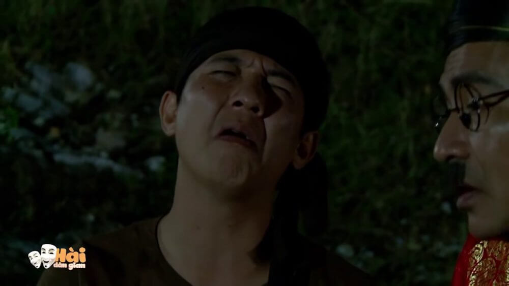

Xin chào bạn, gần đây mình có thử làm chơi một video tên là [K Tigers - Taekwondo Save Me](https://www.youtube.com/watch?v=tp6t8eKo7e4). Và có một bạn đã hỏi mình làm sao để kiếm được ảnh chị tóc vàng xinh thế (ảnh thumbnail video). Thực ra, mình đã sử dụng ảnh thumbnail của video gốc. Nói đến đây có thể nhiều bạn đã hiểu ra vấn đề rồi. Đó là mình đã lấy ảnh thumbnail của video trên youtube.

## Vấn đề là làm sao mình có thể lấy ảnh thumbnail của video trên Youtube?

Hôm nay, mình sẽ chia sẻ với bạn một số cách để lấy được ảnh thumbnail đó.

### Cách 1: Dùng tool Youtube Thumbnail Grabber

Để lấy được ảnh thumbnail của video youtube một cách nhanh chóng, bạn có thể sử dụng tool mà mình đã viết sau đây:

<a 
  href="https://toolskitplus.com/youtube-thumbnail-grabber/" 
  class="btn btn-primary margin-bottom" 
  target="_blank"
  rel="noopener noreferrer">
Youtube Thumbnail Grabber
</a>

Với tool trên, bạn chỉ cần dán link Youtube cần lấy ảnh thumbnail thì tool sẽ tự động hiển thị danh sách các loại ảnh thumbnail tương ứng.

### Cách 2: Thủ công

Đầu tiên, bạn phải có được ID của video trên youtube.

Thật đơn giản, khi bạn nhấn vào một video thì video đó sẽ có link dạng như sau:

```
https://www.youtube.com/watch?v=id_video
```

Phần **id_video** bên trên chính là ID của video trên youtube. Bạn copy lại ID đó và tiếp tục với các cách mà mình sẽ trình bày ngay sau đây.

#### Lấy ảnh thumbnail độ phân giải lớn nhất

Với cách này bạn sẽ thu được ảnh thumbnail với độ phân giải lớn nhất. Bạn chỉ cần copy link sau lên trình duyệt:

```
https://img.youtube.com/vi/id_video/maxresdefault.jpg
```

Trong đó: `id_video` là id của video mà bạn đã copy ở bước trên.

Ví dụ với link sau:

```
https://img.youtube.com/vi/dSs3ya1ppp4/maxresdefault.jpg
```

Bạn sẽ thu được ảnh là:



#### Lấy các ảnh thumbnail kích thước khác

Với cách này bạn sẽ thu được ảnh thumbnail của video trên youtube với các độ phân giải khác nhau.

**Ảnh thumbnail kích thước Standard Definition 640x480:**

```
https://img.youtube.com/vi/id_video/sddefault.jpg
```

**Ảnh thumbnail kích thước High Quality 480x360:**

```
https://img.youtube.com/vi/id_video/hqdefault.jpg
```

**Ảnh thumbnail kích thước Medium Quality 480x360:**

```
https://img.youtube.com/vi/id_video/mqdefault.jpg
```

**Ảnh List Thumbnail kích thước 480x360:**

```
https://img.youtube.com/vi/id_video/0.jpg
```

**Một số ảnh Mini Thumbnail kích thước 120x90:**

```
https://img.youtube.com/vi/id_video/1.jpg
https://img.youtube.com/vi/id_video/2.jpg
https://img.youtube.com/vi/id_video/3.jpg
```

## Lời kết

Trên đây là một số cách để lấy ảnh thumbnail của video trên youtube. Hy vọng nó giúp ích được cho bạn.

Nếu bạn thấy hay thì không ngại để chia sẻ cho mọi người cùng biết nhé. Còn nếu bạn có thắc mắc gì thì vui lòng để lại bình luận phía dưới hoặc gửi mail cho mình. Mình sẽ cố gắng giải đáp giúp bạn.

<a 
  href="https://toolskitplus.com/youtube-thumbnail-grabber/" 
  class="btn btn-primary margin-bottom" 
  target="_blank"
  rel="noopener noreferrer">
Youtube Thumbnail Grabber
</a>

**Lưu ý**: cách này chỉ lấy được ảnh thumbnail của video. Nếu bạn muốn lấy ảnh từ video youtube (bất kỳ tại mọi thời điểm) thì có thể tải video đó về rồi sử dụng [code FFmpeg để chuyển video thành ảnh](/huong-dan-tim-hieu-ffmpeg-co-ban/#Code_ffmpeg_chuyen_doi_video_thanh_anh).

Xin chào và hẹn gặp bạn ở bài viết tiếp theo, thân ái!
