Có lẽ tại thời điểm này thì bạn cũng không còn xa lạ gì với Node.js nữa rồi. Nhờ có Node.js mà JavaScript có thể chạy được trong môi trường server. Do đó, bạn chỉ cần biết JavaScript (và một số thứ nữa) là đã có thể code back-end ngon lành mà không cần phải học thêm PHP, ASP.NET,... Vì vậy, bài viết này mình sẽ giúp bạn tìm hiểu Node.js cơ bản.

**Mục đích của bài viết:**

- Tìm hiểu các đặc điểm cơ bản của Node.js
- Các ứng dụng của Node.js
- Tải và cài đặt Node.js
- Viết một server dạng Hello World với Node.js

_Nếu như bạn đã sẵn sàng để tìm hiểu Node.js cơ bản thì mình bắt đầu nhé!_

## Các đặc điểm cơ bản của Node.js

### Node.js là gì?

Node.js là một môi trường thực thi JavaScript bên ngoài trình duyệt, được xây dựng dựa trên [Chrome's V8 JavaScript engine](https://developers.google.com/v8/).

_Chrome's V8 JavaScript engine được viết bằng C++, giúp biên dịch code JavaScript thành mã máy một cách nhanh chóng._

Hơn nữa, Node.js là [mã nguồn mở](https://github.com/nodejs/node), miễn phí và có thể chạy trên nhiều nền tảng: Windows, [Linux](/tag/ubuntu), Unix, Mac OS X, Embedded system,...

### Node.js có khả năng xử lý bất đồng bộ

Đây là ưu điểm lớn nhất của Node.js so với các nền tảng khác (PHP, ASP,...).

Với Node.js, mọi tiến trình **tốn nhiều thời** gian như đọc/ghi file, truy vấn cơ sở dữ liệu, tạo ra nội dung cho trang web động,... đều là **non-blocking**.

Nghĩa là bạn chỉ cần gửi request, viết hàm xử lý khi có kết quả, rồi có thể chuyển ngay sang request tiếp theo mà không cần phải chờ đợi.

### Node.js chạy single-threaded

Theo mình biết, đối với PHP (Java, ASP.NET,...) mỗi request gửi lên sẽ được đưa vào một thread riêng để thực thi. Điều này dẫn đến tiêu tốn nhiều bộ nhớ.

Ngược lại, Node.js lại chạy **single-threaded**. Nghĩa là mỗi request gửi lên sẽ được cho vào một **event-queue**. Node.js sẽ chạy một **vòng lặp** để duyệt event-queue này và **lần lượt xử lý** các request theo [kiểu bất đồng bộ](/tag/ajax).

[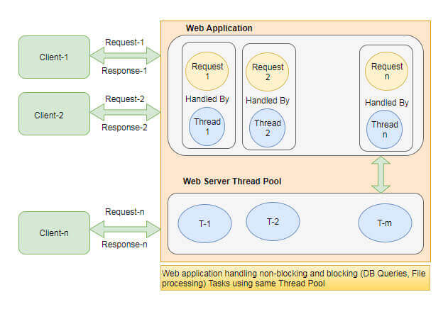](https://www.linkedin.com/pulse/nodejs-overview-single-threaded-architecture-gaurav-mittal)

Chính vì vậy, Node.js sẽ giúp tiết kiệm về bộ nhớ.

_Bạn nghĩ sao về vấn đề này, nếu không ngại thì để lại bình luận chia sẻ quan điểm của mình nhé!_

### Các ứng dụng của Node.js

Với những ưu điểm của mình, Node.js thường được sử dụng để:

- **Phát triển ứng dụng Real-time**: mạng xã hội, chat,...
- **Ứng dụng Single Page Application (SPA)**: bởi những ứng dụng này thường request rất nhiều đến server thông qua AJAX
- **Ứng dụng truy vấn tới NoSQL database** như MongoDB, CouchDB,...
- **Ứng dụng CLI**: đây là các công cụ sử dụng command-line.
- ...

_Theo bạn thì Node.js có thể dùng để làm gì nữa nhỉ?_

## Tải và cài đặt Node.js

_Bài viết này, mình sẽ hướng dẫn bạn cài đặt Node.js trên môi trường Windows (vì máy mình hiện tại chỉ cài Windows 7)._

### Các bước thực hiện

Đầu tiên, bạn tải bản cài đặt Node.js tại [trang chủ](https://nodejs.org/en/). Bạn có thể chọn bản mới nhất. Tuy nhiên, mình sẽ chọn bản LTS (**Long Term Support**). Vì bản này thường sẽ ổn định và khá ít lỗi.

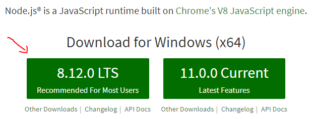

Sau khi tải xong, bạn sẽ thu được một file cài đặt (ví dụ: **node-v8.12.0-x64.msi**). Bây giờ, bạn click vào để cài đặt.

Một cửa sổ sẽ hiện lên, rồi bạn nhấn vào **Run**.

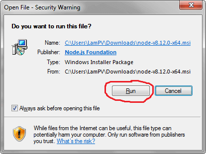

Bạn nhấn **Next** để tiếp tục:

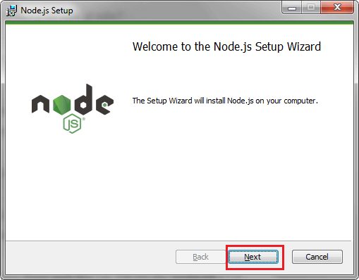

Tiếp theo, bạn nhấn vào checkbox để đồng ý với điều khoản, bản quyền phần mềm, rồi nhấn **Next** để tiếp tục.

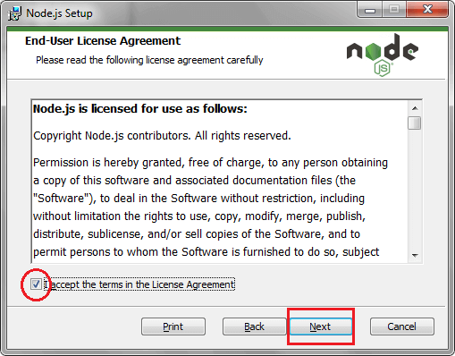

Sau đó là lựa chọn thư mục cài đặt Node.js. Nếu không có gì đặc biệt (ví dụ như ổ C bị đầy) thì bạn cứ để mặc định, rồi nhấn Next để tiếp tục.

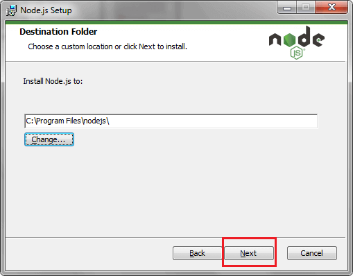

Bước này, Node.js sẽ cho phép bạn tùy chỉnh phần cài đặt. Tuy nhiên, bạn cứ để mặc định thôi. Sau này muốn thay đổi gì thì tính sau.

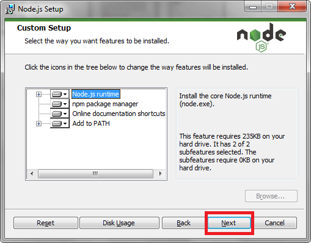

Sau khi mọi thứ đã hoàn tất, bạn nhấn **Install** để bắt đầu cài đặt

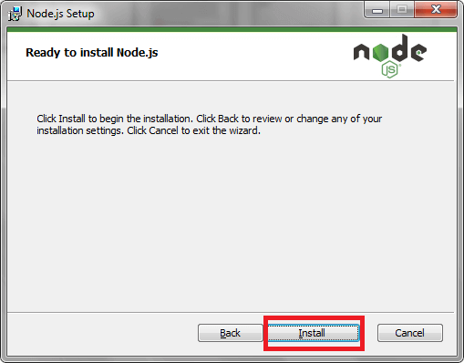

Khi cài đặt xong, bạn nhấn **Finish** để kết thúc.

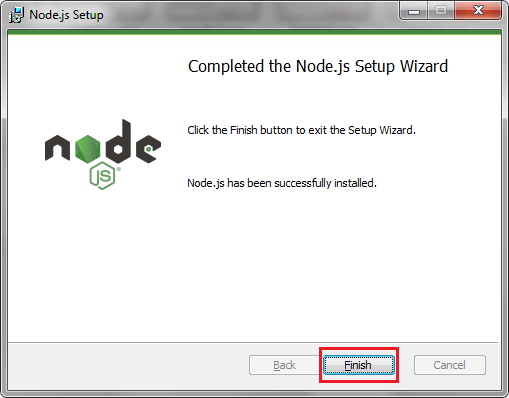

### Kiểm tra cài đặt thành công

Sau khi đã thực hiện xong các bước trên, bạn cần kiểm tra xem mình đã có thể làm việc bình thường với Node.js hay chưa.

Bạn mở [CMD](/cac-cau-lenh-thuong-dung-tren-cmd-windows) trên Windows lên rồi gõ các câu lệnh sau:

```bash
$ node -v
$ npm -v
```

Nếu kết quả hiển thị như này là thành công:

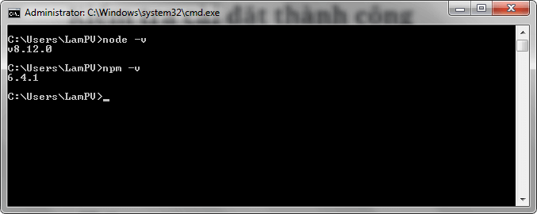

Các câu lệnh trên cho biết: phiên bản Node.js hiện tại là **8.12.0** và phiên bản npm (Node Package Manager) là **6.4.1**.

## Viết một server dạng Hello World với Node.js

### Tạo file nguồn

Đầu tiên bạn cần tạo một file mới với tên là **hello-world.js** bên trong một thư mục bất kỳ.

Sau đó, sửa nội dung của file đó như sau:

```js:title=hello-world.js
const http = require("http");
const hostname = "localhost";
const port = 8000;

const server = http.createServer((request, response) => {
  response.statusCode = 200;
  response.setHeader("Content-Type", "text/plain");
  response.end("Hello World!\n");
});

server.listen(port, hostname, () => {
  console.log(`Server running at http://${hostname}:${port}/`);
});
```

### Giải thích file nguồn

Đầu tiên, bạn khai báo module **http** - dùng để tạo server, **hostname** là **localhost** và cổng sử dụng là **8000** (bạn có thể thay đổi cổng tùy thích).

```js:title=hello-world.js
const http = require("http");
const hostname = "localhost";
const port = 8000;
```

Tiếp theo, bạn khởi tạo server sử dụng phương thức [createServer](https://www.w3schools.com/nodejs/met_http_createserver.asp) của module [http](https://nodejs.org/api/http.html), với 2 tham số đầu vào là **req** và **res**.

```js:title=hello-world.js
const server = http.createServer((req, res) => {
  res.statusCode = 200;
  res.setHeader("Content-Type", "text/plain");
  res.end("Hello World!\n");
});
```

Với **req** là đại diện cho yêu cầu được gửi từ client đến server và **res** là đại diện cho phản hồi từ server về client.

Ở đây response có:

- [Status code](/xmlhttprequest-tao-http-request-den-server-trong-javascript/#Cac_status_code) là 200 - tức là yêu cầu được xử lý thành công.
- Header với _Content-type_ là _text/plain_ - tức là nội dung response có kiểu **text** bình thường (không phải **json** hay **html**).
- Nội dung của response là một đoạn text đơn giản _Hello World!_

Cuối cùng, bắt đầu cho server lắng nghe, với 2 thông số là cổng (**port**) và địa chỉ (**hostname**).

```js:title=hello-world.js
server.listen(port, hostname, () => {
  console.log(`Server running at http://${hostname}:${port}/`);
});
```

### Chạy thử server và kiểm tra kết quả

Để chạy server, bạn mở **CMD** lên tại vị trí file nguồn vừa tạo và chạy [câu lệnh](/tag/command-line):

```bash
$ node hello-world.js
```

Nếu kết quả hiển thị ra _Server running at `http://localhost:8000/`_ là thành công.

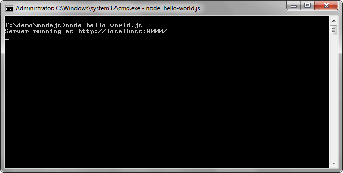

Cuối cùng bạn gõ địa chỉ `http://localhost:8000/` lên trình duyệt để kiểm tra lại:

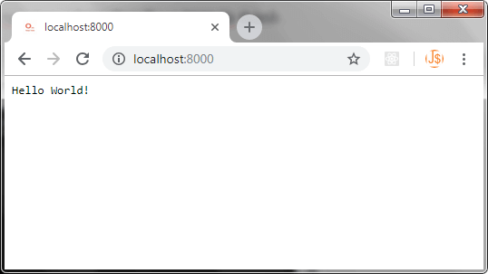

Như vậy, server đã chạy thành công rồi phải không bạn?

## Lời kết

Trên đây là hướng dẫn tìm hiểu Node.js cơ bản. Hy vọng qua bài viết này bạn có thể thu được:

- Hiểu các đặc điểm cơ bản của Node.js
- Biết các ứng dụng của Node.js
- Biết cách tải và cài đặt Node.js
- Viết một server dạng Hello World với Node.js

Sắp tới mình dự định viết một series về cách viết RESTful API sử dụng Node.js, Express và MongoDB. Vì vậy, việc tìm hiểu Node.js cơ bản và cài đặt thành công là điều kiện tiên quyết.

Hy vọng bạn tiếp tục theo dõi và ủng hộ blog của mình.

Xin chào và hẹn gặp lại trong bài viết tiếp theo, thân ái!
