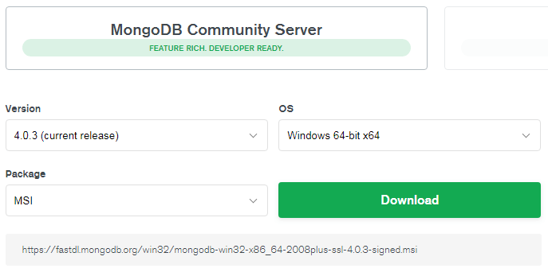
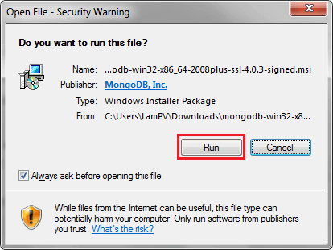
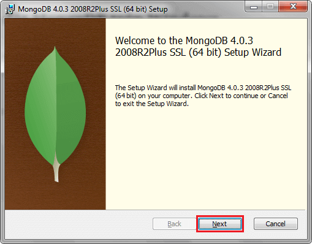
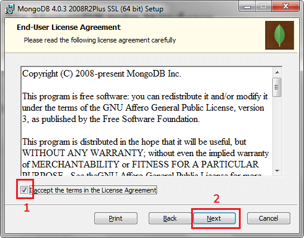
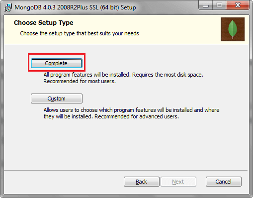
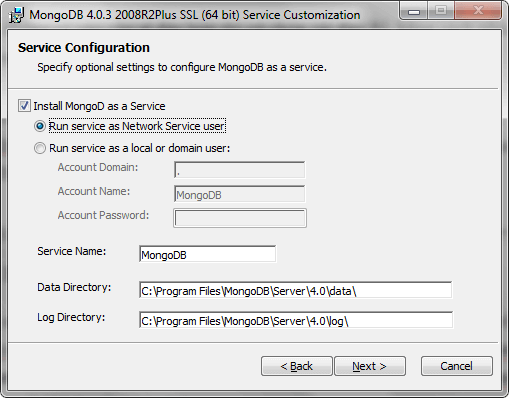
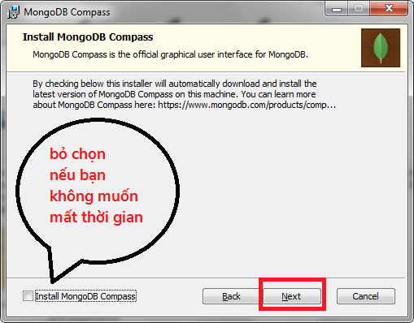
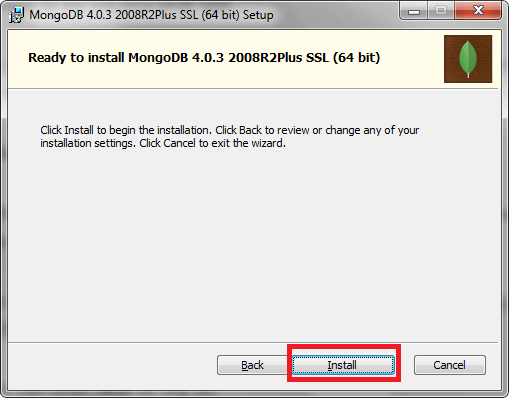
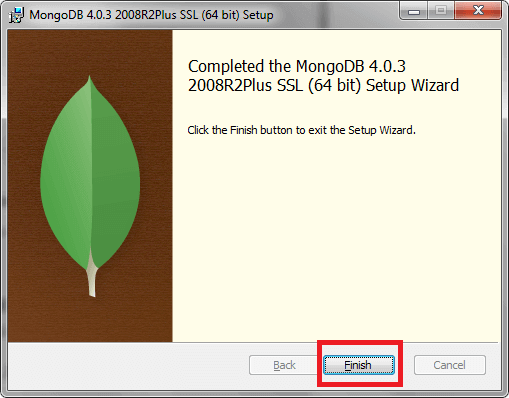
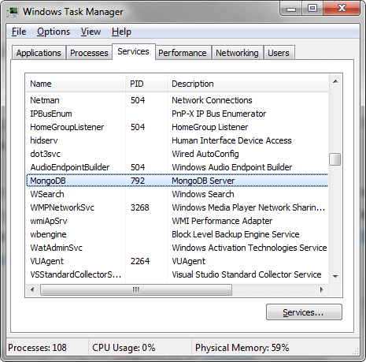

Bài viết này mình sẽ không đi vào giải thích chi tiết về MongoDB. Mà chỉ đơn giản là sẽ chia sẻ cách cài đặt MongoDB trên Windows mới nhất năm 2018.

Nếu bạn muốn biết thêm về MongoDB hay NoSQL Database thì có thể tham khảo thêm các bài viết sau đây:

- [NoSQL có gì hay ho - tổng quan về NoSQL - phần 1](https://toidicodedao.com/2015/09/24/nosql-co-gi-hay-ho-tong-quan-ve-nosql-phan-1/)
- [NoSQL có gì hay ho - tổng quan về NoSQL - phần 2](https://toidicodedao.com/2015/09/29/nosql-co-gi-hay-ho-tong-quan-ve-nosql-phan-2/)
- [Bài 01: Tổng quan về MongoDB](https://freetuts.net/tong-quan-ve-mongodb-203.html)

Còn bây giờ thì bắt đầu nào!

## Các bước cài đặt MongoDB trên Windows

### Tải bản cài đặt

Để cài đặt MongoDB trên Windows, đầu tiên bạn phải tải phần cài đặt của nó trên [trang chủ](https://www.mongodb.com/download-center/community) với 2 phiên bản là: **MongoDB Community Server** và **MongoDB Enterprise Server**.

Trong đó, phiên bản **MongoDB Community Server** là miễn phí (phù hợp cho developer), nên mình sẽ chọn bản này.



Có một số tùy chọn dành cho bạn là:

- **Version (phiên bản)**: hiện tại đã có phiên bản **4.1.4 - development release**. Tuy nhiên mình sẽ chỉ chọn phiên bản **4.0.3 - current release**, để đảm bảo tính ổn định và ít lỗi hơn.
- **OS (hệ điều hành)**: bài viết này hướng dẫn cài đặt MongDB trên Windows nên mình sẽ chọn là **Windows 64-bit x64**.
- **Package**: có 2 loại là **zip** và **msi**. Mình sẽ chọn bản **msi**, vì cài đặt sẽ dễ dàng hơn - hỗ trợ giao diện (nếu chọn **zip** thì bạn phải cài đặt thủ công nhiều hơn).

Sau khi lựa chọn xong phiên bản cài đặt, bạn chỉ cần nhấn vào **Download** thì tệp tin **mongodb-win32-x86_64-2008plus-ssl-4.0.3-signed.msi** sẽ được tải về để có thể cài đặt.

### Cài đặt MongoDB trên Windows

Đầu tiên bạn nhấn vào file vừa tải. Rồi một cửa sổ hiện lên, bạn chỉ cần nhấn vào **Run** để bắt đầu cài đặt MongoDB trên Windows.



Tiếp theo, bạn nhấn vào **Next** để tiếp tục.



Sau đó, bạn nhấn vào **check box** để đồng ý các điều khoản sử dụng, rồi lại nhấn **Next** để tiếp tục.



### Tùy chỉnh cài đặt

Bước kế tiếp, MongoDB sẽ cho phép bạn lựa chọn 2 cách cài đặt: **Complete** (đầy đủ) và **Custom** (tùy chỉnh).

Đối với việc tùy chỉnh, bạn có thể lựa chọn vị trí để cài đặt MongoDB (**ví dụ ổ C đầy rồi thì bạn có thể cài sang ổ D, E**) - rồi lựa chọn những thành phần cài đặt và không cài đặt.

Mình không có yêu cầu gì đặc biệt thì cứ chọn cài đầy đủ, bằng cách nhấn vào **Complete**.



### Cài đặt MongoDB trên Windows như service

Tiếp theo là tùy chọn cấu hình MongoDB như là một **service**. Mặc định, check box **Install MongoDB as a Service** được chọn. Nghĩa là mỗi khi bạn khởi động máy, MongoDB sẽ chạy ngầm giống như là một service.

Sau đó, lại có 2 tùy chọn khác là: **Run service as Network Service user** và **Run service as a local or domain user**.

Mình sẽ chọn **Run service as Network Service user** để có thể kết nối với MongoDB trong toàn mạng. Ngược lại, nếu bạn chọn **Run service as a local or domain user** thì bạn phải thiết lập **domain**, **account name** và **account password** để kết nối (khá phức tạp).

Ngoài ra, bạn có thể thay đổi tên service (**service name**), vị trí lưu dữ liệu (**data directory**) và vị trí lưu log (**log directory**).

Lựa chọn xong thì bạn nhấn vào **Next** để tiếp tục.



### Tùy chỉnh cài đặt MongoDB Compass

Tiếp theo, bạn sẽ được hỏi có muốn cài đặt **[MongoDB Compass](https://www.mongodb.com/products/compass)** hay không?

Đây là công cụ kiểu GUI giúp việc quản lý MongoDB dễ dàng hơn nên **có thể** mình sẽ cài. Tuy nhiên, nếu cài đặt MongoDB ngay bây giờ thì nó sẽ tự động download MongoDB Compass về để cài đặt. **Việc này khá mất thời gian**, nên bạn có thể bỏ check lúc này.

_Ngoài ra, nếu bạn chỉ muốn sử dụng Command-line hoặc đơn giản là bạn muốn sử dụng công cụ quản lý khác (như [Robo 3T](https://robomongo.org/)) thì cũng có thể bỏ chọn._

Sau đó, bạn nhấn **Next** để tiếp tục (bạn có thể cài đặt MongoDB compass sau nếu muốn nhé).



Rồi bạn nhấn **Install** để bắt đầu cài đặt.



Bây giờ, bạn có thể **đứng dậy đi WC** hay **uống một cốc nước** cho tỉnh táo. Đợi vài phút sau quay lại thì MongoDB sẽ cài đặt xong (nếu bạn lựa chọn cài đặt cả MongoDB Compass thì sẽ phải đợi khá lâu đó nhé - ráng đợi).

Và cuối cùng là nhấn **Finish** để kết thúc.



### Kiểm tra cài đặt thành công

Tương như như bài viết về [hướng dẫn tìm hiểu Node.js cơ bản](/huong-dan-tim-hieu-node-js-co-ban/), mình cũng cần phải kiểm tra xem việc cài đặt MongoDB đã thực sự thành công hay chưa.

Như phần trên, mình đã chọn **cài đặt MongoDB như một service** rồi. Nên bây giờ mình sẽ xem thử nó đã chạy hay chưa bằng cách mở **Windows Task Manager** và chọn tab **Services** (_tham khảo thêm bài viết [6 cách để mở Windows Task Manager)](https://ictnews.vn/the-gioi-so/thu-thuat/6-cach-de-mo-windows-task-manager-97595.ict)_.



Nếu bạn tìm thấy MongoDB xuất hiện trong phần này nghĩa là việc cài đặt đã hoàn toàn thành công rồi.

## Tương tác với MongoDB thông qua CMD

### Cài đặt biến môi trường

Trước tiên bạn cần phải tìm đến vị trí thư mục cài đặt MongoDB.

Mặc định, vị trí đó là: **C:\Program Files\MongoDB\Server\4.0\bin**

Nếu nhìn vào thư mục đó, bạn sẽ thấy file **mongo.exe**. Đây chính là chương trình dùng để tương tác với MongoDB thông qua [CMD](/cac-cau-lenh-thuong-dung-tren-cmd-windows/).

Để biết cách cài đặt biến môi trường, bạn có thể tham khảo thêm tại bài viết [hướng dẫn tìm hiểu FFmpeg cơ bản](/huong-dan-tim-hieu-ffmpeg-co-ban/#Cai_dat_phan_mem) để biết thêm chi tiết.

### Các câu lệnh cơ bản

Đầu tiên bạn mở **CMD** lên và gõ [câu lệnh](/tag/command-line/):

```shell
mongo
```

Nếu không có lỗi gì xảy ra thì lúc này bạn có thể bắt đầu gõ câu lệnh cơ bản của MongoDB được rồi.

Ví dụ:

- `show dbs`: dùng để hiển thị danh sách các database đang tồn tại. Mặc định ban đầu sẽ có 3 database của hệ thống là: **admin, config** và **local**.
- `db`: hiển thị danh sách database đang sử dụng. Vì bạn chưa có database nào nên mặc định database mặc định cho bạn sẽ là **test**.
- `use DATABASE_NAME`: chuyển sang sử dụng database với tên là DATABASE_NAME (tên này tùy bạn chọn).
- `db.dropDatabase()`: dùng để xóa database hiện tại
- [`db.createCollection(name, options)`](https://docs.mongodb.com/manual/reference/method/db.createCollection/): dùng để tạo mới một **Collection** trong MongoDB (cái này tương tự như **Table** trong MySQL).
- `show collections`: hiển thị các collection đang tồn tại
- `db.COLLECTION_NAME.insert(document)`: thêm mới một **Document** vào MongoDB (cái này tương như như **Row** trong MySQL)
- `db.COLLECTION_NAME.save(document)`: thêm mới hoặc cập nhật một document trong collection
- ...

Còn rất nhiều phương thức khác nữa mà mình không thể kể hết tại đây. Để biết thêm chi tiết bạn có thể theo dõi tại [trang chủ](https://docs.mongodb.com/manual/reference/method/).

## Lời kết

Trên đây là cách cài đặt MongoDB trên Windows mới nhất năm 2018. Nếu trong quá trình cài đặt mà bạn gặp lỗi thì có thể hỏi bằng cách để lại bình luận phía dưới.

Còn bây giờ thì xin chào và hẹn gặp lại, thân ái!
